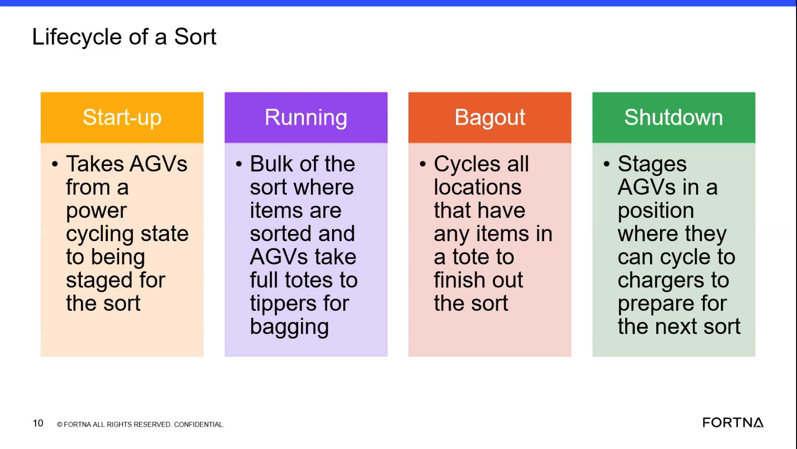
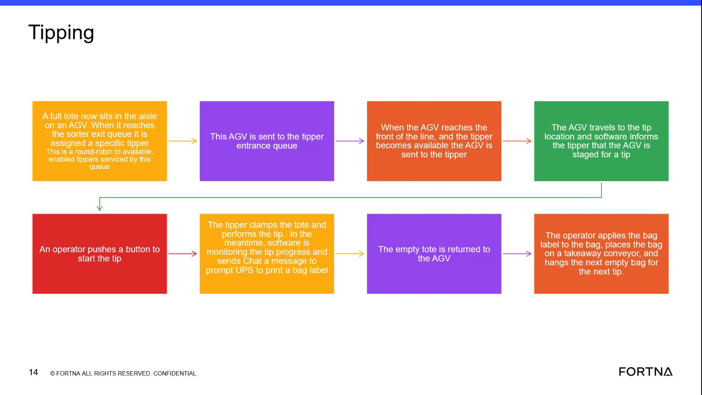
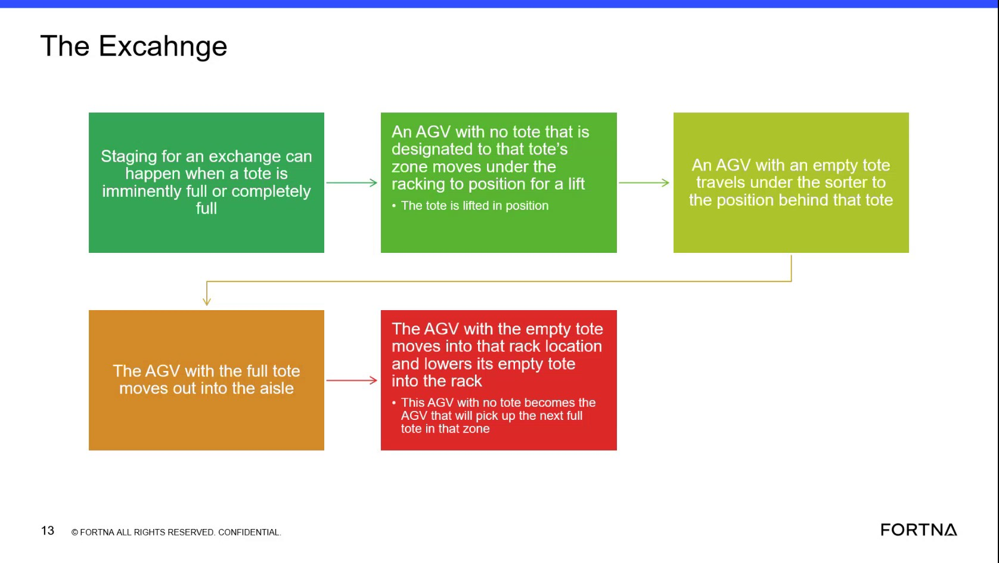
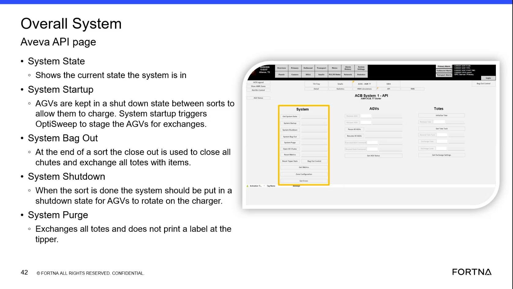
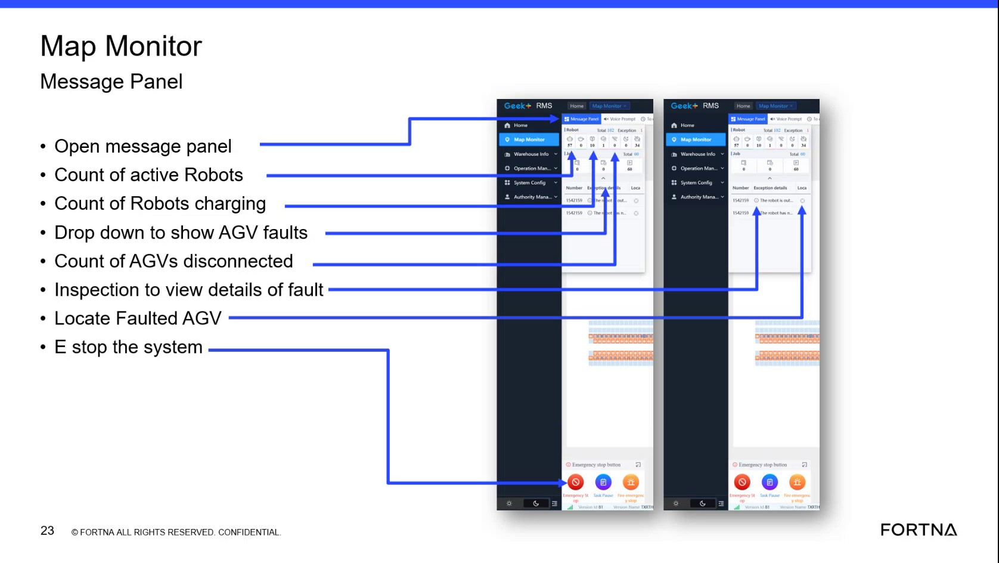
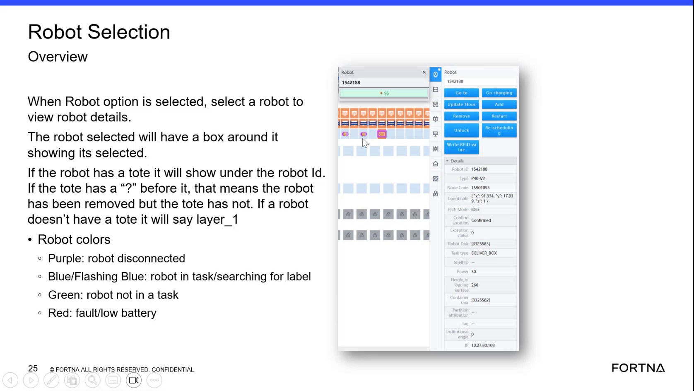

# Bag-out stoppage with unresponsive or out-of-sequence AGVs

## Playbook Header

| Field | Value |
| --- | --- |
| Playbook ID | `playbook_incident_218550_bagout_agv_sequence` |
| Case ID | `218550` |
| Extraction Mode | `one_playbook_candidate_per_incident` |
| Confidence | `medium` |
| Validation Status | `needs_sme_review` |

## Entry Symptoms

- Automated bag-out stops after sorting or starts and then stops before completion.
- Manual bagging out is required because the automated process does not progress.
- One or more AGVs or robots appear not to be moving.
- The site reports that a robot may be out of sequence or out of position.
- An HMI associated with the hospital area shows a fault or a task-related condition.

## Affected Systems

- Bag-out stage
- AGV / robot fleet
- AGV pairing or sequence state
- RMS
- Hospital-area HMI
- Tote or task handling workflow
- AVEVA screen visibility context

## Nodes

### 1 — Confirm automated bag-out stoppage and affected operating scope (`diagnostic_decision`)

**Objective:** Confirm that automated bag-out is stopped or only partially progressing and determine whether the condition is site-wide, localized to a zone or pair, or limited to a tote or task.

**Why this check is next:** The case and chat evidence describe a bag-out stoppage after sorting, manual bagging, and a need to identify the affected robot or exchange pair.

**Action:**

Confirm the bag-out stoppage (stopped vs partially progressing) and identify the affected operating scope (site-wide vs zone/pair vs specific tote/task).

**Suggested database check:**

- **Database:** robotics
  - **Model:** AgvActiveErrorDatabaseModel
  - **Inspect:** Name
  - **Inspect:** Error code
- **Database:** robotics
  - **Model:** SystemActiveErrorModel
  - **Inspect:** Id
  - **Inspect:** EntityInserted
  - **Inspect:** EntityLastUpdate
- **Database:** sorter_sweeper
  - **Model:** ActiveBagOutModel
  - **Inspect:** Entry while bag-out in progress; closes once tote tipped.

**Healthy:** Automated bag-out is progressing normally and the site does not need manual bagging; the affected scope is either not reproducible or limited to a resolved transient condition.

**Unhealthy:** Automated bag-out is stopped or starts but stops before completion; manual bagging out is required; a specific zone/pair/tote/task is identified as unable to progress.

**Inconclusive:** The site cannot clearly identify automated vs manual bag-out behavior, or the available RMS/operational view does not provide enough detail to determine scope.

**Expects capability:** n/a
**Expects surface:** n/a
**Preferred audience:** operator, L1_support

**Runbook Links:**

- `proc_check_rms_fleet_status_agvs_exchange_waiting_startup_delay_v1` (medium, support, score=0.4963, boosted=0.6963) — Check RMS / fleet status UI for AGVs waiting to exchange during shutdown or startup delay waiting on charger
  - gaps: Limited domain-term overlap between placeholder and runbook.; Placeholder wording differs materially from matched runbook title.
- `proc_diagnose_agv_exchange_backfill_gap_v1` (high, support, score=0.4802, boosted=0.6802) — Diagnose AGV exchange/backfill gap when an AGV moves out without a replacement
  - gaps: Limited domain-term overlap between placeholder and runbook.; Placeholder wording differs materially from matched runbook title.

**Evidence Collection Procedures:**

- `proc_check_rms_fleet_status_agvs_exchange_waiting_startup_delay_v1` — Check RMS / fleet status UI for AGVs waiting to exchange during shutdown or startup delay waiting on charger (L1_support): Use the RMS / fleet status UI to determine whether AGVs are not progressing due to state-transition failure visibility patterns: (1) AGVs waiting to do an exchange during shutdown, and/or (2) startup delay while waiting for an AGV on the charger. The system is described as exposing this via system faults and visible waiting conditions.
- `proc_diagnose_agv_exchange_backfill_gap_v1` — Diagnose AGV exchange/backfill gap when an AGV moves out without a replacement (L2_support): Diagnose why a front AGV moved out without a replacement/backfill by checking (1) whether the trailing AGV had a fault (including the case where it was reported ready for a new task and faulted at the same time) and (2) whether chute closure/fullness and exchange timing targets indicate exchanges were not completed before chute closure.

**Source Evidence:**

- The system stopped at bag-out after sorting.
- System is not going into bagout. Manual bagging out reported.

**Branches:**

- `unhealthy` → `node_2` when Stoppage confirmed; scope identified
- `healthy` → `` when No confirmed ongoing stoppage
- `inconclusive` → `` when Scope unclear

**Linked Runbook Procedures:**

<strong>Support runbooks</strong> (2)

Check RMS / fleet status UI for AGVs waiting to exchange during shutdown or startup delay waiting on charger (`proc_check_rms_fleet_status_agvs_exchange_waiting_startup_delay_v1`)

##### Runbook: Check RMS / fleet status UI for AGVs waiting to exchange during shutdown or startup delay waiting on charger

- **Procedure ID:** `proc_check_rms_fleet_status_agvs_exchange_waiting_startup_delay_v1`
- **Procedure Type:** `diagnostic`
- **Role:** `L1_support`
- **Audience:** `support`
- **Merge Status:** `pass_through`

**Summary:**
Use the RMS / fleet status UI to determine whether AGVs are not progressing due to state-transition failure visibility patterns: (1) AGVs waiting to do an exchange during shutdown, and/or (2) startup delay while waiting for an AGV on the charger. The system is described as exposing this via system faults and visible waiting conditions.

**When To Use:**
Use when lifecycle progression appears delayed during shutdown/startup and you need to check whether RMS is showing AGVs in the documented waiting/fault visibility patterns (exchange-waiting during shutdown; charger-waiting startup delay).

- **Source:** `training_video` / `training_video_day1`

**Procedure Steps:**

###### Step 1 — Open RMS / fleet status UI and navigate to AGV status/errors overview

**Responsible role:** L1_support

**Instruction:**
Open the RMS / fleet status UI (rms_ui) and navigate to the AGV status/errors overview area.

**Healthy condition:**
The RMS AGV status/errors overview area is populated and ready for inspection (not blank/unreachable).

**Expected result:**
You are viewing the RMS AGV status/errors overview area where AGV waiting conditions and system fault/alert visibility can be checked.

---

###### Step 2 — Check for AGVs waiting to do an exchange during shutdown

**Responsible role:** L1_support

**Instruction:**
In the RMS AGV status/errors overview, look for AGVs showing a waiting condition consistent with “waiting to do an exchange” during shutdown.

**Healthy condition:**
No widespread exchange-waiting indications are present when shutdown is expected to complete normally.

**Expected result:**
At least one AGV is indicated in RMS as waiting to do an exchange during shutdown (or you determine none are indicated).

**Step Images:**

*Training segment frame used as evidence that the system will show faults/visible waiting conditions for (a) AGV waiting to do an exchange during shutdown and (b) startup delay waiting for an AGV on the charger.*

---

###### Step 3 — Check for startup delay waiting for an AGV on the charger

**Responsible role:** L1_support

**Instruction:**
In the RMS AGV status/errors overview, look for startup delay evidence consistent with “waiting … for an AGV on the charger.”

**Healthy condition:**
No charger-waiting startup delay indications are present when startup proceeds normally.

**Expected result:**
At least one AGV is indicated in RMS as contributing to startup delay by waiting for an AGV on the charger (or you determine none are indicated).

---

###### Step 4 — Confirm system faults/alerts align with the waiting conditions

**Responsible role:** L1_support

**Instruction:**
In the RMS AGV status/errors overview, confirm whether system faults/alerts are visible and align with the exchange-waiting and/or charger-waiting conditions you observed.

**Healthy condition:**
Fault/alert visibility is consistent with normal operation (no fault entries that match the described waiting patterns).

**Expected result:**
RMS shows visible system fault/alert entries that align with the waiting conditions (or you determine there are no aligning fault/alert entries).

---

###### Step 5 — Stop and escalate on repeated or widespread waiting/fault indications

**Responsible role:** L1_support

**Instruction:**
If you see repeated or widespread waiting/fault indications that prevent lifecycle progression (e.g., multiple AGVs stuck in exchange-waiting or charger-waiting states), stop and escalate for deeper investigation.

**Healthy condition:**
No repeated/widespread waiting/fault indications are present; lifecycle progression is not blocked by the described patterns.

**Expected result:**
Escalation is initiated when the RMS evidence shows repeated/widespread waiting/fault indications consistent with the described patterns.

---

**Success Criteria:**

- RMS / fleet status UI shows either (a) AGVs indicated as waiting to do an exchange during shutdown and/or (b) startup delay evidence consistent with waiting for an AGV on the charger.
- RMS also shows visible system faults/alerts that align with the observed waiting conditions (when present).

**Failure Conditions:**

- RMS shows repeated/widespread AGVs waiting to do an exchange during shutdown.
- RMS shows repeated/widespread startup delay evidence consistent with waiting for an AGV on the charger.
- RMS shows system faults/alerts that align with the above waiting conditions.

Diagnose AGV exchange/backfill gap when an AGV moves out without a replacement (`proc_diagnose_agv_exchange_backfill_gap_v1`)

##### Runbook: Diagnose AGV exchange/backfill gap when an AGV moves out without a replacement

- **Procedure ID:** `proc_diagnose_agv_exchange_backfill_gap_v1`
- **Procedure Type:** `diagnostic`
- **Role:** `L2_support`
- **Audience:** `support`
- **Merge Status:** `pass_through`

**Summary:**
Diagnose why a front AGV moved out without a replacement/backfill by checking (1) whether the trailing AGV had a fault (including the case where it was reported ready for a new task and faulted at the same time) and (2) whether chute closure/fullness and exchange timing targets indicate exchanges were not completed before chute closure.

**When To Use:**
Use when you observe or are told that an AGV moved out without another AGV backfilling/replacing it during an exchange, and you need live evidence to confirm whether the trailing AGV fault/ready+fault timing and/or chute fullness/closure and exchange timing targets contributed.

- **Source:** `training_video` / `training_video_day1`

**Procedure Steps:**

###### Step 1 — Open RMS / fleet status UI and identify the AGV pair for the exchange event

**Responsible role:** L2_support

**Instruction:**
Using the RMS / fleet status UI (rms_ui), locate the AGV pair involved in the exchange event: the AGV that moved out (front) and the AGV that should have backfilled (trailing).

**Healthy condition:**
The RMS view clearly shows the relevant AGVs and their status/error context for the exchange event you are investigating.

**Expected result:**
You have identified the specific trailing AGV associated with the exchange event time window (so you can check whether it faulted when the front AGV moved out).

---

###### Step 2 — Check trailing AGV status for fault at the time the front AGV moved out

**Responsible role:** L2_support

**Instruction:**
In RMS / fleet status UI (rms_ui), check the trailing (behind) AGV’s status/error indicators around the time the front AGV moved out. Confirm whether the trailing AGV is faulted, or shows a fault coincident with being reported ready for a new task.

**Healthy condition:**
Trailing AGV shows no fault at the relevant time (or fault timing does not coincide with the front AGV move-out), suggesting the gap may be explained by other factors (e.g., chute fullness/exchange timing).

**Expected result:**
You find live evidence that the trailing AGV had an active fault at (or coincident with) the time the front AGV moved out, consistent with the described pairing/backfill failure mechanism.

---

###### Step 3 — If RMS is inconclusive, query WCS / Helix DB (SSMS) for trailing AGV fault/backfill failure evidence

**Responsible role:** L2_support

**Instruction:**
Using WCS / Helix DB (SSMS) (wcs_sql), query the OptiSweep DB for the same time window to find evidence of a fault/backfill failure for the trailing AGV (e.g., AGV state/error records).

**Healthy condition:**
Database records show no fault/backfill failure for the trailing AGV in the relevant time window, shifting focus to chute fullness/closure and exchange timing.

**Expected result:**
You identify live database evidence that the trailing AGV faulted (or otherwise failed to support backfill) during the exchange window corresponding to the front AGV move-out.

---

###### Step 4 — Check chute fullness/closure and exchange timing targets around the event

**Responsible role:** L2_support

**Instruction:**
Using WCS / Helix DB (SSMS) (wcs_sql), review live system data available for chute fullness and exchange timing metrics around the event time window. Look for conditions consistent with chute closure when the chute is full and exchange not completing before the 80% threshold (with exchange timing deviating from the median ~8 seconds and floor ~6.7 seconds).

**Healthy condition:**
Chute fullness/closure did not occur before exchanges completed, and exchange timing aligns with the described targets (median ~8s, floor ~6.7s).

**Expected result:**
You find live evidence that chute fullness/closure occurred (or was imminent) such that exchanges were not completed before the 80% threshold, and/or exchange timing deviated from the described targets (median ~8s, floor ~6.7s).

**Step Images:**

*Training frame describing the mechanism: front AGV will not move until trailing AGV is present; software sends both commands together; gap can occur if trailing AGV faults (possibly while also being ready); chute gets closed when full; exchange timing targets (median ~8s, floor ~6.7s).*

*Training frame describing exchange thresholds and that exchanges are staged with strict quick KPI targets (context for exchange timing/threshold behavior).*

---

###### Step 5 — Stop and escalate based on confirmed evidence (or lack of evidence)

**Responsible role:** L2_support

**Instruction:**
Based on your findings from RMS and WCS/Helix DB, decide whether to escalate. Escalate when you confirm the trailing AGV fault/ready+fault timing mechanism or confirm chute fullness/insufficient exchange timing mechanism, or when you cannot confirm either mechanism with live evidence.

**Healthy condition:**
Evidence supports one or both mechanisms described (trailing AGV fault timing and/or fullness-driven chute closure with exchange timing deviation).

**Expected result:**
A clear diagnostic conclusion is produced: (1) trailing AGV fault/ready+fault timing explains the missing backfill, and/or (2) chute fullness/closure and exchange timing targets indicate exchanges were not completed before 80%. If neither is supported by live evidence, escalation occurs due to unconfirmed cause.

**Step Images:**

*Training frame describing system-level API page concepts (context only; not specific to this diagnostic’s live checks).*

---

**Success Criteria:**

- You confirm (with live RMS and/or WCS/Helix DB evidence) that the trailing AGV fault/ready+fault timing explains why the front AGV moved out without replacement/backfill.
- OR you confirm (with live WCS/Helix DB evidence) that chute fullness/closure occurred such that exchanges were not completed before the 80% threshold, with exchange timing deviating from the described targets (median ~8s, floor ~6.7s).
- If neither mechanism is supported by live evidence, you escalate rather than assuming the cause.

**Failure Conditions:**

- Trailing AGV fault/ready+fault timing is present at the time the front AGV moved out, consistent with missing backfill.
- Chute fullness/closure occurs (or is imminent) such that exchanges were not completed before reaching 80%, with exchange timing deviating from median ~8s and floor ~6.7s.
- RMS and WCS/Helix DB show no trailing AGV fault/backfill failure evidence and no chute fullness/exchange timing evidence consistent with the described mechanisms.

---

### 2 — Check for AGV inactivity or active fault evidence (`diagnostic_decision`)

**Objective:** Determine whether one or more AGVs show abnormal inactivity, active error, or a related sequence or pairing indication that correlates with the bag-out stoppage.

**Why this check is next:** The source explicitly records an RMS-style observation that an AGV did not move for three hours and preserves a discussion about checking system active error.

**Action:**

Check whether one or more AGVs show abnormal inactivity (not moving) and/or active fault evidence, and determine whether this correlates with the bag-out stoppage.

**Suggested database check:**

- **Database:** robotics
  - **Model:** AgvActiveErrorDatabaseModel
  - **Inspect:** Name
  - **Inspect:** Error code
- **Database:** robotics
  - **Model:** SystemActiveErrorModel
  - **Inspect:** Id
  - **Inspect:** EntityInserted
  - **Inspect:** EntityLastUpdate
- **Database:** robotics
  - **Model:** RobotDatabaseModel
  - **Inspect:** Robot state enum (Tipper/Hospital/Charger/Sorter/GLD/ShutDown family).
  - **Inspect:** Tote currently associated with robot.
  - **Inspect:** Assigned sorter side.

**Healthy:** Affected AGVs show normal movement/activity, and there is no relevant active fault or sequence/pairing indication that correlates with the bag-out stoppage.

**Unhealthy:** One or more AGVs show prolonged inactivity and/or an active robot fault exists, and the evidence correlates with the bag-out stoppage scope.

**Inconclusive:** AGV identifiers/status details cannot be read, RMS evidence is stale/unavailable, or correlation to bag-out cannot be established.

**Expects capability:** n/a
**Expects surface:** n/a
**Preferred audience:** operator, L1_support

**Runbook Links:**

- `proc_check_rms_fleet_status_agvs_exchange_waiting_startup_delay_v1` (medium, support, score=0.6048, boosted=0.8048) — Check RMS / fleet status UI for AGVs waiting to exchange during shutdown or startup delay waiting on charger
  - gaps: Limited domain-term overlap between placeholder and runbook.; Placeholder wording differs materially from matched runbook title.

**Evidence Collection Procedures:**

- `proc_check_rms_fleet_status_agvs_exchange_waiting_startup_delay_v1` — Check RMS / fleet status UI for AGVs waiting to exchange during shutdown or startup delay waiting on charger (L1_support): Use the RMS / fleet status UI to determine whether AGVs are not progressing due to state-transition failure visibility patterns: (1) AGVs waiting to do an exchange during shutdown, and/or (2) startup delay while waiting for an AGV on the charger. The system is described as exposing this via system faults and visible waiting conditions.

**Source Evidence:**

- An AGV did not move for 3 hours.
- You can check system active error.

**Branches:**

- `unhealthy` → `node_4` when AGV inactivity/active fault/sequence anomaly indicated
- `inconclusive` → `node_3` when No relevant AGV abnormality or evidence inconclusive

**Linked Runbook Procedures:**

<strong>Support runbooks</strong> (1)

Check RMS / fleet status UI for AGVs waiting to exchange during shutdown or startup delay waiting on charger (`proc_check_rms_fleet_status_agvs_exchange_waiting_startup_delay_v1`)

##### Runbook: Check RMS / fleet status UI for AGVs waiting to exchange during shutdown or startup delay waiting on charger

- **Procedure ID:** `proc_check_rms_fleet_status_agvs_exchange_waiting_startup_delay_v1`
- **Procedure Type:** `diagnostic`
- **Role:** `L1_support`
- **Audience:** `support`
- **Merge Status:** `pass_through`

**Summary:**
Use the RMS / fleet status UI to determine whether AGVs are not progressing due to state-transition failure visibility patterns: (1) AGVs waiting to do an exchange during shutdown, and/or (2) startup delay while waiting for an AGV on the charger. The system is described as exposing this via system faults and visible waiting conditions.

**When To Use:**
Use when lifecycle progression appears delayed during shutdown/startup and you need to check whether RMS is showing AGVs in the documented waiting/fault visibility patterns (exchange-waiting during shutdown; charger-waiting startup delay).

- **Source:** `training_video` / `training_video_day1`

**Procedure Steps:**

###### Step 1 — Open RMS / fleet status UI and navigate to AGV status/errors overview

**Responsible role:** L1_support

**Instruction:**
Open the RMS / fleet status UI (rms_ui) and navigate to the AGV status/errors overview area.

**Healthy condition:**
The RMS AGV status/errors overview area is populated and ready for inspection (not blank/unreachable).

**Expected result:**
You are viewing the RMS AGV status/errors overview area where AGV waiting conditions and system fault/alert visibility can be checked.

---

###### Step 2 — Check for AGVs waiting to do an exchange during shutdown

**Responsible role:** L1_support

**Instruction:**
In the RMS AGV status/errors overview, look for AGVs showing a waiting condition consistent with “waiting to do an exchange” during shutdown.

**Healthy condition:**
No widespread exchange-waiting indications are present when shutdown is expected to complete normally.

**Expected result:**
At least one AGV is indicated in RMS as waiting to do an exchange during shutdown (or you determine none are indicated).

**Step Images:**

*Training segment frame used as evidence that the system will show faults/visible waiting conditions for (a) AGV waiting to do an exchange during shutdown and (b) startup delay waiting for an AGV on the charger.*

---

###### Step 3 — Check for startup delay waiting for an AGV on the charger

**Responsible role:** L1_support

**Instruction:**
In the RMS AGV status/errors overview, look for startup delay evidence consistent with “waiting … for an AGV on the charger.”

**Healthy condition:**
No charger-waiting startup delay indications are present when startup proceeds normally.

**Expected result:**
At least one AGV is indicated in RMS as contributing to startup delay by waiting for an AGV on the charger (or you determine none are indicated).

---

###### Step 4 — Confirm system faults/alerts align with the waiting conditions

**Responsible role:** L1_support

**Instruction:**
In the RMS AGV status/errors overview, confirm whether system faults/alerts are visible and align with the exchange-waiting and/or charger-waiting conditions you observed.

**Healthy condition:**
Fault/alert visibility is consistent with normal operation (no fault entries that match the described waiting patterns).

**Expected result:**
RMS shows visible system fault/alert entries that align with the waiting conditions (or you determine there are no aligning fault/alert entries).

---

###### Step 5 — Stop and escalate on repeated or widespread waiting/fault indications

**Responsible role:** L1_support

**Instruction:**
If you see repeated or widespread waiting/fault indications that prevent lifecycle progression (e.g., multiple AGVs stuck in exchange-waiting or charger-waiting states), stop and escalate for deeper investigation.

**Healthy condition:**
No repeated/widespread waiting/fault indications are present; lifecycle progression is not blocked by the described patterns.

**Expected result:**
Escalation is initiated when the RMS evidence shows repeated/widespread waiting/fault indications consistent with the described patterns.

---

**Success Criteria:**

- RMS / fleet status UI shows either (a) AGVs indicated as waiting to do an exchange during shutdown and/or (b) startup delay evidence consistent with waiting for an AGV on the charger.
- RMS also shows visible system faults/alerts that align with the observed waiting conditions (when present).

**Failure Conditions:**

- RMS shows repeated/widespread AGVs waiting to do an exchange during shutdown.
- RMS shows repeated/widespread startup delay evidence consistent with waiting for an AGV on the charger.
- RMS shows system faults/alerts that align with the above waiting conditions.

---

### 3 — Check HMI-visible task, tote, or lane fault (`diagnostic_decision`)

**Objective:** Determine whether an HMI-visible fault, stuck task, tote association, or hospital-area workflow condition is preventing bag-out from progressing.

**Why this check is next:** The source reports a hospital HMI fault, a tote read at an unexpected location, a stuck task visible only on that HMI, and guidance to acknowledge and try again.

**Action:**

Inspect the hospital-area HMI for the displayed fault/task/tote condition and determine whether it is blocking bag-out progress (or whether HMI evidence is unavailable/uninterpretable).

**Suggested database check:**

- **Database:** robotics
  - **Model:** HospitalDatabaseModel
  - **Inspect:** Hospital entrance and exit queue locations.
  - **Inspect:** Hospital tote drop-off location.
- **Database:** sorter_sweeper
  - **Model:** HospitalTagsModel
  - **Inspect:** Whether tag is in or out; drives action.
  - **Inspect:** List of hospital controller tags.
  - **Inspect:** Modular typed value columns (string/bool) selected by variable type.
- **Database:** robotics
  - **Model:** RobotDatabaseModel
  - **Inspect:** Robot state enum (Tipper/Hospital/Charger/Sorter/GLD/ShutDown family).
  - **Inspect:** Tote currently associated with robot.
  - **Inspect:** Assigned sorter side.

**Healthy:** The HMI shows no relevant fault or stuck task; the tote/task is correctly identified and the workflow request progresses; and the site confirms the HMI-related condition is no longer blocking operation.

**Unhealthy:** The HMI shows a fault; a stuck task is visible only on that HMI; and/or a tote location discrepancy is displayed, and the request enters a state but does not progress.

**Inconclusive:** The HMI screen is unavailable/unreadable/unreachable or the fault relationship to bag-out stoppage cannot be established from the evidence provided.

**Expects capability:** n/a
**Expects surface:** n/a
**Preferred audience:** operator, L1_support

**Runbook Links:**

- `proc_check_hospital_hmi_operations_menu_induct_extract_status_v1` (medium, operator, score=0.6566, boosted=0.8266) — Check Hospital HMI Operations Screen Induct/Extract Position Read-Only Data and WCS Status Messages
  - gaps: Limited domain-term overlap between placeholder and runbook.; Placeholder wording differs materially from matched runbook title.

**Evidence Collection Procedures:**

- `proc_check_hospital_hmi_operations_menu_induct_extract_status_v1` — Check Hospital HMI Operations Screen Induct/Extract Position Read-Only Data and WCS Status Messages (operator): Use the Hospital HMI / lane UI Operations Menu screen to read the WCS-fed induct and extract position fields (AGV#, Tote ID, Bar Code, Status). Confirm the Status messages explain why the tote is there and what station operator menu/action to use.

**Source Evidence:**

- The HMI at the hospital is showing a fault.
- One of last night's errors, a stuck task, is only visible on that HMI.

**Branches:**

- `unhealthy` → `node_4` when HMI fault/stuck task/tote inconsistency indicated
- `inconclusive` → `` when No interpretable HMI condition

**Linked Runbook Procedures:**

<strong>Operator runbooks</strong> (1)

Check Hospital HMI Operations Screen Induct/Extract Position Read-Only Data and WCS Status Messages (`proc_check_hospital_hmi_operations_menu_induct_extract_status_v1`)

##### Runbook: Check Hospital HMI Operations Screen Induct/Extract Position Read-Only Data and WCS Status Messages

- **Procedure ID:** `proc_check_hospital_hmi_operations_menu_induct_extract_status_v1`
- **Procedure Type:** `diagnostic`
- **Role:** `operator`
- **Audience:** `operator`
- **Merge Status:** `pass_through`

**Summary:**
Use the Hospital HMI / lane UI Operations Menu screen to read the WCS-fed induct and extract position fields (AGV#, Tote ID, Bar Code, Status). Confirm the Status messages explain why the tote is there and what station operator menu/action to use.

**When To Use:**
When a tote arrives at the hospital station and you need to determine what tote/AGV is at the induct and extract positions and what the WCS status message requires the station operator to do next.

- **Source:** `manual` / `manual_optisweep_om_v3`

**Procedure Steps:**

###### Step 1 — Open Hospital HMI Operations Menu and locate Induct Position / Extract Position sections

**Responsible role:** operator

**Instruction:**
On the Hospital HMI / lane UI, navigate to the Operations Menu screen that contains the "Induct Position" and "Extract Position" sections.

**Healthy condition:**
"Induct Position" and "Extract Position" sections are visible on the Operations Menu screen.

**Expected result:**
The screen shows both "Induct Position" and "Extract Position" sections.

---

###### Step 2 — Read Induct Position read-only fields (AGV#, Tote ID, Bar Code, Status)

**Responsible role:** operator

**Instruction:**
In the "Induct Position" section, read the four read-only fields: AGV#, Tote ID, Bar Code, and Status.

**Healthy condition:**
AGV#, Tote ID, Bar Code, and Status are present in the "Induct Position" section as read-only WCS data.

**Expected result:**
The "Induct Position" section displays values for AGV#, Tote ID, Bar Code, and a Status message.

**Step Images:**

*Hospital HMI Operations Menu screen showing read-only Induct Position and Extract Position panels (AGV#, Tote ID, Bar Code, Status).*

---

###### Step 3 — Read Extract Position read-only fields (AGV#, Tote ID, Bar Code, Status)

**Responsible role:** operator

**Instruction:**
In the "Extract Position" section, read the four read-only fields: AGV#, Tote ID, Bar Code, and Status.

**Healthy condition:**
AGV#, Tote ID, Bar Code, and Status are present in the "Extract Position" section as read-only WCS data.

**Expected result:**
The "Extract Position" section displays values for AGV#, Tote ID, Bar Code, and a Status message.

---

###### Step 4 — Confirm both Status messages are present and provide WCS explanation/action guidance

**Responsible role:** operator

**Instruction:**
Verify that the "Induct Position" Status and "Extract Position" Status messages are present and written as messages received from the WCS that explain why the tote is there and what menu/action the station operator needs to use.

**Healthy condition:**
Induct Position Status and Extract Position Status each provide a clear WCS message describing why the tote is there and what menu/action to perform.

**Expected result:**
Both Status fields contain non-blank WCS messages that provide explanation and action/menu guidance.

---

**Success Criteria:**

- Induct Position shows read-only AGV#, Tote ID, Bar Code, and a non-blank Status message.
- Extract Position shows read-only AGV#, Tote ID, Bar Code, and a non-blank Status message.
- Both Status messages explain why the tote is there and what menu/action the station operator needs to use.

**Failure Conditions:**

- Induct Position Status is blank/missing.
- Extract Position Status is blank/missing.
- Either Status message does not provide explanation/action guidance (why the tote is there and what menu/action to use).

---

### 4 — Restore the affected AGV sequence or pairing state through an authorized recovery path (`procedure_reference`)

**Objective:** Use an approved, role-authorized recovery procedure to restore the affected AGV or pair to a valid operating sequence when the diagnostic evidence supports that direction.

**Why this check is next:** Support asked the site to remove and add AGV pairs; the source also states that a removed AGV without a tote must be replaced and later reports robots in proper sequence.

**Action:**

Restore the affected AGV sequence/pairing state using an authorized recovery path consistent with the diagnostic evidence; ensure removed AGVs are appropriately replaced and operations are resumed within role/safety limits.

**Healthy:** Authorized personnel confirm the affected AGV or pair is in expected sequence; robots remain on and available after recovery; and recovery completion did not introduce a new fault.

**Unhealthy:** Affected AGV/pair remains out of sequence/unavailable; robots turn off again or cannot support bag-out; bag-out starts but stops again after recovery attempt.

**Inconclusive:** The exact decisive recovery action and resulting sequence/pairing state cannot be verified; required authorized role is unavailable.

**Procedure Reference:**

- **Trigger condition:** L2 support or another authorized role records that the approved recovery path was completed. Progress evidence is that affected robots remain on, the relevant sequence or pairing state is restored, and bag-out can proceed; failure evidence is continued inactivity, repeated stopping, or an unresolved sequence or pairing condition; inconclusive evidence is that the exact recovery action or resulting state cannot be verified.
- **Selected procedure:** unresolved
- **Selection rationale:** n/a
- **Success confirmation:** n/a
- **Failure boundary:** Stop at the documented failure condition and escalate; do not invent a recovery path.

**Prerequisites:**

- None
- None

**Safety checks:**

- None

**Expects capability:** n/a
**Expects surface:** n/a
**Preferred audience:** L2_support, L3_support

**Runbook Links:**

- No linked procedure; escalate if the required state cannot be confirmed using the available approved evidence sources.

**Source Evidence:**

- Asked the site to remove and add AGV pairs; bag-out started, processed most, then stopped.
- When all robots were in proper sequence, the customer confirmed they were functional.

**Decision Outcomes:**

- `healthy` (observer=remote; tool=rms_ui (and physical_floor evidence as applicable)): Authorized recovery completed and affected state restored to a valid operating sequence.
- `unhealthy` (observer=remote; tool=rms_ui; site confirmation): Recovery cannot complete safely or affected state remains unresolved; repeated inactivity or repeated bag-out stop observed.
- `inconclusive` (observer=site_or_remote; tool=rms_ui; site_interview): Exact decisive recovery action or resulting sequence/pairing state cannot be verified.

**Branches:**

- `healthy` → `node_5` when Authorized recovery completed
- `unhealthy` → `node_6` when Recovery cannot be completed or state unresolved

**Linked Runbook Procedures:**

*No linked runbook content available.*

---

### 5 — Validate stable AGV operation and automated bag-out (`validation_gate`)

**Objective:** Confirm that the recovery restored the affected workflow and that AGVs remain functional rather than merely showing a temporary improvement.

**Why this check is next:** The source records customer confirmation that robots were functional in proper sequence and a later all-good response after HMI-related troubleshooting.

**Validate:**

Validate sustained AGV functionality and stable automated bag-out behavior (not just a temporary improvement), including checking recurrence on RMS and the relevant hospital-area HMI.

**Success:** AGVs remain functional and automated bag-out continues or completes without recurrence; relevant HMI condition is cleared and does not reappear.

**Failure:** AGV inactivity returns, bag-out stops again after partial progress, or HMI fault/stuck-task recurs; affected sequence/pairing state is not maintained.

**Inconclusive:** Only a temporary 'all good' verbal report is available, or RMS/HMI views cannot be observed/checked; continued operation cannot be confirmed.

**Validation Gate:**

**Validation checklist:**

- Confirm the owning service remains running and stable.
- Confirm the supported API or control endpoint responds.
- Compare database or fleet state with the live HMI or site-observed state.
- Observe the affected workflow for recurrence during the stated observation window.

**Required evidence sources:** RMS

**Stable-operation observation:** Observe the affected workflow for recurrence during the defined observation window; a reachable screen or successful request alone is not recovery.

**Expects capability:** n/a
**Expects surface:** n/a
**Preferred audience:** operator, L1_support

**Runbook Links:**

- `proc_use_rms_map_monitor_message_panel_agv_faults_v1` (medium, support, score=0.5327, boosted=0.7327) — Use RMS Map Monitor Message Panel to view AGV fault list, fault details, and locate a faulted AGV
  - gaps: Limited domain-term overlap between placeholder and runbook.; Placeholder wording differs materially from matched runbook title.

**Evidence Collection Procedures:**

- `proc_use_rms_map_monitor_message_panel_agv_faults_v1` — Use RMS Map Monitor Message Panel to view AGV fault list, fault details, and locate a faulted AGV (L1_support): Use the RMS / fleet status UI Map Monitor message panel to identify faulted/disconnected AGVs, view the selected fault’s details, and use the “Locate Faulted AGV” control to bring up the corresponding location cue.

**Source Evidence:**

- With all robots in proper sequence, the customer confirmed they were functional.
- Yes, the tote at hospital is 28. Yes Sir, all good.

**Branches:**

- `healthy` → `` when Stable AGV operation + automated bag-out continues/completes
- `unhealthy` → `node_6` when Validation failure / recurrence observed

**Linked Runbook Procedures:**

<strong>Support runbooks</strong> (1)

Use RMS Map Monitor Message Panel to view AGV fault list, fault details, and locate a faulted AGV (`proc_use_rms_map_monitor_message_panel_agv_faults_v1`)

##### Runbook: Use RMS Map Monitor Message Panel to view AGV fault list, fault details, and locate a faulted AGV

- **Procedure ID:** `proc_use_rms_map_monitor_message_panel_agv_faults_v1`
- **Procedure Type:** `diagnostic`
- **Role:** `L1_support`
- **Audience:** `support`
- **Merge Status:** `pass_through`

**Summary:**
Use the RMS / fleet status UI Map Monitor message panel to identify faulted/disconnected AGVs, view the selected fault’s details, and use the “Locate Faulted AGV” control to bring up the corresponding location cue.

**When To Use:**
When you need to determine which AGVs are faulted and/or disconnected and then inspect the fault details and locate the affected AGV using the RMS Map Monitor message panel.

- **Source:** `training_video` / `training_video_day1`

**Procedure Steps:**

###### Step 1 — Open the RMS / fleet status UI and navigate to the Map Monitor message panel

**Responsible role:** L1_support

**Instruction:**
Open the RMS / fleet status UI (rms_ui) and navigate to the Map Monitor message panel on the right side of the interface.

**Healthy condition:**
All labeled panel sections are present and readable in the Map Monitor message panel.

**Expected result:**
The Map Monitor message panel is visible on the right side and shows the labeled items: “Count of active Robots”, “Count of Robots charging”, “Drop down to show AGV faults”, “Count of AGVs disconnected”, “Inspection to view details of fault”, and “Locate Faulted AGV”.

**Step Images:**

*RMS Map Monitor Message Panel on the right side showing: “Count of active Robots”, “Count of Robots charging”, “Drop down to show AGV faults”, “Count of AGVs disconnected”, “Inspection to view details of fault”, and “Locate Faulted AGV”.*

*Map Monitor Message Panel count metrics and AGV fault/disconnect panel items (active robots count, robots charging count, AGV faults dropdown, disconnected count, fault inspection, locate faulted AGV).*

---

###### Step 2 — Verify the active robot and charging count metrics

**Responsible role:** L1_support

**Instruction:**
On the Map Monitor message panel, locate and verify the fields labeled “Count of active Robots” and “Count of Robots charging”.

**Healthy condition:**
The panel shows numeric values for “Count of active Robots” and “Count of Robots charging”.

**Expected result:**
Both count fields are displayed on the panel.

---

###### Step 3 — Open the AGV faults dropdown to display the fault list

**Responsible role:** L1_support

**Instruction:**
Use the dropdown labeled “Drop down to show AGV faults” to display the AGV fault list.

**Healthy condition:**
Fault entries are visible in the dropdown list.

**Expected result:**
The AGV faults dropdown expands and shows fault entries.

---

###### Step 4 — Check the count of AGVs disconnected

**Responsible role:** L1_support

**Instruction:**
On the same Map Monitor message panel, locate and check the field labeled “Count of AGVs disconnected”.

**Healthy condition:**
The “Count of AGVs disconnected” field displays a current numeric count.

**Expected result:**
A numeric value is shown for “Count of AGVs disconnected”.

---

###### Step 5 — Select a fault entry and confirm fault details update

**Responsible role:** L1_support

**Instruction:**
In the AGV faults list, select a fault entry and use the “Inspection to view details of fault” area to confirm the fault details update for the selected entry.

**Healthy condition:**
Fault details change when you select different fault entries.

**Expected result:**
The “Inspection to view details of fault” area updates to show details for the selected fault entry.

---

###### Step 6 — Locate the faulted AGV using the “Locate Faulted AGV” control

**Responsible role:** L1_support

**Instruction:**
Use “Locate Faulted AGV” to bring up the faulted AGV location cue (e.g., map highlight/selection) and confirm the located AGV corresponds to the selected fault.

**Healthy condition:**
The map/location cue highlights/selects the AGV associated with the selected fault.

**Expected result:**
A location cue appears for the faulted AGV after using “Locate Faulted AGV”, and it corresponds to the selected fault entry.

**Step Images:**

*Robot selection overview cues (robot selection and robot details; includes robot colors such as purple for disconnected and red for fault/low battery) that can help visually confirm the located robot corresponds to the selected fault.*

---

**Success Criteria:**

- The Map Monitor message panel shows “Count of active Robots” and “Count of Robots charging”.
- The “Drop down to show AGV faults” displays fault entries.
- Selecting a fault entry updates the “Inspection to view details of fault” area.
- Using “Locate Faulted AGV” produces a location cue that corresponds to the selected faulted AGV.

**Failure Conditions:**

- AGV faults dropdown shows no fault entries while AGV issues are reported.
- Fault details do not update after selecting a fault entry.
- Locate Faulted AGV location cue does not correspond to the selected fault.

---

### 6 — Stop and escalate when the supported path cannot establish stable recovery (`escalation_gate`)

**Objective:** Hand off when the available evidence does not identify a supported recovery path, authorized recovery cannot be completed safely, or validation fails after recovery.

**Why this check is next:** The source states that available troubleshooting options were exhausted, additional technical assistance was requested, and the exact decisive recovery was not isolated.

**Action:**

Stop and escalate by preparing an evidence package that includes bag-out behavior, RMS evidence, hospital/HMI fault evidence, recovery attempts, and validation results; do not continue unsupported recovery actions.

**Healthy:** Not applicable as a terminal handoff; escalation package is complete and condition is beyond supported resolution within this path.

**Unhealthy:** Condition persists or recurs and stable recovery cannot be established from supported/authorized actions; evidence remains ambiguous.

**Inconclusive:** Required evidence surfaces are unavailable/unreadable, decisive recovery action cannot be identified, or fault-to-bag-out relationship remains ambiguous.

**Escalation Gate:**

- **Reason:** Hand off when the available evidence does not identify a supported recovery path, authorized recovery cannot be completed safely, or validation fails after recovery.
- **Required next team:** The owning L2/L3 service or controls team
**Evidence package:**

- Bag-out behavior timeline (stopped/partial, manual bagging used, whether it repeated)
- RMS evidence used (AGV inactivity/active fault evidence or evidence of absence/inconclusiveness)
- Hospital HMI fault/stuck-task evidence (or explicit inability/unreadable condition)
- Which recovery actions were attempted and by which authorized role
- Validation outcomes (healthy/unhealthy/inconclusive) after recovery attempt
- Stop criteria reached (supported path boundary reached; options exhausted)
- {'page_ref': 'case_218550:page_10', 'site_code': 'ups_haslet_tx', 'site_label': 'UPS Haslet TX (TXRTH)', 'quote_or_summary': 'They had run out of options to try.'}
- {'page_ref': 'case_218550:page_3', 'site_code': 'ups_haslet_tx', 'site_label': 'UPS Haslet TX (TXRTH)', 'quote_or_summary': 'FORTNA Technical Support requested assistance on the case.'}
**Actions attempted:**

- None
**Unresolved questions:**

- None

**Expects capability:** n/a
**Expects surface:** n/a
**Preferred audience:** L2_support, L3_support

**Runbook Links:**

- No linked procedure; escalate if the required state cannot be confirmed using the available approved evidence sources.

**Source Evidence:**

- They had run out of options to try.
- FORTNA Technical Support requested assistance on the case.

**Decision Outcomes:**

- `escalate` (observer=remote; tool=RMS / AGV status UI; hospital_hmi; site interview): Supported path cannot establish stable recovery, authorized recovery cannot be completed safely, or validation fails after recovery.

**Branches:**

- `escalate` → `` when Stop and escalate

**Linked Runbook Procedures:**

*No linked runbook content available.*

---

## Branch Graph

| From Node | Outcome | Condition | Next Node |
| --- | --- | --- | --- |
| `node_1` | `unhealthy` | Stoppage confirmed; scope identified | `node_2` |
| `node_1` | `healthy` | No confirmed ongoing stoppage | `` |
| `node_1` | `inconclusive` | Scope unclear | `` |
| `node_2` | `unhealthy` | AGV inactivity/active fault/sequence anomaly indicated | `node_4` |
| `node_2` | `inconclusive` | No relevant AGV abnormality or evidence inconclusive | `node_3` |
| `node_3` | `unhealthy` | HMI fault/stuck task/tote inconsistency indicated | `node_4` |
| `node_3` | `inconclusive` | No interpretable HMI condition | `` |
| `node_4` | `healthy` | Authorized recovery completed | `node_5` |
| `node_4` | `unhealthy` | Recovery cannot be completed or state unresolved | `node_6` |
| `node_5` | `healthy` | Stable AGV operation + automated bag-out continues/completes | `` |
| `node_5` | `unhealthy` | Validation failure / recurrence observed | `node_6` |
| `node_6` | `escalate` | Stop and escalate | `` |
