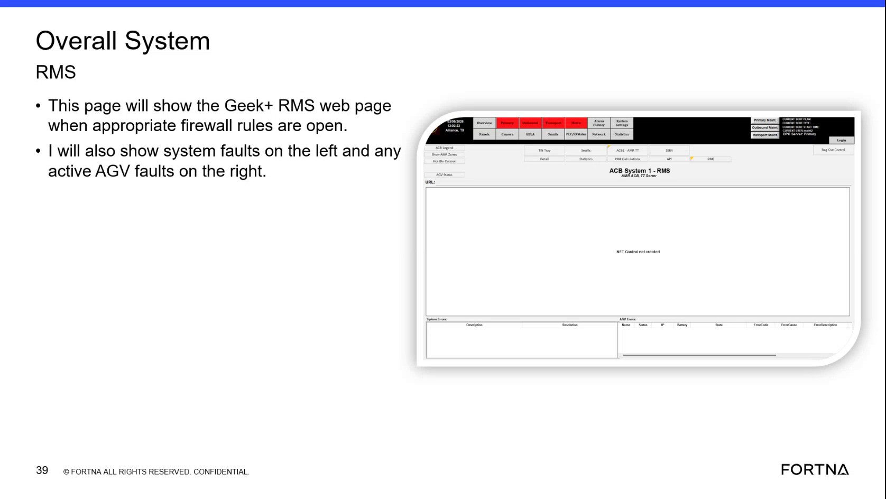
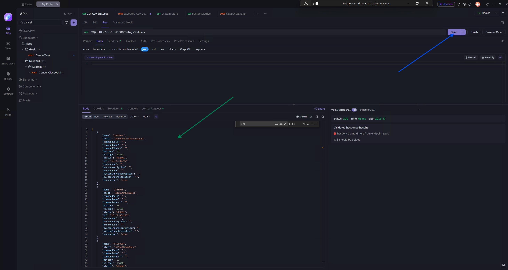
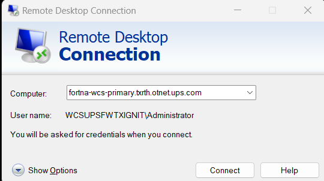
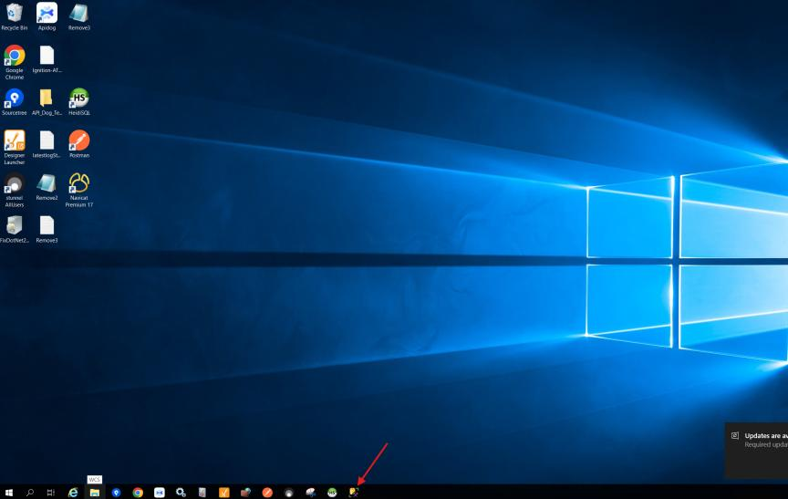
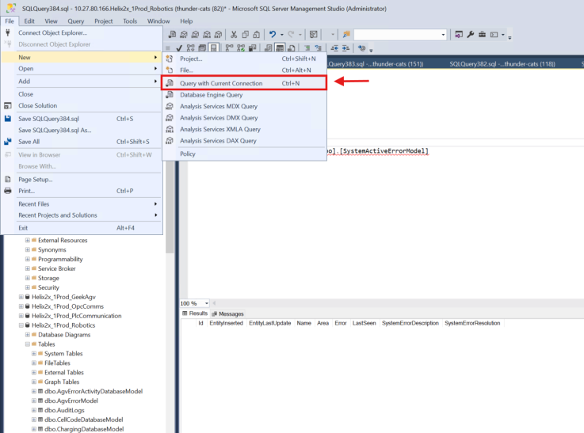
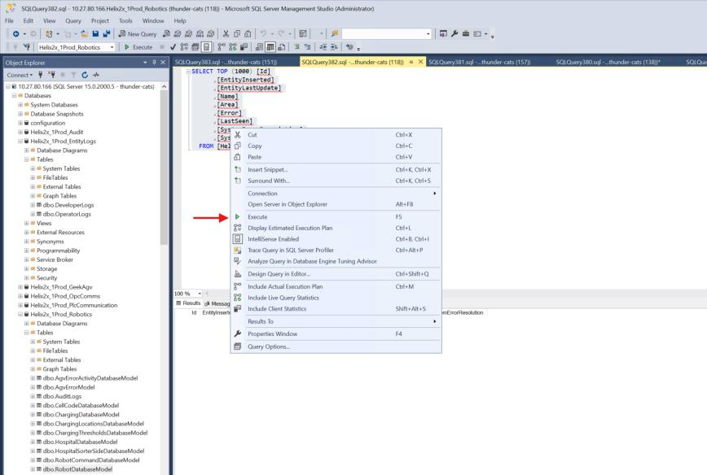
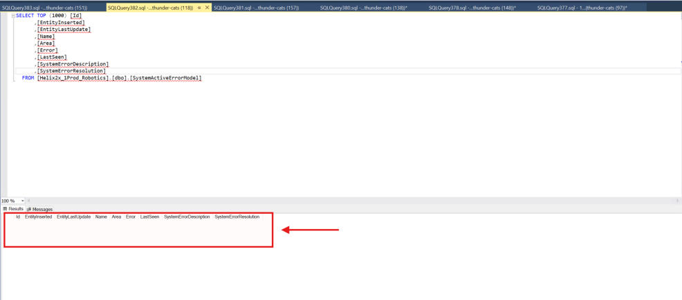
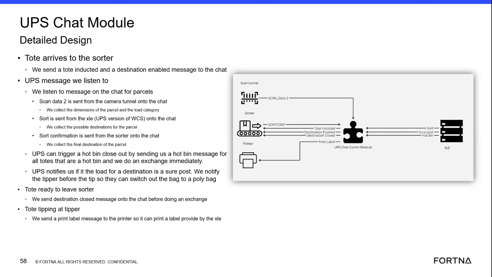
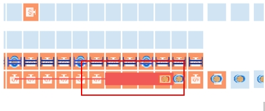
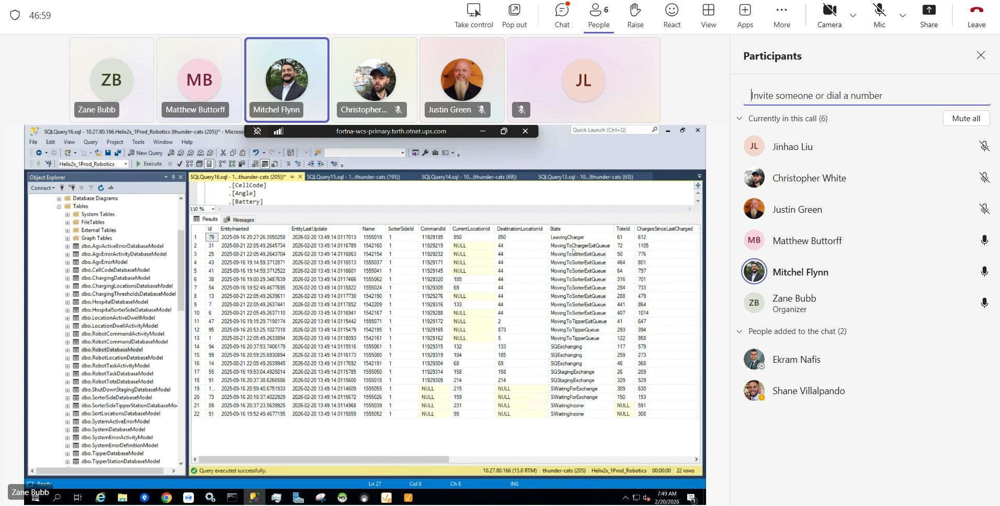

# Site-wide robotic stoppage with AGV synchronization loss

## Playbook Header

| Field | Value |
| --- | --- |
| Playbook ID | `playbook_incident_228086_sitewide_robotic_stoppage` |
| Case ID | `228086` |
| Extraction Mode | `one_playbook_candidate_per_incident` |
| Confidence | `high` |
| Validation Status | `needs_sme_review` |

## Entry Symptoms

- Operators reported that nothing was moving.
- The robotic system was reported as not responding.
- The small sort was not running.
- Multiple bots were reported as not moving in different areas.
- Totes could not be removed from the hospital workflow.
- The RMS/HMI appeared mostly blank and displayed a message reported as '.NET Control not created.'
- AGVs were reported as out of sync.

## Affected Systems

- OptiSweep service
- AGVs and robotic system
- RMS / HMI
- Ignition gateway
- WCSWebApplication
- Windows Event Viewer / Service Control Manager
- OptiSweep / WCS API
- Small sort and hospital workflow

## Nodes

### 1 — Confirm the observable scope of the stoppage (`diagnostic_decision`)

**Objective:** Determine whether the report represents a site-wide or broad robotic stoppage with abnormal control-system presentation rather than an isolated robot issue.

**Why this check is next:** The incident began with reports that nothing was moving, the small sort was not running, and the robotic system was not responding; RMS screenshots showed an abnormal mostly blank presentation.

**Action:**

Ask the site to confirm which areas/workflows are stopped (including whether the small sort and hospital tote removal are affected) and inspect the RMS overview presentation to determine whether the display is normally populated versus mostly blank with the reported “.NET Control not created.” message.

**Suggested database check:**

- **Database:** robotics
  - **Model:** SystemDatabaseModel
  - **Inspect:** Id
  - **Inspect:** EntityInserted
- **Database:** robotics
  - **Model:** SystemStateModel
  - **Inspect:** SystemStatus
  - **Inspect:** Keep chutes closed after bag-out
  - **Inspect:** Getting sort data
- **Database:** robotics
  - **Model:** SortModel
  - **Inspect:** SortName
  - **Inspect:** SortGuid
  - **Inspect:** CurrentSort

**Healthy:** Impact is localized (not broad) and the RMS overview is populated and shows normal system presentation; automated areas not in the reported scope continue operating normally.

**Unhealthy:** Broad stoppage with abnormal control-system presentation: multiple areas/robots appear stopped or the robotic system is not responding; small sort/hospital workflow unavailable; RMS main panel mostly blank and shows an apparent “.NET Control not created.” message.

**Inconclusive:** Scope cannot be confirmed (unclear broad vs localized), RMS image/error sections are unreadable, or site confirmation is unavailable/incomplete.

**Expects capability:** n/a
**Expects surface:** n/a
**Preferred audience:** operator, L1_support

**Runbook Links:**

- `proc_check_overall_system_faults_and_active_agv_faults_overall_system_rms_v1` (medium, support, score=0.5737, boosted=0.7737) — Check Overall System Faults and Active AGV Faults on the Overall System RMS Page
  - gaps: Limited domain-term overlap between placeholder and runbook.; Placeholder wording differs materially from matched runbook title.

**Evidence Collection Procedures:**

- `proc_check_overall_system_faults_and_active_agv_faults_overall_system_rms_v1` — Check Overall System Faults and Active AGV Faults on the Overall System RMS Page (L1_support): Perform a first-pass live check on the RMS / fleet status UI (Geek+ RMS web page) to determine whether the system has any system faults (left side) and whether any AGVs have active faults (right side).

**Source Evidence:**

- Reports stated that 4-6 bots were not moving, hospital totes could not be removed, and nothing was moving.
- RMS page was mostly blank and displayed an apparent '.NET Control not created.' message.

**Branches:**

- `unhealthy` → `node_2` when Broad stoppage or abnormal RMS presentation is confirmed
- `healthy` → `` when Impact is localized or the broad pattern is not confirmed

**Linked Runbook Procedures:**

<strong>Support runbooks</strong> (1)

Check Overall System Faults and Active AGV Faults on the Overall System RMS Page (`proc_check_overall_system_faults_and_active_agv_faults_overall_system_rms_v1`)

##### Runbook: Check Overall System Faults and Active AGV Faults on the Overall System RMS Page

- **Procedure ID:** `proc_check_overall_system_faults_and_active_agv_faults_overall_system_rms_v1`
- **Procedure Type:** `diagnostic`
- **Role:** `L1_support`
- **Audience:** `support`
- **Merge Status:** `pass_through`

**Summary:**
Perform a first-pass live check on the RMS / fleet status UI (Geek+ RMS web page) to determine whether the system has any system faults (left side) and whether any AGVs have active faults (right side).

**When To Use:**
Use when a caller reports a potential fleet/system issue and you need a quick overview of (1) system faults and (2) any active AGV faults visible on the Overall System RMS page.

- **Source:** `training_video` / `training_video_day1`

**Procedure Steps:**

###### Step 1 — Open the Overall System RMS page in the RMS / fleet status UI

**Responsible role:** L1_support

**Instruction:**
Open the RMS / fleet status UI (Geek+ RMS web page) for the site and navigate to the Overall System RMS page.

**Healthy condition:**
Both left and right fault areas are visible on the Overall System RMS page.

**Expected result:**
The Overall System RMS page loads and shows the two fault areas: system faults on the left and active AGV faults on the right.

**Step Images:**

*Overall System RMS page example showing system faults on the left and active AGV faults on the right (used to confirm the expected layout/areas).*

*Example where the Overall System RMS page may appear blank when the firewall is not open (useful for diagnosing page-load/visibility issues).*

---

###### Step 2 — Check the left-side “system faults” area

**Responsible role:** L1_support

**Instruction:**
On the Overall System RMS page, look at the left-side “system faults” area and determine whether any system faults are listed/present.

**Healthy condition:**
The left-side “system faults” area shows no system faults (empty/not showing faults).

**Expected result:**
You can state whether the left-side “system faults” area shows one or more fault entries or is empty/not showing faults at the time of the check.

---

###### Step 3 — Check the right-side “active AGV faults” area

**Responsible role:** L1_support

**Instruction:**
On the same Overall System RMS page, look at the right-side “active AGV faults” area and determine whether any active AGV faults are listed/present.

**Healthy condition:**
The right-side “active AGV faults” area shows no active AGV faults (empty/not showing faults).

**Expected result:**
You can state whether the right-side “active AGV faults” area shows one or more fault entries or is empty/not showing faults at the time of the check.

---

###### Step 4 — Report the displayed fault indications (or confirm none are displayed)

**Responsible role:** L1_support

**Instruction:**
If the left “system faults” area and/or the right “active AGV faults” area shows entries, report those fault indications to support. If both areas are empty/not showing faults, report that no system faults/active AGV faults are currently displayed on this page.

**Healthy condition:**
Report indicates both sides show no fault entries (no system faults and no active AGV faults displayed).

**Expected result:**
A clear statement is provided indicating whether system faults are present on the left and whether active AGV faults are present on the right at the time of the check.

---

**Success Criteria:**

- You verify the presence/absence of system faults in the left-side “system faults” area on the Overall System RMS page.
- You verify the presence/absence of active AGV faults in the right-side “active AGV faults” area on the Overall System RMS page.
- You report whether each side shows fault entries or is empty/not showing faults.

**Failure Conditions:**

- Left-side “system faults” area lists one or more system faults.
- Right-side “active AGV faults” area lists one or more active AGV faults.
- Overall System RMS page cannot be reached or does not load the content needed to view the left/right fault areas.

---

### 2 — Check for a named service or application failure (`diagnostic_decision`)

**Objective:** Determine whether Windows evidence indicates an OptiSweep service termination or clustered WCSWebApplication/application errors that correlate with the broad stoppage.

**Why this check is next:** The source shows OptiSweep Event 7031 termination evidence and clustered WCSWebApplication/Application Error entries around 6:35-6:36 AM.

**Action:**

Review Windows Event Viewer (System/Application) for OptiSweep termination evidence and clustered WCSWebApplication/application errors around the reported interruption window, preserving timestamps and uncertainty.

**Healthy:** No relevant OptiSweep termination event and no clustered WCSWebApplication/Application Error entries temporally related to the stoppage.

**Unhealthy:** Service/application failure evidence is present and temporally correlated: Service Control Manager Event 7031 indicates OptiSweep terminated unexpectedly; Application-log entries show clustered WCSWebApplication/Application Error events around the stoppage; WCSWebApplication Event 20102 indicates failed database-command evidence near that time.

**Inconclusive:** Logs unavailable/incomplete, timestamps ambiguous, or errors cannot be aligned credibly to the stoppage window.

**Expects capability:** n/a
**Expects surface:** n/a
**Preferred audience:** L1_support, L2_support

**Runbook Links:**

- `proc_windows_event_viewer_services_optisweep_wcswebapplication_diagnostic_v1` (high, support, score=0.9026, boosted=1.0) — Windows Event Viewer and Services diagnostic for OptiSweep and WCSWebApplication failures

**Evidence Collection Procedures:**

- `proc_windows_event_viewer_services_optisweep_wcswebapplication_diagnostic_v1` — Windows Event Viewer and Services diagnostic for OptiSweep and WCSWebApplication failures (L2_support): Use Windows Event Viewer / services to inspect the live Windows Application and System logs, then verify the current OptiSweep service state. Correlate WCSWebApplication database-command errors around 6:35-6:36 AM with OptiSweep Service Control Manager Event 7031 and the current Windows Services status before further recovery.

**Source Evidence:**

- Event 7031 states that the OptiSweep service terminated unexpectedly and that Windows planned a restart.
- WCSWebApplication Event 20102 shows a failed database command.

**Branches:**

- `unhealthy` → `node_3` when OptiSweep termination or correlated WCSWebApplication/application errors are indicated
- `healthy` → `` when No relevant service or application fault is indicated

**Linked Runbook Procedures:**

<strong>Support runbooks</strong> (1)

Windows Event Viewer and Services diagnostic for OptiSweep and WCSWebApplication failures (`proc_windows_event_viewer_services_optisweep_wcswebapplication_diagnostic_v1`)

##### Runbook: Windows Event Viewer and Services diagnostic for OptiSweep and WCSWebApplication failures

- **Procedure ID:** `proc_windows_event_viewer_services_optisweep_wcswebapplication_diagnostic_v1`
- **Procedure Type:** `diagnostic`
- **Role:** `L2_support`
- **Audience:** `support`
- **Merge Status:** `pass_through`

**Summary:**
Use Windows Event Viewer / services to inspect the live Windows Application and System logs, then verify the current OptiSweep service state. Correlate WCSWebApplication database-command errors around 6:35-6:36 AM with OptiSweep Service Control Manager Event 7031 and the current Windows Services status before further recovery.

**When To Use:**
Use Windows Event Viewer / services when the live OptiSweep or WCS-backed system is unresponsive, when clustered WCSWebApplication errors are suspected, or when a service crash or restart must be correlated with the incident. Inspect the live Windows Application and System logs and current Windows Services state before performing further recovery.

**Safety Notes:**

- This is an inspection and diagnostic procedure; do not infer root cause from clustered errors.
- Automatic restart configuration records an intended Windows action, not confirmed service recovery.
- Do not perform further recovery based only on the historical service-state screenshot.

- **Source:** `incident_case` / `source_case_228086`

**Procedure Steps:**

###### Step 1 — Inspect the Windows Event Viewer Application log

**Responsible role:** L2_support

**Instruction:**
In Windows Event Viewer / services, open Windows Logs > Application and inspect entries around 2/20/2026 6:35:24-6:36:07 AM. Open the WCSWebApplication error details, including Event ID 20102, and check nearby Application Error or Windows Error Reporting entries.

**Healthy condition:**
No new or repeated WCSWebApplication or related application errors appear in the current inspection window.

**Expected result:**
The Application log shows whether WCSWebApplication Event ID 20102 with 'Failed executing DbCommand (1,840ms)' and nearby clustered application errors are present in the inspected time window.

**Step Images:**

*Windows Event Viewer Application log showing Windows Error Reporting Event 1001 and clustered WCSWebApplication and Application Error entries around 6:36 AM.*

*Windows Event Viewer Application log showing WCSWebApplication Event ID 20102 and the 'Failed executing DbCommand (1,840ms)' message.*

---

###### Step 2 — Inspect the OptiSweep termination event

**Responsible role:** L2_support

**Instruction:**
In Windows Event Viewer / services, select Windows Logs > System and open the Service Control Manager event for OptiSweep. Check for Event ID 7031, Level Error, and inspect whether the message states that OptiSweep terminated unexpectedly and Windows planned to restart it after 60000 milliseconds.

**Healthy condition:**
No new or repeated OptiSweep Event ID 7031 termination is present in the current System log inspection.

**Expected result:**
The System log identifies whether an OptiSweep Event ID 7031 termination is present and whether the event contains the 60000-millisecond restart message.

**Step Images:**

*Windows Event Viewer System log showing OptiSweep Service Control Manager Event 7031, unexpected termination, and the planned 60000-millisecond restart.*

---

###### Step 3 — Verify the current OptiSweep service state

**Responsible role:** L2_support

**Instruction:**
In Windows Event Viewer / services, open Windows Services, select OptiSweep, and inspect the current Status and Startup Type.

**Healthy condition:**
OptiSweep is currently shown as Running and its Startup Type is shown as Automatic.

**Expected result:**
Windows Services displays the current OptiSweep Status and Startup Type, allowing the live service state to be compared with the Event Viewer evidence.

**Step Images:**

*Windows Services showing OptiSweep selected with Status Running and Startup Type Automatic.*

---

###### Step 4 — Correlate Windows Event Viewer / services evidence with the live incident state

**Responsible role:** L2_support

**Instruction:**
Compare the timestamps and live entries in Windows Event Viewer / services with the current incident state and the current OptiSweep status in Windows Services. Do not treat the configured automatic restart as proof that recovery completed.

**Healthy condition:**
The current Windows Services state is Running and the current Event Viewer inspection shows no new or repeated relevant errors.

**Expected result:**
The diagnostic conclusion separately identifies the observed WCSWebApplication errors, any OptiSweep Event 7031 termination, and the current OptiSweep service state.

---

**Success Criteria:**

- Windows Event Viewer / services inspection identifies whether current Application log evidence includes WCSWebApplication Event ID 20102 or clustered related errors.
- Windows Event Viewer / services inspection identifies whether an OptiSweep Event ID 7031 termination is present and whether a 60000-millisecond restart was configured.
- Windows Services shows the current OptiSweep Status and Startup Type.
- The diagnostic conclusion does not claim recovery or root cause without live supporting evidence.

**Failure Conditions:**

- WCSWebApplication Event ID 20102 or clustered application errors are present or repeating in the current inspection.
- OptiSweep Event ID 7031 is present or repeating in the current System log inspection.
- OptiSweep is not shown as Running in Windows Services.
- The available evidence only shows a configured restart and does not establish that recovery completed.
- The evidence is insufficient to establish a definitive root cause.

---

### 3 — Restore the affected OptiSweep or gateway service through an approved procedure (`procedure_reference`)

**Objective:** Perform the source-supported recovery direction for the affected control service or gateway when the authorized support role confirms an abnormal service or gateway state.

**Why this check is next:** The source records OptiSweep reset activity, an Ignition gateway restart attempt, automatic service restart behavior, and later evidence of the OptiSweep service in a Running state.

**Action:**

Restore the affected OptiSweep service or Ignition gateway using the approved recovery procedure after safety/role prerequisites are confirmed, and record whether recovery completion criteria are met.

**Healthy:** Authorized recovery completed (or still in progress with visible evidence); OptiSweep is shown as Running after the recovery attempt and Ignition Systems Overview is reachable after gateway recovery (when applicable).

**Unhealthy:** Recovery failure: OptiSweep remains stopped or terminates again; Ignition gateway remains unavailable or restart does not complete; the same service/application errors recur immediately.

**Inconclusive:** Cannot confirm completion: restart shown as in-progress only, or service Running but no responsiveness validation performed yet, or recovery described without direct status evidence.

**Procedure Reference:**

- **Trigger condition:** L1, L2, or L3 support records that the approved recovery procedure for the affected OptiSweep service or Ignition gateway has completed or is still in progress. Progress is indicated by a returned service or gateway status and an available post-recovery validation surface. Failure is indicated by an unavailable service, repeated termination, or an incomplete gateway restart. Inconclusive status means the procedure outcome is not visible or cannot be confirmed.
- **Selected procedure:** Ignition gateway restart and OptiSweep / WCS API response validation (`proc_ignition_gateway_restart_and_optisweep_response_validation_v1`)
- **Selection rationale:** Retrieval realigned to fleet/status-check runbook; prior link penalized for intent mismatch.
- **Success confirmation:** The Ignition gateway Systems Overview responds after the restart.
- **Failure boundary:** Ignition gateway Systems Overview does not respond after the restart.

**Prerequisites:**

- The site is in the physical E-stop state before the restart sequence begins.
- The physical E-stop remains active until API responsiveness is confirmed.
- L2 support access to the Ignition gateway, Windows Event Viewer / services, and Apidog / WCS API.
- A site operator available at the physical floor / grid to place and release the physical E-stop.

**Safety checks:**

- The site operator must place the system in the physical E-stop state before the restart sequence.
- Keep the physical E-stop active during recovery.
- Do not release the physical E-stop until the OptiSweep / WCS API response is confirmed.
- Support must not perform or remotely release the physical E-stop.

**Expects capability:** n/a
**Expects surface:** n/a
**Preferred audience:** L2_support, L3_support

**Runbook Links:**

- `proc_ignition_gateway_restart_and_optisweep_response_validation_v1` (medium, support, score=0.6015, boosted=0.8015) — Ignition gateway restart and OptiSweep / WCS API response validation
  - gaps: Limited domain-term overlap between placeholder and runbook.

**Evidence Collection Procedures:**

- `proc_ignition_gateway_restart_and_optisweep_response_validation_v1` — Ignition gateway restart and OptiSweep / WCS API response validation (L2_support): Use the Ignition gateway, Windows Event Viewer / services, and Apidog / WCS API surfaces to restart the Ignition gateway, verify the GetAgvStatuses response, and restart OptiSweep only if the API does not respond. The site operator must place and release the physical E-stop; support must not release it until the API response is confirmed.

**Source Evidence:**

- After resetting OptiSweep, RMS was used to locate and correct out-of-sync AGVs.
- Ignition gateway restart activity was shown as waiting for gateway restart.
- OptiSweep was shown as Running in Windows Services.

**Decision Outcomes:**

- `healthy` (observer=remote; tool=Windows Services / Ignition Systems Overview / event evidence): Authorized recovery completed (or visibly in-progress with evidence) and next validation surfaces are available.
- `unhealthy` (observer=remote; tool=Windows Services / Event Viewer / Ignition gateway): Recovery incomplete or fails.
- `inconclusive` (observer=remote; tool=Windows Services / Ignition gateway): Recovery status cannot be confirmed.
- `escalate` (observer=remote; tool=N/A): Recovery procedure prerequisites/outcomes cannot be provided safely.

**Branches:**

- `healthy` → `node_4` when Authorized service or gateway recovery completed
- `unhealthy` → `node_8` when Recovery is incomplete, unauthorized, or fails

**Linked Runbook Procedures:**

<strong>Support runbooks</strong> (1)

Ignition gateway restart and OptiSweep / WCS API response validation (`proc_ignition_gateway_restart_and_optisweep_response_validation_v1`)

##### Runbook: Ignition gateway restart and OptiSweep / WCS API response validation

- **Procedure ID:** `proc_ignition_gateway_restart_and_optisweep_response_validation_v1`
- **Procedure Type:** `recovery`
- **Role:** `L2_support`
- **Audience:** `support`
- **Merge Status:** `pass_through`

**Summary:**
Use the Ignition gateway, Windows Event Viewer / services, and Apidog / WCS API surfaces to restart the Ignition gateway, verify the GetAgvStatuses response, and restart OptiSweep only if the API does not respond. The site operator must place and release the physical E-stop; support must not release it until the API response is confirmed.

**When To Use:**
Use when the Ignition gateway or OptiSweep / WCS API is not responding and the site is held in the physical E-stop state pending recovery validation. Perform the Ignition gateway restart, verify the Ignition gateway, then validate OptiSweep through the GetAgvStatuses request before returning the system to operation.

**Safety Notes:**

- The site operator must place the system in the physical E-stop state before the restart sequence.
- Keep the physical E-stop active during recovery.
- Do not release the physical E-stop until the OptiSweep / WCS API response is confirmed.
- Support must not perform or remotely release the physical E-stop.

- **Source:** `incident_case` / `source_case_228086`

**Procedure Steps:**

###### Step 1 — Place the system in the physical E-stop state

**Responsible role:** operator

**Instruction:**
On the physical floor / grid, have the site operator place the system in the physical E-stop state and keep it active throughout recovery.

**Healthy condition:**
The site confirms that the physical E-stop is engaged before L2 support begins the restart sequence.

**Expected result:**
The physical E-stop is active and remains active while the Ignition gateway and OptiSweep / WCS API are restarted or checked.

---

###### Step 2 — Restart the Ignition gateway

**Responsible role:** L2_support

**Instruction:**
On the Windows Event Viewer / services surface, open a Windows Administrator Command Prompt, navigate to the Inductive Automation Ignition installation directory, run `gwcmd -r`, and wait for the console to show `Waiting for Gateway restart...`.

**Healthy condition:**
The restart command is accepted and the console enters the gateway-restart waiting state.

**Expected result:**
The Windows Administrator Command Prompt shows `gwcmd -r` executed from the Ignition directory and displays `Waiting for Gateway restart...`.

**Step Images:**

*Windows Administrator Command Prompt showing the Ignition directory, `gwcmd -r`, and `Waiting for Gateway restart...`.*

---

###### Step 3 — Verify the Ignition gateway Systems Overview

**Responsible role:** L2_support

**Instruction:**
On the Ignition gateway, open Status > Systems > Overview and check that the page responds, including Current Response Time and Recent Slow Response Events.

**Healthy condition:**
The Systems Overview page loads with a current response-time value and no recent slow response events displayed.

**Expected result:**
The Ignition gateway Systems Overview responds and displays a Current Response Time; the incident evidence showed 11 ms and `No events to display` under Recent Slow Response Events.

**Step Images:**

*Ignition gateway Status > Systems > Overview showing Current Response Time and Recent Slow Response Events.*

---

###### Step 4 — Validate OptiSweep / WCS API responsiveness

**Responsible role:** L2_support

**Instruction:**
On the Apidog / WCS API surface, send the `GetAgvStatuses` request and inspect the response for HTTP Success / Status 200 and returned AGV records, including visible status values such as `NORMAL`.

**Healthy condition:**
The API client displays a successful 200 response containing AGV status records.

**Expected result:**
The GetAgvStatuses request returns HTTP 200 with AGV records; the incident response showed visible `NORMAL` status values.

**Step Images:**

*Apidog / WCS API GetAgvStatuses response showing HTTP 200, AGV records, visible NORMAL values, and the response-schema warning.*

---

###### Step 5 — Restart OptiSweep only if GetAgvStatuses does not respond

**Responsible role:** L2_support

**Instruction:**
If GetAgvStatuses does not respond, open Windows Event Viewer / services, select OptiSweep, use the visible `Restart the service` control, then return to Apidog / WCS API and send GetAgvStatuses again.

**Healthy condition:**
The API responds after the conditional service restart and OptiSweep is shown as Running in Windows Event Viewer / services.

**Expected result:**
After the documented OptiSweep service restart, GetAgvStatuses returns a response with AGV records; Windows Event Viewer / services shows OptiSweep in a Running state when inspected.

**Step Images:**

*Windows Event Viewer / services surface showing OptiSweep selected with status Running and the Restart the service control visible.*

---

###### Step 6 — Release the physical E-stop and confirm auto bag-out

**Responsible role:** operator

**Instruction:**
After the GetAgvStatuses response is confirmed, have the site operator release the physical E-stop on the physical floor / grid and confirm that the site can resume the auto bag-out operation.

**Healthy condition:**
The physical E-stop is released by the site operator after API confirmation and the site resumes auto bag-out.

**Expected result:**
The site operator releases the physical E-stop and confirms that auto bag-out can resume.

---

**Success Criteria:**

- The Ignition gateway Systems Overview responds after the restart.
- The Systems Overview displays a current response-time value; the incident evidence showed 11 ms and no recent slow response events.
- GetAgvStatuses returns HTTP 200 with AGV records and visible status values such as NORMAL.
- If the initial API check is nonresponsive, OptiSweep is restarted through Windows Event Viewer / services and the repeated GetAgvStatuses request responds.
- The site operator releases the physical E-stop only after API confirmation and confirms that auto bag-out can resume.

**Failure Conditions:**

- Ignition gateway Systems Overview does not respond after the restart.
- GetAgvStatuses does not return a response.
- OptiSweep does not show Running after the documented restart attempt.
- The API returns a response-schema warning: `Response data differs from endpoint spec` and `$ should be object`.
- The physical E-stop cannot be safely released or the site cannot resume auto bag-out.

---

### 4 — Validate service and API responsiveness (`validation_gate`)

**Objective:** Confirm that the recovered control path responds before attempting residual AGV correction or releasing the site to automated operation.

**Why this check is next:** The source defines GetAgvStatuses as a post-restart responsiveness check and shows HTTP 200 with returned AGV records, while also documenting Ignition and Windows Services checks.

**Validate:**

Validate recovered control path responsiveness by checking GetAgvStatuses (HTTP/API) and corroborating with Ignition Systems Overview and Windows Services state (as available), without treating the observed client schema warning as proof of total endpoint failure.

**Success:** GetAgvStatuses returns HTTP 200 with returned AGV records; OptiSweep Running; Ignition Systems Overview reachable with no sustained abnormal responsiveness.

**Failure:** No API response or unusable records; gateway unavailable; OptiSweep stopped/unavailable or repeatedly failing service state.

**Inconclusive:** HTTP success occurs but API client reports schema warning/unclear data validity; gateway page reachable but relationship to recovered service responsiveness is uncertain.

**Validation Gate:**

**Validation checklist:**

- Confirm the owning service remains running and stable.
- Confirm the supported API or control endpoint responds.
- Compare database or fleet state with the live HMI or site-observed state.
- Observe the affected workflow for recurrence during the stated observation window.

**Required evidence sources:** Service state, API response, fleet or database state, site observation

**Stable-operation observation:** Observe the affected workflow for recurrence during the defined observation window; a reachable screen or successful request alone is not recovery.

**Expects capability:** n/a
**Expects surface:** n/a
**Preferred audience:** L1_support, L2_support

**Runbook Links:**

- No linked procedure; escalate if the required state cannot be confirmed using the available approved evidence sources.

**Source Evidence:**

- GetAgvStatuses returned HTTP 200 with AGV records, while the client displayed a response-schema warning.
- Ignition Systems Overview showed current response time and no recent slow response events.

**Branches:**

- `healthy` → `node_5` when Service and API responsiveness are confirmed
- `unhealthy` → `node_8` when No response, repeated service failure, or unresolved validation prevents confirmation

**Linked Runbook Procedures:**

*No linked runbook content available.*

---

### 5 — Determine whether residual AGV synchronization issues remain (`diagnostic_decision`)

**Objective:** Identify whether individual AGVs remain out of sync after service responsiveness has returned.

**Why this check is next:** After the OptiSweep reset, RMS was used to locate and correct AGVs that remained out of sync; a separate artifact shows read-only SSMS inspection of AGV states.

**Action:**

Inspect for residual residual AGV out-of-sync/synchronization issues using RMS fleet/map status and corroborate AGV state via WCS/robotics read-only SSMS and/or GetAgvStatuses data, and distinguish residual sync problems from normal charging/queueing/exchange states.

**Suggested database check:**

- **Database:** robotics
  - **Model:** RobotDatabaseModel
  - **Inspect:** State
  - **Inspect:** CurrentLocationId
  - **Relate by:** robot_id, location_id
  - **Freshness:** EntityLastUpdate
- **Database:** robotics
  - **Model:** RobotLocationDatabaseModel
  - **Inspect:** StationNumber
  - **Relate by:** robot_id, location_id
  - **Freshness:** EntityLastUpdate
- **Database:** robotics
  - **Model:** AgvActiveErrorDatabaseModel
  - **Inspect:** Name
  - **Inspect:** Error code
  - **Inspect:** Description
  - **Inspect:** SortGuid

**Healthy:** No residual out-of-sync indicators: RMS shows expected fleet without residual mismatches, and read-only robotics/API state is coherent with normal operation.

**Unhealthy:** Residual synchronization problems remain: one or more AGVs still marked out of sync or roster/state mismatch persists and corroboration agrees it’s abnormal.

**Inconclusive:** RMS sections unreadable, API records present but state meaning unclear, or SSMS outputs show states (waiting/charging/exchange) without validated mapping to “out of sync.”

**Expects capability:** n/a
**Expects surface:** n/a
**Preferred audience:** operator, L2_support

**Runbook Links:**

- `proc_query_active_agv_errors_from_the_wcs_database_v1` (low, support, score=0.8436, boosted=1.0) — Query Active AGV Errors From the WCS Database
  - gaps: Missing corroboration for `device_roster_state`: roster/mapping abnormality — check RMS map monitor / robot roster (optionally WCS robot-location models for L2).; Limited domain-term overlap between placeholder and runbook.; Placeholder wording differs materially from matched runbook title.
- `proc_verify_robotics_module_agv_state_machine_generates_geek_plus_commands_from_tote_tasks_v1` (low, support, score=0.7102, boosted=0.9401999999999999) — Verify Robotics module AGV state machine generates Geek Plus execution commands from Sorter Sweeper tote tasks
  - gaps: Missing corroboration for `device_roster_state`: roster/mapping abnormality — check RMS map monitor / robot roster (optionally WCS robot-location models for L2).; Limited domain-term overlap between placeholder and runbook.; Placeholder wording differs materially from matched runbook title.

**Evidence Collection Procedures:**

- `proc_query_active_agv_errors_from_the_wcs_database_v1` — Query Active AGV Errors From the WCS Database (L2_support): Retrieve current active AGV error records from the WCS database by logging into the WCS primary server, opening the WCS database, creating a new query tab, entering the documented SQL query against [Helix2x_1Prod_Robotics].[dbo].[SystemActiveErrorModel], executing it, and reviewing the returned results.
- `proc_verify_robotics_module_agv_state_machine_generates_geek_plus_commands_from_tote_tasks_v1` — Verify Robotics module AGV state machine generates Geek Plus execution commands from Sorter Sweeper tote tasks (L2_support): Validate the handoff from Sorter Sweeper tote tasks to the Robotics module’s AGV state machine and confirm that the Robotics module generates Geek Plus execution commands for the documented AGV task set (induct tote, remove tote, initialize AGV, go to, pick up tote, move tote, drop off tote, cancel request, go charge).

**Source Evidence:**

- RMS was used to locate AGVs that were out of sync and fix them individually.
- SQL Server Management Studio visibly showed robotics-related AGV state results.

**Branches:**

- `unhealthy` → `node_6` when Residual out-of-sync AGVs or abnormal roster/state evidence is indicated
- `healthy` → `node_7` when No residual synchronization problem is indicated

**Linked Runbook Procedures:**

<strong>Support runbooks</strong> (2)

Query Active AGV Errors From the WCS Database (`proc_query_active_agv_errors_from_the_wcs_database_v1`)

##### Runbook: Query Active AGV Errors From the WCS Database

- **Procedure ID:** `proc_query_active_agv_errors_from_the_wcs_database_v1`
- **Procedure Type:** `diagnostic`
- **Role:** `L2_support`
- **Audience:** `support`
- **Merge Status:** `pass_through`

**Summary:**
Retrieve current active AGV error records from the WCS database by logging into the WCS primary server, opening the WCS database, creating a new query tab, entering the documented SQL query against [Helix2x_1Prod_Robotics].[dbo].[SystemActiveErrorModel], executing it, and reviewing the returned results.

**When To Use:**
Use this procedure when active AGV error records need to be retrieved from the WCS database for investigation or visibility.

**Safety Notes:**

- This is a source-backed diagnostic retrieval procedure.
- The source does not provide corrective actions for returned errors; use the output for investigation only.

- **Source:** `manual` / `active_agv_error_query_1`

**Procedure Steps:**

###### Step 1 — Log into the WCS primary server

**Responsible role:** L2_support

**Instruction:**
Log into the WCS primary server.

**Healthy condition:**
The WCS primary server is accessible and the session is opened successfully.

**Expected result:**
You are logged into the WCS primary server and can continue to the database access step.

**Step Images:**

*Initial server access or login entry point associated with the first procedure step.*

*Initial server access or login entry point associated with the first procedure step.*

---

###### Step 2 — Open the WCS database

**Responsible role:** L2_support

**Instruction:**
Open the WCS database.

**Healthy condition:**
The WCS database opens successfully and the query interface can be accessed.

**Expected result:**
The WCS database is open and ready for query entry.

**Step Images:**

*Database access point or initial database selection area after server login.*

*Database access point or initial database selection area after server login.*

---

###### Step 3 — Open a new query tab

**Responsible role:** L2_support

**Instruction:**
Open a new query tab by clicking the indicated control.

**Healthy condition:**
The new query tab appears in the database interface.

**Expected result:**
A new query tab opens and is ready for SQL entry.

**Step Images:**

*UI control used to open a new query tab and where the new tab appears.*

*UI control used to open a new query tab and where the new tab appears.*

---

###### Step 4 — Paste the documented SQL query into the new tab

**Responsible role:** L2_support

**Instruction:**
Copy and paste the provided SQL query into the newly opened query tab.

**Healthy condition:**
The full SQL query is visible in the new query tab.

**Expected result:**
The query editor contains the documented SQL statement.

**Step Images:**

*Query editor area where the SQL statement should be entered.*

*Query editor area where the SQL statement should be entered.*

---

###### Step 5 — Use the documented active AGV error query text

**Responsible role:** L2_support

**Instruction:**
Use the provided query text exactly as documented: SELECT TOP (1000) [Id], [EntityInserted], [EntityLastUpdate], [Name], [Area], [Error], [LastSeen], [SystemErrorDescription], [SystemErrorResolution] FROM [Helix2x_1Prod_Robotics].[dbo].[SystemActiveErrorModel].

**Healthy condition:**
The query includes Id, EntityInserted, EntityLastUpdate, Name, Area, Error, LastSeen, SystemErrorDescription, and SystemErrorResolution from [Helix2x_1Prod_Robotics].[dbo].[SystemActiveErrorModel].

**Expected result:**
The query text references the documented fields and the [Helix2x_1Prod_Robotics].[dbo].[SystemActiveErrorModel] table.

**Step Images:**

*Query editor area containing the pasted SQL statement.*

*Query editor area containing the pasted SQL statement.*

---

###### Step 6 — Execute the query

**Responsible role:** L2_support

**Instruction:**
Right click on the query and click execute.

**Healthy condition:**
The query executes without blocking the results display.

**Expected result:**
The query runs and the interface proceeds to display returned results.

**Step Images:**

*Query area where the execute action is initiated.*

*Query area where the execute action is initiated.*

---

###### Step 7 — Review the results area

**Responsible role:** L2_support

**Instruction:**
Review the results area where the active errors appear.

**Healthy condition:**
The results panel or table is visible and populated with active error records.

**Expected result:**
A results area displays the active AGV errors returned by the query.

**Step Images:**

*Results panel or table where active AGV errors are shown after execution.*

*Results panel or table where active AGV errors are shown after execution.*

---

###### Step 8 — Check the returned fields in the results

**Responsible role:** L2_support

**Instruction:**
Check the returned fields in the results, including Id, EntityInserted, EntityLastUpdate, Name, Area, Error, LastSeen, SystemErrorDescription, and SystemErrorResolution.

**Healthy condition:**
Returned records show Id, EntityInserted, EntityLastUpdate, Name, Area, Error, LastSeen, SystemErrorDescription, and SystemErrorResolution.

**Expected result:**
The results include the documented identifier, timestamp, area, error, description, and resolution fields.

**Step Images:**

*Returned results table and the displayed columns for active AGV errors.*

*Returned results table and the displayed columns for active AGV errors.*

---

**Success Criteria:**

- The WCS primary server is accessed successfully.
- The WCS database is opened successfully.
- A new query tab is opened.
- The documented SQL query against [Helix2x_1Prod_Robotics].[dbo].[SystemActiveErrorModel] is entered.
- The query executes successfully.
- The results area displays active AGV error records.
- Returned results include Id, EntityInserted, EntityLastUpdate, Name, Area, Error, LastSeen, SystemErrorDescription, and SystemErrorResolution.

**Failure Conditions:**

- Access to the WCS primary server is not available.
- Access to the WCS database is not available.
- A new query tab cannot be opened.
- The query cannot be executed.
- The results area does not display returned active errors.
- Expected fields are missing from the returned results.

Verify Robotics module AGV state machine generates Geek Plus execution commands from Sorter Sweeper tote tasks (`proc_verify_robotics_module_agv_state_machine_generates_geek_plus_commands_from_tote_tasks_v1`)

##### Runbook: Verify Robotics module AGV state machine generates Geek Plus execution commands from Sorter Sweeper tote tasks

- **Procedure ID:** `proc_verify_robotics_module_agv_state_machine_generates_geek_plus_commands_from_tote_tasks_v1`
- **Procedure Type:** `diagnostic`
- **Role:** `L2_support`
- **Audience:** `support`
- **Merge Status:** `pass_through`

**Summary:**
Validate the handoff from Sorter Sweeper tote tasks to the Robotics module’s AGV state machine and confirm that the Robotics module generates Geek Plus execution commands for the documented AGV task set (induct tote, remove tote, initialize AGV, go to, pick up tote, move tote, drop off tote, cancel request, go charge).

**When To Use:**
Use when you need to confirm that tote tasks created by Sorter Sweeper are received by the Robotics module (AGV state machine) and that the Robotics module generates Geek Plus execution commands matching the expected AGV command/task names.

- **Source:** `training_video` / `training_video_day2`

**Procedure Steps:**

###### Step 1 — Confirm the Robotics module is the AGV state machine that receives tote tasks and generates Geek Plus commands

**Responsible role:** L2_support

**Instruction:**
On the live OptiSweep/WCS/Robotics command-generation evidence you have access to, confirm that the Robotics module is the component responsible for acting as the AGV state machine that receives tote tasks from Sorter Sweeper and generates commands for Geek Plus to execute.

**Healthy condition:**
The live evidence shows Robotics module command generation activity corresponding to tote-task handling (not just Sorter Sweeper orchestration).

**Expected result:**
You can observe that tote tasks originating from Sorter Sweeper are handled by the Robotics module as the AGV state machine, and that Geek Plus execution commands are produced from those tote tasks.

**Step Images:**

*Segment describing Sorter Sweeper orchestration, tote tasks, and that the Robotics module acts as the AGV state machine receiving tote tasks and generating Geek Plus commands; includes the expected AGV command/task names list.*

---

###### Step 2 — Verify the Robotics module receives tote tasks from the Sorter Sweeper module

**Responsible role:** L2_support

**Instruction:**
Using the live evidence you have access to for Robotics module command generation and/or Robotics-side task/command tracking, verify that tote tasks created by Sorter Sweeper are present/consumed by the Robotics module.

**Healthy condition:**
Tote-task-driven command generation is observable in Robotics-side evidence (e.g., command records progressing through statuses).

**Expected result:**
For the relevant tote tasks, Robotics module shows corresponding command-generation activity (or command records) that indicate it received/processed those tote tasks.

---

###### Step 3 — Check that the Robotics module generates Geek Plus commands for the expected AGV task set

**Responsible role:** L2_support

**Instruction:**
For the relevant tote tasks, verify that the Robotics module generates Geek Plus execution commands corresponding to the documented AGV task set: induct tote, remove tote, initialize AGV, go to, pick up tote, move tote, drop off tote, cancel request, go charge.

**Healthy condition:**
The generated command set includes the expected command/task names (Induct tote, Remove tote, Initialize AGV, Go to, Pickup tote, Move tote, Drop off tote, Cancel Request, Go Charge) for the tote-task sequence being validated.

**Expected result:**
Support can confirm that for the relevant tote tasks, the Robotics module produces Geek Plus execution commands corresponding to the documented AGV task set.

---

**Success Criteria:**

- For the relevant tote tasks, the Robotics module produces Geek Plus execution commands corresponding to the documented AGV task set (induct tote, remove tote, initialize AGV, go to, pick up tote, move tote, drop off tote, cancel request, go charge).

**Failure Conditions:**

- Tote tasks are received but Geek Plus commands are not generated.
- Generated command set does not match the documented AGV task names.

---

### 6 — Correct residual AGV synchronization state (`procedure_reference`)

**Objective:** Use the authorized RMS recovery procedure to correct individually identified out-of-sync AGVs after the control service is responsive.

**Why this check is next:** The historical response used RMS to locate and fix out-of-sync AGVs one by one after resetting OptiSweep.

**Action:**

Use the authorized RMS recovery procedure to correct individually identified out-of-sync AGVs, then confirm in RMS/corroborating state views that each AGV no longer appears out of sync.

**Healthy:** Each identified AGV is no longer represented as out of sync and fleet view is coherent after correction.

**Unhealthy:** An AGV remains out of sync after approved correction, becomes unavailable/inconsistent in RMS state, or correction requires physical handling/unsupported actions.

**Inconclusive:** RMS state does not refresh or cannot be correlated to source state; correction appears complete but automated operation validation not yet performed.

**Procedure Reference:**

- **Trigger condition:** The authorized operator or support role records that the identified AGV synchronization corrections are complete. Progress is indicated by the affected AGV no longer appearing out of sync in the RMS or corroborating state view. Failure is indicated by an AGV remaining out of sync, becoming unavailable, or requiring an unsupported physical or configuration action. Inconclusive status means the correction result cannot be confirmed.
- **Selected procedure:** Recover From AGV Fault During Exchange (RMS E-stop, remove faulted AGV, backfill, introduce new tote + empty AGV) (`proc_recover_from_agv_fault_during_exchange_recovery_v1`)
- **Selection rationale:** Retrieval match (0.7357, boosted 0.9057).
- **Success confirmation:** Faulted AGV is removed from RMS.
- **Failure boundary:** Trailing AGV does not backfill and cannot be removed/cleared as described.

**Prerequisites:**

- rms_ui

**Safety checks:**

- Perform an RMS E-stop as the first recovery action for this fault scenario.

**Expects capability:** n/a
**Expects surface:** n/a
**Preferred audience:** L2_support, L3_support

**Runbook Links:**

- `proc_recover_from_agv_fault_during_exchange_recovery_v1` (medium, support, score=0.7357, boosted=0.9057) — Recover From AGV Fault During Exchange (RMS E-stop, remove faulted AGV, backfill, introduce new tote + empty AGV)
  - gaps: Limited domain-term overlap between placeholder and runbook.; Placeholder wording differs materially from matched runbook title.
- `proc_wcs_helix_db_ssms_agv_state_inspection_v1` (high, support, score=0.5781, boosted=0.7115) — WCS / Helix DB (SSMS) AGV state inspection
  - gaps: Limited domain-term overlap between placeholder and runbook.; Placeholder wording differs materially from matched runbook title.
- `proc_remove_recover_agv_by_robot_id_optisweep_geek_api_v1` (high, support, score=0.5123, boosted=0.6023) — Remove/Recover a specific AGV by robot ID using OptiSweep→Geek API requests
  - gaps: Limited domain-term overlap between placeholder and runbook.; Placeholder wording differs materially from matched runbook title.

**Evidence Collection Procedures:**

- `proc_recover_from_agv_fault_during_exchange_recovery_v1` — Recover From AGV Fault During Exchange (RMS E-stop, remove faulted AGV, backfill, introduce new tote + empty AGV) (L2_support): Restore exchange flow after an AGV faults while leaving by stopping RMS, removing the faulted AGV from the RMS, optionally removing the trailing AGV if it does not backfill, then introducing a new tote and placing an empty AGV in the affected zone.
- `proc_wcs_helix_db_ssms_agv_state_inspection_v1` — WCS / Helix DB (SSMS) AGV state inspection (L2_support): Use the WCS / Helix DB (SSMS) live read-only database surface to inspect robotics-related AGV state records when the RMS / fleet status UI reports AGVs out of sync or the robotic system is stopped. Compare the populated SSMS State results with the live RMS / fleet status UI; the listed state values do not independently establish a fault.
- `proc_remove_recover_agv_by_robot_id_optisweep_geek_api_v1` — Remove/Recover a specific AGV by robot ID using OptiSweep→Geek API requests (L2_support): Use the OptiSweep / WCS API client to send a Geek request to remove a specified AGV from the system (RemoveAgv) or re-add it (RecoverAGV). Both API actions require the target robot ID.

**Source Evidence:**

- After resetting OptiSweep, RMS was used to locate and fix out-of-sync AGVs individually.

**Decision Outcomes:**

- `healthy` (observer=remote; tool=RMS fleet/map): Identified AGV synchronization corrections completed.
- `unhealthy` (observer=remote; tool=RMS fleet/map): Correction fails or requires out-of-authorization actions.
- `inconclusive` (observer=remote; tool=RMS fleet/map): RMS refresh/confirmation cannot be performed.

**Branches:**

- `healthy` → `node_7` when Identified AGV synchronization corrections are completed
- `unhealthy` → `node_8` when Correction fails, an AGV remains abnormal, or the next action exceeds authorization

**Linked Runbook Procedures:**

<strong>Support runbooks</strong> (3)

Recover From AGV Fault During Exchange (RMS E-stop, remove faulted AGV, backfill, introduce new tote + empty AGV) (`proc_recover_from_agv_fault_during_exchange_recovery_v1`)

##### Runbook: Recover From AGV Fault During Exchange (RMS E-stop, remove faulted AGV, backfill, introduce new tote + empty AGV)

- **Procedure ID:** `proc_recover_from_agv_fault_during_exchange_recovery_v1`
- **Procedure Type:** `recovery`
- **Role:** `L2_support`
- **Audience:** `support`
- **Merge Status:** `pass_through`

**Summary:**
Restore exchange flow after an AGV faults while leaving by stopping RMS, removing the faulted AGV from the RMS, optionally removing the trailing AGV if it does not backfill, then introducing a new tote and placing an empty AGV in the affected zone.

**When To Use:**
Use when an AGV faults during exchange while leaving and you need to restore exchange flow by removing the faulted AGV from RMS, handling backfill behavior, and reintroducing the correct tote + empty-AGV state in the affected zone.

**Safety Notes:**

- Perform an RMS E-stop as the first recovery action for this fault scenario.

- **Source:** `manual` / `manual_optisweep_om_v3`

**Procedure Steps:**

###### Step 1 — E-stop RMS

**Responsible role:** L2_support

**Instruction:**
On the RMS / fleet status UI (rms_ui), perform an E-stop of the RMS.

**Healthy condition:**
RMS remains stopped (no exchange movement continuing) while you proceed with AGV removal actions.

**Expected result:**
RMS is in an E-stopped state (fleet movement is stopped) on the RMS / fleet status UI.

---

###### Step 2 — Remove the faulted AGV that is lifted and faulted out while leaving

**Responsible role:** L2_support

**Instruction:**
On the RMS / fleet status UI (rms_ui), identify the AGV that is lifted and has faulted out while leaving, then remove that AGV from the RMS using the AGV API Controls flow referenced by the manual.

**Healthy condition:**
Only the faulted AGV is removed; the RMS remains stopped while you confirm the removal is reflected in the RMS UI.

**Expected result:**
The faulted AGV is removed from the RMS (it no longer appears as an active AGV in the RMS fleet context for the affected zone).

**Step Images:**

*HMI screenshot showing the faulted AGV with tote state (used as visual context for the faulted condition during exchange recovery).*

*RMS screen showing an AGV fault example (visual context for RMS fault screens; not specific to this exact exchange-fault step).*

*AGV API Controls screen showing controls such as Remove AGV / Recover AGV / Pause All AGVs / Resume All AGVs (used for the AGV removal action referenced by the recovery procedure).*

---

###### Step 3 — Check backfill; remove trailing AGV if it does not backfill

**Responsible role:** L2_support

**Instruction:**
On the RMS / fleet status UI (rms_ui), check whether the AGV behind the faulted AGV backfills into the expected position. If it does not backfill, remove that trailing AGV as well using the same AGV API Controls flow referenced by the manual.

**Healthy condition:**
Backfill occurs as expected, or the trailing AGV is successfully removed so the zone can be re-established with the correct tote + empty AGV state.

**Expected result:**
Either (a) the AGV behind backfills into the expected position, or (b) the trailing AGV is removed from RMS when it does not backfill.

---

###### Step 4 — Introduce new tote and place an empty AGV in the affected zone

**Responsible role:** L2_support

**Instruction:**
Introduce a new tote at the faulted location and place an empty AGV in that zone using the RMS UI actions referenced by the manual.

**Healthy condition:**
The affected exchange location shows the newly introduced tote and an empty AGV in the zone (exchange can resume).

**Expected result:**
A newly introduced tote is present at the affected location, and an empty AGV is placed in that zone so exchange can proceed.

**Step Images:**

*RMS screen for adding an AGV to a zone when no empty AGV is present (visual support for re-establishing empty AGV state in the affected zone).*

---

**Success Criteria:**

- Faulted AGV is removed from RMS.
- If the AGV behind did not backfill, the trailing AGV is also removed.
- Affected exchange location has a newly introduced tote and an empty AGV placed in the correct zone so exchange can proceed.

**Failure Conditions:**

- Trailing AGV does not backfill and cannot be removed/cleared as described.
- New tote and/or empty AGV cannot be introduced into the correct zone.

WCS / Helix DB (SSMS) AGV state inspection (`proc_wcs_helix_db_ssms_agv_state_inspection_v1`)

##### Runbook: WCS / Helix DB (SSMS) AGV state inspection

- **Procedure ID:** `proc_wcs_helix_db_ssms_agv_state_inspection_v1`
- **Procedure Type:** `diagnostic`
- **Role:** `L2_support`
- **Audience:** `support`
- **Merge Status:** `pass_through`

**Summary:**
Use the WCS / Helix DB (SSMS) live read-only database surface to inspect robotics-related AGV state records when the RMS / fleet status UI reports AGVs out of sync or the robotic system is stopped. Compare the populated SSMS State results with the live RMS / fleet status UI; the listed state values do not independently establish a fault.

**When To Use:**
Use the live WCS / Helix DB (SSMS) surface to inspect AGV state records when the RMS / fleet status UI reports AGVs out of sync or the robotic system is stopped.

**Safety Notes:**

- This procedure is supported as a read-only diagnostic; do not modify database values.
- Do not treat the displayed AGV State values as proof of a fault by themselves.
- Escalate if the WCS / Helix DB (SSMS) connection or query execution fails, or if expected AGV results are unavailable.

- **Source:** `incident_case` / `source_case_228086`

**Procedure Steps:**

###### Step 1 — Open WCS / Helix DB (SSMS) and connect to the robotics-related database context

**Responsible role:** L2_support

**Instruction:**
Open WCS / Helix DB (SSMS) and connect to the robotics-related database context shown in the incident evidence. Do not substitute an undocumented database name or context.

**Healthy condition:**
The WCS / Helix DB (SSMS) connection is active and the robotics-related database context is available for the diagnostic query.

**Expected result:**
WCS / Helix DB (SSMS) shows an active connection to the robotics-related database context and is ready to execute the source-provided AGV state check.

---

###### Step 2 — Run the source-provided AGV state check in WCS / Helix DB (SSMS)

**Responsible role:** L2_support

**Instruction:**
In WCS / Helix DB (SSMS), run the source-provided robotics AGV state check without adding undocumented query text. Wait for the SSMS status bar to show that the query executed successfully.

**Healthy condition:**
The source-provided check completes successfully and the SSMS results grid contains AGV records.

**Expected result:**
WCS / Helix DB (SSMS) shows a populated query results grid and a successful execution indication in the SSMS status bar.

**Step Images:**

*Incident screenshot showing WCS / Helix DB (SSMS) with a robotics-related query results grid, an AGV State column, and successful query execution status.*

---

###### Step 3 — Inspect the AGV State column in WCS / Helix DB (SSMS)

**Responsible role:** L2_support

**Instruction:**
Inspect the returned State column in the WCS / Helix DB (SSMS) results grid and record the visible values. Incident examples include LeavingCharger, MovingToChargerExitQueue, MovingToSorterExitQueue, MovingToTipperQueue, SQExchanging, SQStagingExchange, SWaitingForExchange, and SWaitingInzone. Do not assign fault meaning to a value without live context.

**Healthy condition:**
AGV records and their State values are visible in the WCS / Helix DB (SSMS) results grid.

**Expected result:**
The WCS / Helix DB (SSMS) results grid visibly contains AGV records with State values that can be recorded for comparison.

---

###### Step 4 — Compare WCS / Helix DB (SSMS) states with the RMS / fleet status UI

**Responsible role:** L2_support

**Instruction:**
Compare the recorded AGV State values from WCS / Helix DB (SSMS) with the corresponding live AGV information in the RMS / fleet status UI. Keep this diagnostic read-only and do not change database values.

**Healthy condition:**
The returned WCS / Helix DB (SSMS) records can be correlated with visible AGV information in the RMS / fleet status UI.

**Expected result:**
The WCS / Helix DB (SSMS) AGV records and the corresponding RMS / fleet status UI information are available for side-by-side diagnostic comparison.

---

**Success Criteria:**

- WCS / Helix DB (SSMS) connects to the available robotics-related database context.
- The source-provided AGV state check executes successfully and produces a populated results grid.
- Visible State values are recorded and compared with the live RMS / fleet status UI without modifying database records.

**Failure Conditions:**

- WCS / Helix DB (SSMS) cannot connect to the robotics-related database context.
- The source-provided check fails to execute or produces no usable results.
- The State column or expected AGV records are unavailable.
- SSMS records cannot be correlated with the RMS / fleet status UI.
- The diagnostic would require modifying database values.

Remove/Recover a specific AGV by robot ID using OptiSweep→Geek API requests (`proc_remove_recover_agv_by_robot_id_optisweep_geek_api_v1`)

##### Runbook: Remove/Recover a specific AGV by robot ID using OptiSweep→Geek API requests

- **Procedure ID:** `proc_remove_recover_agv_by_robot_id_optisweep_geek_api_v1`
- **Procedure Type:** `operation`
- **Role:** `L2_support`
- **Audience:** `support`
- **Merge Status:** `pass_through`

**Summary:**
Use the OptiSweep / WCS API client to send a Geek request to remove a specified AGV from the system (RemoveAgv) or re-add it (RecoverAGV). Both API actions require the target robot ID.

**When To Use:**
When you need to remove a specific AGV from the system roster (RemoveAgv) or re-add it (RecoverAGV) by sending the correct OptiSweep→Geek API request using the required robot ID.

- **Source:** `training_video` / `training_video_day2`

**Procedure Steps:**

###### Step 1 — Identify the target AGV robot ID for the API request

**Responsible role:** L2_support

**Instruction:**
Obtain the target AGV's robot ID that you will enter into the OptiSweep / WCS API request.

**Healthy condition:**
The robot ID you plan to use corresponds to the intended AGV you are trying to remove/recover.

**Expected result:**
You have a specific robot ID value ready to use for the RemoveAgv and RecoverAGV requests.

---

###### Step 2 — Select RemoveAgv in the OptiSweep / WCS API client and confirm it targets Geek removal by robot ID

**Responsible role:** L2_support

**Instruction:**
In the Apidog / WCS API client, select the API action named RemoveAgv and confirm it is described as requiring the robot ID and sending a request to Geek to remove the specified AGV from the system.

**Healthy condition:**
RemoveAgv is the selected action and its description matches: requires robot ID; sends request to Geek to remove the specified AGV from the system.

**Expected result:**
The RemoveAgv action is selected in the API client and is associated with the robot ID input requirement.

**Step Images:**

*API action definitions: RemoveAgv requires robot ID and sends a request to Geek to remove the specified AGV; RecoverAGV requires robot ID and sends a request to Geek to add the specified AGV.*

---

###### Step 3 — Submit RemoveAgv request with the target robot ID

**Responsible role:** L2_support

**Instruction:**
Submit the RemoveAgv request in the Apidog / WCS API client using the target robot ID you identified.

**Healthy condition:**
The API client response indicates the request was accepted/executed for RemoveAgv.

**Expected result:**
The RemoveAgv request is submitted and you receive an observable API client response indicating acceptance/execution (success or error).

---

###### Step 4 — Verify RemoveAgv request corresponds to intended action and response indicates acceptance/success

**Responsible role:** L2_support

**Instruction:**
Review the RemoveAgv request/response in the Apidog / WCS API client and verify the response indicates acceptance/execution (success vs error).

**Healthy condition:**
Response indicates the request was accepted/executed for RemoveAgv.

**Expected result:**
The API client response for RemoveAgv shows an observable success/acceptance indicator (or an error indicator if it failed).

---

###### Step 5 — Select RecoverAGV in the OptiSweep / WCS API client and confirm it targets Geek add by robot ID

**Responsible role:** L2_support

**Instruction:**
In the Apidog / WCS API client, select the API action named RecoverAGV and confirm it is described as requiring the robot ID and sending a request to Geek to add the specified AGV to the system.

**Healthy condition:**
RecoverAGV is the selected action and its description matches: requires robot ID; sends request to Geek to add the specified AGV to the system.

**Expected result:**
The RecoverAGV action is selected in the API client and is associated with the robot ID input requirement.

---

###### Step 6 — Submit RecoverAGV request with the same target robot ID

**Responsible role:** L2_support

**Instruction:**
Submit the RecoverAGV request in the Apidog / WCS API client using the same robot ID used for RemoveAgv.

**Healthy condition:**
The API client response indicates the request was accepted/executed for RecoverAGV.

**Expected result:**
The RecoverAGV request is submitted and you receive an observable API client response indicating acceptance/success (or error).

---

###### Step 7 — Verify RecoverAGV request corresponds to intended action and response indicates acceptance/success

**Responsible role:** L2_support

**Instruction:**
Review the RecoverAGV request/response in the Apidog / WCS API client and verify the response indicates acceptance/execution (success vs error).

**Healthy condition:**
Response indicates the request was accepted/executed for RecoverAGV.

**Expected result:**
The API client response for RecoverAGV shows an observable success/acceptance indicator (or an error indicator if it failed).

---

**Success Criteria:**

- RemoveAgv request is accepted/executed for the specified robot ID (observable success/acceptance in the API client response).
- RecoverAGV request is accepted/executed for the same robot ID (observable success/acceptance in the API client response).

**Failure Conditions:**

- API client response indicates RemoveAgv failed/error.
- API client response indicates RecoverAGV failed/error.
- Robot ID is incorrect or missing (request cannot target intended AGV).

---

### 7 — Validate stable automated operation (`validation_gate`)

**Objective:** Confirm that service responsiveness, AGV state, and the affected automated workflows have recovered sufficiently to declare the technical response successful.

**Why this check is next:** The historical response reported resumed auto bag-out after service reset and RMS correction, with API and service-state evidence used as validation.

**Validate:**

Validate stable automated operation after service responsiveness and residual AGV correction: confirm the site observes resumed automated movement and the affected workflow (e.g., auto bag-out/sort operation) continues working.

**Success:** Stable recovery: automated movement/workflow resumed and remains running; service/API responsiveness still good; no residual out-of-sync AGVs in available status views.

**Failure:** Validation fails: renewed non-movement, workflow remains unavailable, repeated service termination or lost API responsiveness, or residual out-of-sync AGVs remain.

**Inconclusive:** Only partial evidence exists (e.g., service Running but no operational workflow confirmation; or HTTP 200 with unresolved schema ambiguity; or RMS status stale/unavailable).

**Validation Gate:**

**Validation checklist:**

- Confirm the owning service remains running and stable.
- Confirm the supported API or control endpoint responds.
- Compare database or fleet state with the live HMI or site-observed state.
- Observe the affected workflow for recurrence during the stated observation window.

**Required evidence sources:** SSMS

**Stable-operation observation:** Observe the affected workflow for recurrence during the defined observation window; a reachable screen or successful request alone is not recovery.

**Expects capability:** n/a
**Expects surface:** n/a
**Preferred audience:** operator, L1_support, L2_support

**Runbook Links:**

- No linked procedure; escalate if the required state cannot be confirmed using the available approved evidence sources.

**Source Evidence:**

- Instructions required confirming OptiSweep response with a Get Statuses request before releasing the E-stop.
- After correcting out-of-sync AGVs, the site resumed the auto bag-out procedure.

**Branches:**

- `healthy` → `` when Automated movement and affected sort or bag-out workflow resume and remain stable
- `unhealthy` → `node_8` when Movement, workflow, service responsiveness, or AGV state validation fails

**Linked Runbook Procedures:**

*No linked runbook content available.*

---

### 8 — Stop when the supported recovery path cannot be validated (`escalation_gate`)

**Objective:** Hand off when the authorized diagnostic, recovery, or validation path is unavailable, unsafe, unauthorized, or does not restore stable operation.

**Why this check is next:** The incident evidence includes unresolved ambiguity around the web application, service recovery outcome, memory/log follow-up, and the API schema warning, supporting a technical stop condition when validation fails.

**Action:**

Prepare an evidence-based technical escalation/hand-off package when the supported recovery/validation path cannot be validated, cannot be executed safely/authorized, or does not restore stable operation.

**Healthy:** Not applicable (entered only when supported path cannot safely continue).

**Unhealthy:** Escalation warranted because authorized recovery/validation cannot proceed or stable operation not achieved.

**Inconclusive:** Evidence insufficient to confirm recovery succeeded or required surfaces unavailable.

**Escalation Gate:**

- **Reason:** Hand off when the authorized diagnostic, recovery, or validation path is unavailable, unsafe, unauthorized, or does not restore stable operation.
- **Required next team:** The owning L2/L3 service or controls team
**Evidence package:**

- Windows Event Viewer System/Application evidence used (OptiSweep termination, WCSWebApplication/application errors).
- OptiSweep Windows Services state evidence (Running vs Stopped; restart outcomes).
- Ignition gateway status evidence.
- GetAgvStatuses/API result evidence (including the schema warning ambiguity if present).
- RMS abnormal presentation and any RMS AGV-state evidence (out-of-sync vs corrected).
- Recovery attempts and validation results, plus explicit stop criteria reached.
- {'page_ref': 'case_228086:page_17', 'artifact_id': 'artifact_incident_228086_page_017_embedded_image_01', 'chunk_id': 'stage4_artifact_chunk_002', 'support_type': 'validation_evidence', 'quote_or_summary': 'API returned HTTP 200 but displayed a response-schema validation warning.'}
- {'page_ref': 'case_228086:page_26', 'artifact_id': 'artifact_incident_228086_page_026_full_page_01', 'chunk_id': 'stage4_artifact_chunk_003', 'support_type': 'case_comment', 'quote_or_summary': 'The web application fault and memory/log-size issue remained an investigation topic.'}
**Actions attempted:**

- None
**Unresolved questions:**

- None

**Expects capability:** n/a
**Expects surface:** n/a
**Preferred audience:** L2_support, L3_support

**Runbook Links:**

- No linked procedure; escalate if the required state cannot be confirmed using the available approved evidence sources.

**Source Evidence:**

- API returned HTTP 200 but displayed a response-schema validation warning.
- The web application fault and memory/log-size issue remained an investigation topic.

**Decision Outcomes:**

- `escalate` (observer=remote; tool=evidence pack (Event Viewer + services + ignition + API + RMS)): Stop and handoff with evidence package.

**Branches:**

- `escalate` → `` when Stop when the supported recovery path cannot be validated

**Linked Runbook Procedures:**

*No linked runbook content available.*

---

## Branch Graph

| From Node | Outcome | Condition | Next Node |
| --- | --- | --- | --- |
| `node_1` | `unhealthy` | Broad stoppage or abnormal RMS presentation is confirmed | `node_2` |
| `node_1` | `healthy` | Impact is localized or the broad pattern is not confirmed | `` |
| `node_2` | `unhealthy` | OptiSweep termination or correlated WCSWebApplication/application errors are indicated | `node_3` |
| `node_2` | `healthy` | No relevant service or application fault is indicated | `` |
| `node_3` | `healthy` | Authorized service or gateway recovery completed | `node_4` |
| `node_3` | `unhealthy` | Recovery is incomplete, unauthorized, or fails | `node_8` |
| `node_4` | `healthy` | Service and API responsiveness are confirmed | `node_5` |
| `node_4` | `unhealthy` | No response, repeated service failure, or unresolved validation prevents confirmation | `node_8` |
| `node_5` | `unhealthy` | Residual out-of-sync AGVs or abnormal roster/state evidence is indicated | `node_6` |
| `node_5` | `healthy` | No residual synchronization problem is indicated | `node_7` |
| `node_6` | `healthy` | Identified AGV synchronization corrections are completed | `node_7` |
| `node_6` | `unhealthy` | Correction fails, an AGV remains abnormal, or the next action exceeds authorization | `node_8` |
| `node_7` | `healthy` | Automated movement and affected sort or bag-out workflow resume and remain stable | `` |
| `node_7` | `unhealthy` | Movement, workflow, service responsiveness, or AGV state validation fails | `node_8` |
| `node_8` | `escalate` | Stop when the supported recovery path cannot be validated | `` |
