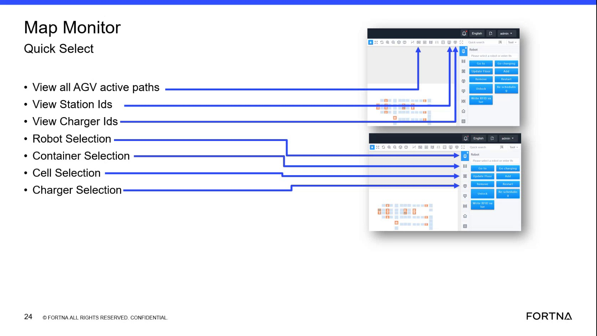

# AMR pairing failure with abnormal fleet roster or mapping state

## Playbook Header

| Field | Value |
| --- | --- |
| Playbook ID | `playbook_incident_228723_agv_pairing_roster_recovery` |
| Case ID | `228723` |
| Extraction Mode | `one_playbook_candidate_per_incident` |
| Confidence | `medium` |
| Validation Status | `needs_sme_review` |

## Entry Symptoms

- A site reports that an ACB or affected zone cannot get a pair.
- The ACB system is described as down or production is seriously impacted.
- Replacement AMRs reportedly route to the hospital lane instead of supporting the affected workflow.
- An AMR was previously reported with low battery or in an abnormal physical location.
- The issue follows an AMR replacement, add, or remove activity.

## Affected Systems

- ACB system
- AMRs / AGVs
- RMS
- Hospital lane
- Affected zone pairing workflow

## Nodes

### 1 — Confirm the observable pairing and routing pattern (`diagnostic_decision`)

**Objective:** Determine whether the site is experiencing an active pairing failure with abnormal AMR routing or behavior after a replacement or add/remove event.

**Why this check is next:** The source records site-reported inability to get a pair, replacement AMRs going to the hospital lane, and earlier low-battery and robot-location circumstances.

**Action:**

Confirm with the site (interview and/or immediate physical observation) whether the affected zone can’t obtain a pair and whether AMRs are routing to the hospital lane after the recent add/remove or replacement event.

**Suggested database check:**

- **Database:** robotics
  - **Model:** RobotDatabaseModel
  - **Inspect:** State
  - **Inspect:** CurrentLocationId
  - **Relate by:** robot_id, location_id
  - **Freshness:** EntityLastUpdate
- **Database:** robotics
  - **Model:** RobotLocationDatabaseModel
  - **Inspect:** StationNumber
  - **Relate by:** robot_id, location_id
  - **Freshness:** EntityLastUpdate
- **Database:** robotics
  - **Model:** AgvActiveErrorDatabaseModel
  - **Inspect:** Robot code.
  - **Inspect:** Active error code.
  - **Inspect:** Error description.
  - **Inspect:** Sort identifier during which the error occurred.

**Healthy:** The site operator or L1 support confirms pairing is available for the affected workflow and AMRs route to the intended workflow rather than consistently to the hospital lane.

**Unhealthy:** The site operator or L1 support confirms the affected zone/workflow still cannot obtain a pair and/or multiple replacement AMRs continue routing to the hospital lane, coinciding with the recent replacement/add/remove context.

**Inconclusive:** The site cannot reproduce the issue, cannot identify the affected workflow/robots, or cannot confirm current pairing/routing behavior or timing relative to the replacement/add/remove event.

**Expects capability:** n/a
**Expects surface:** n/a
**Preferred audience:** operator, L1_support

**Runbook Links:**

- `proc_check_rms_fleet_status_shutdown_queues_zone_cycling_v1` (medium, support, score=0.6101, boosted=0.8101) — Check RMS fleet status for AGVs in shutdown queues and zone cycling
  - gaps: Limited domain-term overlap between placeholder and runbook.; Placeholder wording differs materially from matched runbook title.

**Evidence Collection Procedures:**

- `proc_check_rms_fleet_status_shutdown_queues_zone_cycling_v1` — Check RMS fleet status for AGVs in shutdown queues and zone cycling (L1_support): Use the RMS / fleet status UI to verify that AGVs are held in shutdown queues (shutdown state), then cycle into their assigned zones (4 zones) after startup, consistent with the system state model described in the segment.

**Source Evidence:**

- Site reported that the affected zone was unable to get a pair.
- Site reported an earlier low-battery AMR issue and replacement AMRs going to the hospital lane.

**Branches:**

- `unhealthy` → `node_2` when Pairing failure + abnormal routing confirmed (with recent add/remove context)
- `healthy` → `` when Pairing is available and abnormal routing pattern is not present
- `inconclusive` → `` when Inconclusive (cannot confirm current pairing/routing behavior)

**Linked Runbook Procedures:**

<strong>Support runbooks</strong> (1)

Check RMS fleet status for AGVs in shutdown queues and zone cycling (`proc_check_rms_fleet_status_shutdown_queues_zone_cycling_v1`)

##### Runbook: Check RMS fleet status for AGVs in shutdown queues and zone cycling

- **Procedure ID:** `proc_check_rms_fleet_status_shutdown_queues_zone_cycling_v1`
- **Procedure Type:** `diagnostic`
- **Role:** `L1_support`
- **Audience:** `support`
- **Merge Status:** `pass_through`

**Summary:**
Use the RMS / fleet status UI to verify that AGVs are held in shutdown queues (shutdown state), then cycle into their assigned zones (4 zones) after startup, consistent with the system state model described in the segment.

**When To Use:**
When you need to confirm that AGVs are in the shutdown state (shutdown queues) and then transition into their assigned zones (4 zones) after startup, using the live fleet status view in RMS.

- **Source:** `training_video` / `training_video_day1`

**Procedure Steps:**

###### Step 1 — Open RMS / fleet status UI and view AGV roster/map

**Responsible role:** L1_support

**Instruction:**
Open the RMS / fleet status UI (rms_ui) and navigate to the AGV list/map view where you can see each AGV’s current state and/or location/zone assignment.

**Healthy condition:**
The RMS fleet status view is accessible and shows AGVs with state/location/zone information (enough to distinguish shutdown queues vs zone assignments).

**Expected result:**
You can see the AGV list/map view in RMS with each AGV’s current state and/or location/zone assignment visible.

---

###### Step 2 — Confirm AGVs are in shutdown queues (shutdown state)

**Responsible role:** L1_support

**Instruction:**
In the RMS AGV list/map view, identify the relevant AGVs and confirm that their current state and/or location/zone assignment corresponds to shutdown queues (shutdown state), not idle/running zones.

**Healthy condition:**
AGVs expected to be in shutdown are consistently shown as being in shutdown queues/shutdown state.

**Expected result:**
AGVs that should be in shutdown are displayed in a shutdown queues/shutdown state condition in RMS (observable via their state and/or location/zone assignment).

---

###### Step 3 — Observe transition from shutdown queues into assigned zones (4 zones)

**Responsible role:** L1_support

**Instruction:**
Observe the AGVs in RMS over the expected startup transition window and confirm they move from shutdown queues into their assigned zones. The segment references 4 zones.

**Healthy condition:**
AGVs move out of shutdown queues into zone assignments rather than remaining in shutdown state.

**Expected result:**
AGVs transition from shutdown queues/shutdown state into their assigned zones (4 zones referenced in the segment).

**Step Images:**

*Training video frame segment (timestamp ~00:47:36.500) containing the shutdown queues → cycle → 4 zones explanation and the mention of AGVs cycling through charging while in shutdown logic.*

---

###### Step 4 — If tipper/hospital scenario is active, confirm shutdown/startup cycle still holds

**Responsible role:** L1_support

**Instruction:**
If the segment’s scenario is active (tipper issue leading to hospital/reject handling), confirm in RMS that AGVs still follow the shutdown/startup cycle model: shutdown queues → assigned zones, rather than remaining stuck in shutdown queues.

**Healthy condition:**
No prolonged retention in shutdown queues beyond what the shutdown/startup logic implies; AGVs still enter their zone assignments.

**Expected result:**
Even during the tipper/hospital scenario, AGVs still transition from shutdown queues into their assigned zones in RMS.

---

**Success Criteria:**

- In RMS, AGVs expected to be in shutdown are shown in shutdown queues/shutdown state.
- After startup, those AGVs transition from shutdown queues into their assigned zones (4 zones referenced).
- During any tipper/hospital scenario, AGVs still follow shutdown queues → zones behavior rather than remaining stuck in shutdown.

**Failure Conditions:**

- AGVs remain in shutdown queues/shutdown state without transitioning into their assigned zones when startup is expected.
- RMS shows AGVs in non-shutdown zone assignments during a shutdown period.

---

### 2 — Check fleet roster and mapping state (`diagnostic_decision`)

**Objective:** Determine whether RMS shows an abnormal robot membership, mapping, or status condition that could explain the pairing failure.

**Why this check is next:** The source identifies RMS as the system used to view robot status and states that a removed robot was shown as not mapped; the artifact shows red-highlighted RMS table entries.

**Action:**

Inspect RMS fleet/robot status views to determine whether the roster/mapping state is abnormal for the affected workflow (e.g., missing/not mapped, exception-highlighted, or otherwise inconsistent membership).

**Suggested database check:**

- **Database:** robotics
  - **Model:** RobotDatabaseModel
  - **Inspect:** State
  - **Inspect:** CurrentLocationId
  - **Relate by:** robot_id, location_id
  - **Freshness:** EntityLastUpdate
- **Database:** robotics
  - **Model:** RobotLocationDatabaseModel
  - **Inspect:** StationNumber
  - **Relate by:** robot_id, location_id
  - **Freshness:** EntityLastUpdate
- **Database:** robotics
  - **Model:** AgvActiveErrorDatabaseModel
  - **Inspect:** Robot code.
  - **Inspect:** Active error code.
  - **Inspect:** Error description.
  - **Inspect:** Sort identifier during which the error occurred.

**Healthy:** RMS shows roster/mapping consistent with normal operation for the affected workflow; no abnormal/unmapped/exception indicators remain for the relevant robot(s).

**Unhealthy:** RMS shows abnormal roster/mapping for relevant robot(s) (e.g., a robot shown as not mapped, missing, duplicated, or exception-highlighted and correlating to the affected workflow).

**Inconclusive:** RMS state is unreadable/unavailable or the abnormal entry cannot be reliably correlated to the affected workflow.

**Expects capability:** n/a
**Expects surface:** n/a
**Preferred audience:** operator, L1_support

**Runbook Links:**

- `proc_check_rms_fleet_status_shutdown_queues_zone_cycling_v1` (medium, support, score=0.6961, boosted=0.8961) — Check RMS fleet status for AGVs in shutdown queues and zone cycling
  - gaps: Limited domain-term overlap between placeholder and runbook.

**Evidence Collection Procedures:**

- `proc_check_rms_fleet_status_shutdown_queues_zone_cycling_v1` — Check RMS fleet status for AGVs in shutdown queues and zone cycling (L1_support): Use the RMS / fleet status UI to verify that AGVs are held in shutdown queues (shutdown state), then cycle into their assigned zones (4 zones) after startup, consistent with the system state model described in the segment.

**Source Evidence:**

- RMS robot status tables show red-highlighted entries; exact values are unreadable.
- Resolution details state that the removed robot was shown as not mapped.

**Branches:**

- `unhealthy` → `node_3` when RMS abnormal roster/mapping supported
- `healthy` → `` when RMS shows normal roster/mapping or suspected pattern not indicated
- `inconclusive` → `node_5` when RMS unreadable/un-correlatable

**Linked Runbook Procedures:**

<strong>Support runbooks</strong> (1)

Check RMS fleet status for AGVs in shutdown queues and zone cycling (`proc_check_rms_fleet_status_shutdown_queues_zone_cycling_v1`)

##### Runbook: Check RMS fleet status for AGVs in shutdown queues and zone cycling

- **Procedure ID:** `proc_check_rms_fleet_status_shutdown_queues_zone_cycling_v1`
- **Procedure Type:** `diagnostic`
- **Role:** `L1_support`
- **Audience:** `support`
- **Merge Status:** `pass_through`

**Summary:**
Use the RMS / fleet status UI to verify that AGVs are held in shutdown queues (shutdown state), then cycle into their assigned zones (4 zones) after startup, consistent with the system state model described in the segment.

**When To Use:**
When you need to confirm that AGVs are in the shutdown state (shutdown queues) and then transition into their assigned zones (4 zones) after startup, using the live fleet status view in RMS.

- **Source:** `training_video` / `training_video_day1`

**Procedure Steps:**

###### Step 1 — Open RMS / fleet status UI and view AGV roster/map

**Responsible role:** L1_support

**Instruction:**
Open the RMS / fleet status UI (rms_ui) and navigate to the AGV list/map view where you can see each AGV’s current state and/or location/zone assignment.

**Healthy condition:**
The RMS fleet status view is accessible and shows AGVs with state/location/zone information (enough to distinguish shutdown queues vs zone assignments).

**Expected result:**
You can see the AGV list/map view in RMS with each AGV’s current state and/or location/zone assignment visible.

---

###### Step 2 — Confirm AGVs are in shutdown queues (shutdown state)

**Responsible role:** L1_support

**Instruction:**
In the RMS AGV list/map view, identify the relevant AGVs and confirm that their current state and/or location/zone assignment corresponds to shutdown queues (shutdown state), not idle/running zones.

**Healthy condition:**
AGVs expected to be in shutdown are consistently shown as being in shutdown queues/shutdown state.

**Expected result:**
AGVs that should be in shutdown are displayed in a shutdown queues/shutdown state condition in RMS (observable via their state and/or location/zone assignment).

---

###### Step 3 — Observe transition from shutdown queues into assigned zones (4 zones)

**Responsible role:** L1_support

**Instruction:**
Observe the AGVs in RMS over the expected startup transition window and confirm they move from shutdown queues into their assigned zones. The segment references 4 zones.

**Healthy condition:**
AGVs move out of shutdown queues into zone assignments rather than remaining in shutdown state.

**Expected result:**
AGVs transition from shutdown queues/shutdown state into their assigned zones (4 zones referenced in the segment).

**Step Images:**

*Training video frame segment (timestamp ~00:47:36.500) containing the shutdown queues → cycle → 4 zones explanation and the mention of AGVs cycling through charging while in shutdown logic.*

---

###### Step 4 — If tipper/hospital scenario is active, confirm shutdown/startup cycle still holds

**Responsible role:** L1_support

**Instruction:**
If the segment’s scenario is active (tipper issue leading to hospital/reject handling), confirm in RMS that AGVs still follow the shutdown/startup cycle model: shutdown queues → assigned zones, rather than remaining stuck in shutdown queues.

**Healthy condition:**
No prolonged retention in shutdown queues beyond what the shutdown/startup logic implies; AGVs still enter their zone assignments.

**Expected result:**
Even during the tipper/hospital scenario, AGVs still transition from shutdown queues into their assigned zones in RMS.

---

**Success Criteria:**

- In RMS, AGVs expected to be in shutdown are shown in shutdown queues/shutdown state.
- After startup, those AGVs transition from shutdown queues into their assigned zones (4 zones referenced).
- During any tipper/hospital scenario, AGVs still follow shutdown queues → zones behavior rather than remaining stuck in shutdown.

**Failure Conditions:**

- AGVs remain in shutdown queues/shutdown state without transitioning into their assigned zones when startup is expected.
- RMS shows AGVs in non-shutdown zone assignments during a shutdown period.

---

### 3 — Use an authorized site-side robot isolation or removal path (`procedure_reference`)

**Objective:** If an abnormal roster or mapping condition is supported, use the approved site procedure to isolate or remove the affected robot from the operating system and place it in a safe non-operational state.

**Why this check is next:** The incident reports site-side removal of a robot from the system and placement on a charger, followed by reported system recovery.

**Action:**

If an abnormal roster/mapping condition is supported, isolate/remove the affected robot using the authorized site-side physical action path and place it into a safe non-operational state (e.g., charging) without creating hazards; then confirm the corresponding RMS state as feasible.

**Healthy:** Authorized site personnel confirm the robot is safely isolated/removed from active operation and placed in the intended safe state without creating a new physical hazard.

**Unhealthy:** Robot remains active/obstructed or still associated with the abnormal roster state, and pairing failure continues after the supported action.

**Inconclusive:** The site cannot confirm physical state or corresponding RMS state; or the action cannot be performed safely/within authorization.

**Procedure Reference:**

- **Trigger condition:** The authorized site operator observes that the identified robot has been removed or isolated from active operation and placed in the reported safe state, such as charging, without creating a new physical hazard. Successful completion is confirmed by the site; failure or uncertainty means the robot cannot be safely isolated, the system-side state is unclear, or the action is outside the executor's authorization.
- **Selected procedure:** unresolved
- **Selection rationale:** n/a
- **Success confirmation:** n/a
- **Failure boundary:** Stop at the documented failure condition and escalate; do not invent a recovery path.

**Prerequisites:**

- None
- None

**Safety checks:**

- None

**Expects capability:** n/a
**Expects surface:** n/a
**Preferred audience:** operator

**Runbook Links:**

- No linked procedure; escalate if the required state cannot be confirmed using the available approved evidence sources.

**Source Evidence:**

- Site removed the robot from the system, placed it on a charger, and reported that the system began functioning again.

**Decision Outcomes:**

- `healthy` (observer=site; tool=physical_floor): Authorized site-side isolation/removal completed; robot is in a safe non-operational state.
- `unhealthy` (observer=site_or_remote; tool=physical_floor): Robot remains active/unsafe or still associated with abnormal roster/mapping; pairing failure persists.
- `inconclusive` (observer=site; tool=physical_floor): Cannot confirm safe completion or corresponding system-side state; action cannot proceed safely/authorized.

**Branches:**

- `healthy` → `node_4` when Isolation/removal completed safely and robot isolated
- `inconclusive` → `node_5` when Unsafe/unauthorized/inconclusive action

**Linked Runbook Procedures:**

*No linked runbook content available.*

---

### 4 — Confirm pairing and operational stability (`validation_gate`)

**Objective:** Determine whether the affected workflow has recovered after the authorized robot isolation or removal action.

**Why this check is next:** The source reports that the system began functioning after robot removal and remained operational during approximately ten minutes of monitoring, while acknowledging that the recovery was not independently validated by readable RMS data.

**Validate:**

Validate recovery by confirming pairing availability and operational stability after the authorized isolation/removal action during a monitoring window, and check RMS for persistent abnormal roster/mapping indicators if readable.

**Success:** Pairing resumes and operation remains stable during observation; RMS no longer shows the relevant abnormal roster/mapping indicator (where readable).

**Failure:** Pairing remains unavailable, AMRs continue abnormal routing, or RMS still shows the relevant unmapped/abnormal state.

**Inconclusive:** Recovery is only reported administratively without direct operational confirmation; RMS screenshots do not show readable final status details; stability monitoring window is not completed.

**Validation Gate:**

**Validation checklist:**

- Confirm the owning service remains running and stable.
- Confirm the supported API or control endpoint responds.
- Confirm the source-observed HMI state and ask the site to repeat the affected workflow.
- Observe the affected workflow for recurrence during the stated observation window.

**Required evidence sources:** a site interview

**Stable-operation observation:** Observe the affected workflow for recurrence during the defined observation window; a reachable screen or successful request alone is not recovery.

**Expects capability:** n/a
**Expects surface:** n/a
**Preferred audience:** operator, L1_support

**Runbook Links:**

- `proc_display_station_ids_on_map_monitor_quick_select_v1` (medium, support, score=0.472, boosted=0.672) — Display Station IDs on the Map Using Map Monitor Quick Select
  - gaps: Limited domain-term overlap between placeholder and runbook.; Placeholder wording differs materially from matched runbook title.

**Evidence Collection Procedures:**

- `proc_display_station_ids_on_map_monitor_quick_select_v1` — Display Station IDs on the Map Using Map Monitor Quick Select (L1_support): Use the RMS / fleet status UI Map Monitor Quick Select icon “View Station Ids” to overlay unique station identifiers on the live map. This helps identify/debug station-related issues by confirming station locations and their unique IDs are visible.

**Source Evidence:**

- Site believed removal may have fixed the issue and support monitored operation.
- System reportedly began functioning again and remained operational during approximately ten minutes of monitoring.

**Branches:**

- `healthy` → `` when Pairing and routing recovered; operation stable during monitoring
- `unhealthy` → `node_5` when Validation failure (pairing/routing abnormal persists)

**Linked Runbook Procedures:**

<strong>Support runbooks</strong> (1)

Display Station IDs on the Map Using Map Monitor Quick Select (`proc_display_station_ids_on_map_monitor_quick_select_v1`)

##### Runbook: Display Station IDs on the Map Using Map Monitor Quick Select

- **Procedure ID:** `proc_display_station_ids_on_map_monitor_quick_select_v1`
- **Procedure Type:** `diagnostic`
- **Role:** `L1_support`
- **Audience:** `support`
- **Merge Status:** `pass_through`

**Summary:**
Use the RMS / fleet status UI Map Monitor Quick Select icon “View Station Ids” to overlay unique station identifiers on the live map. This helps identify/debug station-related issues by confirming station locations and their unique IDs are visible.

**When To Use:**
When you need to visually confirm station locations and their unique station IDs on the RMS Map Monitor map (stations are special locations distinct from cells) to support station-related identification/debugging.

- **Source:** `training_video` / `training_video_day1`

**Procedure Steps:**

###### Step 1 — Open RMS Map Monitor Quick Select panel

**Responsible role:** L1_support

**Instruction:**
Open the RMS / fleet status UI (Map Monitor) and locate the left-side “Map Monitor Quick Select” panel.

**Healthy condition:**
You can see the Quick Select icons on the left panel, including the “View Station Ids” icon.

**Expected result:**
The left-side “Map Monitor Quick Select” panel is visible with Quick Select icons including “View Station Ids”.

**Step Images:**

*Map Monitor Quick Select panel showing the “View Station Ids” icon and related Quick Select icons (e.g., View all AGV active paths, View Charger Ids, Robot/Cell/Charger selection).*

---

###### Step 2 — Select “View Station Ids” overlay

**Responsible role:** L1_support

**Instruction:**
Click the “View Station Ids” icon in the Quick Select panel.

**Healthy condition:**
Unique station IDs appear at station locations on the map.

**Expected result:**
Station locations on the map display unique station IDs after selecting “View Station Ids”.

---

###### Step 3 — Verify station unique IDs display on the map

**Responsible role:** L1_support

**Instruction:**
On the map, verify that station locations display unique station IDs.

**Healthy condition:**
Station locations (special locations distinct from cells) have visible unique station IDs.

**Expected result:**
Station locations show unique station IDs on the map.

---

**Success Criteria:**

- After selecting “View Station Ids”, station locations on the RMS Map Monitor map display unique station IDs.

**Failure Conditions:**

- Station IDs do not appear on the map after selecting “View Station Ids”.

---

### 5 — Stop when the supported roster-recovery path is unsafe or unsuccessful (`escalation_gate`)

**Objective:** Hand off when the abnormal state cannot be safely isolated, the available evidence is inconclusive, or pairing and stable operation do not return after the supported path.

**Why this check is next:** The incident record shows incomplete and partly conflicting evidence, including unreadable RMS details, a delayed recovery report, and unresolved ambiguity about the cause.

**Action:**

If the supported roster-recovery path is unsafe/unsuccessful or validation does not confirm recovery, prepare an escalation handoff with site-observed symptoms, RMS evidence status (including unreadable portions), physical robot state, actions attempted, authorization/safety constraints, and validation results.

**Healthy:** Handoff includes all required evidence and stop criteria; a supported continuation exists only when authorization, safety, system-side state, and recovery evidence are sufficient.

**Unhealthy:** Evidence is missing/contradictory, physical safety or authorization cannot be ensured, or pairing/routing did not recover after supported action.

**Inconclusive:** Cannot determine whether the issue is mechanical vs mapping-related vs another subsystem due to insufficient evidence; RMS values are unreadable and cannot be correlated to pairing workflow.

**Escalation Gate:**

- **Reason:** Hand off when the abnormal state cannot be safely isolated, the available evidence is inconclusive, or pairing and stable operation do not return after the supported path.
- **Required next team:** The owning L2/L3 service or controls team
**Evidence package:**

- Site-observed pairing and routing symptoms (what is happening now).
- RMS screenshots/status evidence and whether key values are unreadable.
- Physical robot state (whether isolation/removal occurred and in what safe state).
- Actions attempted and what could not be completed safely or within authorization.
- Validation results (monitoring window outcome: recovered vs not recovered).
- Explicit statement of any ambiguity/inconclusive evidence and missing correlatable identifiers.
- {'page_ref': 'case_228723:page_6', 'artifact_id': 'artifact_incident_228723_page_006_embedded_image_01', 'quote_or_summary': 'RMS details are partly unreadable and the meaning of red entries cannot be confirmed.'}
- {'page_ref': 'case_228723:page_10', 'artifact_id': 'artifact_incident_228723_page_010_embedded_image_01', 'quote_or_summary': 'Recovery was reported after robot removal, but direct independent system validation was limited.'}
**Actions attempted:**

- None
**Unresolved questions:**

- None

**Expects capability:** n/a
**Expects surface:** n/a
**Preferred audience:** L2_support, L3_support

**Runbook Links:**

- No linked procedure; escalate if the required state cannot be confirmed using the available approved evidence sources.

**Source Evidence:**

- RMS details are partly unreadable and the meaning of red entries cannot be confirmed.
- Recovery was reported after robot removal, but direct independent system validation was limited.

**Decision Outcomes:**

- `escalate` (observer=remote; tool=RMS / AGV status UI + site interview + physical_floor notes): Supported recovery cannot be safely continued or validation fails; prepare escalation handoff.

**Branches:**

- `escalate` → `` when Stop and handoff to L2/L3 support

**Linked Runbook Procedures:**

*No linked runbook content available.*

---

## Branch Graph

| From Node | Outcome | Condition | Next Node |
| --- | --- | --- | --- |
| `node_1` | `unhealthy` | Pairing failure + abnormal routing confirmed (with recent add/remove context) | `node_2` |
| `node_1` | `healthy` | Pairing is available and abnormal routing pattern is not present | `` |
| `node_1` | `inconclusive` | Inconclusive (cannot confirm current pairing/routing behavior) | `` |
| `node_2` | `unhealthy` | RMS abnormal roster/mapping supported | `node_3` |
| `node_2` | `healthy` | RMS shows normal roster/mapping or suspected pattern not indicated | `` |
| `node_2` | `inconclusive` | RMS unreadable/un-correlatable | `node_5` |
| `node_3` | `healthy` | Isolation/removal completed safely and robot isolated | `node_4` |
| `node_3` | `inconclusive` | Unsafe/unauthorized/inconclusive action | `node_5` |
| `node_4` | `healthy` | Pairing and routing recovered; operation stable during monitoring | `` |
| `node_4` | `unhealthy` | Validation failure (pairing/routing abnormal persists) | `node_5` |
| `node_5` | `escalate` | Stop and handoff to L2/L3 support | `` |
