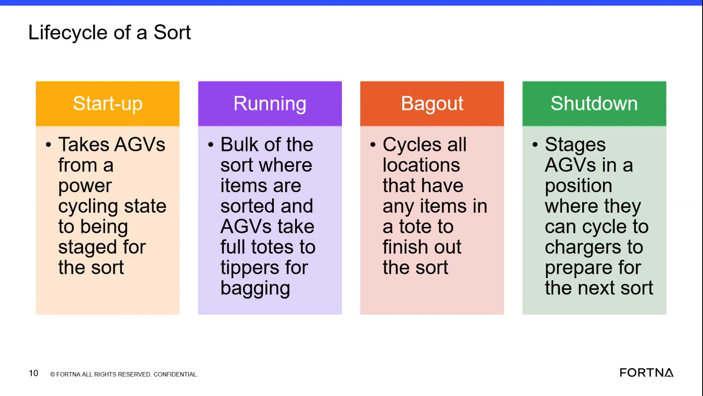
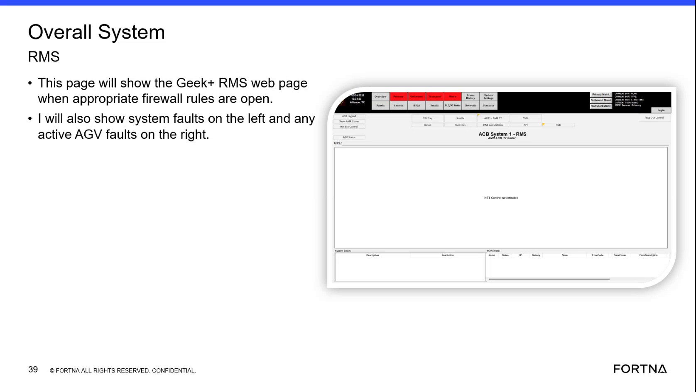

# Troubleshoot bag-out stoppage with abnormal AGV or task sequencing

## Playbook Header

| Field | Value |
| --- | --- |
| Playbook ID | `playbook_incident_218550_bagout_agv_sequence` |
| Case ID | `218550` |
| Extraction Mode | `one_or_more_playbook_candidates_when_separable` |
| Confidence | `medium` |
| Validation Status | `needs_sme_review` |

## Entry Symptoms

- Bag-out stops after sorting or does not progress to completion.
- The site must manually bag out.
- One or more AGVs or robots are not moving for an extended period.
- The site reports a robot out of sequence or out of position.
- Bag-out starts after an AGV-pair change but stops again.
- A hospital-area HMI reports a fault or a stuck task is visible there.

## Affected Systems

- Bag-out workflow
- AGV / robot fleet
- AGV pairs and sequence state
- RMS
- Hospital HMI
- AVEVA screen visibility context
- Tote and task workflow

## Nodes

### 1 — Confirm bag-out stoppage and affected operational pattern (`diagnostic_decision`)

**Objective:** Confirm whether bag-out is stalled or only partially progressing and whether the observable pattern includes AGV inactivity, sequence or pairing concerns, or a related HMI fault.

**Why this check is next:** The case subject and site messages describe a bag-out stoppage after sorting, manual bagging, and a robot believed to be out of sequence. The RMS artifact and related message report an AGV that did not move for three hours.

**Action:**

Confirm with the site whether bag-out is stopped versus only partially progressing, whether manual bagging is being used, and which observed pattern applies (AGV inactivity, out-of-sequence/out-of-position robot, pair not exchanging, tote mismatch, and/or hospital-area HMI fault). Then check the RMS fleet/activity/status view for the affected area to see whether AGVs are actively routing/moving.

**Suggested database check:**

- **Database:** robotics
  - **Model:** AgvActiveErrorDatabaseModel
  - **Inspect:** Name
  - **Inspect:** Error code
- **Database:** robotics
  - **Model:** SystemActiveErrorModel
  - **Inspect:** Id
  - **Inspect:** EntityInserted
  - **Inspect:** EntityLastUpdate
- **Database:** robotics
  - **Model:** RobotDatabaseModel
  - **Inspect:** Robot state enum (Tipper/Hospital/Charger/Sorter/GLD/ShutDown family).
  - **Inspect:** Tote currently associated with robot.
  - **Inspect:** Assigned sorter side.

**Healthy:** Bag-out progresses normally with active AGV movement/routing; manual bagging is not required.

**Unhealthy:** Bag-out is stopped or only partially progressing and/or requires manual bagging; site reports prolonged AGV inactivity and/or out-of-sequence/pairing/tote/HMI symptoms.

**Inconclusive:** Bag-out state cannot be clearly observed by the site, the affected area/robot behavior cannot be identified in RMS, or the relevant HMI/operational state is unavailable/readable.

**Expects capability:** n/a
**Expects surface:** n/a
**Preferred audience:** operator, L1_support

**Runbook Links:**

- `proc_check_rms_fleet_status_agvs_exchange_waiting_startup_delay_v1` (medium, support, score=0.5877, boosted=0.7877) — Check RMS / fleet status UI for AGVs waiting to exchange during shutdown or startup delay waiting on charger
  - gaps: Limited domain-term overlap between placeholder and runbook.

**Evidence Collection Procedures:**

- `proc_check_rms_fleet_status_agvs_exchange_waiting_startup_delay_v1` — Check RMS / fleet status UI for AGVs waiting to exchange during shutdown or startup delay waiting on charger (L1_support): Use the RMS / fleet status UI to determine whether AGVs are not progressing due to state-transition failure visibility patterns: (1) AGVs waiting to do an exchange during shutdown, and/or (2) startup delay while waiting for an AGV on the charger. The system is described as exposing this via system faults and visible waiting conditions.

**Source Evidence:**

- The system stopped at bag-out after sorting.
- An AGV did not move for 3 hours.

**Branches:**

- `unhealthy` → `node_2` when Bag-out stopped or partially progressing; pattern reported
- `healthy` → `` when Bag-out and AGV activity appear normal / pattern not confirmed
- `inconclusive` → `node_6` when Evidence unavailable or cannot be correlated

**Linked Runbook Procedures:**

<strong>Support runbooks</strong> (1)

Check RMS / fleet status UI for AGVs waiting to exchange during shutdown or startup delay waiting on charger (`proc_check_rms_fleet_status_agvs_exchange_waiting_startup_delay_v1`)

##### Runbook: Check RMS / fleet status UI for AGVs waiting to exchange during shutdown or startup delay waiting on charger

- **Procedure ID:** `proc_check_rms_fleet_status_agvs_exchange_waiting_startup_delay_v1`
- **Procedure Type:** `diagnostic`
- **Role:** `L1_support`
- **Audience:** `support`
- **Merge Status:** `pass_through`

**Summary:**
Use the RMS / fleet status UI to determine whether AGVs are not progressing due to state-transition failure visibility patterns: (1) AGVs waiting to do an exchange during shutdown, and/or (2) startup delay while waiting for an AGV on the charger. The system is described as exposing this via system faults and visible waiting conditions.

**When To Use:**
Use when lifecycle progression appears delayed during shutdown/startup and you need to check whether RMS is showing AGVs in the documented waiting/fault visibility patterns (exchange-waiting during shutdown; charger-waiting startup delay).

- **Source:** `training_video` / `training_video_day1`

**Procedure Steps:**

###### Step 1 — Open RMS / fleet status UI and navigate to AGV status/errors overview

**Responsible role:** L1_support

**Instruction:**
Open the RMS / fleet status UI (rms_ui) and navigate to the AGV status/errors overview area.

**Healthy condition:**
The RMS AGV status/errors overview area is populated and ready for inspection (not blank/unreachable).

**Expected result:**
You are viewing the RMS AGV status/errors overview area where AGV waiting conditions and system fault/alert visibility can be checked.

---

###### Step 2 — Check for AGVs waiting to do an exchange during shutdown

**Responsible role:** L1_support

**Instruction:**
In the RMS AGV status/errors overview, look for AGVs showing a waiting condition consistent with “waiting to do an exchange” during shutdown.

**Healthy condition:**
No widespread exchange-waiting indications are present when shutdown is expected to complete normally.

**Expected result:**
At least one AGV is indicated in RMS as waiting to do an exchange during shutdown (or you determine none are indicated).

**Step Images:**

*Training segment frame used as evidence that the system will show faults/visible waiting conditions for (a) AGV waiting to do an exchange during shutdown and (b) startup delay waiting for an AGV on the charger.*

---

###### Step 3 — Check for startup delay waiting for an AGV on the charger

**Responsible role:** L1_support

**Instruction:**
In the RMS AGV status/errors overview, look for startup delay evidence consistent with “waiting … for an AGV on the charger.”

**Healthy condition:**
No charger-waiting startup delay indications are present when startup proceeds normally.

**Expected result:**
At least one AGV is indicated in RMS as contributing to startup delay by waiting for an AGV on the charger (or you determine none are indicated).

---

###### Step 4 — Confirm system faults/alerts align with the waiting conditions

**Responsible role:** L1_support

**Instruction:**
In the RMS AGV status/errors overview, confirm whether system faults/alerts are visible and align with the exchange-waiting and/or charger-waiting conditions you observed.

**Healthy condition:**
Fault/alert visibility is consistent with normal operation (no fault entries that match the described waiting patterns).

**Expected result:**
RMS shows visible system fault/alert entries that align with the waiting conditions (or you determine there are no aligning fault/alert entries).

---

###### Step 5 — Stop and escalate on repeated or widespread waiting/fault indications

**Responsible role:** L1_support

**Instruction:**
If you see repeated or widespread waiting/fault indications that prevent lifecycle progression (e.g., multiple AGVs stuck in exchange-waiting or charger-waiting states), stop and escalate for deeper investigation.

**Healthy condition:**
No repeated/widespread waiting/fault indications are present; lifecycle progression is not blocked by the described patterns.

**Expected result:**
Escalation is initiated when the RMS evidence shows repeated/widespread waiting/fault indications consistent with the described patterns.

---

**Success Criteria:**

- RMS / fleet status UI shows either (a) AGVs indicated as waiting to do an exchange during shutdown and/or (b) startup delay evidence consistent with waiting for an AGV on the charger.
- RMS also shows visible system faults/alerts that align with the observed waiting conditions (when present).

**Failure Conditions:**

- RMS shows repeated/widespread AGVs waiting to do an exchange during shutdown.
- RMS shows repeated/widespread startup delay evidence consistent with waiting for an AGV on the charger.
- RMS shows system faults/alerts that align with the above waiting conditions.

---

### 2 — Determine whether an AGV active error or abnormal fleet state is present (`diagnostic_decision`)

**Objective:** Determine whether an AGV, robot, or system active-error condition correlates with the bag-out stoppage.

**Why this check is next:** Support reported checking activity and finding an AGV that had not moved for three hours, while the discussion also referred to checking system active error because the Aveva screen was not visible.

**Action:**

Determine whether an active AGV/system error or abnormal fleet/robot state is present that correlates with the bag-out stoppage by reviewing RMS fleet/activity status and (when the system is viewable to the support role) confirming active-error evidence.

**Suggested database check:**

- **Database:** robotics
  - **Model:** AgvActiveErrorDatabaseModel
  - **Inspect:** Name
  - **Inspect:** Error code
- **Database:** robotics
  - **Model:** SystemActiveErrorModel
  - **Inspect:** Id
  - **Inspect:** EntityInserted
  - **Inspect:** EntityLastUpdate
- **Database:** sorter_sweeper
  - **Model:** ActiveBagOutModel
  - **Inspect:** Entry while bag-out in progress; closes once tote tipped.

**Healthy:** No relevant active AGV/system error is displayed and the affected AGV/pair shows expected movement/availability consistent with bag-out progression.

**Unhealthy:** An active AGV/system error is displayed and the affected AGV remains inactive/unavailable; fleet view shows robot state inconsistent with the stalled workflow.

**Inconclusive:** The active-error view is unavailable/unreadable, RMS activity is stale/unidentifiable, or errors cannot be correlated to the bag-out symptom.

**Expects capability:** n/a
**Expects surface:** n/a
**Preferred audience:** operator, L1_support

**Runbook Links:**

- `proc_check_overall_system_faults_and_active_agv_faults_overall_system_rms_v1` (medium, support, score=0.6456, boosted=0.8456) — Check Overall System Faults and Active AGV Faults on the Overall System RMS Page
  - gaps: Limited domain-term overlap between placeholder and runbook.

**Evidence Collection Procedures:**

- `proc_check_overall_system_faults_and_active_agv_faults_overall_system_rms_v1` — Check Overall System Faults and Active AGV Faults on the Overall System RMS Page (L1_support): Perform a first-pass live check on the RMS / fleet status UI (Geek+ RMS web page) to determine whether the system has any system faults (left side) and whether any AGVs have active faults (right side).

**Source Evidence:**

- I checked the activity and see an AGV didn't move for 3 hours.
- Page context mentions checking system active error; the cropped technical view is not readable.

**Branches:**

- `unhealthy` → `node_3` when Active AGV error/abnormal state correlates
- `healthy` → `node_3` when No active error found; still discriminate using hospital HMI/tote/task evidence
- `inconclusive` → `node_6` when Active-error/RMS evidence unavailable or cannot be correlated

**Linked Runbook Procedures:**

<strong>Support runbooks</strong> (1)

Check Overall System Faults and Active AGV Faults on the Overall System RMS Page (`proc_check_overall_system_faults_and_active_agv_faults_overall_system_rms_v1`)

##### Runbook: Check Overall System Faults and Active AGV Faults on the Overall System RMS Page

- **Procedure ID:** `proc_check_overall_system_faults_and_active_agv_faults_overall_system_rms_v1`
- **Procedure Type:** `diagnostic`
- **Role:** `L1_support`
- **Audience:** `support`
- **Merge Status:** `pass_through`

**Summary:**
Perform a first-pass live check on the RMS / fleet status UI (Geek+ RMS web page) to determine whether the system has any system faults (left side) and whether any AGVs have active faults (right side).

**When To Use:**
Use when a caller reports a potential fleet/system issue and you need a quick overview of (1) system faults and (2) any active AGV faults visible on the Overall System RMS page.

- **Source:** `training_video` / `training_video_day1`

**Procedure Steps:**

###### Step 1 — Open the Overall System RMS page in the RMS / fleet status UI

**Responsible role:** L1_support

**Instruction:**
Open the RMS / fleet status UI (Geek+ RMS web page) for the site and navigate to the Overall System RMS page.

**Healthy condition:**
Both left and right fault areas are visible on the Overall System RMS page.

**Expected result:**
The Overall System RMS page loads and shows the two fault areas: system faults on the left and active AGV faults on the right.

**Step Images:**

*Overall System RMS page example showing system faults on the left and active AGV faults on the right (used to confirm the expected layout/areas).*

*Example where the Overall System RMS page may appear blank when the firewall is not open (useful for diagnosing page-load/visibility issues).*

---

###### Step 2 — Check the left-side “system faults” area

**Responsible role:** L1_support

**Instruction:**
On the Overall System RMS page, look at the left-side “system faults” area and determine whether any system faults are listed/present.

**Healthy condition:**
The left-side “system faults” area shows no system faults (empty/not showing faults).

**Expected result:**
You can state whether the left-side “system faults” area shows one or more fault entries or is empty/not showing faults at the time of the check.

---

###### Step 3 — Check the right-side “active AGV faults” area

**Responsible role:** L1_support

**Instruction:**
On the same Overall System RMS page, look at the right-side “active AGV faults” area and determine whether any active AGV faults are listed/present.

**Healthy condition:**
The right-side “active AGV faults” area shows no active AGV faults (empty/not showing faults).

**Expected result:**
You can state whether the right-side “active AGV faults” area shows one or more fault entries or is empty/not showing faults at the time of the check.

---

###### Step 4 — Report the displayed fault indications (or confirm none are displayed)

**Responsible role:** L1_support

**Instruction:**
If the left “system faults” area and/or the right “active AGV faults” area shows entries, report those fault indications to support. If both areas are empty/not showing faults, report that no system faults/active AGV faults are currently displayed on this page.

**Healthy condition:**
Report indicates both sides show no fault entries (no system faults and no active AGV faults displayed).

**Expected result:**
A clear statement is provided indicating whether system faults are present on the left and whether active AGV faults are present on the right at the time of the check.

---

**Success Criteria:**

- You verify the presence/absence of system faults in the left-side “system faults” area on the Overall System RMS page.
- You verify the presence/absence of active AGV faults in the right-side “active AGV faults” area on the Overall System RMS page.
- You report whether each side shows fault entries or is empty/not showing faults.

**Failure Conditions:**

- Left-side “system faults” area lists one or more system faults.
- Right-side “active AGV faults” area lists one or more active AGV faults.
- Overall System RMS page cannot be reached or does not load the content needed to view the left/right fault areas.

---

### 3 — Check for sequence, pair, tote, or task-state evidence (`branching_condition`)

**Objective:** Distinguish an AGV sequence or pairing concern from a tote or task condition visible through the hospital-area HMI.

**Why this check is next:** The source reports a tote read at the hospital while physically elsewhere, a hospital HMI fault, a stuck task visible only on that HMI, and a suspected robot out-of-sequence condition. These remain source-supported observations and hypotheses rather than confirmed cause.

**Action:**

Use the hospital-area HMI (and tote identity/state it reports) to decide whether the bag-out stoppage is consistent with a sequence/pairing concern versus a tote/task condition that is visible through that HMI; treat all such HMI-reported conditions as unconfirmed until corroborated by correlation with the bag-out symptom and RMS activity.

**Suggested database check:**

- **Database:** robotics
  - **Model:** AgvActiveErrorDatabaseModel
  - **Inspect:** Name
  - **Inspect:** Error code
- **Database:** robotics
  - **Model:** SystemActiveErrorModel
  - **Inspect:** Id
  - **Inspect:** EntityInserted
  - **Inspect:** EntityLastUpdate
- **Database:** robotics
  - **Model:** RobotDatabaseModel
  - **Inspect:** Robot state enum (Tipper/Hospital/Charger/Sorter/GLD/ShutDown family).
  - **Inspect:** Tote currently associated with robot.
  - **Inspect:** Assigned sorter side.

**Healthy:** Hospital HMI shows no relevant fault or stuck task; tote identity/location aligns with the workflow; RMS activity/pair/sequence observations are consistent with normal operation.

**Unhealthy:** Hospital HMI shows a fault and/or stuck task, and/or tote identity is reported in an unexpected location; site reports sequence/pair/tote mismatch inconsistent with workflow.

**Inconclusive:** Hospital HMI cannot be viewed/read; fault text is unreadable; tote/task relationship cannot be confirmed; evidence cannot be tied to the bag-out symptom.

**Expects capability:** n/a
**Expects surface:** n/a
**Preferred audience:** operator, L1_support

**Runbook Links:**

- No linked procedure; escalate if the required state cannot be confirmed using the available approved evidence sources.

**Source Evidence:**

- A tote was reported read at the hospital while physically in another location; bag-out entered request and did not progress.
- The HMI at the hospital is showing a fault.
- A prior stuck task was reported as visible only on that HMI.

**Branches:**

- `unhealthy` → `node_4` when Sequence/pair/tote/HMI fault or stuck-task indicated
- `healthy` → `node_6` when No sequence/pair/tote/HMI/task condition indicated
- `inconclusive` → `node_6` when Hospital/HMI evidence unavailable or ambiguous

**Linked Runbook Procedures:**

*No linked runbook content available.*

---

### 4 — Apply authorized recovery for the identified AGV or sequence condition (`procedure_reference`)

**Objective:** Use the approved recovery path appropriate to the confirmed condition, such as restoring robot availability, correcting an AGV pair or sequence state, or handling a confirmed task or HMI condition.

**Why this check is next:** The incident records robots being turned off because of low batteries, later turned back on, AGV pairs being removed and added, and advice to acknowledge and retry an HMI fault. The source does not isolate which action produced the final recovery.

**Action:**

Apply the authorized recovery appropriate to the confirmed diagnostic evidence category (restore robot availability, correct an AGV pair/sequence state, and/or acknowledge/retry a hospital HMI fault/stuck task using authorized boundaries).

**Healthy:** Recovery completes for the affected state: robots remain powered and available; pair/sequence restored; hospital HMI fault/task indication clears without unsafe intervention.

**Unhealthy:** Recovery does not restore progress: a robot remains unavailable or repeatedly powers off; bag-out starts and stops again; hospital HMI fault/stuck task persists.

**Inconclusive:** Recovery cannot be safely selected from available evidence, authorization/role limits block actions, or recovery effects cannot be observed.

**Procedure Reference:**

- **Trigger condition:** The authorized site or support role completes the applicable recovery procedure. A recovery-progress signal is that affected robots remain powered and available, the relevant pair or sequence is restored, or the identified task/tote condition is cleared. An unhealthy signal is that the same AGV or task remains unavailable or bag-out stops again. Inconclusive means the source-supported recovery option is not authorized, the condition cannot be identified, or the procedure outcome cannot be observed.
- **Selected procedure:** Recover From AGV Fault During Exchange (RMS E-stop, remove faulted AGV, backfill, introduce new tote + empty AGV) (`proc_recover_from_agv_fault_during_exchange_recovery_v1`)
- **Selection rationale:** Retrieval match (0.6837, boosted 0.8537).
- **Success confirmation:** Faulted AGV is removed from RMS.
- **Failure boundary:** Trailing AGV does not backfill and cannot be removed/cleared as described.

**Prerequisites:**

- rms_ui

**Safety checks:**

- Perform an RMS E-stop as the first recovery action for this fault scenario.

**Expects capability:** n/a
**Expects surface:** n/a
**Preferred audience:** operator, L2_support

**Runbook Links:**

- `proc_recover_from_agv_fault_during_exchange_recovery_v1` (low, support, score=0.6837, boosted=0.8537) — Recover From AGV Fault During Exchange (RMS E-stop, remove faulted AGV, backfill, introduce new tote + empty AGV)
  - gaps: Missing corroboration for `hospital_diversion`: hospital-lane diversion — ask site about hospital stacklight/lane routing; check Hospital HMI and RMS fleet routing (optionally hospital DB models for L2).; Missing corroboration for `zone_pairing_state`: zone pairing failure — ask site whether the zone can obtain a pair; check RMS zone/AGV status and/or remote WCS pairing-related views (L2).; Limited domain-term overlap between placeholder and runbook.; Placeholder wording differs materially from matched runbook title.

**Evidence Collection Procedures:**

- `proc_recover_from_agv_fault_during_exchange_recovery_v1` — Recover From AGV Fault During Exchange (RMS E-stop, remove faulted AGV, backfill, introduce new tote + empty AGV) (L2_support): Restore exchange flow after an AGV faults while leaving by stopping RMS, removing the faulted AGV from the RMS, optionally removing the trailing AGV if it does not backfill, then introducing a new tote and placing an empty AGV in the affected zone.

**Source Evidence:**

- Robots were turned off because batteries were low, then turned back on and stayed on.
- AGV pairs were removed and added; bag-out started but later stopped again.
- Support advised acknowledging the HMI fault and trying again.

**Decision Outcomes:**

- `healthy` (observer=site_or_remote; tool=Hospital HMI (hospital_hmi) + RMS activity/status (rms_ui)): Authorized recovery is completed and affected state shows recovery progress.
- `unhealthy` (observer=site_or_remote; tool=Hospital HMI (hospital_hmi) + RMS activity/status (rms_ui)): Recovery unsuccessful or leaves the same condition unchanged.
- `inconclusive` (observer=remote; tool=Hospital HMI (hospital_hmi) and RMS (rms_ui)): Recovery cannot be safely selected or its outcome cannot be observed.
- `escalate` (observer=remote; tool=Hospital HMI (hospital_hmi) + RMS (rms_ui)): Limits prevent further supported action.

**Branches:**

- `healthy` → `node_5` when Authorized recovery shows progress
- `unhealthy` → `node_6` when Recovery unauthorized/cannot be completed/does not change condition

**Linked Runbook Procedures:**

<strong>Support runbooks</strong> (1)

Recover From AGV Fault During Exchange (RMS E-stop, remove faulted AGV, backfill, introduce new tote + empty AGV) (`proc_recover_from_agv_fault_during_exchange_recovery_v1`)

##### Runbook: Recover From AGV Fault During Exchange (RMS E-stop, remove faulted AGV, backfill, introduce new tote + empty AGV)

- **Procedure ID:** `proc_recover_from_agv_fault_during_exchange_recovery_v1`
- **Procedure Type:** `recovery`
- **Role:** `L2_support`
- **Audience:** `support`
- **Merge Status:** `pass_through`

**Summary:**
Restore exchange flow after an AGV faults while leaving by stopping RMS, removing the faulted AGV from the RMS, optionally removing the trailing AGV if it does not backfill, then introducing a new tote and placing an empty AGV in the affected zone.

**When To Use:**
Use when an AGV faults during exchange while leaving and you need to restore exchange flow by removing the faulted AGV from RMS, handling backfill behavior, and reintroducing the correct tote + empty-AGV state in the affected zone.

**Safety Notes:**

- Perform an RMS E-stop as the first recovery action for this fault scenario.

- **Source:** `manual` / `manual_optisweep_om_v3`

**Procedure Steps:**

###### Step 1 — E-stop RMS

**Responsible role:** L2_support

**Instruction:**
On the RMS / fleet status UI (rms_ui), perform an E-stop of the RMS.

**Healthy condition:**
RMS remains stopped (no exchange movement continuing) while you proceed with AGV removal actions.

**Expected result:**
RMS is in an E-stopped state (fleet movement is stopped) on the RMS / fleet status UI.

---

###### Step 2 — Remove the faulted AGV that is lifted and faulted out while leaving

**Responsible role:** L2_support

**Instruction:**
On the RMS / fleet status UI (rms_ui), identify the AGV that is lifted and has faulted out while leaving, then remove that AGV from the RMS using the AGV API Controls flow referenced by the manual.

**Healthy condition:**
Only the faulted AGV is removed; the RMS remains stopped while you confirm the removal is reflected in the RMS UI.

**Expected result:**
The faulted AGV is removed from the RMS (it no longer appears as an active AGV in the RMS fleet context for the affected zone).

**Step Images:**

*HMI screenshot showing the faulted AGV with tote state (used as visual context for the faulted condition during exchange recovery).*

*RMS screen showing an AGV fault example (visual context for RMS fault screens; not specific to this exact exchange-fault step).*

*AGV API Controls screen showing controls such as Remove AGV / Recover AGV / Pause All AGVs / Resume All AGVs (used for the AGV removal action referenced by the recovery procedure).*

---

###### Step 3 — Check backfill; remove trailing AGV if it does not backfill

**Responsible role:** L2_support

**Instruction:**
On the RMS / fleet status UI (rms_ui), check whether the AGV behind the faulted AGV backfills into the expected position. If it does not backfill, remove that trailing AGV as well using the same AGV API Controls flow referenced by the manual.

**Healthy condition:**
Backfill occurs as expected, or the trailing AGV is successfully removed so the zone can be re-established with the correct tote + empty AGV state.

**Expected result:**
Either (a) the AGV behind backfills into the expected position, or (b) the trailing AGV is removed from RMS when it does not backfill.

---

###### Step 4 — Introduce new tote and place an empty AGV in the affected zone

**Responsible role:** L2_support

**Instruction:**
Introduce a new tote at the faulted location and place an empty AGV in that zone using the RMS UI actions referenced by the manual.

**Healthy condition:**
The affected exchange location shows the newly introduced tote and an empty AGV in the zone (exchange can resume).

**Expected result:**
A newly introduced tote is present at the affected location, and an empty AGV is placed in that zone so exchange can proceed.

**Step Images:**

*RMS screen for adding an AGV to a zone when no empty AGV is present (visual support for re-establishing empty AGV state in the affected zone).*

---

**Success Criteria:**

- Faulted AGV is removed from RMS.
- If the AGV behind did not backfill, the trailing AGV is also removed.
- Affected exchange location has a newly introduced tote and an empty AGV placed in the correct zone so exchange can proceed.

**Failure Conditions:**

- Trailing AGV does not backfill and cannot be removed/cleared as described.
- New tote and/or empty AGV cannot be introduced into the correct zone.

---

### 5 — Validate restored sequence and sustained bag-out operation (`validation_gate`)

**Objective:** Confirm that robots are functional, the relevant sequence is stable, and bag-out completes or continues normally without immediate recurrence.

**Why this check is next:** The source states that with all robots in proper sequence the customer confirmed they were functional. It also records a temporary bag-out restart followed by another stop, so sustained validation is necessary.

**Validate:**

Validate that recovery is sustained: confirm robots remain functional and in proper sequence, bag-out completes or continues normally without immediate recurrence, and any hospital HMI fault/task indication is cleared.

**Success:** Automated bag-out progresses and/or completes; robots remain functional and in proper sequence; HMI fault/task indication cleared; no recurrence.

**Failure:** Bag-out stops again or remains incomplete; robots again show prolonged inactivity/active error; hospital HMI fault/task remains present; site cannot confirm sustained automated operation.

**Inconclusive:** Only temporary improvement is seen or bag-out has not reached the relevant validation point; RMS/HMI evidence cannot be observed/read.

**Validation Gate:**

**Validation checklist:**

- Confirm the owning service remains running and stable.
- Confirm the supported API or control endpoint responds.
- Compare database or fleet state with the live HMI or site-observed state.
- Observe the affected workflow for recurrence during the stated observation window.

**Required evidence sources:** RMS

**Stable-operation observation:** Observe the affected workflow for recurrence during the defined observation window; a reachable screen or successful request alone is not recovery.

**Expects capability:** n/a
**Expects surface:** n/a
**Preferred audience:** operator, L1_support

**Runbook Links:**

- No linked procedure; escalate if the required state cannot be confirmed using the available approved evidence sources.

**Source Evidence:**

- With all the robots in proper sequence the customer confirms that they are functional.
- Bag-out started, processed most items, but stopped again.
- The tote at the hospital was identified and the site reported that all was good.

**Branches:**

- `healthy` → `` when Sustained successful validation
- `unhealthy` → `node_6` when Validation failure / recurrence
- `inconclusive` → `node_6` when Only temporary improvement / cannot monitor next phase

**Linked Runbook Procedures:**

*No linked runbook content available.*

---

### 6 — Stop and escalate when the supported path does not restore stable operation (`escalation_gate`)

**Objective:** Hand off when the abnormal state cannot be identified, authorized recovery is unavailable or unsuccessful, or validation fails after the supported troubleshooting path.

**Why this check is next:** The source records that available troubleshooting options were exhausted at one point, that a prior pair adjustment only temporarily restored bag-out, and that the HMI/task issue required follow-up.

**Action:**

Stop and prepare an escalation handoff when the supported diagnostic/recovery path cannot identify the affected component, when authorized recovery cannot be completed or does not restore stable operation, or when validation fails/recurs after recovery attempts.

**Healthy:** Validation passes; escalation is not needed because stable automated operation is confirmed.

**Unhealthy:** Bag-out remains stopped/stops again; affected AGV/task/tote/HMI condition remains unresolved; recurrence after attempted supported recovery.

**Inconclusive:** Evidence is insufficient to determine system stability or tie observations to a specific affected component/state.

**Escalation Gate:**

- **Reason:** Hand off when the abnormal state cannot be identified, authorized recovery is unavailable or unsuccessful, or validation fails after the supported troubleshooting path.
- **Required next team:** The owning L2/L3 service or controls team
**Evidence package:**

- RMS evidence: AGV inactivity and any active faults observed during node_1/node_2
- Hospital HMI evidence: fault indication and/or stuck-task visibility and any tote identity/state observations (or explicit unreadable/ambiguous status)
- Bag-out behavior timeline: stopped/partial vs restart attempts and recurrence
- What recovery was attempted (category level) and what outcome was observed
- Authorization/role limits that prevented further actions
- {'page_ref': 'case_218550:page_10', 'artifact_id': None, 'site_code': 'ups_haslet_tx', 'site_label': 'UPS Haslet TX (TXRTH)', 'quote_or_summary': 'The team reported that available options had been exhausted.'}
- {'page_ref': 'case_218550:page_13', 'artifact_id': None, 'site_code': 'ups_haslet_tx', 'site_label': 'UPS Haslet TX (TXRTH)', 'quote_or_summary': 'Follow-up was requested for the HMI update and stuck-task recovery process.'}
**Actions attempted:**

- None
**Unresolved questions:**

- None

**Expects capability:** n/a
**Expects surface:** n/a
**Preferred audience:** L1_support, L2_support

**Runbook Links:**

- No linked procedure; escalate if the required state cannot be confirmed using the available approved evidence sources.

**Source Evidence:**

- The team reported that available options had been exhausted.
- Follow-up was requested for the HMI update and stuck-task recovery process.

**Decision Outcomes:**

- `healthy` (observer=site_or_remote; tool=RMS activity/status (rms_ui) and hospital HMI (hospital_hmi)): No escalation needed because validation passes.
- `unhealthy` (observer=remote; tool=RMS (rms_ui) and hospital HMI (hospital_hmi) with site interview evidence): Escalate: unresolved or recurring operation.
- `inconclusive` (observer=remote; tool=RMS (rms_ui) and hospital HMI (hospital_hmi) with site interview evidence): Escalate due to insufficient evidence to determine stability.

**Branches:**

- `unhealthy` → `` when Stop and escalate

**Linked Runbook Procedures:**

*No linked runbook content available.*

---

## Branch Graph

| From Node | Outcome | Condition | Next Node |
| --- | --- | --- | --- |
| `node_1` | `unhealthy` | Bag-out stopped or partially progressing; pattern reported | `node_2` |
| `node_1` | `healthy` | Bag-out and AGV activity appear normal / pattern not confirmed | `` |
| `node_1` | `inconclusive` | Evidence unavailable or cannot be correlated | `node_6` |
| `node_2` | `unhealthy` | Active AGV error/abnormal state correlates | `node_3` |
| `node_2` | `healthy` | No active error found; still discriminate using hospital HMI/tote/task evidence | `node_3` |
| `node_2` | `inconclusive` | Active-error/RMS evidence unavailable or cannot be correlated | `node_6` |
| `node_3` | `unhealthy` | Sequence/pair/tote/HMI fault or stuck-task indicated | `node_4` |
| `node_3` | `healthy` | No sequence/pair/tote/HMI/task condition indicated | `node_6` |
| `node_3` | `inconclusive` | Hospital/HMI evidence unavailable or ambiguous | `node_6` |
| `node_4` | `healthy` | Authorized recovery shows progress | `node_5` |
| `node_4` | `unhealthy` | Recovery unauthorized/cannot be completed/does not change condition | `node_6` |
| `node_5` | `healthy` | Sustained successful validation | `` |
| `node_5` | `unhealthy` | Validation failure / recurrence | `node_6` |
| `node_5` | `inconclusive` | Only temporary improvement / cannot monitor next phase | `node_6` |
| `node_6` | `unhealthy` | Stop and escalate | `` |
