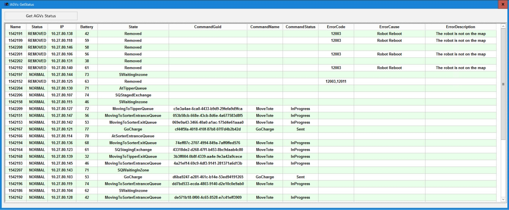
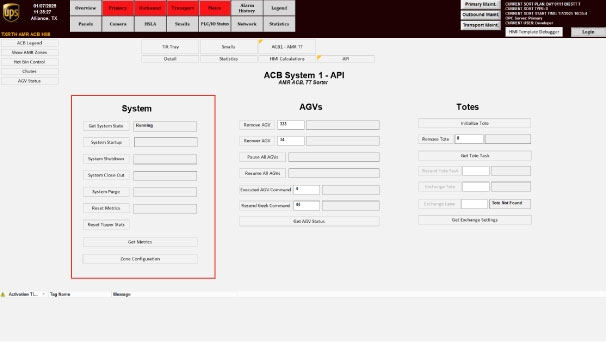

# Hospital station cannot add or induct totes

## Playbook Header

| Field | Value |
| --- | --- |
| Playbook ID | `playbook_incident_223554_hospital_tote_induction` |
| Case ID | `223554` |
| Extraction Mode | `one_or_more_playbook_candidates_when_separable` |
| Confidence | `high` |
| Validation Status | `needs_sme_review` |

## Entry Symptoms

- The hospital station cannot add or induct totes.
- Totes can be removed but cannot be added at the hospital.
- A robot or AGV is reported in a shut down state.
- An AGV appears not to belong in the displayed location, or two AGVs appear under the same rack or in the same zone.
- Hospital backlog or tote flow disruption is reported.

## Affected Systems

- ACB hospital station
- AGV hospital station
- AGVs and robot roster/location state
- Tote associations
- Hospital lane
- API dog / Aveva recovery interfaces

## Nodes

### 1 — Confirm the hospital induction symptom and current AGV/tote context (`diagnostic_decision`)

**Objective:** Confirm whether the reported failure is specifically inability to add or induct totes at the hospital station and whether an affected AGV, rack position, or associated tote appears abnormal.

**Why this check is next:** The source reports that the site could remove totes but could not add them, and shows an annotated HMI-style layout in a discussion of an AGV being in the wrong location.

**Action:**

Interview the site/operator about whether hospital tote removal works while tote add/induct fails, then verify on the hospital HMI whether the affected station shows any unexpected AGV/rack/zone occupancy pattern.

**Suggested database check:**

- **Database:** robotics
  - **Model:** HospitalDatabaseModel
  - **Inspect:** Hospital entrance and exit queue locations.
  - **Inspect:** Hospital tote drop-off location.
- **Database:** sorter_sweeper
  - **Model:** HospitalTagsModel
  - **Inspect:** Whether tag is in or out; drives action.
  - **Inspect:** List of hospital controller tags.
  - **Inspect:** Modular typed value columns (string/bool) selected by variable type.
- **Database:** robotics
  - **Model:** RobotDatabaseModel
  - **Inspect:** Robot state enum (Tipper/Hospital/Charger/Sorter/GLD/ShutDown family).
  - **Inspect:** Tote currently associated with robot.
  - **Inspect:** Assigned sorter side.

**Healthy:** Hospital tote add/induct works at the affected station and hospital HMI shows no unexpected AGV occupancy or duplicate rack/zone association.

**Unhealthy:** Hospital tote add/induct remains unavailable (especially while removal works) and hospital HMI shows an unexpected AGV/rack/zone occupancy pattern or duplicate occupancy.

**Inconclusive:** The site cannot reproduce the symptom, or station/HMI labels/identifiers are unreadable, or operator and displayed state cannot be reconciled with available evidence.

**Expects capability:** n/a
**Expects surface:** n/a
**Preferred audience:** operator, L1_support

**Runbook Links:**

- No linked procedure; escalate if the required state cannot be confirmed using the available approved evidence sources.

**Source Evidence:**

- They can remove totes but cannot add; chat also says an AGV does not belong in the shown location and two AGVs are under the rack in the same zone.

**Branches:**

- `unhealthy` → `node_2` when Hospital tote induction fails (with or without AGV/tote anomaly)
- `healthy` → `node_5` when Hospital add/remove works; no relevant anomaly observed

**Linked Runbook Procedures:**

*No linked runbook content available.*

---

### 2 — Determine whether AGV and tote state is inconsistent (`diagnostic_decision`)

**Objective:** Determine whether an AGV removal, unexpected location, duplicate rack occupancy, or disconnected tote association is present and plausibly connected to the hospital induction symptom.

**Why this check is next:** The packet repeatedly discusses an AGV in the wrong location, multiple AGVs under a rack, a disconnected tote, and use of API dog or Aveva to correct AGV and tote state.

**Action:**

Verify whether the hospital AGV roster/location state is inconsistent with the expected rack/zone layout and whether a disconnected/orphaned tote association exists, using hospital HMI for what is visible and authorized backend reads when available.

**Suggested database check:**

- **Database:** robotics
  - **Model:** RobotDatabaseModel
  - **Inspect:** Robot state enum (Tipper/Hospital/Charger/Sorter/GLD/ShutDown family).
  - **Inspect:** Tote currently associated with robot.
- **Database:** robotics
  - **Model:** RobotLocationDatabaseModel
  - **Inspect:** Station / workstation number for the location.
  - **Inspect:** Whether the location is currently occupied.
  - **Inspect:** Zone associated with the location (sorter-side zones).
- **Database:** robotics
  - **Model:** AgvActiveErrorDatabaseModel
  - **Inspect:** Robot code.
  - **Inspect:** Active error code.
  - **Inspect:** Error description.

**Healthy:** AGV position and station/rack association match the expected layout and no disconnected/orphaned tote association is observed.

**Unhealthy:** An AGV is displayed in an unexpected location; duplicate occupancy under one rack/zone is shown; and/or a tote appears associated with a removed/disconnected AGV.

**Inconclusive:** Hospital view identifiers cannot be read (low resolution); the association cannot be confirmed; or the anomaly is based only on second-hand discussion.

**Expects capability:** n/a
**Expects surface:** n/a
**Preferred audience:** L1_support, L2_support

**Runbook Links:**

- No linked procedure; escalate if the required state cannot be confirmed using the available approved evidence sources.

**Source Evidence:**

- Summary describes an AGV with a disconnected tote, removal of an inducted tote through API dog, and removal of additional AGVs to restore flow.
- Chat says Aveva hits the same endpoints as API dog and was used to remove an AGV from a zone and add a tote to a station.

**Branches:**

- `unhealthy` → `node_3` when AGV location/roster/tote association inconsistency indicated
- `inconclusive` → `node_5` when AGV/tote state appears consistent or anomaly cannot be confirmed

**Linked Runbook Procedures:**

*No linked runbook content available.*

---

### 3 — Apply authorized correction for supported AGV or tote-state mismatch (`procedure_reference`)

**Objective:** Use an authorized, source-supported recovery procedure to correct the affected AGV or tote state when the diagnostic evidence identifies a supported mismatch.

**Why this check is next:** The source reports high-level use of API dog and Aveva to remove totes, remove an AGV from a zone, and add a tote to a station; it does not provide the exact procedure.

**Action:**

Use the authorized Aveva/API interface to correct the supported AGV or tote-state mismatch, then obtain evidence that the stale/disconnected association is removed and the expected hospital association is restored.

**Healthy:** Authorized interface reflects the intended AGV/tote association after correction, allowing hospital tote-flow validation to proceed.

**Unhealthy:** The interface rejects the correction, or the state remains inconsistent, leaving the hospital induction target ambiguous.

**Inconclusive:** The interface does not provide reliable confirmation, or required role/safety preconditions are unavailable.

**Procedure Reference:**

- **Trigger condition:** The authorized operator or support role observes that the targeted AGV or tote state has been corrected in the approved interface. Progress signal: the stale or disconnected association is removed or the expected station association is restored. Unhealthy signal: the interface rejects the correction, the state remains inconsistent, or the action would require an unapproved physical or database change. Inconclusive: the source interface does not show a reliable post-action state.
- **Selected procedure:** Use AGV API Controls to Remove/Recover an AGV and Pause/Resume All AGVs (`proc_use_agv_api_controls_remove_recover_pause_resume_v1`)
- **Selection rationale:** Retrieval match (0.6619, boosted 0.8619).
- **Success confirmation:** Remove AGV is followed by physical removal of the AGV from the system; if a tote is present, the tote is taken to the hospital where the tote is removed.
- **Failure boundary:** Cannot physically remove/recover the AGV/tote as required after using Remove AGV.

**Prerequisites:**

- You have the target AGV ID to enter into the Remove AGV and Recover AGV fields.
- Access to the System HMI API screen with the AGVs section (AGV API Controls)

**Safety checks:**

- If the AGV has a tote, take the tote to the hospital where the tote is removed; the tote is recovered when it is put back in the system.

**Expects capability:** n/a
**Expects surface:** n/a
**Preferred audience:** operator, L1_support

**Runbook Links:**

- `proc_use_agv_api_controls_remove_recover_pause_resume_v1` (medium, operator, score=0.6619, boosted=0.8619) — Use AGV API Controls to Remove/Recover an AGV and Pause/Resume All AGVs
  - gaps: Limited domain-term overlap between placeholder and runbook.; Placeholder wording differs materially from matched runbook title.
- `proc_start_optsweep_agv_system_reset_metrics_start_closeout_bagout_verify_running_shutdown_v1` (high, operator, score=0.573, boosted=0.743) — Start OptiSweep AGV System (Reset Metrics → Start System → Close Out/Bag Out → Verify Running → Shut Down)
  - gaps: Limited domain-term overlap between placeholder and runbook.; Placeholder wording differs materially from matched runbook title.
- `proc_start_optisweep_agv_system_from_shutdown_reset_metrics_start_closeout_running_v1` (high, operator, score=0.5605, boosted=0.7305) — Start OptiSweep AGV System From Shut-down Mode (Reset Metrics → Start → Close out/Bag Out → Running)
  - gaps: Limited domain-term overlap between placeholder and runbook.; Placeholder wording differs materially from matched runbook title.

**Evidence Collection Procedures:**

- `proc_use_agv_api_controls_remove_recover_pause_resume_v1` — Use AGV API Controls to Remove/Recover an AGV and Pause/Resume All AGVs (operator): Use the System HMI API screen’s AGVs section to remove a problematic AGV by ID, recover (add back) the AGV by ID after physical recovery, and pause/resume all AGV movement fleet-wide.
- `proc_start_optsweep_agv_system_reset_metrics_start_closeout_bagout_verify_running_shutdown_v1` — Start OptiSweep AGV System (Reset Metrics → Start System → Close Out/Bag Out → Verify Running → Shut Down) (operator): Perform the required AGV start-up prerequisites (nine empty AGVs: five under the north rack and four under the south rack), start the OptiSweep system 15 minutes before the sort, run the documented start sequence (Reset Metrics → Start System → Close Out/Bag Out), verify the system returns to the "Running" state after Bag Out, and then shut down.
- `proc_start_optisweep_agv_system_from_shutdown_reset_metrics_start_closeout_running_v1` — Start OptiSweep AGV System From Shut-down Mode (Reset Metrics → Start → Close out/Bag Out → Running) (operator): Use the OptiSweep system screen to bring the AGV system from Shut-down Mode into the normal “Running” state by verifying the required number of empty AGVs, resetting metrics, starting the system, performing close out (Bag Out) until the system returns to “Running,” and then shutting down when finished.

**Source Evidence:**

- API dog was used to remove an inducted tote and a disconnected tote, and additional AGVs were taken out during recovery.

**Decision Outcomes:**

- `healthy` (observer=remote; tool=Apidog — OptiSweep / WCS API client): Authorized correction completed and intended association restored.
- `unhealthy` (observer=remote; tool=Apidog — OptiSweep / WCS API client): Correction fails or leaves association ambiguous.
- `inconclusive` (observer=remote; tool=Apidog — OptiSweep / WCS API client): Post-action state confirmation is not reliable.

**Branches:**

- `healthy` → `node_4` when Authorized correction completed
- `unhealthy` → `node_5` when Correction rejected/unsafe/unauthorized or leaves association ambiguous

**Linked Runbook Procedures:**

<strong>Operator runbooks</strong> (3)

Use AGV API Controls to Remove/Recover an AGV and Pause/Resume All AGVs (`proc_use_agv_api_controls_remove_recover_pause_resume_v1`)

##### Runbook: Use AGV API Controls to Remove/Recover an AGV and Pause/Resume All AGVs

- **Procedure ID:** `proc_use_agv_api_controls_remove_recover_pause_resume_v1`
- **Procedure Type:** `operation`
- **Role:** `operator`
- **Audience:** `operator`
- **Merge Status:** `pass_through`

**Summary:**
Use the System HMI API screen’s AGVs section to remove a problematic AGV by ID, recover (add back) the AGV by ID after physical recovery, and pause/resume all AGV movement fleet-wide.

**When To Use:**
When an AGV needs to be removed from the system (e.g., it has an issue) and later recovered after physical removal/recovery, and you need to pause/resume all AGV movement using the AGV API Controls.

**Safety Notes:**

- If the AGV has a tote, take the tote to the hospital where the tote is removed; the tote is recovered when it is put back in the system.

- **Source:** `manual` / `manual_optisweep_om_v3`

**Procedure Steps:**

###### Step 1 — Open the System HMI API screen and navigate to the AGVs section

**Responsible role:** operator

**Instruction:**
Open the System HMI API screen and navigate to the AGVs section (AGV API Controls).

**Healthy condition:**
AGV API Controls are visible and ready for input (Remove AGV / Recover AGV fields and Pause/Resume buttons are present).

**Expected result:**
The AGVs section is visible with controls including Remove AGV, Recover AGV, Pause All AGVs, and Resume All AGVs.

**Step Images:**

*AGV API Controls screen showing Remove AGV, Recover AGV, Pause All AGVs, Resume All AGVs (and related controls).*

*Get AGV Status pop-up used to view AGV details (battery status, command status, error codes, and AGV state).*

*Example HMI state for a faulted AGV with a tote; recovery guidance references removing the AGV via API controls and taking the tote to the hospital.*

---

###### Step 2 — Remove an AGV from the system by AGV ID

**Responsible role:** operator

**Instruction:**
In the AGVs section, enter the target AGV ID in the Remove AGV input field, then click the Remove AGV control/button.

**Healthy condition:**
After clicking Remove AGV, you can proceed with physical removal of the AGV from the system (and tote handling if applicable).

**Expected result:**
The Remove AGV action is accepted for the entered AGV ID, and the AGV is removed from the system after the required physical removal step.

---

###### Step 3 — Recover (add back) the AGV by AGV ID after physical recovery

**Responsible role:** operator

**Instruction:**
After the physical recovery/add-back step, enter the same (or correct) AGV ID in the Recover AGV input field, then click the Recover AGV control/button.

**Healthy condition:**
The AGV is successfully re-added to the system and you can proceed to fleet pause/resume actions as needed.

**Expected result:**
The Recover AGV action is accepted for the entered AGV ID, and the AGV is added back into the system after physical recovery.

---

###### Step 4 — Pause all AGV movement

**Responsible role:** operator

**Instruction:**
Click Pause All AGVs in the AGVs section of the API screen.

**Healthy condition:**
AGV movement is stopped fleet-wide (pause state is in effect).

**Expected result:**
Fleet-wide AGV movement is paused after clicking Pause All AGVs.

---

###### Step 5 — Resume all AGV movement

**Responsible role:** operator

**Instruction:**
Click Resume All AGVs in the AGVs section of the API screen.

**Healthy condition:**
AGV movement is running fleet-wide (resume state is in effect).

**Expected result:**
Fleet-wide AGV movement resumes after clicking Resume All AGVs.

---

**Success Criteria:**

- Remove AGV is followed by physical removal of the AGV from the system; if a tote is present, the tote is taken to the hospital where the tote is removed.
- Recover AGV is performed after physical recovery/add-back, resulting in the AGV being added back into the system.
- Pause All AGVs stops fleet-wide AGV movement, and Resume All AGVs resumes fleet-wide AGV movement.

**Failure Conditions:**

- Cannot physically remove/recover the AGV/tote as required after using Remove AGV.
- System does not reflect expected fleet behavior after Pause All AGVs (verify AGV state using Get AGV Status pop-up).

Start OptiSweep AGV System (Reset Metrics → Start System → Close Out/Bag Out → Verify Running → Shut Down) (`proc_start_optsweep_agv_system_reset_metrics_start_closeout_bagout_verify_running_shutdown_v1`)

##### Runbook: Start OptiSweep AGV System (Reset Metrics → Start System → Close Out/Bag Out → Verify Running → Shut Down)

- **Procedure ID:** `proc_start_optsweep_agv_system_reset_metrics_start_closeout_bagout_verify_running_shutdown_v1`
- **Procedure Type:** `operation`
- **Role:** `operator`
- **Audience:** `operator`
- **Merge Status:** `pass_through`

**Summary:**
Perform the required AGV start-up prerequisites (nine empty AGVs: five under the north rack and four under the south rack), start the OptiSweep system 15 minutes before the sort, run the documented start sequence (Reset Metrics → Start System → Close Out/Bag Out), verify the system returns to the "Running" state after Bag Out, and then shut down.

**When To Use:**
Use to start the OptiSweep AGV system for an upcoming sort, ensuring the system is properly prepared (nine empty AGVs) and that the system transitions back to the "Running" state after close out (Bag Out).

- **Source:** `manual` / `manual_optisweep_om_v3`

**Procedure Steps:**

###### Step 1 — Verify nine empty AGVs are present (5 north / 4 south)

**Responsible role:** operator

**Instruction:**
Verify there are nine (9) AGVs without totes in the system: five (5) under the north rack and four (4) under the south rack.

**Healthy condition:**
North rack has 5 AGVs without totes and south rack has 4 AGVs without totes.

**Expected result:**
You confirm five (5) empty AGVs under the north rack and four (4) empty AGVs under the south rack.

---

###### Step 2 — Move an empty AGV into the missing zone and add it to RMS (if needed)

**Responsible role:** operator

**Instruction:**
If fewer than nine empty AGVs are present, move an AGV without a tote into the zone that is missing an empty AGV, then add that AGV to the RMS after moving it.

**Healthy condition:**
After adding the moved AGV in RMS, the AGV is successfully registered (per the RMS add screen procedure, the AGV turns blue and its status is verified as "szonestaging").

**Expected result:**
The missing zone now has an empty AGV, and the moved AGV has been added to RMS.

**Step Images:**

*RMS screen for adding an AGV to a zone when no empty AGV is present (includes steps to E-stop RMS, move an AGV into the zone, add AGV in RMS, wait for AGV to turn blue, and verify AGV status is "szonestaging").*

---

###### Step 3 — Confirm start timing (15 minutes before sort starts)

**Responsible role:** operator

**Instruction:**
Confirm the system start will occur 15 minutes before the sort starts.

**Healthy condition:**
System start is initiated at the required lead time (15 minutes before sort starts).

**Expected result:**
You confirm the start time is set to occur 15 minutes before the sort begins.

---

###### Step 4 — Reset metrics

**Responsible role:** operator

**Instruction:**
On the system control surface (System API Controls), perform the Reset Metrics step.

**Healthy condition:**
Reset Metrics is executed as the first step in the sequence before starting the system.

**Expected result:**
Metrics have been reset (Reset Metrics action completed on the System API Controls screen).

**Step Images:**

*System API Controls screen showing controls for Get System State, System Startup, System Shutdown, System Close Out, System Purge, and Reset Metrics.*

---

###### Step 5 — Start the system

**Responsible role:** operator

**Instruction:**
On the system control surface (System API Controls), start the system using the System Startup control.

**Healthy condition:**
System Startup is executed after Reset Metrics and before Close Out (Bag Out).

**Expected result:**
The system is placed into the running state via the System Startup control.

---

###### Step 6 — Perform close out (Bag Out)

**Responsible role:** operator

**Instruction:**
On the system control surface (System API Controls), perform Close Out (Bag Out) as the next step in the sequence.

**Healthy condition:**
Close Out (Bag Out) completes as the third step in the sequence.

**Expected result:**
Close out (Bag Out) is completed.

---

###### Step 7 — Verify system returns to "Running" after Bag Out

**Responsible role:** operator

**Instruction:**
After close out (Bag Out) is completed, verify the system state returns to "Running".

**Healthy condition:**
System state shows "Running".

**Expected result:**
System state is "Running" after Bag Out completes.

**Step Images:**

*System screen showing the shut-down state used during the AGV system start-up procedure (includes the documented sequence: Reset metrics → Start system → Close out (Bag Out) → Running → Shut down).*

---

###### Step 8 — Shut down the system

**Responsible role:** operator

**Instruction:**
On the system control surface (System API Controls), shut down the system using the System Shutdown control.

**Healthy condition:**
Shutdown is performed as the final step after Bag Out and verification of "Running".

**Expected result:**
System shutdown is initiated/completed via the System Shutdown control.

---

**Success Criteria:**

- Nine empty AGVs prerequisite is satisfied (5 under north rack, 4 under south rack), with any moved empty AGV added to RMS.
- System is started 15 minutes before the sort starts.
- After close out (Bag Out) is completed, the system state returns to "Running".
- System shutdown is completed as the final step.

**Failure Conditions:**

- System does not return to "Running" after close out (Bag Out).
- Nine empty AGV prerequisite cannot be met (not 5 north / 4 south) without moving an empty AGV and adding it to RMS.

Start OptiSweep AGV System From Shut-down Mode (Reset Metrics → Start → Close out/Bag Out → Running) (`proc_start_optisweep_agv_system_from_shutdown_reset_metrics_start_closeout_running_v1`)

##### Runbook: Start OptiSweep AGV System From Shut-down Mode (Reset Metrics → Start → Close out/Bag Out → Running)

- **Procedure ID:** `proc_start_optisweep_agv_system_from_shutdown_reset_metrics_start_closeout_running_v1`
- **Procedure Type:** `operation`
- **Role:** `operator`
- **Audience:** `operator`
- **Merge Status:** `pass_through`

**Summary:**
Use the OptiSweep system screen to bring the AGV system from Shut-down Mode into the normal “Running” state by verifying the required number of empty AGVs, resetting metrics, starting the system, performing close out (Bag Out) until the system returns to “Running,” and then shutting down when finished.

**When To Use:**
Use this procedure when the OptiSweep AGV system is in Shut-down Mode and you need to start it into normal “Running” operation using the documented start-up sequence (Reset metrics → Start → Close out/Bag Out → Running).

- **Source:** `manual` / `manual_optisweep_om_v3`

**Procedure Steps:**

###### Step 1 — Verify nine (9) empty AGVs are present (5 north, 4 south)

**Responsible role:** operator

**Instruction:**
Confirm there are nine (9) AGVs without totes in the system: five (5) under the north rack and four (4) under the south rack. If not, move an AGV into the zone missing an empty AGV, then add that AGV to RMS after moving it.

**Healthy condition:**
The empty-AGV counts match the required distribution: 5 north and 4 south.

**Expected result:**
You have five (5) empty AGVs under the north rack and four (4) empty AGVs under the south rack (total nine (9) empty AGVs).

**Step Images:**

*Figure 5-3: Add AGV to Zone with No Empty AGV Screen used when the system is started without nine empty AGVs and you must move an AGV into the missing zone and add it to RMS.*

---

###### Step 2 — Open the System in Shut-down Mode screen and verify Shut-down Mode

**Responsible role:** operator

**Instruction:**
Open the system screen shown as “System in Shut-down Mode” (Figure 5-1) and verify the system mode indicates Shut-down.

**Healthy condition:**
System mode is displayed as Shut-down on the referenced system screen.

**Expected result:**
The system mode indicator on the “System in Shut-down Mode” screen shows Shut-down.

---

###### Step 3 — Reset metrics

**Responsible role:** operator

**Instruction:**
On the “System in Shut-down Mode” screen (Figure 5-1), use the control option to Reset metrics.

**Healthy condition:**
Reset metrics control is executed as part of the start-up sequence.

**Expected result:**
Metrics are reset using the Reset metrics control on the system screen.

**Step Images:**

*Figure 5-1: System in Shut-down Mode screen referenced for verifying Shut-down Mode and using the start-up controls (Reset metrics / Start / Close out/Bag Out / Shut down).*

*Figure 4-9: System API Controls screen showing System Startup, System Shutdown, System Close Out, Reset Metrics, and Get System State.*

---

###### Step 4 — Start the system

**Responsible role:** operator

**Instruction:**
On the “System in Shut-down Mode” screen (Figure 5-1), use the control to Start the system.

**Healthy condition:**
System Startup is initiated from the Shut-down Mode screen.

**Expected result:**
The system start control is executed as part of the start-up sequence.

---

###### Step 5 — Perform close out (Bag Out) until system returns to Running

**Responsible role:** operator

**Instruction:**
Perform close out (Bag Out) and continue until the system status returns to “Running.”

**Healthy condition:**
System status transitions back to “Running” after Bag Out completes.

**Expected result:**
After close out (Bag Out) is completed, the system status returns to “Running.”

---

###### Step 6 — Shut down when the start-up process is complete and you are done

**Responsible role:** operator

**Instruction:**
When the start-up process is complete and you are done with the procedure, shut down using the documented shut down step/control.

**Healthy condition:**
System Shutdown is executed after the system has returned to Running and you are done with the procedure.

**Expected result:**
System shutdown is initiated using the documented shut down control/step.

---

**Success Criteria:**

- After close out (Bag Out) is completed, the system status returns to “Running”.

**Failure Conditions:**

- System does not return to “Running” after Bag Out (Step 5).
- Precondition not met: fewer than nine (9) empty AGVs (5 north, 4 south) before starting (Step 1).

---

### 4 — Validate hospital tote flow and AGV recovery (`validation_gate`)

**Objective:** Confirm that the hospital station accepts totes again and that the affected AGV and tote state no longer prevents normal flow.

**Why this check is next:** The source reports restoration of adding and removing totes and that all robots were re-added and running.

**Validate:**

Validate hospital tote flow by confirming that the hospital station can add and remove totes again, and that affected robots/AGVs are back up and operating normally without immediate recurrence.

**Success:** Hospital can add and remove totes; affected robots/AGVs are back up and running; movement resumes; backlog does not immediately recur.

**Failure:** Hospital cannot accept/induct totes; AGVs remain shut down/misplaced or associated with disconnected totes; backlog continues to grow.

**Inconclusive:** Only a general statement that the system is running is available; validation is not performed at the hospital station.

**Validation Gate:**

**Validation checklist:**

- Confirm the owning service remains running and stable.
- Confirm the supported API or control endpoint responds.
- Confirm the source-observed HMI state and ask the site to repeat the affected workflow.
- Observe the affected workflow for recurrence during the stated observation window.

**Required evidence sources:** a site interview

**Stable-operation observation:** Observe the affected workflow for recurrence during the defined observation window; a reachable screen or successful request alone is not recovery.

**Expects capability:** n/a
**Expects surface:** n/a
**Preferred audience:** operator, L1_support

**Runbook Links:**

- No linked procedure; escalate if the required state cannot be confirmed using the available approved evidence sources.

**Source Evidence:**

- Site was able to add and remove totes and all robots were re-added and back up and running.

**Branches:**

- `healthy` → `node_5` when Hospital adds/removes totes and robots operating as expected
- `unhealthy` → `node_5` when Hospital still cannot induct/add totes or inconsistency persists

**Linked Runbook Procedures:**

*No linked runbook content available.*

---

### 5 — Stop if hospital-state correction is unsupported or validation fails (`escalation_gate`)

**Objective:** Hand off when the hospital tote or AGV state cannot be safely identified or the approved correction does not restore hospital tote flow.

**Why this check is next:** The packet documents uncertain cause, unreadable artifacts, and high-level state-correction actions without a complete supported procedure.

**Action:**

Stop and prepare an escalation handoff only after confirming that hospital tote/AGV state cannot be safely identified or that the supported correction did not restore hospital tote flow.

**Healthy:** Gate condition is met as a stop/handoff event with sufficient evidence for the next role; no additional unapproved state changes should be performed here.

**Unhealthy:** Attempting additional unapproved physical/database/config changes would be required to continue without evidence or authorization.

**Inconclusive:** Affected AGV/tote/station cannot be uniquely identified or evidence is limited to second-hand/unreadable artifacts.

**Escalation Gate:**

- **Reason:** Hand off when the hospital tote or AGV state cannot be safely identified or the approved correction does not restore hospital tote flow.
- **Required next team:** The owning L2/L3 service or controls team
**Evidence package:**

- Hospital HMI/layout evidence of the attempted/observed induction failure context
- AGV and tote association observations (what is known vs unknown)
- Results of any attempted authorized corrections via Apidog/WCS API (success/reject/uncertain post-action state)
- Validation results from hospital tote add/remove behavior
- Stop criteria justification: why further state-changing or physical actions would be unsafe or unapproved
- {'page_ref': 'case_223554:page_11', 'chunk_id': 'stage4_page_chunk_004', 'site_code': 'ups_haslet_tx', 'site_label': 'UPS Haslet TX (TXRTH)', 'quote_or_summary': 'Incident summary states the exact cause was not known and lists several recovery actions.'}
**Actions attempted:**

- None
**Unresolved questions:**

- None

**Expects capability:** n/a
**Expects surface:** n/a
**Preferred audience:** L2_support, L3_support

**Runbook Links:**

- No linked procedure; escalate if the required state cannot be confirmed using the available approved evidence sources.

**Source Evidence:**

- Incident summary states the exact cause was not known and lists several recovery actions.

**Decision Outcomes:**

- `healthy` (observer=remote; tool=Hospital HMI / lane UI): Stop condition satisfied: sufficient evidence exists for an escalation handoff; no further state changes performed here.
- `unhealthy` (observer=remote; tool=Hospital HMI / lane UI): Unapproved continuation risk: further state-changing or physical actions would be required without safe identification.
- `inconclusive` (observer=remote; tool=Hospital HMI / lane UI): Insufficient evidence prevents safe handoff completeness.

**Branches:** no branch outcomes — proceed / escalate (procedure or escalation node).

**Linked Runbook Procedures:**

*No linked runbook content available.*

---

## Branch Graph

| From Node | Outcome | Condition | Next Node |
| --- | --- | --- | --- |
| `node_1` | `unhealthy` | Hospital tote induction fails (with or without AGV/tote anomaly) | `node_2` |
| `node_1` | `healthy` | Hospital add/remove works; no relevant anomaly observed | `node_5` |
| `node_2` | `unhealthy` | AGV location/roster/tote association inconsistency indicated | `node_3` |
| `node_2` | `inconclusive` | AGV/tote state appears consistent or anomaly cannot be confirmed | `node_5` |
| `node_3` | `healthy` | Authorized correction completed | `node_4` |
| `node_3` | `unhealthy` | Correction rejected/unsafe/unauthorized or leaves association ambiguous | `node_5` |
| `node_4` | `healthy` | Hospital adds/removes totes and robots operating as expected | `node_5` |
| `node_4` | `unhealthy` | Hospital still cannot induct/add totes or inconsistency persists | `node_5` |
