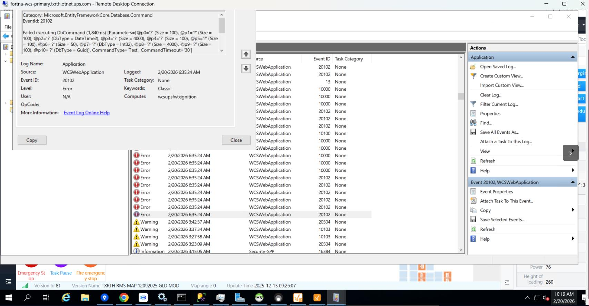
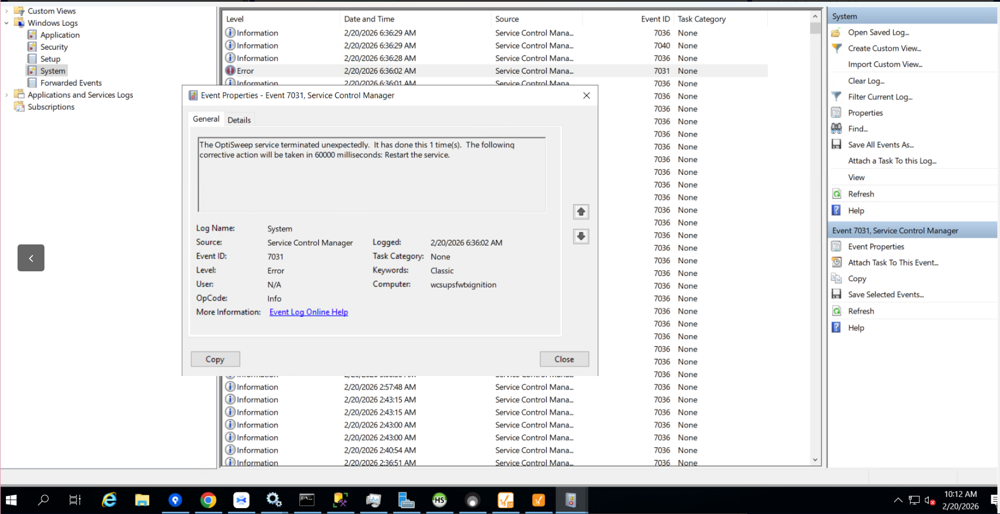
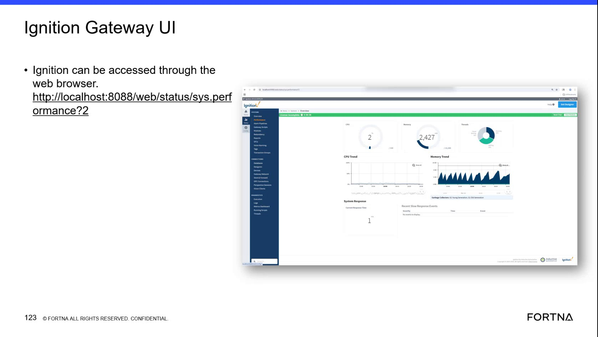
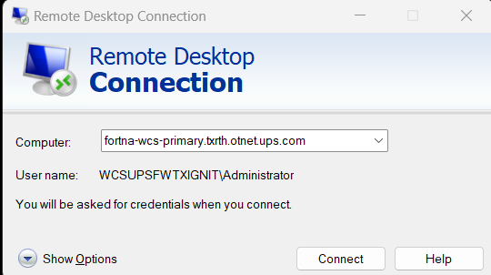
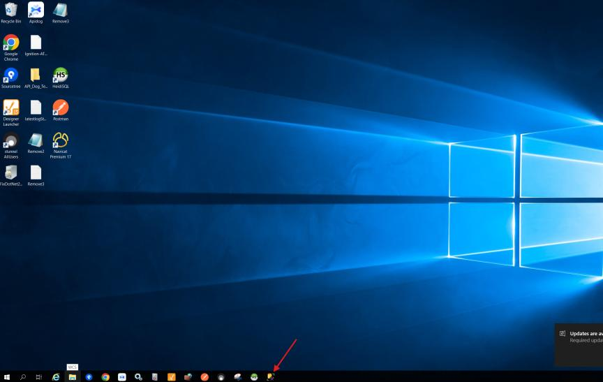
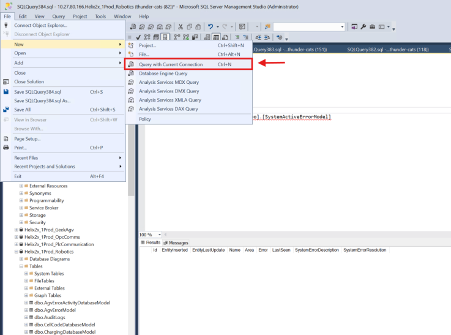
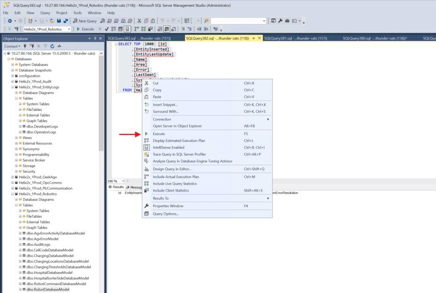
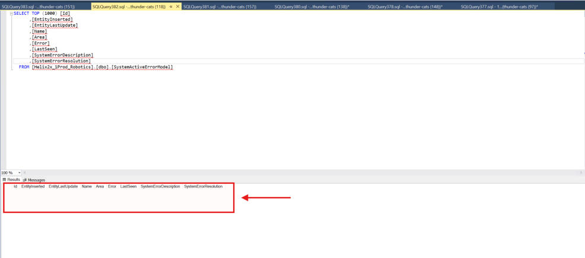
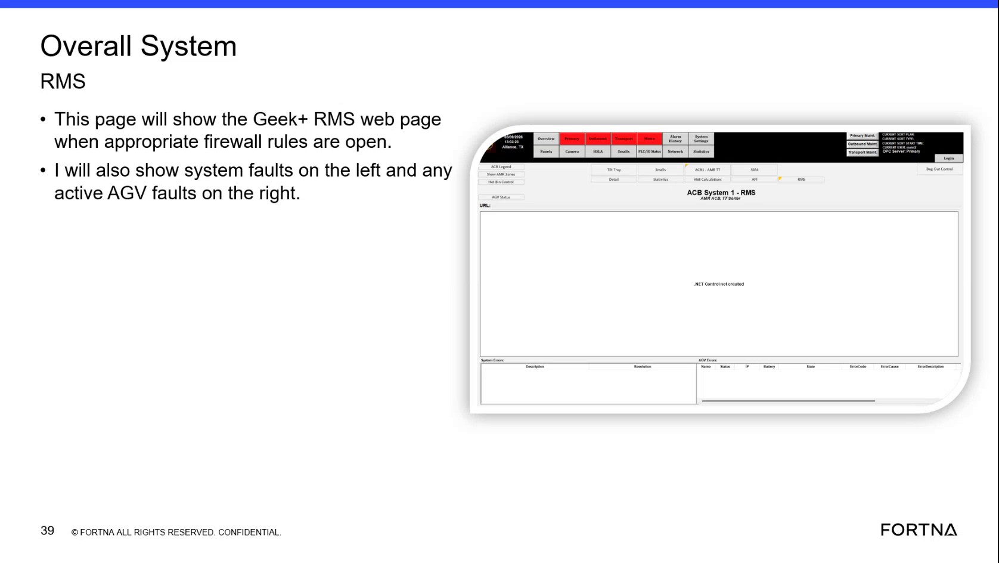
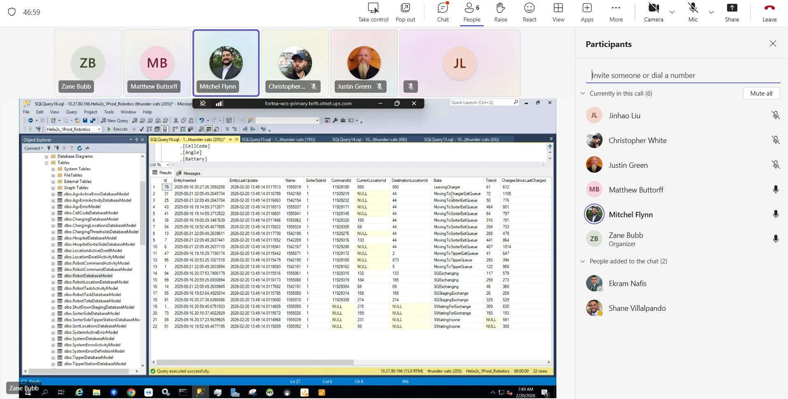

# Robotic system not responding with AGVs stopped or out of sync

## Playbook Header

| Field | Value |
| --- | --- |
| Playbook ID | `playbook_incident_228086_sitewide_robotic_stoppage` |
| Case ID | `228086` |
| Extraction Mode | `one_or_more_playbook_candidates_when_separable` |
| Confidence | `high` |
| Validation Status | `needs_sme_review` |

## Entry Symptoms

- Nothing is moving across the site or bots are stopped in multiple areas.
- The robotic system is reported as not responding.
- Small sort operation is not running.
- AGVs are reported out of sync or several AGVs stop after a heartbeat issue.
- Totes cannot be removed from the hospital workflow.
- RMS or HMI is mostly blank or displays an apparent ".NET Control not created." message.
- The site reports no obvious failed AGV even though automated movement has stopped.

## Affected Systems

- OptiSweep service
- AGVs and robotic system
- RMS / HMI
- WCSWebApplication
- Ignition gateway
- Windows Event Viewer / Service Control Manager
- OptiSweep / WCS API
- Hospital workflow
- Small sort workflow

## Nodes

### 1 — Confirm the stoppage pattern and abnormal control-system presentation (`diagnostic_decision`)

**Objective:** Determine whether the report represents a broad robotic-operation stoppage with an abnormal RMS or HMI presentation rather than an isolated AGV issue.

**Why this check is next:** The source reports a site-wide or multi-area motion stoppage, no obvious failed AGV, stopped small sort, hospital tote-removal difficulty, and abnormal RMS/HMI presentation.

**Action:**

Confirm whether the stoppage is broad (multi-area) and whether RMS/HMI presentation is blank or shows an abnormal/control-not-created message; otherwise switch to localized/alternate symptom triage.

**Suggested database check:**

- **Database:** robotics
  - **Model:** AgvActiveErrorDatabaseModel
  - **Inspect:** Name
  - **Inspect:** Error code
- **Database:** robotics
  - **Model:** SystemActiveErrorModel
  - **Inspect:** Id
  - **Inspect:** EntityInserted
  - **Inspect:** EntityLastUpdate
- **Database:** robotics
  - **Model:** SystemDatabaseModel
  - **Inspect:** Id
  - **Inspect:** EntityInserted
  - **Inspect:** EntityLastUpdate

**Healthy:** Site confirms movement continues normally or impact is limited to a single asset/local area, and RMS/HMI shows a populated normal status view for the overall fleet (localized impact only).

**Unhealthy:** Nothing is moving across multiple areas; small sort is stopped and/or hospital totes cannot be removed; RMS/HMI is mostly blank or displays an abnormal/control-not-created style presentation that matches a system-level stoppage pattern.

**Inconclusive:** Only one robot/local area appears affected, or the RMS message cannot be read/its meaning is uncertain, or the site cannot reliably confirm whether the issue is still active.

**Expects capability:** n/a
**Expects surface:** n/a
**Preferred audience:** operator, L1_support

**Runbook Links:**

- No linked procedure; escalate if the required state cannot be confirmed using the available approved evidence sources.

**Source Evidence:**

- Reports state that 4-6 bots were not moving, totes could not be removed from hospital, and the site reported nothing was moving.
- RMS page appears mostly blank and shows '.NET Control not created.'
- Work order states that the robotic system was not responding and the small sort was not running.

**Branches:**

- `unhealthy` → `node_2` when Broad stoppage with abnormal/blank RMS/HMI presentation confirmed
- `healthy` → `` when Impact localized or abnormal RMS/HMI pattern not confirmed
- `inconclusive` → `node_8` when Inconclusive scope or RMS message meaning

**Linked Runbook Procedures:**

*No linked runbook content available.*

---

### 2 — Determine whether a named service or application failure correlates with the stoppage (`diagnostic_decision`)

**Objective:** Use the available Windows log evidence to determine whether OptiSweep or WCSWebApplication entered an abnormal state near the onset of the operational stoppage.

**Why this check is next:** The source contains Event Viewer evidence of OptiSweep termination, clustered WCSWebApplication errors, a failed database command, and a later OptiSweep Running state.

**Action:**

Inspect Windows Event Viewer and Windows Services evidence to determine whether OptiSweep termination or clustered WCSWebApplication/Application Error events correlate with the stoppage onset.

**Healthy:** No relevant OptiSweep termination or correlated clustered WCSWebApplication/Application Error evidence near symptom onset; or only current Running state without abnormal correlation (prompt alternate investigation).

**Unhealthy:** OptiSweep unexpectedly terminated/restarted and/or WCSWebApplication clustered errors/failures are present near the stoppage onset timestamps, supporting a correlated service/application investigation path.

**Inconclusive:** Logs unavailable, timestamps cannot be correlated, or event details are incomplete/unreadable; only a current Running state is available without historical timing.

**Expects capability:** n/a
**Expects surface:** n/a
**Preferred audience:** L1_support, L2_support

**Runbook Links:**

- `proc_windows_event_viewer_services_optisweep_wcswebapplication_diagnostic_v1` (low, support, score=0.8936, boosted=1.0) — Windows Event Viewer and Services diagnostic for OptiSweep and WCSWebApplication failures
  - gaps: Missing corroboration for `wcs_system_faults`: no linked runbook covers this capability; prefer catalog peers with matching capability_tags / expects_surface.

**Evidence Collection Procedures:**

- `proc_windows_event_viewer_services_optisweep_wcswebapplication_diagnostic_v1` — Windows Event Viewer and Services diagnostic for OptiSweep and WCSWebApplication failures (L2_support): Use Windows Event Viewer / services to inspect the live Windows Application and System logs, then verify the current OptiSweep service state. Correlate WCSWebApplication database-command errors around 6:35-6:36 AM with OptiSweep Service Control Manager Event 7031 and the current Windows Services status before further recovery.

**Source Evidence:**

- Event 7031 states that the OptiSweep service terminated unexpectedly and that Windows planned a restart.
- WCSWebApplication Event 20102 reports a failed database command.
- Application log shows clustered WCSWebApplication and Application Error entries around 6:36 AM.

**Branches:**

- `unhealthy` → `node_3` when OptiSweep termination or correlated WCSWebApplication/Application Error evidence is present
- `healthy` → `node_8` when No relevant correlated service/application failure found

**Linked Runbook Procedures:**

<strong>Support runbooks</strong> (1)

Windows Event Viewer and Services diagnostic for OptiSweep and WCSWebApplication failures (`proc_windows_event_viewer_services_optisweep_wcswebapplication_diagnostic_v1`)

##### Runbook: Windows Event Viewer and Services diagnostic for OptiSweep and WCSWebApplication failures

- **Procedure ID:** `proc_windows_event_viewer_services_optisweep_wcswebapplication_diagnostic_v1`
- **Procedure Type:** `diagnostic`
- **Role:** `L2_support`
- **Audience:** `support`
- **Merge Status:** `pass_through`

**Summary:**
Use Windows Event Viewer / services to inspect the live Windows Application and System logs, then verify the current OptiSweep service state. Correlate WCSWebApplication database-command errors around 6:35-6:36 AM with OptiSweep Service Control Manager Event 7031 and the current Windows Services status before further recovery.

**When To Use:**
Use Windows Event Viewer / services when the live OptiSweep or WCS-backed system is unresponsive, when clustered WCSWebApplication errors are suspected, or when a service crash or restart must be correlated with the incident. Inspect the live Windows Application and System logs and current Windows Services state before performing further recovery.

**Safety Notes:**

- This is an inspection and diagnostic procedure; do not infer root cause from clustered errors.
- Automatic restart configuration records an intended Windows action, not confirmed service recovery.
- Do not perform further recovery based only on the historical service-state screenshot.

- **Source:** `incident_case` / `source_case_228086`

**Procedure Steps:**

###### Step 1 — Inspect the Windows Event Viewer Application log

**Responsible role:** L2_support

**Instruction:**
In Windows Event Viewer / services, open Windows Logs > Application and inspect entries around 2/20/2026 6:35:24-6:36:07 AM. Open the WCSWebApplication error details, including Event ID 20102, and check nearby Application Error or Windows Error Reporting entries.

**Healthy condition:**
No new or repeated WCSWebApplication or related application errors appear in the current inspection window.

**Expected result:**
The Application log shows whether WCSWebApplication Event ID 20102 with 'Failed executing DbCommand (1,840ms)' and nearby clustered application errors are present in the inspected time window.

**Step Images:**

*Windows Event Viewer Application log showing Windows Error Reporting Event 1001 and clustered WCSWebApplication and Application Error entries around 6:36 AM.*

*Windows Event Viewer Application log showing WCSWebApplication Event ID 20102 and the 'Failed executing DbCommand (1,840ms)' message.*

---

###### Step 2 — Inspect the OptiSweep termination event

**Responsible role:** L2_support

**Instruction:**
In Windows Event Viewer / services, select Windows Logs > System and open the Service Control Manager event for OptiSweep. Check for Event ID 7031, Level Error, and inspect whether the message states that OptiSweep terminated unexpectedly and Windows planned to restart it after 60000 milliseconds.

**Healthy condition:**
No new or repeated OptiSweep Event ID 7031 termination is present in the current System log inspection.

**Expected result:**
The System log identifies whether an OptiSweep Event ID 7031 termination is present and whether the event contains the 60000-millisecond restart message.

**Step Images:**

*Windows Event Viewer System log showing OptiSweep Service Control Manager Event 7031, unexpected termination, and the planned 60000-millisecond restart.*

---

###### Step 3 — Verify the current OptiSweep service state

**Responsible role:** L2_support

**Instruction:**
In Windows Event Viewer / services, open Windows Services, select OptiSweep, and inspect the current Status and Startup Type.

**Healthy condition:**
OptiSweep is currently shown as Running and its Startup Type is shown as Automatic.

**Expected result:**
Windows Services displays the current OptiSweep Status and Startup Type, allowing the live service state to be compared with the Event Viewer evidence.

**Step Images:**

*Windows Services showing OptiSweep selected with Status Running and Startup Type Automatic.*

---

###### Step 4 — Correlate Windows Event Viewer / services evidence with the live incident state

**Responsible role:** L2_support

**Instruction:**
Compare the timestamps and live entries in Windows Event Viewer / services with the current incident state and the current OptiSweep status in Windows Services. Do not treat the configured automatic restart as proof that recovery completed.

**Healthy condition:**
The current Windows Services state is Running and the current Event Viewer inspection shows no new or repeated relevant errors.

**Expected result:**
The diagnostic conclusion separately identifies the observed WCSWebApplication errors, any OptiSweep Event 7031 termination, and the current OptiSweep service state.

---

**Success Criteria:**

- Windows Event Viewer / services inspection identifies whether current Application log evidence includes WCSWebApplication Event ID 20102 or clustered related errors.
- Windows Event Viewer / services inspection identifies whether an OptiSweep Event ID 7031 termination is present and whether a 60000-millisecond restart was configured.
- Windows Services shows the current OptiSweep Status and Startup Type.
- The diagnostic conclusion does not claim recovery or root cause without live supporting evidence.

**Failure Conditions:**

- WCSWebApplication Event ID 20102 or clustered application errors are present or repeating in the current inspection.
- OptiSweep Event ID 7031 is present or repeating in the current System log inspection.
- OptiSweep is not shown as Running in Windows Services.
- The available evidence only shows a configured restart and does not establish that recovery completed.
- The evidence is insufficient to establish a definitive root cause.

---

### 3 — Check whether Ignition gateway health is abnormal or merely a related observation (`diagnostic_decision`)

**Objective:** Determine whether the Ignition gateway shows a current responsiveness problem or whether the memory observation is only follow-up context.

**Why this check is next:** The source includes requests to determine whether Ignition crashed, memory trend charts, an Ignition Systems Overview showing 11 ms response and no recent slow-response events, and a note that memory did not indicate it caused a crash.

**Action:**

Check whether the Ignition gateway shows current responsiveness/health abnormalities versus treating the memory observation as follow-up context.

**Healthy:** Ignition Systems Overview responds with current response time; no recent slow-response events displayed; resource trend not visibly abnormal or described as improving below reference.

**Unhealthy:** Ignition gateway cannot be reached or does not respond; recent slow-response activity/health indicators are clearly abnormal and correlated with stoppage timing.

**Inconclusive:** Memory/trend changes are sharp but unlabeled thresholds/causal rules absent; snapshot is stale/unclear; or gateway state cannot be verified (e.g., after recovery it appears normal but historical evidence is missing).

**Expects capability:** n/a
**Expects surface:** n/a
**Preferred audience:** L1_support, L2_support

**Runbook Links:**

- `proc_check_ignition_gateway_sys_perf_localhost_v1` (medium, support, score=0.6487, boosted=0.7887) — Check Ignition Gateway system performance status via localhost sys.perf page
  - gaps: Limited domain-term overlap between placeholder and runbook.; Placeholder wording differs materially from matched runbook title.

**Evidence Collection Procedures:**

- `proc_check_ignition_gateway_sys_perf_localhost_v1` — Check Ignition Gateway system performance status via localhost sys.perf page (L2_support): Use the Ignition Gateway web UI on the host to open the system performance status page at http://localhost:8088/web/status/sys.perf. Confirm the page loads and that system performance/health indicators are visible (not a connection/refused/unreachable error).

**Source Evidence:**

- Support stated that the memory trend did not indicate that memory caused a crash and suggested checking CPU trend.
- Ignition Systems Overview shows current response time 11 ms and no recent slow-response events.
- Memory trend remains below a higher visible reference line without an obvious threshold crossing.

**Branches:**

- `unhealthy` → `node_4` when Ignition is unavailable or shows correlated abnormal gateway state
- `healthy` → `node_4` when Ignition responds and no correlated gateway failure indicated

**Linked Runbook Procedures:**

<strong>Support runbooks</strong> (1)

Check Ignition Gateway system performance status via localhost sys.perf page (`proc_check_ignition_gateway_sys_perf_localhost_v1`)

##### Runbook: Check Ignition Gateway system performance status via localhost sys.perf page

- **Procedure ID:** `proc_check_ignition_gateway_sys_perf_localhost_v1`
- **Procedure Type:** `diagnostic`
- **Role:** `L2_support`
- **Audience:** `support`
- **Merge Status:** `pass_through`

**Summary:**
Use the Ignition Gateway web UI on the host to open the system performance status page at http://localhost:8088/web/status/sys.perf. Confirm the page loads and that system performance/health indicators are visible (not a connection/refused/unreachable error).

**When To Use:**
When Ignition Gateway reachability or performance is suspected on the Ignition Gateway host, and you need a quick local check that the /web/status/sys.perf page is reachable and shows performance/health indicators.

- **Source:** `training_video` / `training_video_day2`

**Procedure Steps:**

###### Step 1 — Open the Ignition Gateway sys.perf status page on localhost

**Responsible role:** L2_support

**Instruction:**
On the Ignition Gateway host, open a web browser and navigate to http://localhost:8088/web/status/sys.perf.

**Healthy condition:**
The sys.perf page loads with visible page content rather than an unreachable/error state.

**Expected result:**
The browser successfully loads the Ignition Gateway system performance status page at /web/status/sys.perf (page content visible; not a connection/refused/unreachable error).

**Step Images:**

*Frame showing Ignition Gateway UI accessed via browser at http://localhost:8088/web/status/sys.perf (sys.perf path visible).*

---

###### Step 2 — Verify sys.perf performance/health indicators are visible

**Responsible role:** L2_support

**Instruction:**
On the loaded /web/status/sys.perf page, observe the system performance status indicators/readouts shown on the page.

**Healthy condition:**
Performance/health indicators/readouts are visible on the sys.perf page.

**Expected result:**
System performance/health information is displayed on the sys.perf page (not blank and not replaced by an error/unavailable state).

---

**Success Criteria:**

- http://localhost:8088/web/status/sys.perf loads successfully in a browser
- The sys.perf page displays system performance/health indicators (no connection/refused/unreachable error)

**Failure Conditions:**

- sys.perf page does not load due to unreachable/error state (e.g., connection refused/unreachable)
- sys.perf page loads but performance indicators show degraded/unacceptable status

---

### 4 — Perform authorized recovery of the affected gateway or OptiSweep service (`procedure_reference`)

**Objective:** Use the approved role-specific recovery procedure for the service or gateway identified by the diagnostic evidence.

**Why this check is next:** The source shows an Ignition gateway restart in progress, reports that OptiSweep was reset, and later shows OptiSweep Running. Exact commands and procedures are intentionally not reproduced.

**Action:**

Execute authorized recovery for the affected gateway or OptiSweep service identified by the diagnostic evidence.

**Healthy:** Authorized recovery completes without immediate repeat failure; gateway/service becomes available for subsequent validation.

**Unhealthy:** Recovery cannot be completed; OptiSweep terminates again or gateway remains unavailable; safety/role preconditions not met.

**Inconclusive:** Evidence shows restart/recovery in progress only; or service appears Running but timing relative to recovery completion cannot be confirmed.

**Procedure Reference:**

- **Trigger condition:** An authorized L1/L2/L3 support role records that the selected recovery action has completed or is still in progress. Progress is indicated by the gateway returning from restart or the OptiSweep service becoming available; failure is indicated by an unsuccessful restart, repeated termination, or continued lack of response; inconclusive means completion cannot be verified.
- **Selected procedure:** Ignition gateway restart and OptiSweep / WCS API response validation (`proc_ignition_gateway_restart_and_optisweep_response_validation_v1`)
- **Selection rationale:** Retrieval realigned to fleet/status-check runbook; prior link penalized for intent mismatch.
- **Success confirmation:** The Ignition gateway Systems Overview responds after the restart.
- **Failure boundary:** Ignition gateway Systems Overview does not respond after the restart.

**Prerequisites:**

- The site is in the physical E-stop state before the restart sequence begins.
- The physical E-stop remains active until API responsiveness is confirmed.
- L2 support access to the Ignition gateway, Windows Event Viewer / services, and Apidog / WCS API.
- A site operator available at the physical floor / grid to place and release the physical E-stop.

**Safety checks:**

- The site operator must place the system in the physical E-stop state before the restart sequence.
- Keep the physical E-stop active during recovery.
- Do not release the physical E-stop until the OptiSweep / WCS API response is confirmed.
- Support must not perform or remotely release the physical E-stop.

**Expects capability:** n/a
**Expects surface:** n/a
**Preferred audience:** L2_support, L3_support

**Runbook Links:**

- `proc_ignition_gateway_restart_and_optisweep_response_validation_v1` (medium, support, score=0.5738, boosted=0.7738) — Ignition gateway restart and OptiSweep / WCS API response validation
  - gaps: Limited domain-term overlap between placeholder and runbook.

**Evidence Collection Procedures:**

- `proc_ignition_gateway_restart_and_optisweep_response_validation_v1` — Ignition gateway restart and OptiSweep / WCS API response validation (L2_support): Use the Ignition gateway, Windows Event Viewer / services, and Apidog / WCS API surfaces to restart the Ignition gateway, verify the GetAgvStatuses response, and restart OptiSweep only if the API does not respond. The site operator must place and release the physical E-stop; support must not release it until the API response is confirmed.

**Source Evidence:**

- Ignition gateway restart was initiated and the console showed waiting for gateway restart.
- Case comments state that OptiSweep was reset before RMS follow-up.

**Decision Outcomes:**

- `healthy` (observer=remote; tool=Gateway/Service availability indicators (procedure-defined) + service state confirmation): Authorized recovery completed; gateway/service available for follow-up checks.
- `unhealthy` (observer=remote; tool=Gateway/Service availability indicators (procedure-defined) + service state confirmation): Recovery fails or repeats termination/unavailability.
- `inconclusive` (observer=remote; tool=Gateway/Service availability indicators (procedure-defined) + service state confirmation): Recovery completion cannot be verified yet.
- `escalate` (observer=remote; tool=procedure evidence + access control): Do not proceed if unauthorized or safety preconditions not met.

**Branches:**

- `healthy` → `node_5` when Authorized service or gateway recovery completed
- `unhealthy` → `node_8` when Recovery fails/repeats/cannot be performed within role and safety limits

**Linked Runbook Procedures:**

<strong>Support runbooks</strong> (1)

Ignition gateway restart and OptiSweep / WCS API response validation (`proc_ignition_gateway_restart_and_optisweep_response_validation_v1`)

##### Runbook: Ignition gateway restart and OptiSweep / WCS API response validation

- **Procedure ID:** `proc_ignition_gateway_restart_and_optisweep_response_validation_v1`
- **Procedure Type:** `recovery`
- **Role:** `L2_support`
- **Audience:** `support`
- **Merge Status:** `pass_through`

**Summary:**
Use the Ignition gateway, Windows Event Viewer / services, and Apidog / WCS API surfaces to restart the Ignition gateway, verify the GetAgvStatuses response, and restart OptiSweep only if the API does not respond. The site operator must place and release the physical E-stop; support must not release it until the API response is confirmed.

**When To Use:**
Use when the Ignition gateway or OptiSweep / WCS API is not responding and the site is held in the physical E-stop state pending recovery validation. Perform the Ignition gateway restart, verify the Ignition gateway, then validate OptiSweep through the GetAgvStatuses request before returning the system to operation.

**Safety Notes:**

- The site operator must place the system in the physical E-stop state before the restart sequence.
- Keep the physical E-stop active during recovery.
- Do not release the physical E-stop until the OptiSweep / WCS API response is confirmed.
- Support must not perform or remotely release the physical E-stop.

- **Source:** `incident_case` / `source_case_228086`

**Procedure Steps:**

###### Step 1 — Place the system in the physical E-stop state

**Responsible role:** operator

**Instruction:**
On the physical floor / grid, have the site operator place the system in the physical E-stop state and keep it active throughout recovery.

**Healthy condition:**
The site confirms that the physical E-stop is engaged before L2 support begins the restart sequence.

**Expected result:**
The physical E-stop is active and remains active while the Ignition gateway and OptiSweep / WCS API are restarted or checked.

---

###### Step 2 — Restart the Ignition gateway

**Responsible role:** L2_support

**Instruction:**
On the Windows Event Viewer / services surface, open a Windows Administrator Command Prompt, navigate to the Inductive Automation Ignition installation directory, run `gwcmd -r`, and wait for the console to show `Waiting for Gateway restart...`.

**Healthy condition:**
The restart command is accepted and the console enters the gateway-restart waiting state.

**Expected result:**
The Windows Administrator Command Prompt shows `gwcmd -r` executed from the Ignition directory and displays `Waiting for Gateway restart...`.

**Step Images:**

*Windows Administrator Command Prompt showing the Ignition directory, `gwcmd -r`, and `Waiting for Gateway restart...`.*

---

###### Step 3 — Verify the Ignition gateway Systems Overview

**Responsible role:** L2_support

**Instruction:**
On the Ignition gateway, open Status > Systems > Overview and check that the page responds, including Current Response Time and Recent Slow Response Events.

**Healthy condition:**
The Systems Overview page loads with a current response-time value and no recent slow response events displayed.

**Expected result:**
The Ignition gateway Systems Overview responds and displays a Current Response Time; the incident evidence showed 11 ms and `No events to display` under Recent Slow Response Events.

**Step Images:**

*Ignition gateway Status > Systems > Overview showing Current Response Time and Recent Slow Response Events.*

---

###### Step 4 — Validate OptiSweep / WCS API responsiveness

**Responsible role:** L2_support

**Instruction:**
On the Apidog / WCS API surface, send the `GetAgvStatuses` request and inspect the response for HTTP Success / Status 200 and returned AGV records, including visible status values such as `NORMAL`.

**Healthy condition:**
The API client displays a successful 200 response containing AGV status records.

**Expected result:**
The GetAgvStatuses request returns HTTP 200 with AGV records; the incident response showed visible `NORMAL` status values.

**Step Images:**

*Apidog / WCS API GetAgvStatuses response showing HTTP 200, AGV records, visible NORMAL values, and the response-schema warning.*

---

###### Step 5 — Restart OptiSweep only if GetAgvStatuses does not respond

**Responsible role:** L2_support

**Instruction:**
If GetAgvStatuses does not respond, open Windows Event Viewer / services, select OptiSweep, use the visible `Restart the service` control, then return to Apidog / WCS API and send GetAgvStatuses again.

**Healthy condition:**
The API responds after the conditional service restart and OptiSweep is shown as Running in Windows Event Viewer / services.

**Expected result:**
After the documented OptiSweep service restart, GetAgvStatuses returns a response with AGV records; Windows Event Viewer / services shows OptiSweep in a Running state when inspected.

**Step Images:**

*Windows Event Viewer / services surface showing OptiSweep selected with status Running and the Restart the service control visible.*

---

###### Step 6 — Release the physical E-stop and confirm auto bag-out

**Responsible role:** operator

**Instruction:**
After the GetAgvStatuses response is confirmed, have the site operator release the physical E-stop on the physical floor / grid and confirm that the site can resume the auto bag-out operation.

**Healthy condition:**
The physical E-stop is released by the site operator after API confirmation and the site resumes auto bag-out.

**Expected result:**
The site operator releases the physical E-stop and confirms that auto bag-out can resume.

---

**Success Criteria:**

- The Ignition gateway Systems Overview responds after the restart.
- The Systems Overview displays a current response-time value; the incident evidence showed 11 ms and no recent slow response events.
- GetAgvStatuses returns HTTP 200 with AGV records and visible status values such as NORMAL.
- If the initial API check is nonresponsive, OptiSweep is restarted through Windows Event Viewer / services and the repeated GetAgvStatuses request responds.
- The site operator releases the physical E-stop only after API confirmation and confirms that auto bag-out can resume.

**Failure Conditions:**

- Ignition gateway Systems Overview does not respond after the restart.
- GetAgvStatuses does not return a response.
- OptiSweep does not show Running after the documented restart attempt.
- The API returns a response-schema warning: `Response data differs from endpoint spec` and `$ should be object`.
- The physical E-stop cannot be safely released or the site cannot resume auto bag-out.

---

### 5 — Determine whether residual AGV state requires correction after service recovery (`diagnostic_decision`)

**Objective:** Identify whether AGVs remain out of sync, unmapped, or otherwise abnormal after the service or gateway recovery.

**Why this check is next:** After the OptiSweep reset, the source says RMS was used to locate and fix out-of-sync AGVs one by one. The packet also includes RMS map and SSMS state evidence.

**Action:**

Determine whether residual AGV synchronization/state issues remain after service/gateway recovery.

**Suggested database check:**

- **Database:** robotics
  - **Model:** AgvActiveErrorDatabaseModel
  - **Inspect:** Name
  - **Inspect:** Error code
- **Database:** robotics
  - **Model:** SystemActiveErrorModel
  - **Inspect:** Id
  - **Inspect:** EntityInserted
  - **Inspect:** EntityLastUpdate
- **Database:** robotics
  - **Model:** RobotDatabaseModel
  - **Inspect:** State
  - **Inspect:** CurrentLocationId
  - **Inspect:** DestinationLocationId
  - **Relate by:** robot_id, location_id
  - **Freshness:** EntityLastUpdate

**Healthy:** RMS shows expected fleet state; no residual out-of-sync indicators; AGV state/locations consistent with restored operation.

**Unhealthy:** One or more AGVs remain out of sync or in an abnormal state after recovery; RMS roster/map/state inconsistent with expected operation; assets still appear stopped due to residual sync issues.

**Inconclusive:** RMS is unavailable/blank, displayed state is readable but operational meaning is not established, or only a single AGV snapshot without fleet-wide confirmation.

**Expects capability:** n/a
**Expects surface:** n/a
**Preferred audience:** operator, L2_support

**Runbook Links:**

- `proc_query_active_agv_errors_from_the_wcs_database_v1` (low, support, score=0.8245, boosted=1.0) — Query Active AGV Errors From the WCS Database
  - gaps: Missing corroboration for `device_roster_state`: roster/mapping abnormality — check RMS map monitor / robot roster (optionally WCS robot-location models for L2).; Missing corroboration for `fleet_system_status`: fleet/system-down status — check Overall System RMS / AGV status (optionally WCS system-state models for L2).; Limited domain-term overlap between placeholder and runbook.; Placeholder wording differs materially from matched runbook title.
- `proc_check_geek_rms_overall_system_faults_vs_agv_faults_v1` (low, support, score=0.6797, boosted=1.1430333333333333) — Check Geek+ RMS overall page for system faults vs AGV system faults (and handle blank RMS due to firewall)
  - gaps: Missing corroboration for `agv_active_errors`: AGV active errors — check RMS active AGV faults and/or WCS/SSMS SystemActiveErrorModel (L2).; Missing corroboration for `device_roster_state`: roster/mapping abnormality — check RMS map monitor / robot roster (optionally WCS robot-location models for L2).; Limited domain-term overlap between placeholder and runbook.; Placeholder wording differs materially from matched runbook title.

**Evidence Collection Procedures:**

- `proc_query_active_agv_errors_from_the_wcs_database_v1` — Query Active AGV Errors From the WCS Database (L2_support): Retrieve current active AGV error records from the WCS database by logging into the WCS primary server, opening the WCS database, creating a new query tab, entering the documented SQL query against [Helix2x_1Prod_Robotics].[dbo].[SystemActiveErrorModel], executing it, and reviewing the returned results.
- `proc_check_geek_rms_overall_system_faults_vs_agv_faults_v1` — Check Geek+ RMS overall page for system faults vs AGV system faults (and handle blank RMS due to firewall) (L1_support): Use the Geek+ RMS / fleet status web UI to confirm the overall page is reachable and that it correctly separates fault categories: “system faults” on the left and “AGV system faults” on the right. If the RMS page is blank, treat it as a reachability/firewall symptom. Use the left/right placement to interpret whether the issue is communication loss vs an AGV that was commanded to move but is not in progress.

**Source Evidence:**

- After resetting OptiSweep, RMS was used to locate and fix AGVs that were out of sync.
- RMS Map Monitor shows a selected robot with displayed path and confirmation state.
- SSMS artifact shows multiple robotics-related AGV state values.

**Branches:**

- `unhealthy` → `node_6` when Residual AGV synchronization or state abnormality is indicated
- `healthy` → `node_7` when Fleet state appears normal or no residual synchronization issue is indicated

**Linked Runbook Procedures:**

<strong>Support runbooks</strong> (2)

Query Active AGV Errors From the WCS Database (`proc_query_active_agv_errors_from_the_wcs_database_v1`)

##### Runbook: Query Active AGV Errors From the WCS Database

- **Procedure ID:** `proc_query_active_agv_errors_from_the_wcs_database_v1`
- **Procedure Type:** `diagnostic`
- **Role:** `L2_support`
- **Audience:** `support`
- **Merge Status:** `pass_through`

**Summary:**
Retrieve current active AGV error records from the WCS database by logging into the WCS primary server, opening the WCS database, creating a new query tab, entering the documented SQL query against [Helix2x_1Prod_Robotics].[dbo].[SystemActiveErrorModel], executing it, and reviewing the returned results.

**When To Use:**
Use this procedure when active AGV error records need to be retrieved from the WCS database for investigation or visibility.

**Safety Notes:**

- This is a source-backed diagnostic retrieval procedure.
- The source does not provide corrective actions for returned errors; use the output for investigation only.

- **Source:** `manual` / `active_agv_error_query_1`

**Procedure Steps:**

###### Step 1 — Log into the WCS primary server

**Responsible role:** L2_support

**Instruction:**
Log into the WCS primary server.

**Healthy condition:**
The WCS primary server is accessible and the session is opened successfully.

**Expected result:**
You are logged into the WCS primary server and can continue to the database access step.

**Step Images:**

*Initial server access or login entry point associated with the first procedure step.*

*Initial server access or login entry point associated with the first procedure step.*

---

###### Step 2 — Open the WCS database

**Responsible role:** L2_support

**Instruction:**
Open the WCS database.

**Healthy condition:**
The WCS database opens successfully and the query interface can be accessed.

**Expected result:**
The WCS database is open and ready for query entry.

**Step Images:**

*Database access point or initial database selection area after server login.*

*Database access point or initial database selection area after server login.*

---

###### Step 3 — Open a new query tab

**Responsible role:** L2_support

**Instruction:**
Open a new query tab by clicking the indicated control.

**Healthy condition:**
The new query tab appears in the database interface.

**Expected result:**
A new query tab opens and is ready for SQL entry.

**Step Images:**

*UI control used to open a new query tab and where the new tab appears.*

*UI control used to open a new query tab and where the new tab appears.*

---

###### Step 4 — Paste the documented SQL query into the new tab

**Responsible role:** L2_support

**Instruction:**
Copy and paste the provided SQL query into the newly opened query tab.

**Healthy condition:**
The full SQL query is visible in the new query tab.

**Expected result:**
The query editor contains the documented SQL statement.

**Step Images:**

*Query editor area where the SQL statement should be entered.*

*Query editor area where the SQL statement should be entered.*

---

###### Step 5 — Use the documented active AGV error query text

**Responsible role:** L2_support

**Instruction:**
Use the provided query text exactly as documented: SELECT TOP (1000) [Id], [EntityInserted], [EntityLastUpdate], [Name], [Area], [Error], [LastSeen], [SystemErrorDescription], [SystemErrorResolution] FROM [Helix2x_1Prod_Robotics].[dbo].[SystemActiveErrorModel].

**Healthy condition:**
The query includes Id, EntityInserted, EntityLastUpdate, Name, Area, Error, LastSeen, SystemErrorDescription, and SystemErrorResolution from [Helix2x_1Prod_Robotics].[dbo].[SystemActiveErrorModel].

**Expected result:**
The query text references the documented fields and the [Helix2x_1Prod_Robotics].[dbo].[SystemActiveErrorModel] table.

**Step Images:**

*Query editor area containing the pasted SQL statement.*

*Query editor area containing the pasted SQL statement.*

---

###### Step 6 — Execute the query

**Responsible role:** L2_support

**Instruction:**
Right click on the query and click execute.

**Healthy condition:**
The query executes without blocking the results display.

**Expected result:**
The query runs and the interface proceeds to display returned results.

**Step Images:**

*Query area where the execute action is initiated.*

*Query area where the execute action is initiated.*

---

###### Step 7 — Review the results area

**Responsible role:** L2_support

**Instruction:**
Review the results area where the active errors appear.

**Healthy condition:**
The results panel or table is visible and populated with active error records.

**Expected result:**
A results area displays the active AGV errors returned by the query.

**Step Images:**

*Results panel or table where active AGV errors are shown after execution.*

*Results panel or table where active AGV errors are shown after execution.*

---

###### Step 8 — Check the returned fields in the results

**Responsible role:** L2_support

**Instruction:**
Check the returned fields in the results, including Id, EntityInserted, EntityLastUpdate, Name, Area, Error, LastSeen, SystemErrorDescription, and SystemErrorResolution.

**Healthy condition:**
Returned records show Id, EntityInserted, EntityLastUpdate, Name, Area, Error, LastSeen, SystemErrorDescription, and SystemErrorResolution.

**Expected result:**
The results include the documented identifier, timestamp, area, error, description, and resolution fields.

**Step Images:**

*Returned results table and the displayed columns for active AGV errors.*

*Returned results table and the displayed columns for active AGV errors.*

---

**Success Criteria:**

- The WCS primary server is accessed successfully.
- The WCS database is opened successfully.
- A new query tab is opened.
- The documented SQL query against [Helix2x_1Prod_Robotics].[dbo].[SystemActiveErrorModel] is entered.
- The query executes successfully.
- The results area displays active AGV error records.
- Returned results include Id, EntityInserted, EntityLastUpdate, Name, Area, Error, LastSeen, SystemErrorDescription, and SystemErrorResolution.

**Failure Conditions:**

- Access to the WCS primary server is not available.
- Access to the WCS database is not available.
- A new query tab cannot be opened.
- The query cannot be executed.
- The results area does not display returned active errors.
- Expected fields are missing from the returned results.

Check Geek+ RMS overall page for system faults vs AGV system faults (and handle blank RMS due to firewall) (`proc_check_geek_rms_overall_system_faults_vs_agv_faults_v1`)

##### Runbook: Check Geek+ RMS overall page for system faults vs AGV system faults (and handle blank RMS due to firewall)

- **Procedure ID:** `proc_check_geek_rms_overall_system_faults_vs_agv_faults_v1`
- **Procedure Type:** `diagnostic`
- **Role:** `L1_support`
- **Audience:** `support`
- **Merge Status:** `pass_through`

**Summary:**
Use the Geek+ RMS / fleet status web UI to confirm the overall page is reachable and that it correctly separates fault categories: “system faults” on the left and “AGV system faults” on the right. If the RMS page is blank, treat it as a reachability/firewall symptom. Use the left/right placement to interpret whether the issue is communication loss vs an AGV that was commanded to move but is not in progress.

**When To Use:**
When you need to verify that the Geek+ RMS overall/fleet status page is reachable and that it is showing the expected fault panels (left system faults vs right AGV system faults), including the specific symptom where the page appears blank due to firewall not being open.

- **Source:** `training_video` / `training_video_day1`

**Procedure Steps:**

###### Step 1 — Open the Geek+ RMS / fleet status web UI (RMS overall page)

**Responsible role:** L1_support

**Instruction:**
Open the Geek+ RMS / fleet status web UI (RMS / fleet status UI).

**Healthy condition:**
The RMS overall page is visible and fault panels can be observed.

**Expected result:**
The RMS overall page loads (or you observe that it is blank).

---

###### Step 2 — Confirm the RMS page is not blank; if blank, treat as firewall/reachability symptom

**Responsible role:** L1_support

**Instruction:**
Check whether the RMS overall page shows content/fault panels. If it is blank, treat it as the firewall-not-open symptom described by the source.

**Healthy condition:**
Fault panels are visible (not blank).

**Expected result:**
Either (a) fault panels are visible, or (b) the page is blank consistent with firewall not being open.

---

###### Step 3 — Check left-side “system faults” panel

**Responsible role:** L1_support

**Instruction:**
On the RMS overall page, check the left side labeled area for “system faults”.

**Healthy condition:**
The left “system faults” panel is visible (fault rows/entries can be observed if present).

**Expected result:**
The left-side “system faults” area is visible and can be reviewed for any listed faults.

---

###### Step 4 — Check right-side “AGV system faults” panel

**Responsible role:** L1_support

**Instruction:**
On the RMS overall page, check the right side labeled area for “AGV system faults” (active AGV faults).

**Healthy condition:**
The right “AGV system faults” panel is visible (fault rows/entries can be observed if present).

**Expected result:**
The right-side “AGV system faults” area is visible and can be reviewed for any listed faults.

**Step Images:**

*Overall System RMS page frame showing the expected layout: system faults on the left and active AGV system faults on the right; also includes the blank-page symptom when firewall is not open.*

---

###### Step 5 — Interpret left/right fault placement for communication loss vs commanded-but-not-in-progress movement

**Responsible role:** L1_support

**Instruction:**
Use the source mapping: if you lose communication with a chat, expect it on the left “system faults”; if you told an AGV to move but it hasn’t moved, expect it on the right “AGV system faults”.

**Healthy condition:**
Observed faults align with the expected left/right meaning (left = communication loss; right = commanded move not in progress).

**Expected result:**
You can map the observed fault placement to either communication-loss (left) or commanded-but-not-in-progress movement (right).

---

**Success Criteria:**

- RMS overall page is reachable and not blank (fault panels visible).
- Left “system faults” and right “AGV system faults” areas are observable on the RMS overall page.
- Observed fault placement can be interpreted as communication loss (left) vs commanded-but-not-in-progress movement (right) using the source mapping.

**Failure Conditions:**

- RMS remains blank (no visible system/AGV fault panels).
- Left/right fault separation is not observable or does not align with the expected meaning (left = communication loss; right = commanded move not in progress).

---

### 6 — Apply authorized correction for residual AGV synchronization or state issues (`procedure_reference`)

**Objective:** Perform the approved correction for AGVs identified as out of sync or otherwise abnormal, without treating the historical correction as a universal procedure.

**Why this check is next:** The source reports that RMS was used to locate and fix out-of-sync AGVs after the OptiSweep reset, but it does not provide a complete reusable procedure.

**Action:**

Apply authorized correction for residual AGV synchronization or state issues identified on RMS (without substituting physical recovery or unsafe actions).

**Healthy:** Corrected AGV presents expected state after authorized correction; fleet operation can proceed without immediate recurrence.

**Unhealthy:** AGV remains out of sync or returns to abnormal state; correction would require unsupported/unsafe action; multiple assets remain affected beyond supported correction scope.

**Inconclusive:** RMS does not refresh; resulting state cannot be observed; affected asset not clearly identified in the correction path.

**Procedure Reference:**

- **Trigger condition:** An authorized role records that the identified AGV state correction has completed. Progress is indicated by the affected AGV returning to an expected state and no longer blocking fleet operation; failure is indicated by persistent abnormal state or repeated loss of synchronization; inconclusive means the correction outcome cannot be observed.
- **Selected procedure:** Remove/Recover a specific AGV by robot ID using OptiSweep→Geek API requests (`proc_remove_recover_agv_by_robot_id_optisweep_geek_api_v1`)
- **Selection rationale:** Retrieval match (0.5659, boosted 0.7659).
- **Success confirmation:** RemoveAgv request is accepted/executed for the specified robot ID (observable success/acceptance in the API client response).
- **Failure boundary:** API client response indicates RemoveAgv failed/error.

**Prerequisites:**

- You have the target AGV's robot ID to use in the API request.
- Apidog / WCS API client access

**Safety checks:**

**Expects capability:** n/a
**Expects surface:** n/a
**Preferred audience:** L2_support, L3_support

**Runbook Links:**

- `proc_remove_recover_agv_by_robot_id_optisweep_geek_api_v1` (medium, support, score=0.5659, boosted=0.7659) — Remove/Recover a specific AGV by robot ID using OptiSweep→Geek API requests
  - gaps: Limited domain-term overlap between placeholder and runbook.; Placeholder wording differs materially from matched runbook title.
- `proc_wcs_helix_db_ssms_agv_state_inspection_v1` (medium, support, score=0.7436, boosted=0.7436) — WCS / Helix DB (SSMS) AGV state inspection

**Evidence Collection Procedures:**

- `proc_remove_recover_agv_by_robot_id_optisweep_geek_api_v1` — Remove/Recover a specific AGV by robot ID using OptiSweep→Geek API requests (L2_support): Use the OptiSweep / WCS API client to send a Geek request to remove a specified AGV from the system (RemoveAgv) or re-add it (RecoverAGV). Both API actions require the target robot ID.
- `proc_wcs_helix_db_ssms_agv_state_inspection_v1` — WCS / Helix DB (SSMS) AGV state inspection (L2_support): Use the WCS / Helix DB (SSMS) live read-only database surface to inspect robotics-related AGV state records when the RMS / fleet status UI reports AGVs out of sync or the robotic system is stopped. Compare the populated SSMS State results with the live RMS / fleet status UI; the listed state values do not independently establish a fault.

**Source Evidence:**

- RMS was used to locate and fix out-of-sync AGVs after the service reset.

**Decision Outcomes:**

- `healthy` (observer=site_or_remote; tool=RMS fleet/map UI): Authorized AGV state correction completed; RMS indicates expected state.
- `unhealthy` (observer=site_or_remote; tool=RMS fleet/map UI): Residual abnormal state persists or correction would be unsafe/unsupported.
- `inconclusive` (observer=site_or_remote; tool=RMS fleet/map UI): Correction outcome cannot be observed or asset identification unclear.
- `escalate` (observer=remote; tool=RMS fleet/map UI + role/access constraints): Stop because required correction mechanism cannot be supported safely.

**Branches:**

- `healthy` → `node_7` when Authorized AGV state correction completed
- `unhealthy` → `node_8` when AGV state remains abnormal or correction cannot be completed safely

**Linked Runbook Procedures:**

<strong>Support runbooks</strong> (2)

Remove/Recover a specific AGV by robot ID using OptiSweep→Geek API requests (`proc_remove_recover_agv_by_robot_id_optisweep_geek_api_v1`)

##### Runbook: Remove/Recover a specific AGV by robot ID using OptiSweep→Geek API requests

- **Procedure ID:** `proc_remove_recover_agv_by_robot_id_optisweep_geek_api_v1`
- **Procedure Type:** `operation`
- **Role:** `L2_support`
- **Audience:** `support`
- **Merge Status:** `pass_through`

**Summary:**
Use the OptiSweep / WCS API client to send a Geek request to remove a specified AGV from the system (RemoveAgv) or re-add it (RecoverAGV). Both API actions require the target robot ID.

**When To Use:**
When you need to remove a specific AGV from the system roster (RemoveAgv) or re-add it (RecoverAGV) by sending the correct OptiSweep→Geek API request using the required robot ID.

- **Source:** `training_video` / `training_video_day2`

**Procedure Steps:**

###### Step 1 — Identify the target AGV robot ID for the API request

**Responsible role:** L2_support

**Instruction:**
Obtain the target AGV's robot ID that you will enter into the OptiSweep / WCS API request.

**Healthy condition:**
The robot ID you plan to use corresponds to the intended AGV you are trying to remove/recover.

**Expected result:**
You have a specific robot ID value ready to use for the RemoveAgv and RecoverAGV requests.

---

###### Step 2 — Select RemoveAgv in the OptiSweep / WCS API client and confirm it targets Geek removal by robot ID

**Responsible role:** L2_support

**Instruction:**
In the Apidog / WCS API client, select the API action named RemoveAgv and confirm it is described as requiring the robot ID and sending a request to Geek to remove the specified AGV from the system.

**Healthy condition:**
RemoveAgv is the selected action and its description matches: requires robot ID; sends request to Geek to remove the specified AGV from the system.

**Expected result:**
The RemoveAgv action is selected in the API client and is associated with the robot ID input requirement.

**Step Images:**

*API action definitions: RemoveAgv requires robot ID and sends a request to Geek to remove the specified AGV; RecoverAGV requires robot ID and sends a request to Geek to add the specified AGV.*

---

###### Step 3 — Submit RemoveAgv request with the target robot ID

**Responsible role:** L2_support

**Instruction:**
Submit the RemoveAgv request in the Apidog / WCS API client using the target robot ID you identified.

**Healthy condition:**
The API client response indicates the request was accepted/executed for RemoveAgv.

**Expected result:**
The RemoveAgv request is submitted and you receive an observable API client response indicating acceptance/execution (success or error).

---

###### Step 4 — Verify RemoveAgv request corresponds to intended action and response indicates acceptance/success

**Responsible role:** L2_support

**Instruction:**
Review the RemoveAgv request/response in the Apidog / WCS API client and verify the response indicates acceptance/execution (success vs error).

**Healthy condition:**
Response indicates the request was accepted/executed for RemoveAgv.

**Expected result:**
The API client response for RemoveAgv shows an observable success/acceptance indicator (or an error indicator if it failed).

---

###### Step 5 — Select RecoverAGV in the OptiSweep / WCS API client and confirm it targets Geek add by robot ID

**Responsible role:** L2_support

**Instruction:**
In the Apidog / WCS API client, select the API action named RecoverAGV and confirm it is described as requiring the robot ID and sending a request to Geek to add the specified AGV to the system.

**Healthy condition:**
RecoverAGV is the selected action and its description matches: requires robot ID; sends request to Geek to add the specified AGV to the system.

**Expected result:**
The RecoverAGV action is selected in the API client and is associated with the robot ID input requirement.

---

###### Step 6 — Submit RecoverAGV request with the same target robot ID

**Responsible role:** L2_support

**Instruction:**
Submit the RecoverAGV request in the Apidog / WCS API client using the same robot ID used for RemoveAgv.

**Healthy condition:**
The API client response indicates the request was accepted/executed for RecoverAGV.

**Expected result:**
The RecoverAGV request is submitted and you receive an observable API client response indicating acceptance/success (or error).

---

###### Step 7 — Verify RecoverAGV request corresponds to intended action and response indicates acceptance/success

**Responsible role:** L2_support

**Instruction:**
Review the RecoverAGV request/response in the Apidog / WCS API client and verify the response indicates acceptance/execution (success vs error).

**Healthy condition:**
Response indicates the request was accepted/executed for RecoverAGV.

**Expected result:**
The API client response for RecoverAGV shows an observable success/acceptance indicator (or an error indicator if it failed).

---

**Success Criteria:**

- RemoveAgv request is accepted/executed for the specified robot ID (observable success/acceptance in the API client response).
- RecoverAGV request is accepted/executed for the same robot ID (observable success/acceptance in the API client response).

**Failure Conditions:**

- API client response indicates RemoveAgv failed/error.
- API client response indicates RecoverAGV failed/error.
- Robot ID is incorrect or missing (request cannot target intended AGV).

WCS / Helix DB (SSMS) AGV state inspection (`proc_wcs_helix_db_ssms_agv_state_inspection_v1`)

##### Runbook: WCS / Helix DB (SSMS) AGV state inspection

- **Procedure ID:** `proc_wcs_helix_db_ssms_agv_state_inspection_v1`
- **Procedure Type:** `diagnostic`
- **Role:** `L2_support`
- **Audience:** `support`
- **Merge Status:** `pass_through`

**Summary:**
Use the WCS / Helix DB (SSMS) live read-only database surface to inspect robotics-related AGV state records when the RMS / fleet status UI reports AGVs out of sync or the robotic system is stopped. Compare the populated SSMS State results with the live RMS / fleet status UI; the listed state values do not independently establish a fault.

**When To Use:**
Use the live WCS / Helix DB (SSMS) surface to inspect AGV state records when the RMS / fleet status UI reports AGVs out of sync or the robotic system is stopped.

**Safety Notes:**

- This procedure is supported as a read-only diagnostic; do not modify database values.
- Do not treat the displayed AGV State values as proof of a fault by themselves.
- Escalate if the WCS / Helix DB (SSMS) connection or query execution fails, or if expected AGV results are unavailable.

- **Source:** `incident_case` / `source_case_228086`

**Procedure Steps:**

###### Step 1 — Open WCS / Helix DB (SSMS) and connect to the robotics-related database context

**Responsible role:** L2_support

**Instruction:**
Open WCS / Helix DB (SSMS) and connect to the robotics-related database context shown in the incident evidence. Do not substitute an undocumented database name or context.

**Healthy condition:**
The WCS / Helix DB (SSMS) connection is active and the robotics-related database context is available for the diagnostic query.

**Expected result:**
WCS / Helix DB (SSMS) shows an active connection to the robotics-related database context and is ready to execute the source-provided AGV state check.

---

###### Step 2 — Run the source-provided AGV state check in WCS / Helix DB (SSMS)

**Responsible role:** L2_support

**Instruction:**
In WCS / Helix DB (SSMS), run the source-provided robotics AGV state check without adding undocumented query text. Wait for the SSMS status bar to show that the query executed successfully.

**Healthy condition:**
The source-provided check completes successfully and the SSMS results grid contains AGV records.

**Expected result:**
WCS / Helix DB (SSMS) shows a populated query results grid and a successful execution indication in the SSMS status bar.

**Step Images:**

*Incident screenshot showing WCS / Helix DB (SSMS) with a robotics-related query results grid, an AGV State column, and successful query execution status.*

---

###### Step 3 — Inspect the AGV State column in WCS / Helix DB (SSMS)

**Responsible role:** L2_support

**Instruction:**
Inspect the returned State column in the WCS / Helix DB (SSMS) results grid and record the visible values. Incident examples include LeavingCharger, MovingToChargerExitQueue, MovingToSorterExitQueue, MovingToTipperQueue, SQExchanging, SQStagingExchange, SWaitingForExchange, and SWaitingInzone. Do not assign fault meaning to a value without live context.

**Healthy condition:**
AGV records and their State values are visible in the WCS / Helix DB (SSMS) results grid.

**Expected result:**
The WCS / Helix DB (SSMS) results grid visibly contains AGV records with State values that can be recorded for comparison.

---

###### Step 4 — Compare WCS / Helix DB (SSMS) states with the RMS / fleet status UI

**Responsible role:** L2_support

**Instruction:**
Compare the recorded AGV State values from WCS / Helix DB (SSMS) with the corresponding live AGV information in the RMS / fleet status UI. Keep this diagnostic read-only and do not change database values.

**Healthy condition:**
The returned WCS / Helix DB (SSMS) records can be correlated with visible AGV information in the RMS / fleet status UI.

**Expected result:**
The WCS / Helix DB (SSMS) AGV records and the corresponding RMS / fleet status UI information are available for side-by-side diagnostic comparison.

---

**Success Criteria:**

- WCS / Helix DB (SSMS) connects to the available robotics-related database context.
- The source-provided AGV state check executes successfully and produces a populated results grid.
- Visible State values are recorded and compared with the live RMS / fleet status UI without modifying database records.

**Failure Conditions:**

- WCS / Helix DB (SSMS) cannot connect to the robotics-related database context.
- The source-provided check fails to execute or produces no usable results.
- The State column or expected AGV records are unavailable.
- SSMS records cannot be correlated with the RMS / fleet status UI.
- The diagnostic would require modifying database values.

---

### 7 — Validate service responsiveness, AGV status, and resumed operation (`validation_gate`)

**Objective:** Confirm that the recovered service and fleet state support stable automated operation before declaring the troubleshooting path complete.

**Why this check is next:** The source provides Windows Services, GetAgvStatuses API, RMS follow-up, and site resumption evidence, while explicitly leaving the API schema warning and complete restoration scope uncertain.

**Validate:**

Validate OptiSweep responsiveness and fleet state, then confirm stable resumed robotic operation with the site.

**Success:** OptiSweep is Running; GetAgvStatuses returns usable HTTP 200 with returned AGV records; returned records are interpretable as normal/expected; RMS is normal; site confirms resumed stable operation.

**Failure:** GetAgvStatuses fails/unusable; OptiSweep stopped/terminates again; RMS still shows abnormal out-of-sync AGVs; site cannot confirm resumed automated operation.

**Inconclusive:** HTTP 200 occurs but schema warning prevents reliable interpretation; service appears Running but timing vs recovery unclear; site confirmation unavailable; broader fleet stability not confirmed.

**Validation Gate:**

**Validation checklist:**

- Confirm the owning service remains running and stable.
- Confirm the supported API or control endpoint responds.
- Compare database or fleet state with the live HMI or site-observed state.
- Observe the affected workflow for recurrence during the stated observation window.

**Required evidence sources:** SSMS

**Stable-operation observation:** Observe the affected workflow for recurrence during the defined observation window; a reachable screen or successful request alone is not recovery.

**Expects capability:** n/a
**Expects surface:** n/a
**Preferred audience:** operator, L1_support, L2_support

**Runbook Links:**

- No linked procedure; escalate if the required state cannot be confirmed using the available approved evidence sources.

**Source Evidence:**

- GetAgvStatuses returned HTTP 200 with AGV records, including visible NORMAL values, but the API client reported a schema warning.
- Windows Services shows OptiSweep Running.
- After RMS correction of out-of-sync AGVs, the site resumed auto bag-out.

**Branches:**

- `healthy` → `` when Service responds, AGV status evidence usable, RMS normal, and site confirms stable automated operation
- `unhealthy` → `node_8` when No response, repeated failure, unresolved AGV abnormality, or no confirmed operational recovery

**Linked Runbook Procedures:**

*No linked runbook content available.*

---

### 8 — Stop and escalate when recovery or validation remains unsupported or fails (`escalation_gate`)

**Objective:** Hand off only when the supported diagnostic, recovery, and validation path cannot safely continue or does not restore stable operation.

**Why this check is next:** The incident evidence supports stopping when service recovery, AGV correction, or validation does not establish stable operation. Historical coordination and case-management activity are not used as escalation triggers.

**Action:**

Stop troubleshooting and prepare an escalation handoff with an evidence package (logs, service states, gateway/API/RMS evidence, recovery actions, and validation outcomes).

**Healthy:** Not applicable (stop gate).

**Unhealthy:** Recovery/validation remains unsafe, unauthorized, unsupported, repeated, unresolved, or evidence is insufficient after supported diagnostics and validation.

**Inconclusive:** Evidence surfaces are unavailable/contradictory or API returns data but cannot be interpreted; recovery timing/outcome unknown.

**Escalation Gate:**

- **Reason:** Hand off only when the supported diagnostic, recovery, and validation path cannot safely continue or does not restore stable operation.
- **Required next team:** The owning L2/L3 service or controls team
**Evidence package:**

- Windows Event Viewer System/Application evidence (service termination/crash and application errors)
- Windows Services state for OptiSweep/service components
- Ignition gateway status indicators
- GetAgvStatuses response evidence (including HTTP status and unusable/ambiguous schema warning details if present)
- RMS fleet-state evidence
- Recovery actions attempted and whether completion was verified
- Validation results and explicit stop criteria
- {'page_ref': 'case_228086:page_17', 'artifact_id': 'artifact_incident_228086_page_017_embedded_image_01', 'chunk_id': 'stage4_artifact_chunk_002', 'quote_or_summary': 'API returned HTTP 200 but showed a response-schema warning.'}
- {'page_ref': 'case_228086:page_29', 'artifact_id': 'artifact_incident_228086_page_029_embedded_image_01', 'chunk_id': 'stage4_artifact_chunk_003', 'quote_or_summary': 'OptiSweep termination was recorded, but successful automatic restart was not confirmed.'}
**Actions attempted:**

- None
**Unresolved questions:**

- None

**Expects capability:** n/a
**Expects surface:** n/a
**Preferred audience:** L1_support, L2_support

**Runbook Links:**

- No linked procedure; escalate if the required state cannot be confirmed using the available approved evidence sources.

**Source Evidence:**

- API returned HTTP 200 but showed a response-schema warning.
- OptiSweep termination was recorded, but successful automatic restart was not confirmed.

**Decision Outcomes:**

- `unhealthy` (observer=remote; tool=Event Viewer, Windows Services, Ignition gateway, GetAgvStatuses evidence, RMS state, recovery log): Escalation is required due to unresolved recovery or failed validation.
- `inconclusive` (observer=remote; tool=Evidence surfaces as available): Evidence is insufficient or contradictory.

**Branches:**

- `escalate` → `` when Stop and escalate

**Linked Runbook Procedures:**

*No linked runbook content available.*

---

## Branch Graph

| From Node | Outcome | Condition | Next Node |
| --- | --- | --- | --- |
| `node_1` | `unhealthy` | Broad stoppage with abnormal/blank RMS/HMI presentation confirmed | `node_2` |
| `node_1` | `healthy` | Impact localized or abnormal RMS/HMI pattern not confirmed | `` |
| `node_1` | `inconclusive` | Inconclusive scope or RMS message meaning | `node_8` |
| `node_2` | `unhealthy` | OptiSweep termination or correlated WCSWebApplication/Application Error evidence is present | `node_3` |
| `node_2` | `healthy` | No relevant correlated service/application failure found | `node_8` |
| `node_3` | `unhealthy` | Ignition is unavailable or shows correlated abnormal gateway state | `node_4` |
| `node_3` | `healthy` | Ignition responds and no correlated gateway failure indicated | `node_4` |
| `node_4` | `healthy` | Authorized service or gateway recovery completed | `node_5` |
| `node_4` | `unhealthy` | Recovery fails/repeats/cannot be performed within role and safety limits | `node_8` |
| `node_5` | `unhealthy` | Residual AGV synchronization or state abnormality is indicated | `node_6` |
| `node_5` | `healthy` | Fleet state appears normal or no residual synchronization issue is indicated | `node_7` |
| `node_6` | `healthy` | Authorized AGV state correction completed | `node_7` |
| `node_6` | `unhealthy` | AGV state remains abnormal or correction cannot be completed safely | `node_8` |
| `node_7` | `healthy` | Service responds, AGV status evidence usable, RMS normal, and site confirms stable automated operation | `` |
| `node_7` | `unhealthy` | No response, repeated failure, unresolved AGV abnormality, or no confirmed operational recovery | `node_8` |
| `node_8` | `escalate` | Stop and escalate | `` |
