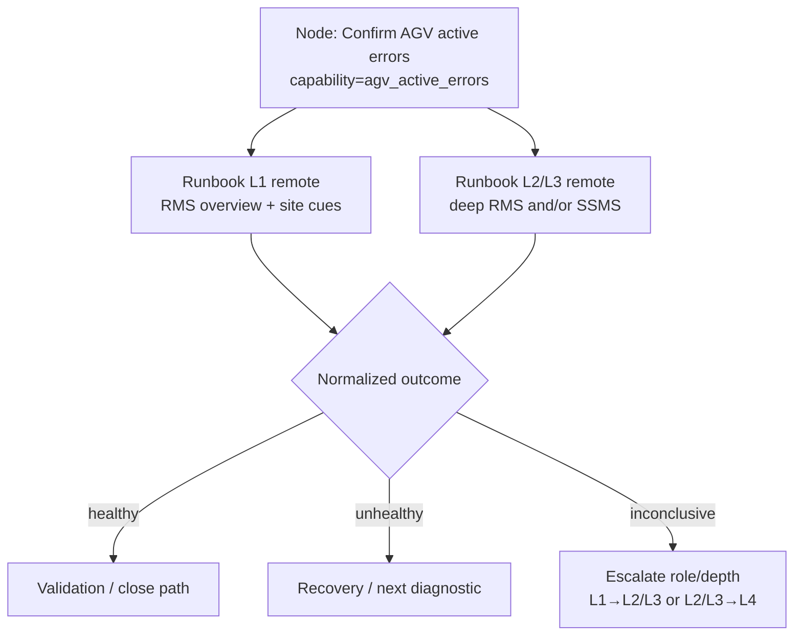

# Support Roles, Components, and Runbook Adjacency

Working model for how L1 / L2–L3 / L4 responsibilities map onto OptiSweep
components, and how playbooks should present **role-adjacent** runbooks without
hardcoding “RMS ≡ SQL” peer lists.

**Constraints:**

- L1, L2/L3, and L4 are **FORTNA** support (CSE / SW Dev) and work **remotely**.
- **`operator` = customer/client site personnel** (not a FORTNA support team member).
  Same side of the fence as “customer” in Salesforce/RCA language.
- On-site physical work (E-stop, LOTO, floor recovery) is done by the
  customer/client operator (or their field staff), guided by remote FORTNA support
  — not by a local FORTNA L1.

Read alongside:

- **Frozen taxonomy:** [`taxonomy/runbook_capability_taxonomy.json`](taxonomy/runbook_capability_taxonomy.json) (`schema_version` 0.4) — capability / surface / role / failure IDs + edges; deep catalogs in [`catalogs/`](catalogs/)
- [Stage 8 Capability Tags & Linking Quality Plan](../design_decisions/stage_8_capability_tags_and_linking_plan.md)
- [Stage 8 Playbook Finalization](../design_decisions/stage_8_playbook_finalization.md) (KG / component enrichment)
- Stage 8 advisory tables in `stage_prompts/stage_8/stage8_playbook_linking_prompt.md`
- Training slides PDF + Day 1/Day 2 videos (RMS, Aveva, DB/API/Ignition/Stunnel walkthroughs)
- OM v3 operator-station / VISU / LOTO candidates

Related SME sendable sheet (access only): [sme_component_access_matrix.md](sme_component_access_matrix.md) · Teams copy: [`docs/design_decisions/sme_component_access_matrix.md`](../design_decisions/sme_component_access_matrix.md) · Prompt canonical: [`stage_prompts/shared/role_component_access_matrix.md`](../../stage_prompts/shared/role_component_access_matrix.md)

---

## Bottom line

| Question | Answer |
| --- | --- |
| Are support levels remote? | **Yes — FORTNA L1, L2/L3, and L4 are all remote.** |
| Who is `operator`? | **Customer/client site staff — not FORTNA.** Physical E-stop/LOTO/floor work is theirs (or their field), guided by remote FORTNA CSE |
| How do FORTNA roles differ? | L1 owns Salesforce + first-pass remote triage; L2/L3 owns deeper remote investigation/resolve/RCA; L4 is SW Dev when CSE cannot resolve (P1/P2 timers) |
| What is “adjacency”? | Same **capability** (job), different **access_surface** + **audience_role** — e.g. AGV active errors via RMS overview (operator/L1) vs SSMS/WCS (L2/L3) |
| Separate L1 and L2/L3 runbooks? | Yes. One playbook **node** can multi-link both; branching is on **observable outcomes**, not on “which runbook won” |
| Hardcode peer lists? | No — freeze capability / surface / role taxonomy and tag at Stage 6 |

---

## 1. Role responsibilities

### Who is on which side

| Side | Roles | Org |
| --- | --- | --- |
| **FORTNA support** | L1, L2/L3, L4 (SW Dev) | FORTNA CSE / development — all remote |
| **Customer / client** | `operator`, site supervisors, customer contacts | Client site — not FORTNA support |

Do not treat `operator` as a FORTNA tier in taxonomy, playbook audience filters, or UI copy. When a runbook says Primary Role `operator`, it is a **customer/client** procedure (often from OM), which FORTNA CSE may *coach* but does not *perform* as their own job.

Source for FORTNA tiers: CSE Level of Support matrix (Salesforce / RCA / escalation SLAs).

### FORTNA — L1 Technical Support (remote)

Primary point of contact and ticket owner.

| Duty | Detail |
| --- | --- |
| Log incident | Salesforce ticket; accurate Subject + Description (issue summary + restore actions) |
| Maintain status | Keep Salesforce status accurate and timely |
| Collaborate | Bridge customer ↔ L2/L3 for clarification and resolution |
| Resolution details | Update Resolution Details in Salesforce with L2/L3 |
| RCA delivery | With L2/L3, deliver RCA to **CSC** when the customer requests it |

**Operational posture for OptiSweep AI:**

- First-pass **remote** triage: open RMS overview / AGV status, gather site report, coach customer on what physical indicators should look like when those cannot be seen remotely.
- Prefer support-safe, read-oriented surfaces (RMS entry views, customer-reported stacklight/E-stop/HMI state).
- Do **not** treat SSMS/WCS DB deep dives, Ignition admin recovery, or mutating APIs as L1 how-tos.
- Escalate to L2/L3 when the check needs deeper remote tooling, DB/API/Event Viewer, or actions beyond L1 scope.

### FORTNA — L2 / L3 Escalation Support (remote)

Technical investigation and resolution owners (same remote posture as L1; deeper tools and authority).

| Duty | Detail |
| --- | --- |
| Resolve | Investigate and fix the incident |
| Hand resolution text to L1 | So L1 can close Salesforce Resolution Details |
| Produce RCA | Identify RCA; hand to L1 for CSC if customer-requested |
| Escalate to L4 | When incident or RCA cannot be handled independently |

**Operational posture:**

- Deeper remote access: RMS beyond overview, WCS API/Apidog, SSMS (read-only first), Event Viewer, Ignition gateway/OPC connections, Stunnel connection list, tipper WebVisu heartbeat as needed.
- Own corroboration and restore paths that exceed L1 tooling/authority (incl. unplanned-restart host trio: Ignition + Stunnel + OptiSweep).
- Stay inside OptiSweep-supported flows; flag suspected direct RMS/API bypass (see Day 1 boundary runbook).
- Tag runbooks `L2_support` / `L3_support` (or shared `L2_L3_support`) — do not collapse the label to “L2 only” in taxonomy or UI copy.

### FORTNA — L4 Escalation Support (Software Development, remote)

| Duty | Detail |
| --- | --- |
| Allocate SW Dev | Work with L2/L3 on escalated incident or RCA |
| P1 / P2 contact window | If **CSE** cannot handle: contact SW Dev within **0.5 h (P1)** / **1 h (P2)** |

**Operational posture:** product/code/config ownership beyond support playbooks. Playbook nodes should escalate here, not link SW Dev runbooks as routine how-tos.

### Customer / client — operator (not FORTNA)

| Role tag | Meaning |
| --- | --- |
| `operator` | Customer/client person at the site (tipper/hospital/operator station). Synonym in support language: **customer** / **client**. **Not** a FORTNA support team member |
| `on_site` | Location/access tag for customer/client (or rare dispatched field) physical actions — not a FORTNA CSE level |

Typical customer/client work: physical station, VISU/HMI at the machine, stacklights, E-stops, tipper/tote handling, LOTO. FORTNA L1/L2/L3 guide these over the call; the customer/client executes them.

| FORTNA role tags | Typical use |
| --- | --- |
| `L1_support` / `L2_support` / `L3_support` | FORTNA CSE on Stage 6 candidates (`Primary Role`); prefer explicit L2/L3 wording |
| `remote` | Ambient for FORTNA L1 **and** L2/L3 (and L4); not a synonym for L2/L3 alone |

---

## 2. Capability adjacency (how L1 and L2/L3 share a job)

Do **not** encode “runbook A is adjacent to runbook B.” Encode:

| Dimension | Meaning | Examples (taxonomy IDs) |
| --- | --- | --- |
| `capability` | Diagnostic/recovery **job** | `agv_active_errors`, `device_roster_state`, `e_stop_or_safety_stop`, `wcs_service_health`, `gateway_health`, `bag_out_or_closeout_state` |
| `access_surface` | Tool / view used | `site_interview`, `rms_ui`, `wcs_sql`, `wcs_api` / `apidog`, `hospital_hmi`, `tipper_hmi`, `aveva_hmi`, `event_viewer`, `ignition_gateway`, `stunnel`, `physical_floor` |
| `audience_role` | Who may execute | FORTNA: `L1_support`, `L2_support`, `L3_support`. Customer/client: `operator` (never FORTNA). Access hint: `on_site` for physical-only steps |
| `failure_pattern` | When the job is relevant | `bag_out_stuck`, `unplanned_restart`, `opc_connection_faulted`, `zone_agv_mismatch`, … |
| `procedure_intent` | Observe / diagnose / recover / validate | Aligns with existing `procedure_type` |

**Example — check AGV / fleet status for active faults** (all CSE remote)

| Audience | Surface | What they do | Outcome evidence |
| --- | --- | --- | --- |
| L1 (remote) | `rms_ui` | Open RMS overview / AGV status; note active faults | L1 screen: alarms present / clear / RMS blank |
| L1 (remote) | `site_interview` | Ask site to confirm physical cues L1 cannot see (stacklight, E-stop) | Customer report complements remote RMS |
| Operator (site) | `rms_ui` | Day-to-day RMS overview / AGV status / map | Primary RMS audience; site confirms alarms |
| L2/L3 (remote) | `wcs_sql` (and deeper `rms_ui`) | SSMS `AgvActiveErrorDatabaseModel` / `SystemActiveErrorModel`; deeper RMS | Query/roster confirms active errors or clean state |
| L2/L3 (remote) | `event_viewer` / `wcs_api` | Corroborate service crashes, `GetAGVStatuses`, etc. | Log/API evidence |

Same `capability: agv_active_errors`. Different depth/surfaces and roles. Stage 8 multi-links operator/L1 RMS and L2/L3 SQL runbooks to one playbook node when tags overlap.

```text
Playbook node: "Confirm whether AGVs have active errors"
  expects_capability: [agv_active_errors]
  expects_surface:    [rms_ui, wcs_sql, site_interview]   # any of
  preferred_audience: [operator, L1_support, L2_support]    # RMS≈operator; WCS≈L2

  linked runbooks:
    - operator/L1: RMS overview (+ site interview for physical cues)
    - L2/L3:       WCS/SSMS query (+ deeper RMS if needed)
```

---

## 3. Playbook / runbook presentation and branching

### One playbook graph, many role-scoped runbooks

Prefer **one incident playbook** (diagnostic narrative) with nodes that declare the
**job**. Attach multiple runbooks per node (already allowed, max policy in Stage 8).

| Presentation option | When to use | Branching implication |
| --- | --- | --- |
| **A. Multi-link on one node** (recommended default) | Same capability; L1 vs L2/L3 how-tos differ by tool depth | Branches stay on **healthy / unhealthy / inconclusive**; runtime picks runbook by caller role |
| **B. Sibling nodes** (L1 check → escalate → L2/L3 corroborate) | Explicit handoff is part of the story (ticket triage → deeper remote dive) | Branch after L1 outcome: “needs L2/L3 depth” → L2/L3 node |
| **C. Separate L1-only and L2/L3-only playbooks** | Different entry audiences with little shared path | Duplicate graphs; hard to keep outcomes aligned — **avoid** unless product requires audience-split packs |

### How branching works when L1 and L2/L3 outcomes differ

Outcomes are about **system state**, not about which procedure text was opened.

1. Normalize outcomes to shared labels for the capability, e.g.:
   - `healthy` — no active AGV errors / E-stop clear / gateway responsive
   - `unhealthy` — active errors / E-stop in / service down
   - `inconclusive` — cannot see the surface / conflicting reports
2. L1 and L2/L3 runbooks each supply **attainable evidence** for those labels
   (who observes, tool/view, concrete signal) — Track B #1 in the capability-tags plan.
3. Playbook branches on the **label**, not on “L1 said X / L2/L3 said Y”:
   - If either surface proves `unhealthy` → recovery / escalate path.
   - If L1 is `inconclusive` → L2/L3 corroboration node (option B) or show L2/L3 runbook on same node (option A).
   - If L1 `healthy` but L2/L3 later finds `unhealthy` → treat as new evidence; prefer L2/L3 deeper remote evidence for fleet/DB-backed capabilities.



**Do not** create parallel branch edges “if L1 runbook” vs “if L2/L3 runbook” unless the
product UI literally has two independent workflows. Role selection is a **runtime
filter** over linked runbooks (`audience_role` ∩ current user), not a second graph.

### Escalation edges (roles, not components)

| From | To | Trigger |
| --- | --- | --- |
| L1 | L2/L3 | Needs deeper remote tooling (DB/API/Event Viewer/Ignition admin), conflicting evidence, or restore beyond L1 scope |
| L2/L3 | L4 | Cannot resolve or produce RCA; P1 ≤ 0.5 h / P2 ≤ 1 h contact window for SW Dev |
| Any | CSC (via L1) | Customer-requested RCA packaging |
| Any FORTNA CSE → customer/client operator | Physical action required (E-stop reset, LOTO, floor recovery) | Remote FORTNA guides; customer/client executes |

---

## 4. Component catalog

What each component **is**, what it is **used for**, and **who** typically uses it.
Aligns with Stage 8 catalog families + Day 1 software overview + OM operator station.
Mark gaps where the merged catalog is thin.

### Software / control plane

| Component | What it is / depicts | Used for | Who | Notes / adjacency |
| --- | --- | --- | --- | --- |
| **OptiSweep / WCS software** | Integrating warehouse control layer; Windows service on primary | Orchestrates AGV/tote/sorter flows; must be running with Ignition + Stunnel | L1 (concept); L2/L3 (service/API/status); L4 (code) | Direct RMS/API bypass can desync; unplanned restart may require OptiSweep restart after Ignition |
| **RMS (Robot Management System)** | Web fleet / robot status UI (site IP) | Initial and deep support view: AGV issues, roster, map, errors; confirm load before master E-stop clear | **Operator primary**; L1 remote overview; L2/L3 deeper | Peer capability with **WCS SQL** for active errors |
| **OptiSweep / WCS API (+ Apidog)** | System/AGV/Tote APIs; Apidog on primary; same APIs feed Ignition→Aveva | GetAGVStatuses, CloseOut, Pause/ResumeAGVs, InitializeTote, ResendGeekCommand, zone/exchange settings, etc. | L2/L3 (primary); L1 rarely | Surfaces `wcs_api` / `apidog`; catalog in taxonomy `wcs_api_catalog` |
| **AVEVA HMI** | Site HMI (Overall System, AGVs, Totes, metrics, Zone Config, Initialize Tote, Tote Tasks, Exchange Settings) | Operator/building visualizations and Aveva API pages | Customer/client operator; FORTNA via customer or when reachable | Distinguish from tipper VISU and hospital HMI; surface `aveva_hmi` |
| **Ignition (OPC server / gateway)** | OPC to tippers/hospital; gateway UI; tag provider (SYS1 metrics) | Gateway health; OPC Connections faulted; tags for Aveva | L1 (identify role); L2/L3 (gateway + OPC + restart path) | Capabilities `gateway_health`, `opc_connection_or_tipper_heartbeat` |
| **S-Tunnel / Chat xLE** | Stunnel on primary (AI01, AI02, SortationChat); UPS Chat path | Scan/Sort/hot-bin messages; secure OTNet↔UPS | L1: ask if messages flowing; **L2/L3**: Stunnel connection check | Surfaces `stunnel`; capability `ups_chat_or_stunnel_health` (not overview-only) |
| **WCS / Helix databases (SSMS)** | OptiSweep: Audit, GeekAgv, OPCComms, Robotics, SorterSweeper, EntityLogs (+ site Helix2x_*); WCS defaults DataContainers/PLCCommunication unused by OptiSweep | Remote read-only state: robots/errors/dwell/charging/bag-out/items/lanes/system | **L2/L3** | Tag `wcs_sql`; models/fields in taxonomy `wcs_sql_catalog` |
| **SQL Server Agent** | Agent jobs on backup (housekeeping ~12h) | Confirm Agent running after unplanned restart | **L2/L3** | Part of host recovery; with `wcs_service_health` / `unplanned_restart` |
| **Windows Event Viewer / Services** | Host logs / SCM | OptiSweep/WCSWebApplication crashes, 7031, service restarts | L2/L3 | Catalog **gap** (0 runbooks) — playbooks must allow honest `unresolved` |

### Operator / site HMIs and physical

| Component | What it is / depicts | Used for | Who | Notes / adjacency |
| --- | --- | --- | --- | --- |
| **Operator / tipper HMI (VISU / WebVisu)** | Station screens (`visu_io`, `visu_data`, tipper/pneumatic/feedrate) | Tipper faults, IO, station alarms, axis-related station views | Customer/client primary; FORTNA L1 coaches or views remotely if available; L2/L3 deeper IO | Strong catalog. Physical actions stay with customer/client |
| **Hospital HMI / lane UI** | Hospital station / lane / stacklight / ACB stats | Hospital diversion, lane alarms, stacklight color | Customer/client; FORTNA L1/L2/L3 remote when reachable | Corroborate with RMS fleet routing |
| **Building / ACB overview HMI** | Area/bin/smalls/message panel | Area status during outages | Customer/client; FORTNA L1 / L2/L3 remote | Don’t confuse with hospital lane UI |
| **Operator station physical** | Tippers, chute, stacklights, curtains, HMI, push-buttons | Locate and identify station hardware | Customer/client; FORTNA asks them to confirm | OM Fig 3-1 / Table 3-1 |
| **Stacklights** | Status lights (operator station + hospital) | At-a-glance alarm/state | Customer/client; FORTNA via report or camera | FORTNA: “what color?”; L2/L3 adds HMI IO + fleet cause |
| **E-stops / safety stops / push-buttons** | Physical emergency stop and station buttons | Safety stop state; local control | Customer/client executes; FORTNA remote guides/confirms | Physical reset is **customer/client**; LOTO when energy isolation required |
| **LOTO / energy isolation** | Lockout/tagout, shut-off valves | Safe mechanical/pneumatic work | Customer/client trained only | Narrow catalog; FORTNA remotes do not perform LOTO |
| **Teknic / motor / axis** | Axis/motor hardware + parameters | Axis faults, referencing, cable carrier | Customer/client on floor + FORTNA L2/L3 remote procedures where applicable | Often with VISU for navigation |
| **AGV physical recovery** | Add/remove/bump/motionless robot handling | Floor recovery, bump codes | Customer/client executes; FORTNA L1/L2/L3 coach + system-side steps | Pre-check RMS status often adjacent |
| **Tote / material handling** | Exchange, initialize/remove, bag-out | Exchange sequence, tote lifecycle/errors, bag-out/closeout | Customer/client observes; FORTNA L1 verifies remotely; L2/L3 DB/API | Capabilities `tote_exchange_sequence`, `tote_lifecycle_state`, `bag_out_or_closeout_state` |

### Safety / PLC adjacency note

| Check | L1 (remote) | L2/L3 (remote) |
| --- | --- | --- |
| E-stop / safety circuit | Ask customer/client: any E-stop depressed? Stacklight/safety indicators? Do not clear remotely | Remote HMI/PLC status if available; coordinate customer/client reset; escalate mechanical/safety SME |
| WebVisu / tipper alarm | Remote view if available, else ask customer/client for alarm text/color / photo | Deeper VISU/IO; guide customer/client on-site steps |
| Grid entry / LOTO | Never as substitute for “check fleet status” | Only when node intent is physical isolation/recovery (**customer/client** executes) |

---

## 5. Worked adjacency rows (aligned to taxonomy 0.4)

`capability` × `surface` × `role` rows for Stage 6/8 — **not** hardcoded Stage 8 peer lists.  
**Machine form (preferred for RAG):** [`catalogs/capability_catalog.json`](catalogs/capability_catalog.json) — rebuild with `python scripts/build_capability_catalog.py`.  
Full ID list lives in the taxonomy JSON; this table is the human adjacency seed.

| Capability | L1 (remote) surface / action | L2/L3 (remote) surface / action | Escalate if / related failure |
| --- | --- | --- | --- |
| `agv_active_errors` | `rms_ui` overview (operator primary; L1 remote); optional `site_interview` | Deeper RMS + `wcs_sql` AgvActiveError / SystemActiveError; `wcs_api` GetAGVStatuses | P1/P2 → L4; `system_fault` |
| `device_roster_state` | RMS roster/map; ask if robots missing visually | Robot / RobotLocation / CellCode models; Recover/Remove AGV APIs | `mapping_abnormal`, `zone_agv_mismatch`, `rms_map_collision_display` |
| `fleet_system_status` | RMS / Aveva overall system blank or down | Corroborate with services + system state | `site_stoppage` |
| `sort_lifecycle_state` | Ask site/RMS running vs shutting down | SystemDatabaseModel / SystemStateModel + SortGuid | `sort_lifecycle_stuck` |
| `zone_pairing_state` | RMS pairing symptoms; ask site | Deeper RMS / related DB if present | `pairing_failure` |
| `zone_config_state` | Aveva Zone Config overview if available | GetZoneConfig / zone-config staging via API/SSMS | Config mutate beyond playbook |
| `hospital_diversion` | RMS + hospital stacklight/lane report | Hospital HMI + Hospital/CellCode/tags models | `hospital_diversion` |
| `lane_or_chute_state` | Aveva lane/zone; ask chute open/closed | LocationModel LaneStatus; OpenAllChutes | `chute_bypassed_or_stuck_closed` |
| `tipper_station_fault` | Remote VISU / ask alarm text | Tipper models + Tag/Bits; guide LOTO if needed | `tipper_fault` |
| `opc_connection_or_tipper_heartbeat` | Ask tipper HMI alive | Ignition OPC Connections + WebVisu heartbeat | `opc_connection_faulted` → OptiSweep restart |
| `e_stop_or_safety_stop` | Ask physical E-stop; note remote cues | EstopModel + HMI; coordinate on-site reset | Safety uncertainty |
| `rms_soft_stop` | — (not L1 mutate) | PauseAGVs / ResumeAGVs / RMS pause | Soft stop ≠ E-stop |
| `gateway_health` | Identify Ignition role / symptoms | Gateway performance UI + API validate | SW Dev if product defect |
| `wcs_service_health` | High-level system down / blank RMS | OptiSweep service + Event Viewer; SQL Agent on backup | `unplanned_restart`, `service_crash_or_restart` |
| `wcs_api_responsiveness` | — | Apidog / GetAGVStatuses etc. | `api_unresponsive` |
| `windows_service_or_event_log` | — | Event Viewer / Services MMC | Catalog gap → honest unresolved |
| `ups_chat_or_stunnel_health` | Ask if Chat/sort messages flowing | Stunnel AI01/AI02/SortationChat | `stunnel_or_chat_down` |
| `agv_physical_recovery` | Coach site add/remove/bump | System-side Remove/Recover AGV + RMS | `bump_fault`, `object_blocking_agv`, `agv_tracking_or_path_lost` |
| `robot_dwell_or_shutdown_staging` | Ask if shutdown/dwell stuck on floor | LocationActiveDwell + ShutDownStaging | `shutdown_or_dwell_abnormal` |
| `agv_charging_state` | RMS charge indicators if visible | Charging* models / GetChargersStatus | `charging_abnormal` |
| `sorter_item_or_scan_state` | Ask miss-scans / odd dimensions | Item / LaneActivity / default-dim models | `miss_scan_or_dimension_fallback` |
| `tote_exchange_sequence` | Verify normal exchange indicators | ActiveExchange + ToteConfig + exchange APIs | `hot_bin_or_missort_exchange` |
| `tote_lifecycle_state` | Aveva Initialize Tote / Tote Tasks | ToteModel / GetToteTask / InitializeTote | `tote_error_noread_or_mismatch` |
| `bag_out_or_closeout_state` | Confirm bag-out vs service-down | ActiveBagOut / CloseOut / CancelCloseout | `bag_out_stuck` |
| `robot_command_or_task_state` | — | RobotCommand / RobotTask / ResendGeekCommand | `robot_task_or_command_stuck` |
| `wcs_system_faults` | High-level software fault report | SystemActiveError / system faults tables | `system_fault` |

---

## 6. Pipeline implications (short)

| Layer | Change needed for this model |
| --- | --- |
| Taxonomy JSON | **Source of truth** for IDs (`schema_version` 0.4). Keep `operator` customer/client-side; FORTNA = `L1_support` / `L2_support` / `L3_support`. Deep catalogs under `docs/ontology/catalogs/` = runbook/reference detail only |
| Stage 6 runbooks | Emit tags; keep `Primary Role` consistent; prefer `L2_support`/`L3_support` over bare “L2” in titles/copy |
| Stage 5 playbook nodes | `expects_capability` + optional `expects_surface` / `preferred_audience`; name SSMS/API/Stunnel as surfaces without SQL/API payload text |
| Stage 8 | Capability-overlap multi-link; role filter at presentation; outcome evidence per surface |
| App / runtime | Given user role (L1 vs L2/L3), prefer matching runbook links; still show escalate path |
| Docs / SME | This file (§4–5) must stay aligned with taxonomy after ID adds; review MD shows tags + dual L1/L2/L3 links |

---

## 7. Open questions for SME

1. Which remote surfaces are in-scope for L1 vs reserved for L2/L3 (RMS depth, VISU remote, API read-only)?
2. Is **WebVisu** the preferred name for tipper VISU, or keep `VISU` / AVEVA split as in sources?
3. Which E-stop / safety observables can L1 confirm remotely vs must stay customer/client-only?
4. Should P1 playbooks force an L2/L3 corroboration sibling node (option B) even when L1 reports healthy?
5. Confirm CSC vs CSE naming in customer-facing RCA vs internal escalation text.
6. Prefer one taxonomy token `L2_L3_support` or separate `L2_support` + `L3_support`?

---

## 8. Suggested next artifacts

1. Freeze taxonomy from §5 with explicit L2/L3 naming. **Done (pilot 0.4):** [`taxonomy/runbook_capability_taxonomy.json`](taxonomy/runbook_capability_taxonomy.json) + [`catalogs/`](catalogs/) — constrained IDs + Day2-evidenced WCS SQL field catalog.
2. Author or tag an explicit **L1 remote AGV status (RMS overview)** runbook beside L2/L3 RMS/SSMS procedures.
3. Regen one pilot playbook (e.g. 228086 / 228723) with multi-link + attainable outcomes for L1 vs L2/L3 surfaces.
4. Fold component rows that SMEs correct back into Stage 8 hint tables and Stage 5 vocabulary.
5. Keep this file’s §4–5 in lockstep when taxonomy IDs change (no stale aliases like `customer_interview` / `optisweep_api`).
