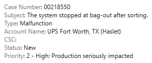
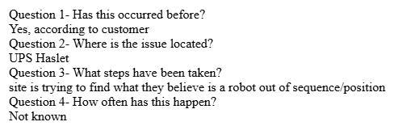
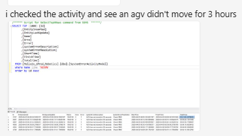
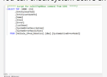
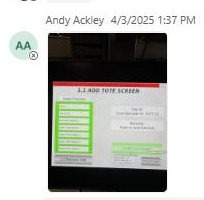

# Stage 3 Artifact Enrichment Review - Case 218550

## Summary

| Metric | Value |
| --- | --- |
| Artifacts | 5 |
| Enriched | 5 |
| Failed | 0 |
| Validation errors | 0 |
| Warnings | 1 |
| Artifacts with uncertainty or quality notes | 5 |

## Counts

### Evidence Roles

| Role | Count |
| --- | --- |
| incident_context_evidence | 3 |
| symptom_evidence | 2 |

### OCR Quality

| Quality | Count |
| --- | --- |
| garbled | 2 |
| usable | 2 |
| low | 1 |

## Warnings

- One or more artifacts were flagged as having garbled OCR.

## Artifact Index

| Page | Artifact | Role | OCR | Summary | Review flags |
| --- | --- | --- | --- | --- | --- |
| 1 | artifact_incident_218550_page_001_nested_image_01 | incident_context_evidence | usable | Salesforce case summary screenshot for case 00218550 showing a bag-out stoppage after sorting at UPS Fort Worth, TX (Haslet). | uncertainty, quality, duplicate:unique |
| 3 | artifact_incident_218550_page_003_nested_image_01 | incident_context_evidence | usable | Escalation questionnaire excerpt listing prior occurrence, location, current troubleshooting, and unknown frequency for an issue at UPS Haslet. | uncertainty, quality, duplicate:unique |
| 11 | artifact_incident_218550_page_011_nested_image_01 | symptom_evidence | low | RMS-style screenshot with text indicating an AGV did not move for 3 hours. | uncertainty, quality, ocr:low, duplicate:unique |
| 11 | artifact_incident_218550_page_011_nested_image_02 | incident_context_evidence | garbled | Small cropped screenshot of a text-based system or log view with mostly unreadable content. | uncertainty, quality, ocr:garbled, duplicate:unique |
| 12 | artifact_incident_218550_page_012_nested_image_01 | symptom_evidence | garbled | Small embedded screenshot of an HMI/tote screen with a red header and green list elements. | uncertainty, quality, ocr:garbled, duplicate:unique |

## Artifact Details

### artifact_incident_218550_page_001_nested_image_01

| Field | Value |
| --- | --- |
| Page | 1 |
| Image type | salesforce_case_screenshot |
| Evidence role | incident_context_evidence |
| OCR quality | usable |
| Duplicate group |  |
| Validation status | needs_sme_review |

**Short description:** Salesforce case summary screenshot for case 00218550 showing a bag-out stoppage after sorting at UPS Fort Worth, TX (Haslet).

**Detailed description:** The cropped artifact appears to be a Salesforce case header or summary panel. Visible case fields include Case Number 00218550, Subject stating that the system stopped at bag-out after sorting, Type listed as Malfunction, Account Name shown as UPS Fort Worth, TX (Haslet), Status shown as New, and Priority shown as 2 - High with production seriously impacted. The image provides incident intake/context information rather than detailed diagnostics or corrective actions. The ingestion site metadata identifies the case site as UPS Haslet TX (TXRTH), which aligns with the visible account name reference to UPS Fort Worth, TX (Haslet).

#### What To Look At

- Case Number field
- Subject text describing the bag-out stoppage
- Account Name and site reference
- Status field
- Priority field

#### Source Supported Claims

- The artifact shows case number 00218550. (visual_image)
- The case subject states that the system stopped at bag-out after sorting. (visual_image)
- The case type is Malfunction. (visual_image)
- The account name shown is UPS Fort Worth, TX (Haslet). (visual_image)
- The case status shown in the cropped artifact is New. (visual_image)
- The priority shown is 2 - High with production seriously impacted. (visual_image)
- Surrounding page OCR indicates later case status transitions including In Progress, Escalated (Waiting on Another Department), Resolved, and Closed. (page_ocr_context)
- Stage 2 classified this artifact as incident_context_evidence from a Salesforce case screenshot. (stage2_classification)

#### Review Uncertainty

- The text token rendered as CSCS/cscs is unclear and not interpreted.
- Later status transitions are taken from page OCR context, not from the cropped artifact image itself.

#### Quality Notes

- Artifact OCR quality is usable and aligns closely with the visible screenshot text.
- Page OCR is usable but contains minor recognition errors such as 'lin Progress' and unclear tokens around comments/status updates.
- The artifact is a cropped case screenshot, so surrounding workflow/history details should be attributed to page context rather than the crop itself.

### artifact_incident_218550_page_003_nested_image_01

| Field | Value |
| --- | --- |
| Page | 3 |
| Image type | rms_screenshot |
| Evidence role | incident_context_evidence |
| OCR quality | usable |
| Duplicate group |  |
| Validation status | needs_sme_review |

**Short description:** Escalation questionnaire excerpt listing prior occurrence, location, current troubleshooting, and unknown frequency for an issue at UPS Haslet.

**Detailed description:** This cropped artifact appears to be a text-based screenshot or embedded message excerpt containing escalation questions and answers. The visible content states that the issue has occurred before according to the customer, identifies the location as UPS Haslet, says the site is trying to find what they believe is a robot that is out of sequence/position, and says the frequency is not known. The artifact itself does not show a live system state, machine UI, or diagnostic screen; it is incident context captured as text.

#### What To Look At

- The four escalation questions and their answers
- The location field showing UPS Haslet
- The troubleshooting note about a robot believed to be out of sequence/position
- Whether surrounding case materials confirm the suspected robot issue and the bag-out stop condition

#### Source Supported Claims

- The artifact states that this has occurred before, according to the customer. (visual_image)
- The artifact identifies the issue location as UPS Haslet. (visual_image)
- The artifact says the site is trying to find what they believe is a robot out of sequence/position. (visual_image)
- The artifact says the frequency of occurrence is not known. (visual_image)
- Surrounding page context ties the case to installation group 1G0011744 - UPS - TXRTH - HASLET, TX and a subject stating the system stopped at bag-out after sorting. (page_ocr_context)
- The ingestion metadata identifies the customer site as UPS Haslet TX (TXRTH). (stage2_classification)

#### Review Uncertainty

- The artifact is labeled as an RMS screenshot, but the visible crop is only a text excerpt rather than a recognizable RMS status interface.
- The phrase 'robot out of sequence/position' appears to be a site belief or preliminary assessment, not a confirmed root cause.
- The broader incident symptom 'system stopped at bag-out after sorting' comes from page context, not from the cropped artifact itself.

#### Quality Notes

- Artifact OCR quality is usable and closely matches the visible text.
- Page OCR quality is usable and provides surrounding case submission context.
- The crop contains text only, so visual interpretation is limited to the displayed questionnaire content.

### artifact_incident_218550_page_011_nested_image_01

| Field | Value |
| --- | --- |
| Page | 11 |
| Image type | rms_screenshot |
| Evidence role | symptom_evidence |
| OCR quality | low |
| Duplicate group |  |
| Validation status | needs_sme_review |

**Short description:** RMS-style screenshot with text indicating an AGV did not move for 3 hours.

**Detailed description:** The cropped artifact appears to be an RMS or similar operational system screenshot. A readable line at the top states that the activity was checked and an AGV did not move for 3 hours. The lower portion of the screenshot appears to contain a tabular grid with multiple rows and columns, but the detailed row values are too small to read reliably from the image. Page context indicates this was shared in discussion about checking system active error because the screen could not be seen in Aveva. The evidence supports a possible AGV inactivity or stalled-state symptom at the UPS Haslet TX (TXRTH) site, but the exact AGV identifier and detailed system fields are not legible in the cropped image.

#### What To Look At

- Any AGV identifier or row in the lower activity table
- Status or activity columns in the grid
- Whether the screenshot shows a stalled or inactive AGV entry
- Any visible error or active alarm indicators

#### Source Supported Claims

- The artifact contains text stating that an AGV did not move for 3 hours. (visual_image)
- The screenshot appears to show an RMS-style operational interface with a tabular activity or status section. (visual_image)
- Page context indicates the discussion included checking system active error because the screen could not be seen in Aveva. (page_ocr_context)
- The case ingestion metadata identifies the site as UPS Haslet TX (TXRTH). (stage2_classification)

#### Review Uncertainty

- Artifact OCR quality is marked low, so small interface text should not be over-interpreted.
- The lower table contents are not readable enough to extract AGV IDs, timestamps, or exact statuses.
- Page OCR provides surrounding chat context but should not be treated as text visibly present inside the cropped screenshot beyond the clearly readable line.

#### Quality Notes

- Primary usable evidence is the visible sentence about an AGV not moving for 3 hours.
- Artifact OCR is low quality but aligns with the clearly visible top text.
- The screenshot resolution is insufficient for reliable extraction of detailed grid values.

### artifact_incident_218550_page_011_nested_image_02

| Field | Value |
| --- | --- |
| Page | 11 |
| Image type | unknown_incident_evidence |
| Evidence role | incident_context_evidence |
| OCR quality | garbled |
| Duplicate group |  |
| Validation status | needs_sme_review |

**Short description:** Small cropped screenshot of a text-based system or log view with mostly unreadable content.

**Detailed description:** This artifact is a small nested image crop showing what appears to be a white-background application window or text pane containing several short lines of monospaced or console-like text. The visible content is too small to read reliably in the crop, and artifact OCR is marked garbled. The surrounding page context indicates discussion of Aveva visibility, a system active error, and an AGV that did not move for 3 hours at UPS Haslet TX (TXRTH), but those statements come from page context rather than clearly readable text inside this cropped image.

#### What To Look At

- Any readable status or error text in the cropped screenshot
- Whether the image is a log/output pane versus a configuration screen
- Any visible labels that could identify the application or subsystem
- Relationship between this screenshot and the page discussion about Aveva and AGV inactivity

#### Source Supported Claims

- The artifact is a small screenshot-like crop containing multiple lines of text on a white background. (visual_image)
- The artifact OCR is not reliable enough to extract specific text from the cropped image. (artifact_ocr)
- Surrounding page context includes discussion that they could not see the screen in Aveva, mentions checking a system active error, and states an AGV did not move for 3 hours. (page_ocr_context)
- The incident packet is associated with UPS Haslet TX (TXRTH). (page_ocr_context)

#### Review Uncertainty

- The image content is too small to confidently identify the application, subsystem, or exact text.
- Artifact OCR is garbled and should not be used to infer specific commands or messages.
- Incident relevance is supported mainly by page context rather than readable content inside the crop.

#### Quality Notes

- Artifact OCR quality is garbled.
- The crop is very small, limiting visual interpretation.
- Use page OCR only as surrounding context; it should not be treated as text proven visible inside the cropped image.

### artifact_incident_218550_page_012_nested_image_01

| Field | Value |
| --- | --- |
| Page | 12 |
| Image type | unknown_incident_evidence |
| Evidence role | symptom_evidence |
| OCR quality | garbled |
| Duplicate group |  |
| Validation status | needs_sme_review |

**Short description:** Small embedded screenshot of an HMI/tote screen with a red header and green list elements.

**Detailed description:** The cropped artifact appears to be a photo or screenshot of a small HMI-style display embedded in a Teams chat. The visible screen has a red title/header bar, a left-side column of green rectangular list fields, and a lighter gray/white panel on the right with text that is too small to read reliably. The image itself is low resolution and the artifact OCR is garbled, so only limited visual details are source-supported from the crop. Surrounding page OCR indicates the chat discussion concerns an HMI at a hospital showing a fault and advice to acknowledge and try again.

#### What To Look At

- Red header/title area on the HMI screen
- Green list or button fields on the left side
- Any fault or status text in the right-side panel
- Whether the screen includes an acknowledge prompt or tote identifier
- Whether the image can be matched to the surrounding chat discussion about an HMI fault

#### Source Supported Claims

- The artifact shows a small HMI-like interface with a red header and green list elements. (visual_image)
- The text inside the cropped image is not reliably readable because the artifact OCR is garbled and the image is low clarity. (artifact_ocr)
- Surrounding chat context states that 'The HMI at the hospital is showing a fault.' (page_ocr_context)
- Surrounding chat context includes the response 'Hit acknowledge and try again.' (page_ocr_context)
- The case ingestion metadata associates this artifact with UPS Haslet TX (TXRTH). (stage2_classification)

#### Review Uncertainty

- The artifact image is very small and low resolution.
- Artifact OCR is garbled and cannot be trusted for detailed text extraction.
- The visible header text may reference a tote screen, but this is not fully reliable.
- The page context references a hospital HMI while ingestion metadata identifies UPS Haslet TX (TXRTH); this location relationship is ambiguous.

#### Quality Notes

- Primary evidence comes from the image layout and surrounding page OCR context rather than readable artifact text.
- Do not treat page OCR chat text as if it is visibly readable inside the cropped image.
- Site metadata from ingestion was preserved as UPS Haslet TX (TXRTH), but the chat wording introduces possible location ambiguity.
