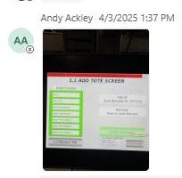

# Acknowledge HMI fault at the hospital area and retry operation

## Runbook Header

| Field | Value |
| --- | --- |
| Procedure ID | `proc_acknowledge_hmi_fault_and_retry_v1` |
| Title | Acknowledge HMI fault at the hospital area and retry operation |
| Procedure Type | `recovery` |
| Primary Role | `L2_support` |
| Supporting Roles | `operator` |
| Support Safe | Yes |
| Validation Status | `needs_sme_review` |
| Merge Status | `source_finalized` |

## Summary

Source-specific incident recovery for an HMI fault reported at the hospital area within the UPS Haslet TX (TXRTH) incident context. The evidence supports viewing the faulted HMI, not unplugging the HMI, using the on-screen acknowledge action, retrying, confirming whether the tote is ID 28, and validating that the condition is cleared and reported as all good.

## When To Use

Use when the HMI associated with the hospital area is reported as showing a fault in the UPS Haslet TX (TXRTH) incident context, and the source-supported response is to acknowledge the fault on the HMI and retry the operation without unplugging the HMI.

## Do Not Use For

* Do not use this runbook as justification to unplug the HMI; the source explicitly says not to unplug it.
* Do not use this runbook for HMI project updates, stuck-task recovery creation, or undocumented task-debug procedures; those were discussed later in the incident but not performed as this recovery.
* Do not use this runbook when the faulted device or tote context cannot be matched to the hospital-area HMI evidence in this case.

## Safety And Operational Notes

* Do not unplug the HMI during this procedure; the source-supported response explicitly rejected unplugging.
* Use only the on-screen acknowledge-and-retry action supported by the incident evidence.
* Do not perform undocumented HMI changes or recovery modifications based on this case alone.

## Access Or Tools Needed

* Access to the HMI associated with the hospital area
* Ability to use the HMI acknowledge control
* Communication with site personnel to confirm tote ID and recovery status

## Procedure Steps

### Step 1 — View the hospital-area HMI fault

**Responsible role:** operator

**Instruction:**
Open or view the HMI associated with the hospital area and confirm that it is showing a fault before taking further action.

**Expected result:**
The HMI fault is visible or confirmed in the same hospital-area context referenced in the incident.

**Screens / Images:**

*HMI-like screen associated with the chat message stating that the HMI at the hospital is showing a fault.*

**Stop or Escalate If:**

* The HMI cannot be accessed or viewed.
* The visible issue does not match the hospital-area HMI fault context from this incident.

---

### Step 2 — Keep the HMI connected

**Responsible role:** operator

**Instruction:**
Do not unplug the HMI. Keep the device connected and prepare to use the on-screen acknowledge action instead.

**Expected result:**
The HMI remains connected and available for the acknowledge-and-retry action.

**Screens / Images:**

*Use the same faulted HMI context; do not disconnect the device shown in this incident context.*

**Stop or Escalate If:**

* Someone proposes unplugging the HMI as the next step.
* The HMI cannot remain connected long enough to perform the acknowledge action.

---

### Step 3 — Acknowledge the fault and retry

**Responsible role:** operator

**Instruction:**
Use the HMI acknowledge control, then try the operation again.

**Expected result:**
The fault is acknowledged and the operation is retried without unplugging the HMI.

**Screens / Images:**

*Faulted HMI interface where the acknowledge action would be taken; screenshot text is unreadable, so rely on the chat-supported acknowledge instruction.*

**Stop or Escalate If:**

* Acknowledge-and-retry does not clear the issue.
* The HMI still shows the fault after retry.
* The required acknowledge control is not available on the HMI.

---

### Step 4 — Confirm whether the tote is ID 28

**Responsible role:** operator

**Instruction:**
Check the HMI context or confirm with site personnel whether the tote involved at the hospital area is tote ID 28.

**Expected result:**
The tote involved is identified and can be reported back to support.

**Screens / Images:**

*Hospital-area HMI/tote context associated with the support question about whether the tote ID is 28.*

**Stop or Escalate If:**

* The tote ID cannot be determined from the HMI or site confirmation.
* The tote context appears unrelated to the hospital-area HMI fault discussed in this incident.

---

### Step 5 — Validate recovery status

**Responsible role:** L2_support

**Instruction:**
Verify with the site or from the HMI context that the tote at the hospital is 28 and that the condition is now cleared or reported as all good.

**Expected result:**
The site confirms the tote at the hospital is 28 and reports that the condition is all good.

**Stop or Escalate If:**

* The site does not confirm that the condition is all good.
* The HMI still shows the issue after acknowledge-and-retry.
* Recovery cannot be validated in the hospital-area context.

---

## Success Criteria

* The hospital-area HMI fault is acknowledged without unplugging the HMI.
* The operation is retried successfully.
* The tote involved is confirmed as ID 28.
* The site reports the condition is all good.

## Failure Conditions

* The HMI cannot be accessed or the fault cannot be confirmed.
* The only contemplated next step is unplugging the HMI.
* Acknowledge-and-retry does not clear the fault.
* The tote ID cannot be confirmed.
* The site does not confirm that the condition is all good after retry.

## Escalation Guidance

* Escalate if acknowledge-and-retry does not clear the fault or the HMI still shows the issue after retry.
* Escalate if the HMI cannot remain connected or cannot be operated using the acknowledge control.
* Escalate if the tote ID or recovery status cannot be confirmed in the hospital-area context.
* Do not proceed into HMI update work, stuck-task recovery changes, or other undocumented remediation based on this runbook alone.

## Missing Details / Known Gaps

* The HMI screenshot text is mostly unreadable, so exact on-screen labels and fields for the acknowledge control are not available from the artifact.
* The source does not provide a precise estimated completion time.
* The source does not specify whether production stop or LOTO is required.
* The source does not provide exact retry mechanics beyond 'try again.'
* The term 'hospital' is preserved from the incident chat as an internal area reference; the packet site metadata remains UPS Haslet TX (TXRTH).

## Source Lineage

- Candidate IDs: candidate_incident_218550_acknowledge_hmi_fault_and_retry
- Source ID: `source_case_218550`
- Source Type: `incident_case`
