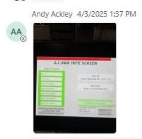

# Hospital HMI / lane UI fault acknowledge-and-retry check

## Runbook Header

| Field | Value |
| --- | --- |
| Procedure ID | `proc_hospital_hmi_lane_ui_fault_acknowledge_retry_check_v1` |
| Title | Hospital HMI / lane UI fault acknowledge-and-retry check |
| Procedure Type | `recovery` |
| Primary Role | `operator` |
| Supporting Roles | `L2_support` |
| Support Safe | Yes |
| Capability Tags | `hospital_diversion` |
| Access Surface | `hospital_hmi` |
| Audience Roles | `operator`, `L2_support` |
| Failure Pattern Tags | `system_fault` |
| Validation Status | `needs_sme_review` |
| Merge Status | `source_finalized` |

## Summary

Use the Hospital HMI / lane UI at UPS Haslet TX (TXRTH) to acknowledge a displayed fault, retry the operation without unplugging the Hospital HMI / lane UI, confirm that the affected tote is tote 28, and verify that the site reports the condition as all good.

## When To Use

Use this Hospital HMI / lane UI check when the Hospital HMI / lane UI displays a fault associated with a hospital-station tote and an acknowledge-and-retry response is appropriate.

## Do Not Use For

* Do not use this as a recovery sequence for a stuck task; the incident identifies a stuck-task visibility limitation on the Hospital HMI / lane UI but does not provide a reusable stuck-task recovery sequence.
* Do not unplug the Hospital HMI / lane UI as a troubleshooting action.

## Safety And Operational Notes

* Do not unplug the Hospital HMI / lane UI as a troubleshooting action.
* Stop and escalate if the fault remains after acknowledge-and-retry.

## Access Or Tools Needed

* Hospital HMI / lane UI

## Visual References

*Hospital HMI / lane UI screenshot showing a small HMI-like tote screen with a red header and green list elements; text inside the crop is mostly unreadable.*

## Procedure Steps

### Step 1 — Inspect the displayed Hospital HMI / lane UI fault

**Responsible role:** operator

**Instruction:**
Open the Hospital HMI / lane UI and inspect the live station screen for the reported fault. Do not unplug the Hospital HMI / lane UI.

**Expected result:**
The reported fault is visible on the Hospital HMI / lane UI and the live screen is available for interaction.

**Stop or Escalate If:**

* The Hospital HMI / lane UI cannot be accessed or the fault is not visible.
* The HMI appears to require unplugging; do not unplug it and escalate for further support.

---

### Step 2 — Acknowledge the fault and retry the operation

**Responsible role:** operator

**Instruction:**
On the Hospital HMI / lane UI, select the acknowledge control and retry the operation. Do not unplug the Hospital HMI / lane UI.

**Expected result:**
The Hospital HMI / lane UI accepts the acknowledgement and the operation enters a retry state rather than remaining blocked by the same displayed fault.

**Stop or Escalate If:**

* The fault remains after acknowledge-and-retry.
* The Hospital HMI / lane UI does not accept the acknowledgement or retry.

---

### Step 3 — Confirm tote 28 and the cleared Hospital HMI / lane UI state

**Responsible role:** operator

**Instruction:**
On the Hospital HMI / lane UI and with the site contact, confirm that the tote at the hospital station is tote 28 and verify that the site reports the condition as all good.

**Expected result:**
The tote at the hospital station is confirmed as tote 28 and the site reports that everything is good.

**Stop or Escalate If:**

* Tote 28 cannot be confirmed.
* The site cannot report an all-good state.
* The fault remains after acknowledge-and-retry.

---

## Success Criteria

* The Hospital HMI / lane UI fault is acknowledged.
* The retry succeeds without unplugging the Hospital HMI / lane UI.
* The tote at the hospital station is confirmed as tote 28.
* The site reports that everything is good.

## Failure Conditions

* The Hospital HMI / lane UI fault remains after acknowledgement and retry.
* The acknowledgement or retry does not take effect.
* Tote 28 cannot be confirmed.
* The site cannot report an all-good condition.

## Escalation Guidance

* Stop and escalate to L2 support if the fault remains after acknowledge-and-retry.
* Escalate if tote 28 cannot be confirmed or the site cannot report an all-good state.
* Do not unplug the Hospital HMI / lane UI.
* The incident identifies a stuck-task visibility limitation on this Hospital HMI / lane UI, but does not provide a reusable stuck-task recovery sequence.

## Missing Details / Known Gaps

* The embedded Hospital HMI / lane UI text is largely unreadable, so exact fault wording and exact control labels beyond the acknowledge instruction are not established.
* The packet does not provide a reusable recovery sequence for a stuck task that is visible only on this Hospital HMI / lane UI.
* The incident messages use the term hospital while authoritative ingestion metadata identifies UPS Haslet TX (TXRTH); the exact station naming within the site is not established.

## Source Lineage

- Candidate IDs: candidate_incident_218550_hospital_hmi_acknowledge_retry
- Source ID: `source_case_218550`
- Source Type: `incident_case`
