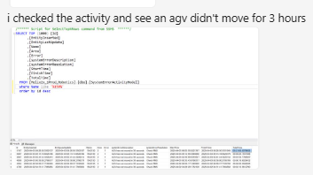

# RMS / fleet status UI check for AGV inactivity and active errors

## Runbook Header

| Field | Value |
| --- | --- |
| Procedure ID | `proc_rms_fleet_status_ui_check_agv_inactivity_active_errors_v1` |
| Title | RMS / fleet status UI check for AGV inactivity and active errors |
| Procedure Type | `diagnostic` |
| Primary Role | `L1_support` |
| Supporting Roles | `L2_support` |
| Support Safe | Yes |
| Capability Tags | `agv_active_errors`, `fleet_system_status` |
| Access Surface | `rms_ui` |
| Audience Roles | `L1_support`, `L2_support` |
| Failure Pattern Tags | `site_stoppage` |
| Validation Status | `needs_sme_review` |
| Merge Status | `source_finalized` |

## Summary

Use the RMS / fleet status UI at UPS Haslet TX (TXRTH) to determine whether an AGV is inactive and whether a system or AGV active error is associated with the bag-out stoppage. The incident evidence showed an AGV with approximately 3 hours without movement and advised checking the system active error when the AVEVA HMI was unavailable.

## When To Use

Use the RMS / fleet status UI when the site reports a bag-out stoppage and support needs to determine whether an AGV is inactive or whether an active error is visible. Use the RMS / fleet status UI as the available live diagnostic surface when the AVEVA HMI cannot be viewed.

## Do Not Use For

* Do not use this RMS / fleet status UI check as a physical AGV recovery or E-stop procedure.
* Do not infer an out-of-sequence robot root cause from inactivity alone.
* Do not substitute undocumented AVEVA HMI or physical-floor actions when the required RMS / fleet status UI information is unavailable.
* This diagnostic does not by itself confirm resolution of the bag-out stoppage.

## Safety And Operational Notes

* This is a support-safe diagnostic inspection; it does not authorize a physical E-stop, production stop, or AGV handling action.
* Stop the diagnostic and escalate when the RMS / fleet status UI shows an active AGV error, continued inactivity, or insufficient information to identify the affected robot.

## Access Or Tools Needed

* RMS / fleet status UI
* RMS fleet activity or AGV status view
* RMS system active error or AGV fault indicator

## Visual References

*RMS-style screenshot showing activity evidence that an AGV did not move for 3 hours; the exact AGV identifier and detailed table values are not legible.*

## Procedure Steps

### Step 1 — Open the RMS / fleet status UI activity view

**Responsible role:** L1_support

**Instruction:**
Open the RMS / fleet status UI and navigate to the fleet activity or AGV status view. Use the visible activity list or status table for the affected site condition.

**Expected result:**
The RMS / fleet status UI displays an AGV activity or status view with live robot rows or status information available for inspection.

**Stop or Escalate If:**

* The RMS / fleet status UI activity or AGV status information is unavailable.
* The view does not provide enough information to identify the affected robot.

---

### Step 2 — Inspect AGV movement duration in the RMS / fleet status UI

**Responsible role:** L1_support

**Instruction:**
In the RMS / fleet status UI activity view, inspect the AGV activity information for a robot with no recent movement. Capture the visible AGV identifier, if available, and the displayed inactivity duration.

**Expected result:**
The RMS / fleet status UI shows either recent AGV movement or an inactivity duration associated with an identifiable AGV; the incident example showed approximately 3 hours without movement.

**Stop or Escalate If:**

* An AGV remains inactive in the RMS / fleet status UI.
* The inactivity duration is visible but the affected AGV cannot be identified.

---

### Step 3 — Inspect active errors in the RMS / fleet status UI

**Responsible role:** L1_support

**Instruction:**
In the RMS / fleet status UI, inspect the available system active error or AGV fault indicator. Capture the displayed error code, description, affected robot, or other visible error identity.

**Expected result:**
The RMS / fleet status UI shows whether an active error is present and, when available, displays its code, description, or affected robot.

**Stop or Escalate If:**

* The RMS / fleet status UI shows an active AGV error.
* The RMS / fleet status UI does not provide enough information to determine whether an active error is present.

---

### Step 4 — Compare RMS / fleet status UI results with the bag-out condition

**Responsible role:** L1_support

**Instruction:**
Compare the activity and active-error results visible in the RMS / fleet status UI with the current bag-out condition. Preserve the visible AGV identifier, inactivity duration, error code, description, affected robot, and any unavailable values for L2 support review.

**Expected result:**
The RMS / fleet status UI findings identify whether continued AGV inactivity or an active error is present alongside the bag-out condition, or clearly show that the required information is unavailable.

**Stop or Escalate If:**

* The AGV remains inactive in the RMS / fleet status UI.
* An active error is present in the RMS / fleet status UI.
* The RMS / fleet status UI does not provide sufficient information to identify or correlate the affected robot.
* Do not infer an out-of-sequence root cause from inactivity alone.

---

## Success Criteria

* The RMS / fleet status UI provides an observable AGV activity result, including recent movement or a visible inactivity duration.
* The RMS / fleet status UI provides an observable active-error result, including no active error or visible error details.
* Any continued inactivity, active error, or insufficient identifying information is preserved and escalated to L2 support.

## Failure Conditions

* An AGV shows extended inactivity in the RMS / fleet status UI, including approximately 3 hours without movement.
* An active AGV or system error is visible in the RMS / fleet status UI.
* The RMS / fleet status UI does not expose sufficient activity or error information to identify the affected robot.
* The diagnostic result does not establish the root cause or resolution of the bag-out stoppage.

## Escalation Guidance

* Stop and escalate to L2 support if the RMS / fleet status UI shows an active AGV error.
* Stop and escalate to L2 support if the RMS / fleet status UI shows continued AGV inactivity.
* Escalate to L2 support if the RMS / fleet status UI does not provide enough information to identify the affected robot.
* Do not substitute undocumented AVEVA HMI or physical-floor actions when the RMS / fleet status UI information is unavailable.

## Missing Details / Known Gaps

* The exact AGV identifier is not legible in the incident artifact.
* Detailed RMS field names, page path, and control names are not provided.
* The incident does not identify a specific active error code or description.
* The incident does not confirm that this diagnostic alone resolved the bag-out stoppage.
* The precise root cause of the bag-out stoppage is not established by the inactivity observation.

## Source Lineage

- Candidate IDs: candidate_incident_218550_rms_agv_activity_active_error_check
- Source ID: `source_case_218550`
- Source Type: `incident_case`
