# Stage 3 Artifact Enrichment Review - Case 223554

## Summary

| Metric | Value |
| --- | --- |
| Artifacts | 19 |
| Enriched | 19 |
| Failed | 0 |
| Validation errors | 0 |
| Warnings | 1 |
| Artifacts with uncertainty or quality notes | 19 |

## Counts

### Evidence Roles

| Role | Count |
| --- | --- |
| incident_context_evidence | 13 |
| unknown | 4 |
| action_evidence | 1 |
| diagnostic_evidence | 1 |

### OCR Quality

| Quality | Count |
| --- | --- |
| garbled | 12 |
| usable | 4 |
| low | 3 |

## Warnings

- One or more artifacts were flagged as having garbled OCR.

## Artifact Index

| Page | Artifact | Role | OCR | Summary | Review flags |
| --- | --- | --- | --- | --- | --- |
| 3 | artifact_incident_223554_page_003_nested_image_01 | incident_context_evidence | garbled | Screenshot of a work order or service request form showing a closed status and a Haslet, TX address. | uncertainty, quality, ocr:garbled, duplicate:unique |
| 5 | artifact_incident_223554_page_005_nested_image_01 | incident_context_evidence | usable | Screenshot of a notes/details pane showing AGV repair ticket 144027 / 747130 with text stating the AGV hospital station has server issues and needs services reset. | uncertainty, quality |
| 5 | artifact_incident_223554_page_005_nested_image_02 | incident_context_evidence | usable | Screenshot of a location/address form showing the UPS Haslet TX / TXRTH hub details. | uncertainty, quality, duplicate:duplicate |
| 5 | artifact_incident_223554_page_005_nested_image_03 | incident_context_evidence | low | Cropped image showing repeated contact-style entries for Guadalupe Villanueva with a phone number. | uncertainty, quality, ocr:low, duplicate:unique |
| 6 | artifact_incident_223554_page_006_nested_image_01 | incident_context_evidence | garbled | Nested image from a Teams chat showing a small grid-style status screenshot with many colored blocks; exact labels and values are unreadable. | uncertainty, quality, ocr:garbled, duplicate:unique |
| 7 | artifact_incident_223554_page_007_nested_image_01 | incident_context_evidence | garbled | Small cropped UI-like image showing a grid of light blue blocks with several orange-highlighted tiles and a blue horizontal line. | uncertainty, quality, ocr:garbled, duplicate:unique |
| 7 | artifact_incident_223554_page_007_nested_image_02 | incident_context_evidence | garbled | Small cropped image showing a row of repeated orange-and-white UI tiles or icons above blue and gray rectangular blocks. | uncertainty, quality, ocr:garbled, duplicate:unique |
| 7 | artifact_incident_223554_page_007_nested_image_03 | unknown | garbled | Small cropped grid-style UI image with several highlighted tiles and no readable text. | uncertainty, quality, ocr:garbled, duplicate:unique |
| 7 | artifact_incident_223554_page_007_nested_image_04 | unknown | low | Small cropped image showing a repeated orange-and-blue logo/banner pattern with no clearly readable text. | uncertainty, quality, ocr:low, duplicate:unique |
| 7 | artifact_incident_223554_page_007_nested_image_05 | unknown | garbled | Small cropped UI icon grid with blue and orange outlined tiles; no readable text is visible. | uncertainty, quality, ocr:garbled, duplicate:unique |
| 7 | artifact_incident_223554_page_007_nested_image_06 | unknown | garbled | Small cropped image showing orange icon tiles on a light background; content is too limited to determine incident relevance. | uncertainty, quality, ocr:garbled, duplicate:unique |
| 8 | artifact_incident_223554_page_008_nested_image_01 | diagnostic_evidence | garbled | Small HMI-style layout screenshot showing a grid/rack map with highlighted cells and a red arrow annotation. | uncertainty, quality, ocr:garbled, duplicate:unique |
| 9 | artifact_incident_223554_page_009_nested_image_01 | incident_context_evidence | garbled | Annotated facility layout image showing a long row of positions with a red arrow pointing to one highlighted location near the right side. | uncertainty, quality, ocr:garbled, duplicate:unique |
| 9 | artifact_incident_223554_page_009_nested_image_02 | incident_context_evidence | garbled | Small low-detail cropped image showing a repeated grid of orange and blue UI-like tiles; incident relevance is unclear. | uncertainty, quality, ocr:garbled, duplicate:unique |
| 9 | artifact_incident_223554_page_009_nested_image_03 | incident_context_evidence | garbled | Small cropped image showing a simplified map or facility-layout style graphic with colored rectangular blocks. | uncertainty, quality, ocr:garbled, duplicate:unique |
| 14 | artifact_incident_223554_page_014_nested_image_01 | incident_context_evidence | garbled | Screenshot of a service/work-order style application showing a dispatched emergency ticket for UPS Haslet/Fort Worth with notes about an ACB hospital station issue. | uncertainty, quality, ocr:garbled, duplicate:unique |
| 15 | artifact_incident_223554_page_015_nested_image_01 | action_evidence | usable | Application notes screen showing an AGV repair note about server issues at an AGV hospital station and a need to reset services. | uncertainty, quality, duplicate:duplicate |
| 15 | artifact_incident_223554_page_015_nested_image_02 | incident_context_evidence | usable | Location/building selection panel showing the UPS Haslet TXRTH site address and building details. | uncertainty, quality |
| 15 | artifact_incident_223554_page_015_nested_image_03 | incident_context_evidence | low | Cropped image showing repeated contact name and phone number fields for Guadalupe Villanueva. | uncertainty, quality, ocr:low, duplicate:unique |

## Artifact Details

### artifact_incident_223554_page_003_nested_image_01

| Field | Value |
| --- | --- |
| Page | 3 |
| Image type | unknown_incident_evidence |
| Evidence role | incident_context_evidence |
| OCR quality | garbled |
| Duplicate group |  |
| Validation status | needs_sme_review |

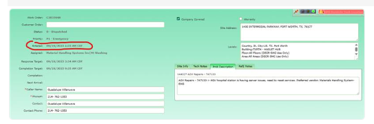

**Short description:** Screenshot of a work order or service request form showing a closed status and a Haslet, TX address.

**Detailed description:** The cropped image appears to show a green-background business application form with multiple labeled fields. A red oval highlights the status area, which visually reads as a closed/completed state. The form also shows customer and site-related fields, including text consistent with UPS/Optisweep context and a visible site address block that includes Haslet, TX 76052. A notes or history panel is visible on the right/lower-right side with at least one dated entry, but most small text is not reliably readable from the image. Artifact OCR is garbled, so interpretation relies primarily on visible image content and surrounding page context.

#### What To Look At

- The red-circled status field
- The address/location block on the right showing Haslet, TX
- Any customer or site labels near the top of the form
- The notes/history section for dated entries
- Whether the form is a CBRE or related work-order portal record

#### Source Supported Claims

- The artifact shows a form-based portal record with a status field highlighted by a red oval. (visual_image)
- The highlighted status appears to indicate the record is closed or completed. (visual_image)
- The screenshot includes a location/address block showing Haslet, TX 76052. (visual_image)
- Page context states that a CBRE work order was entered at 2:35am EST and later says the original issue was resolved at 4:07am EST and all issues were resolved with the site running 100% at 5:05am EST. (page_ocr_context)
- Page context discusses escalation path concerns and references that 50% of the tilt tray is now OptiSweep. (page_ocr_context)

#### Review Uncertainty

- Artifact OCR is garbled and cannot be relied on for exact field values.
- The exact portal/application name is not readable from the crop.
- The exact status wording should be visually confirmed by a reviewer.
- The screenshot may relate to a CBRE work order based on page context, but that linkage is contextual rather than explicitly readable in the crop.

#### Quality Notes

- Primary interpretation is based on the image because artifact OCR quality is marked garbled.
- Page OCR is usable but represents surrounding Teams chat context, not necessarily text visible inside the cropped artifact.
- Location evidence in the image is consistent with ingestion metadata: UPS Haslet TX (TXRTH).

### artifact_incident_223554_page_005_nested_image_01

| Field | Value |
| --- | --- |
| Page | 5 |
| Image type | windows_services_screenshot |
| Evidence role | incident_context_evidence |
| OCR quality | usable |
| Duplicate group | dup_incident_001 |
| Validation status | needs_sme_review |

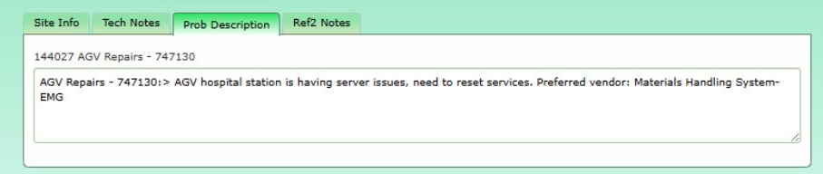

**Short description:** Screenshot of a notes/details pane showing AGV repair ticket 144027 / 747130 with text stating the AGV hospital station has server issues and needs services reset.

**Detailed description:** The cropped image shows a software notes interface with tabs labeled Site Info, Tech Notes, Prob Description, and Ref2 Notes. The Prob Description tab appears selected. Below the tabs, the screen shows the identifier "144027 AGV Repairs - 747130" and a text box containing a problem description. The visible text states that the AGV hospital station is having server issues and that services need to be reset. It also lists a preferred vendor as Materials Handling System-EMG. The packet ingestion metadata ties the case to UPS Haslet TX (TXRTH), but the cropped artifact itself does not visibly show the site name.

#### What To Look At

- The selected Prob Description tab
- The identifier 144027 AGV Repairs - 747130
- The text stating the AGV hospital station has server issues
- The phrase indicating services need to be reset
- The preferred vendor entry Materials Handling System-EMG

#### Source Supported Claims

- The screenshot shows tabs labeled Site Info, Tech Notes, Prob Description, and Ref2 Notes. (visual_image)
- The visible record identifier reads 144027 AGV Repairs - 747130. (visual_image)
- The problem description states that the AGV hospital station is having server issues. (visual_image)
- The problem description says services need to be reset. (visual_image)
- The note lists the preferred vendor as Materials Handling System-EMG. (visual_image)
- The case is associated in ingestion metadata with UPS Haslet TX (TXRTH). (page_ocr_context)
- This artifact is the primary item in duplicate group dup_incident_001. (duplicate_metadata)

#### Review Uncertainty

- The packet labels the image type as windows_services_screenshot, but the visible crop looks like a notes/problem description form rather than a Windows Services console.
- The site association to UPS Haslet TX (TXRTH) comes from ingestion metadata, not from visible text inside the cropped artifact.
- The artifact documents a need to reset services but does not show that the reset occurred.

#### Quality Notes

- Artifact OCR is usable and aligns closely with the visible text.
- Some OCR tab labels are slightly noisy, but the image makes the labels readable.
- Page OCR is partial and should be treated only as surrounding context.

### artifact_incident_223554_page_005_nested_image_02

| Field | Value |
| --- | --- |
| Page | 5 |
| Image type | unknown_incident_evidence |
| Evidence role | incident_context_evidence |
| OCR quality | usable |
| Duplicate group | dup_incident_002 |
| Validation status | needs_sme_review |

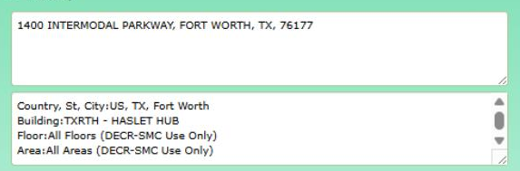

**Short description:** Screenshot of a location/address form showing the UPS Haslet TX / TXRTH hub details.

**Detailed description:** The cropped artifact appears to be a form or ticket field view containing site/location information rather than operational system status. Visible text shows the street address "1400 INTERMODAL PARKWAY, FORT WORTH, TX, 76177" and additional location fields including country/state/city, building, floor, and area. The building field reads "TXRTH - HASLET HUB," which aligns with the ingestion site metadata for UPS Haslet TX (TXRTH). The page context outside the crop suggests the broader incident may involve AGV repairs, but that context is not visibly inside this cropped artifact.

#### What To Look At

- The top address field showing 1400 Intermodal Parkway, Fort Worth, TX 76177
- The building field showing TXRTH - HASLET HUB
- The floor and area scope fields
- Whether the location details match the incident's assigned customer site

#### Source Supported Claims

- The artifact shows the address "1400 INTERMODAL PARKWAY, FORT WORTH, TX, 76177." (visual_image)
- The artifact shows a building/location entry of "TXRTH - HASLET HUB." (visual_image)
- The artifact includes location scope fields indicating "All Floors (DECR-SMC Use Only)" and "All Areas (DECR-SMC Use Only)." (artifact_ocr)
- The broader page context references "AGV Repairs - 747130" and text beginning "AGV hospital station..." (page_ocr_context)
- This artifact is marked as a duplicate within duplicate group dup_incident_002, with primary artifact artifact_incident_223554_page_015_nested_image_02. (duplicate_metadata)

#### Review Uncertainty

- The enrichment relies partly on OCR for lower text fields; reviewer should confirm exact punctuation and field labels.
- Page OCR references AGV repairs, but that context is outside the cropped artifact and should be linked cautiously.
- The city shown in the artifact is Fort Worth, while the authoritative ingestion site label is UPS Haslet TX (TXRTH); these may refer to the same facility area, but reviewer confirmation may be useful.

#### Quality Notes

- Artifact OCR quality is usable and generally matches the visible image.
- The crop is small and focused on location fields, limiting operational interpretation.
- This artifact is best treated as site/context evidence rather than direct symptom or action evidence.

### artifact_incident_223554_page_005_nested_image_03

| Field | Value |
| --- | --- |
| Page | 5 |
| Image type | unknown_incident_evidence |
| Evidence role | incident_context_evidence |
| OCR quality | low |
| Duplicate group |  |
| Validation status | needs_sme_review |

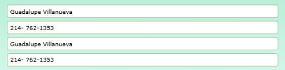

**Short description:** Cropped image showing repeated contact-style entries for Guadalupe Villanueva with a phone number.

**Detailed description:** The cropped artifact appears to show a simple list or form with four horizontal fields. The visible text repeats the name "Guadalupe Villanueva" twice and the phone number appears twice as "214-762-1353." The image does not clearly show the surrounding application or message wrapper, so the exact system context of this cropped item is unclear. Page-level OCR suggests the broader page may relate to an AGV repairs incident, but that context is outside the cropped image itself.

#### What To Look At

- Repeated contact name entries
- Repeated phone number entries
- Whether this contact information is relevant to the AGV repair incident
- Any reviewer-confirmed linkage between the contact and the incident at UPS Haslet TX (TXRTH)

#### Source Supported Claims

- The cropped image shows the name "Guadalupe Villanueva" twice. (visual_image)
- The cropped image shows the phone number "214-762-1353" twice. (visual_image)
- The artifact OCR also captured the name "Guadalupe Villanueva," though the OCR quality is low. (artifact_ocr)
- The surrounding page context appears to reference "AGV Repairs - 747130" and an "AGV hospital station" issue. (page_ocr_context)
- The case ingestion metadata associates this evidence with UPS Haslet TX (TXRTH). (page_ocr_context)

#### Review Uncertainty

- The exact application or message context for this cropped image is not visible.
- It is unclear whether the repeated contact entry is directly relevant to the incident or merely part of surrounding communications.
- Page OCR indicates AGV repair context, but that context should not be assumed to be visible inside the crop.
- No site-specific text is visible in the crop; site association comes from ingestion metadata.

#### Quality Notes

- Artifact OCR quality is low and partially garbled.
- Visual reading of the image is more reliable than the artifact OCR for the phone number.
- The crop is too narrow to identify the parent UI or workflow.

### artifact_incident_223554_page_006_nested_image_01

| Field | Value |
| --- | --- |
| Page | 6 |
| Image type | unknown_incident_evidence |
| Evidence role | incident_context_evidence |
| OCR quality | garbled |
| Duplicate group |  |
| Validation status | needs_sme_review |

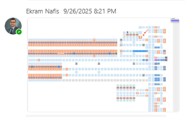

**Short description:** Nested image from a Teams chat showing a small grid-style status screenshot with many colored blocks; exact labels and values are unreadable.

**Detailed description:** The cropped artifact appears to be a screenshot embedded in a Teams message from Ekram Nafis dated 9/26/2025 8:21 PM. The visible image shows a dashboard- or matrix-like interface composed of many small rectangular cells in multiple colors, primarily light blue and orange, with a few darker blue cells. No reliable text labels, system name, or numeric details are readable from the artifact image. Because the artifact OCR is garbled and the screenshot content is too small to read, the artifact can only be described at a high level as a status-style grid or heatmap view that may represent operational state. Page context indicates the surrounding conversation concerns a site reported as down and inability to start or continue sort operations at UPS Haslet TX (TXRTH), but that context should not be treated as text visible inside the cropped screenshot.

#### What To Look At

- Overall grid or matrix layout
- Color distribution across the cells
- Any reviewer-visible labels or legends not captured by OCR
- Whether the screenshot can be matched by an SME to a known operational dashboard

#### Source Supported Claims

- The artifact is a nested screenshot shared in a Teams chat message from Ekram Nafis at 9/26/2025 8:21 PM. (page_ocr_context)
- The screenshot shows a color-coded grid or matrix with many small blue and orange cells. (visual_image)
- The artifact OCR is not reliable enough to extract meaningful text from the screenshot. (artifact_ocr)
- Surrounding page context includes statements that the site was reported as down and that they could not start the sort at all or went down in the middle of sort. (page_ocr_context)
- The case belongs to UPS Haslet TX (TXRTH) per ingestion metadata. (stage2_classification)

#### Review Uncertainty

- The embedded screenshot content is too small to identify the application or exact status.
- Artifact OCR is garbled and cannot be used to recover labels or values.
- Operational issue details come from surrounding page context, not from readable text inside the screenshot.

#### Quality Notes

- Artifact OCR quality is marked garbled.
- Image is low-detail at this crop size, limiting interpretation.
- Page OCR is usable and provides incident context, but it should not be treated as text visible inside the artifact.

### artifact_incident_223554_page_007_nested_image_01

| Field | Value |
| --- | --- |
| Page | 7 |
| Image type | unknown_incident_evidence |
| Evidence role | incident_context_evidence |
| OCR quality | garbled |
| Duplicate group |  |
| Validation status | needs_sme_review |

**Short description:** Small cropped UI-like image showing a grid of light blue blocks with several orange-highlighted tiles and a blue horizontal line.

**Detailed description:** The artifact is a small, low-detail screenshot or graphic rather than readable text content. It shows a pale background with multiple rectangular light blue blocks arranged in rows and columns. A blue horizontal line runs across the upper portion of the image and appears to connect to circular orange-and-blue markers near the right side. Several orange rectangular tiles with white icon-like shapes are visible, including one near the upper left, one near the right-center, and one near the lower right. Because the crop is small and OCR is garbled, the specific application, labels, and operational meaning cannot be determined from this artifact alone. The packet site metadata identifies the case as UPS Haslet TX (TXRTH), but no readable site-specific text is visible inside the artifact image.

#### What To Look At

- Orange-highlighted tiles and circular markers
- Blue horizontal connection line
- Any reviewer-recognizable facility or system layout pattern
- Whether the orange elements correspond to alarms, selections, or route/status indicators in the source system

#### Source Supported Claims

- The artifact is a small cropped image showing a grid of blocks, colored markers, and connecting blue lines rather than readable text. (visual_image)
- No reliable text can be extracted from the artifact because the artifact OCR quality is garbled. (artifact_ocr)
- The case ingestion metadata associates this artifact with UPS Haslet TX (TXRTH). (page_ocr_context)
- The artifact is currently treated as a unique artifact rather than a duplicate. (stage2_classification)

#### Review Uncertainty

- The exact application or interface shown in the crop cannot be identified from the image alone.
- The operational meaning of the orange and blue symbols is unclear.
- No site-specific text is visible in the artifact, so the UPS Haslet TX association comes from ingestion metadata rather than the image content.

#### Quality Notes

- Artifact OCR quality is marked garbled and should not be relied on for factual extraction.
- Page OCR quality is also garbled, limiting surrounding context.
- The crop is small and visually sparse, so interpretation should be confirmed by an SME familiar with the source system.

### artifact_incident_223554_page_007_nested_image_02

| Field | Value |
| --- | --- |
| Page | 7 |
| Image type | unknown_incident_evidence |
| Evidence role | incident_context_evidence |
| OCR quality | garbled |
| Duplicate group |  |
| Validation status | needs_sme_review |

**Short description:** Small cropped image showing a row of repeated orange-and-white UI tiles or icons above blue and gray rectangular blocks.

**Detailed description:** The artifact is a very small, low-detail cropped screenshot fragment. Visually it shows many repeated orange square tiles across the top, each containing a white symbol that resembles a code, terminal, or application icon. Beneath the orange row are repeated blue horizontal bars and a lower row of pale blue and gray rectangular blocks. No clearly readable text is visible in the image, and the provided artifact/page OCR is garbled, so the exact application, system state, and incident relevance cannot be determined from this artifact alone.

#### What To Look At

- Repeated orange icon tiles across the top row
- Any highlighted or selected tile near the right side
- Blue horizontal bars beneath the orange tiles
- Whether the tiled layout corresponds to stations, services, or devices in a known customer UI
- Any reviewer-recognizable UI pattern that could identify the application

#### Source Supported Claims

- The artifact image shows a repeated tiled interface with orange icon tiles across the top and blue/gray blocks below. (visual_image)
- No reliable readable text can be extracted from the artifact because OCR quality is garbled. (artifact_ocr)
- This artifact is associated with the UPS Haslet TX (TXRTH) case based on ingestion source metadata. (page_ocr_context)
- Stage 2 classified this artifact as unique and of unknown incident evidence type. (stage2_classification)

#### Review Uncertainty

- The specific system or application shown in the screenshot fragment is unknown.
- The image does not provide enough readable detail to determine whether it shows a normal or abnormal condition.
- Site-specific location is known from ingestion metadata only, not from visible text in the artifact.
- Incident relevance may depend on parent image or surrounding case context not visible in this crop.

#### Quality Notes

- Artifact OCR quality is garbled and should not be relied on for factual extraction.
- Page OCR quality is also garbled, limiting surrounding context.
- The crop is very small and contains mostly iconography rather than readable text.
- Interpretation should rely primarily on visual layout rather than OCR.

### artifact_incident_223554_page_007_nested_image_03

| Field | Value |
| --- | --- |
| Page | 7 |
| Image type | unknown_incident_evidence |
| Evidence role | unknown |
| OCR quality | garbled |
| Duplicate group |  |
| Validation status | needs_sme_review |

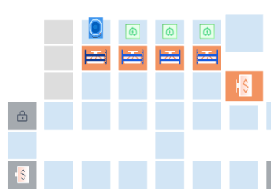

**Short description:** Small cropped grid-style UI image with several highlighted tiles and no readable text.

**Detailed description:** The artifact is a small screenshot-like crop showing a light-colored grid or dashboard layout composed of rectangular tiles. Several tiles near the upper middle are outlined or filled in orange, and a few top-row tiles contain small icon graphics in blue, green, and orange. Two tiles on the left and lower-left edges appear gray with small lock-like or symbol icons. No readable text is visible in the image, and both artifact OCR and page OCR are garbled or missing, so the specific application, labels, and incident relevance cannot be determined from this artifact alone.

#### What To Look At

- Orange-highlighted tiles in the upper middle of the grid
- Small icons in the top-row tiles
- Gray tiles with small icons on the left side
- Any reviewer-recognizable application layout or facility map pattern

#### Source Supported Claims

- The artifact contains a grid-like interface with several orange-highlighted tiles. (visual_image)
- No readable text could be extracted from the artifact because OCR quality is garbled. (artifact_ocr)
- The case ingestion metadata associates this artifact with UPS Haslet TX (TXRTH). (page_ocr_context)
- Stage 2 classified this artifact as unknown incident evidence and marked it for SME review. (stage2_classification)

#### Review Uncertainty

- The specific system or interface shown cannot be identified from the crop alone.
- The operational meaning of the orange-highlighted tiles is unclear.
- No source-supported incident symptom, action, or validation can be confidently derived from this artifact.

#### Quality Notes

- Artifact OCR is garbled and provides no usable text.
- Page OCR is also garbled and does not provide reliable surrounding context.
- The crop is small and icon-level details are difficult to interpret.

### artifact_incident_223554_page_007_nested_image_04

| Field | Value |
| --- | --- |
| Page | 7 |
| Image type | unknown_incident_evidence |
| Evidence role | unknown |
| OCR quality | low |
| Duplicate group |  |
| Validation status | needs_sme_review |

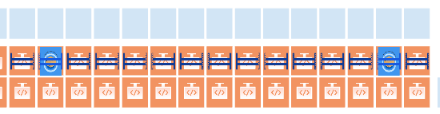

**Short description:** Small cropped image showing a repeated orange-and-blue logo/banner pattern with no clearly readable text.

**Detailed description:** The artifact is a narrow horizontal crop containing many repeated rectangular tiles. Each tile appears to have an orange lower section and a blue/white upper section, with one or more circular blue emblem-like shapes visible in some positions. The image looks more like a repeated graphic, banner, or logo strip than a readable application screenshot. OCR extracted only low-confidence garbled characters, and no reliable page context is available. No incident-specific text, system state, hostname, timestamp, or action can be confirmed from this crop alone.

#### What To Look At

- Repeated orange-and-blue tile pattern
- Any reviewer-recognizable logo or branding in the repeated blocks
- Whether this crop is merely decorative or has incident relevance in the parent image

#### Source Supported Claims

- The artifact shows a repeated orange-and-blue tiled graphic pattern. (visual_image)
- No reliable readable text can be extracted from the crop. (artifact_ocr)
- The artifact belongs to case 223554 page 7 and is associated in ingestion metadata with UPS Haslet TX (TXRTH). (stage2_classification)

#### Review Uncertainty

- The crop is too limited to determine whether it is incident-relevant evidence or a repeated decorative/branding element.
- No readable text or site-specific text is visible in the image.
- Operational state cannot be assessed from this artifact.

#### Quality Notes

- Artifact OCR is low quality and appears garbled.
- Page OCR context is garbled and not useful for interpretation.
- Visual interpretation is limited because the crop is small and repetitive.

### artifact_incident_223554_page_007_nested_image_05

| Field | Value |
| --- | --- |
| Page | 7 |
| Image type | unknown_incident_evidence |
| Evidence role | unknown |
| OCR quality | garbled |
| Duplicate group |  |
| Validation status | needs_sme_review |

**Short description:** Small cropped UI icon grid with blue and orange outlined tiles; no readable text is visible.

**Detailed description:** The artifact is a very small cropped image showing several rectangular tiles arranged in a grid. Multiple center tiles have blue borders and contain circular icon-like shapes connected by short horizontal lines. A right-side column contains similar tiles outlined in orange. No legible text, timestamps, hostnames, or status labels are visible in the crop. Because the image is tiny and OCR is garbled, the specific application, function, and incident relevance cannot be determined from this artifact alone.

#### What To Look At

- Blue-outlined center tiles
- Orange-outlined right-side tiles
- Any icon pattern differences between highlighted tiles
- Whether a reviewer can identify the application or diagram type from surrounding case materials

#### Source Supported Claims

- The artifact is a small screenshot-like crop showing a grid of UI tiles with blue and orange outlined elements. (visual_image)
- No readable text is available from the artifact OCR. (artifact_ocr)
- The artifact is associated by ingestion metadata with UPS Haslet TX (TXRTH). (stage2_classification)

#### Review Uncertainty

- The specific application, workflow, or diagram represented by the crop is unclear.
- The operational meaning of the orange versus blue outlines cannot be determined from the image alone.
- No source-supported incident action, symptom, or validation detail can be extracted confidently.

#### Quality Notes

- Artifact OCR is marked garbled and provides no usable text.
- Page OCR is also garbled and does not provide reliable surrounding context.
- The crop is very small, limiting interpretation.

### artifact_incident_223554_page_007_nested_image_06

| Field | Value |
| --- | --- |
| Page | 7 |
| Image type | unknown_incident_evidence |
| Evidence role | unknown |
| OCR quality | garbled |
| Duplicate group |  |
| Validation status | needs_sme_review |

**Short description:** Small cropped image showing orange icon tiles on a light background; content is too limited to determine incident relevance.

**Detailed description:** The artifact is a very small cropped image containing several pale blue/gray rectangular blocks and multiple orange square tiles with a white symbol inside each tile. The crop appears icon-like or diagrammatic rather than a readable application screenshot. No reliable text is visible in the image, and both artifact OCR and page OCR are marked garbled or effectively missing. Because the crop is tiny and lacks readable labels, the specific system, message, or incident meaning cannot be determined from this artifact alone.

#### What To Look At

- Orange square tiles and their white internal symbols
- Arrangement of pale rectangular blocks around the tiles
- Whether this crop matches a known application icon set or facility layout in the parent image
- Any reviewer-confirmed context from the surrounding case materials

#### Source Supported Claims

- The artifact is a small cropped image showing orange icon-like tiles and pale rectangular blocks on a light background. (visual_image)
- No reliable readable text can be extracted from the artifact. (artifact_ocr)
- The OCR quality for both the artifact and surrounding page context is garbled, limiting interpretation. (stage2_classification)

#### Review Uncertainty

- The artifact may be an icon set, diagram fragment, or partial UI element, but this cannot be confirmed from the crop alone.
- Incident relevance is not directly visible in the image.
- No site-specific text is visible to connect the image content to UPS Haslet TX beyond ingestion metadata.

#### Quality Notes

- Artifact OCR quality is garbled and not usable for factual extraction.
- Page OCR quality is also garbled, so surrounding context cannot be relied on.
- The crop is very small, which limits visual interpretation.

### artifact_incident_223554_page_008_nested_image_01

| Field | Value |
| --- | --- |
| Page | 8 |
| Image type | unknown_incident_evidence |
| Evidence role | diagnostic_evidence |
| OCR quality | garbled |
| Duplicate group |  |
| Validation status | needs_sme_review |

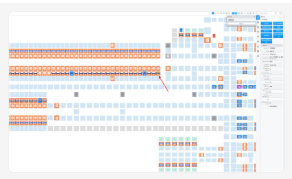

**Short description:** Small HMI-style layout screenshot showing a grid/rack map with highlighted cells and a red arrow annotation.

**Detailed description:** The cropped artifact appears to be a screenshot from an HMI or warehouse/AGV-related interface. It shows a large grid-like layout composed of many small rectangular cells, with several cells highlighted in orange and blue. A red arrow annotation points toward a location in the middle portion of the layout. A narrow panel with controls or status fields is visible on the right side, but the text inside the crop is too small to read reliably. The artifact OCR is garbled, so the image is the primary evidence. Surrounding Teams chat context indicates discussion of an AGV that 'doesn't belong here' and mentions two AGVs under the rack in the same zone, associated with UPS Haslet TX (TXRTH) ingestion metadata.

#### What To Look At

- The red arrow annotation and the exact grid location it points to
- Any duplicated or conflicting AGV positions in the rack/grid view
- The right-side panel for unreadable but potentially important status labels
- Whether colored cells indicate occupancy, alarms, or blocked positions

#### Source Supported Claims

- The artifact is a screenshot of a system UI showing a grid or rack-style layout with colored cells. (visual_image)
- A red arrow annotation is visible and appears to call attention to a specific location on the layout. (visual_image)
- The surrounding Teams chat states, 'This AGV doesn't belong here, we have two AGVs under the rack in the same zone.' (page_ocr_context)
- The surrounding Teams chat discusses an operational symptom where users could remove totes but could not add them. (page_ocr_context)
- The incident ingestion metadata associates this case with UPS Haslet TX (TXRTH). (page_ocr_context)

#### Review Uncertainty

- The cropped screenshot is low resolution and most in-image text is unreadable.
- Artifact OCR is marked garbled, so no reliable text can be extracted from the crop itself.
- Interpretation of the screenshot's meaning depends significantly on surrounding Teams chat context.

#### Quality Notes

- Artifact OCR quality is garbled and should not be relied on for factual extraction.
- Visual interpretation is limited to layout, color blocks, and annotation rather than readable labels.
- Page OCR quality is usable and provides the main contextual explanation for the screenshot.

### artifact_incident_223554_page_009_nested_image_01

| Field | Value |
| --- | --- |
| Page | 9 |
| Image type | unknown_incident_evidence |
| Evidence role | incident_context_evidence |
| OCR quality | garbled |
| Duplicate group |  |
| Validation status | needs_sme_review |

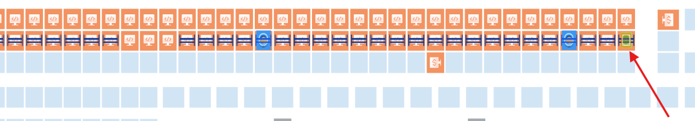

**Short description:** Annotated facility layout image showing a long row of positions with a red arrow pointing to one highlighted location near the right side.

**Detailed description:** The cropped artifact appears to be a simplified site or equipment layout diagram rather than a standard software UI. It shows a long horizontal row of repeated orange and blue position markers across the top portion of the image, with light blue rectangular blocks below. Near the right side, one position is outlined with a yellow/green highlight, and a large red arrow points directly at that highlighted position. A few other positions are marked with blue circular annotations. No reliable readable text is visible in the crop, and OCR for both the artifact and page is marked garbled. Based on the ingestion metadata, this artifact belongs to UPS Haslet TX (TXRTH), but the site name is not visibly readable inside the cropped image itself.

#### What To Look At

- The yellow/green highlighted position near the right side
- The red arrow pointing to that position
- Any repeated layout markers that may correspond to equipment or bays
- Whether related artifacts or page context identify what the highlighted location represents

#### Source Supported Claims

- The artifact shows an annotated layout-style image with a red arrow pointing to a highlighted position near the right side. (visual_image)
- The artifact does not provide reliable readable text because OCR quality is garbled. (artifact_ocr)
- The incident packet is associated with UPS Haslet TX (TXRTH) in ingestion metadata. (stage2_classification)

#### Review Uncertainty

- The exact system, facility area, or asset represented by the layout cannot be identified from the crop alone.
- No source-supported readable text confirms what the highlighted location means.
- The site association comes from ingestion metadata, not visible text inside the image.

#### Quality Notes

- Artifact OCR quality is garbled and should not be relied on for factual extraction.
- Page OCR quality is also garbled, limiting surrounding context.
- Interpretation is based primarily on visible shapes, annotations, and highlighting in the image.

### artifact_incident_223554_page_009_nested_image_02

| Field | Value |
| --- | --- |
| Page | 9 |
| Image type | unknown_incident_evidence |
| Evidence role | incident_context_evidence |
| OCR quality | garbled |
| Duplicate group |  |
| Validation status | needs_sme_review |

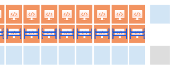

**Short description:** Small low-detail cropped image showing a repeated grid of orange and blue UI-like tiles; incident relevance is unclear.

**Detailed description:** The artifact is a very small cropped image with repeated rectangular tiles arranged in rows. The upper row appears orange with small white icon-like markings, the middle row contains narrow blue horizontal bands, and the lower row appears light blue/gray. A light blue block is visible at the upper right and a gray block at the lower right. No readable text is visible in the image, and both artifact OCR and page OCR are garbled or missing. The image may be a fragment of a dashboard, HMI, or other software interface, but the specific system, labels, and operational meaning cannot be determined from this crop alone. The case ingestion metadata associates the incident with UPS Haslet TX (TXRTH), but no site-specific text is visible inside this artifact.

#### What To Look At

- Repeated orange tiles with white icon-like symbols
- Blue horizontal bands beneath the orange tiles
- Any reviewer-confirmed identification of the UI or system shown
- Whether the parent image or surrounding evidence clarifies what these tiles represent

#### Source Supported Claims

- The artifact shows a repeated grid of orange, blue, and light blue/gray rectangular UI-like tiles. (visual_image)
- No readable text can be extracted from the artifact image. (artifact_ocr)
- The artifact is associated with case 223554, whose ingestion metadata identifies the site as UPS Haslet TX (TXRTH). (stage2_classification)

#### Review Uncertainty

- The artifact is too small and abstract to identify the application or operational meaning.
- No readable text is visible in the image.
- OCR quality is garbled for both the artifact and the page context.
- The crop may be incident-relevant, but that relevance cannot be confirmed from this artifact alone.

#### Quality Notes

- Artifact OCR quality is garbled.
- Page OCR quality is garbled.
- Visual interpretation relies primarily on color blocks and layout rather than text.
- No site-specific text is visible in the artifact; site association comes from ingestion metadata only.

### artifact_incident_223554_page_009_nested_image_03

| Field | Value |
| --- | --- |
| Page | 9 |
| Image type | unknown_incident_evidence |
| Evidence role | incident_context_evidence |
| OCR quality | garbled |
| Duplicate group |  |
| Validation status | needs_sme_review |

**Short description:** Small cropped image showing a simplified map or facility-layout style graphic with colored rectangular blocks.

**Detailed description:** The artifact is a very small, low-detail cropped image. It appears to show a schematic or map-like layout composed of light blue rectangular blocks on a light background, with one orange block containing a small symbol or letters that are not legible at this resolution. No clearly readable text, system status, timestamps, or tool-specific UI labels are visible in the crop. OCR for both the artifact and page context is garbled or missing, so interpretation is limited to the visible shapes and colors only.

#### What To Look At

- The orange highlighted rectangular block
- The surrounding arrangement of blue rectangular blocks
- Whether this crop matches a facility map, sorter map, or location layout in related evidence
- Any reviewer-confirmed meaning of the highlighted block

#### Source Supported Claims

- The artifact shows a small schematic-like image with light blue rectangular blocks and one orange highlighted block. (visual_image)
- No reliable readable text can be extracted from the cropped artifact because OCR quality is garbled. (artifact_ocr)
- The incident ingestion metadata for this case is UPS Haslet TX (TXRTH). (duplicate_metadata)
- This artifact is marked as a unique artifact rather than a duplicate. (stage2_classification)

#### Review Uncertainty

- The artifact content is ambiguous and may be a map, layout, or schematic, but this cannot be confirmed from the crop alone.
- No readable text is available to identify the system, location within the site, or incident significance.
- The orange block may indicate a selected or highlighted area, but its meaning is not source-supported.

#### Quality Notes

- Artifact OCR quality is garbled.
- Page OCR quality is garbled.
- The crop is very small and low-detail, limiting reliable interpretation.
- Visual interpretation relies almost entirely on basic shapes and colors.

### artifact_incident_223554_page_014_nested_image_01

| Field | Value |
| --- | --- |
| Page | 14 |
| Image type | unknown_incident_evidence |
| Evidence role | incident_context_evidence |
| OCR quality | garbled |
| Duplicate group |  |
| Validation status | needs_sme_review |

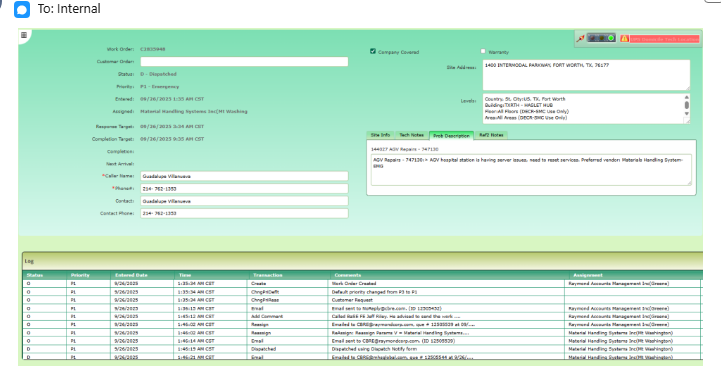

**Short description:** Screenshot of a service/work-order style application showing a dispatched emergency ticket for UPS Haslet/Fort Worth with notes about an ACB hospital station issue.

**Detailed description:** The cropped artifact appears to be a screenshot from a service management or dispatch/work-order application. The visible form shows a work order identifier, customer and site details, dispatch/status fields, assigned personnel, timestamps, contact information, and a notes/comments area. The image visually shows the site address as 1400 Intermodal Parkway, Fort Worth, TX 76177, which aligns with the ingestion site metadata for UPS Haslet TX (TXRTH). In the notes area, visible text indicates an ACB hospital station is having a server issue and needs a reset service, with a reference to a vendor and handling system. A lower log/history table shows multiple status or transaction entries, but most row text is too small to read confidently. The artifact provides incident context and likely diagnostic/symptom context, but the exact system name and many field values remain uncertain due to image resolution and garbled OCR.

#### What To Look At

- Visible status and priority fields
- Site address field showing Fort Worth / Haslet location
- Notes/comments text referencing ACB hospital station server issue
- Lower log/history table for possible dispatch or assignment timeline details
- Any reviewer-confirmed field labels or system name

#### Source Supported Claims

- The artifact is a screenshot of a service/work-order style application with dispatch and incident fields. (visual_image)
- The visible status in the screenshot is dispatched. (visual_image)
- The visible priority appears to be P1 / emergency. (visual_image)
- The screenshot shows the site address as 1400 Intermodal Parkway, Fort Worth, TX 76177. (visual_image)
- The notes/comments area appears to mention an ACB hospital station having a server issue and needing reset service. (visual_image)
- The surrounding case page identifies the account name as UPS Fort Worth, TX (Haslet). (page_ocr_context)
- The surrounding case page subject is 'acb hospital unable to induct'. (page_ocr_context)

#### Review Uncertainty

- Artifact OCR is marked garbled and should not be used for detailed extraction.
- Several field values, names, and timestamps are too small to confirm precisely from the image.
- The notes/comments wording is only partially legible and should be SME-verified before quoting exactly.
- The screenshot's exact source application is unclear.

#### Quality Notes

- Primary interpretation is based on visible image content because artifact OCR quality is garbled.
- Page OCR is usable for surrounding case context only and should not be treated as text visible inside the cropped artifact.
- Site evidence is consistent with ingestion metadata: UPS Haslet TX (TXRTH) and page context 'UPS Fort Worth, TX (Haslet)'.

### artifact_incident_223554_page_015_nested_image_01

| Field | Value |
| --- | --- |
| Page | 15 |
| Image type | windows_services_screenshot |
| Evidence role | action_evidence |
| OCR quality | usable |
| Duplicate group | dup_incident_001 |
| Validation status | needs_sme_review |

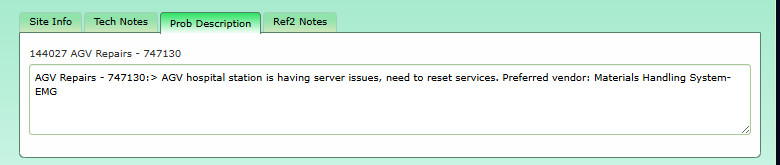

**Short description:** Application notes screen showing an AGV repair note about server issues at an AGV hospital station and a need to reset services.

**Detailed description:** The cropped image shows a tabbed application window with tabs including Site Info, Tech Notes, Prob Description, and Ref2 Notes. The visible content appears to be a notes or problem description text area. The text shown in the image includes a repair reference "144027 AGV Repairs - 747130" and a note stating that the AGV hospital station is having server issues and that services need to be reset. The note also lists a preferred vendor as Materials Handling System-EMG. Page context indicates this evidence is associated with case 223554 for UPS Haslet TX (TXRTH), but the site name is not visibly shown inside the cropped artifact itself.

#### What To Look At

- The note text describing server issues at the AGV hospital station
- Any visible wording about resetting services
- The repair/reference number 144027 AGV Repairs - 747130
- The preferred vendor text

#### Source Supported Claims

- The artifact shows a note entry labeled with "144027 AGV Repairs - 747130." (visual_image)
- The visible note states that the AGV hospital station is having server issues and that services need to be reset. (visual_image)
- The note lists a preferred vendor as Materials Handling System-EMG. (artifact_ocr)
- Page context indicates the surrounding case/work order was in dispatched status with emergency priority and assigned to Material Handling Systems Inc. (page_ocr_context)
- This artifact is marked as a duplicate of primary artifact_incident_223554_page_005_nested_image_01. (duplicate_metadata)

#### Review Uncertainty

- The packet labels the image type as windows_services_screenshot, but the visible crop looks more like an application notes pane than a Windows Services console.
- The preferred vendor text is readable but slightly truncated/noisy at the end in OCR.
- The site association to UPS Haslet TX (TXRTH) comes from ingestion metadata and page context, not from clearly visible site text inside the crop.

#### Quality Notes

- Artifact OCR is usable and generally aligns with the visible note text.
- Page OCR is partially garbled in the lower log area, so only the clearer work-order fields should be relied on.
- Image is a small cropped nested screenshot with limited surrounding UI context.

### artifact_incident_223554_page_015_nested_image_02

| Field | Value |
| --- | --- |
| Page | 15 |
| Image type | unknown_incident_evidence |
| Evidence role | incident_context_evidence |
| OCR quality | usable |
| Duplicate group | dup_incident_002 |
| Validation status | needs_sme_review |

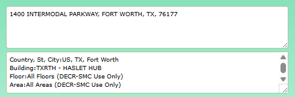

**Short description:** Location/building selection panel showing the UPS Haslet TXRTH site address and building details.

**Detailed description:** The cropped artifact appears to be a small UI panel or form section containing site/location information rather than operational system status. Visible text shows the address "1400 INTERMODAL PARKWAY, FORT WORTH, TX, 76177" and additional location fields including country/state/city, building, floor, and area. The building field reads "TXRTH - HASLET HUB," which aligns with the ingestion site metadata for UPS Haslet TX (TXRTH). The floor and area fields both indicate broad scope selections: "All Floors (DECR-SMC Use Only)" and "All Areas (DECR-SMC Use Only)." Page context suggests this artifact is embedded within a work order/case page, but the cropped image itself does not show incident symptoms, alarms, or remediation actions.

#### What To Look At

- Address field at the top of the panel
- Building field showing TXRTH - HASLET HUB
- Country/state/city line showing US, TX, Fort Worth
- Floor and area scope fields
- Whether this location panel ties the work order to the UPS Haslet TX site

#### Source Supported Claims

- The artifact shows the address "1400 INTERMODAL PARKWAY, FORT WORTH, TX, 76177". (visual_image)
- The artifact shows location fields including country/state/city as "US, TX, Fort Worth". (artifact_ocr)
- The artifact shows the building as "TXRTH - HASLET HUB". (visual_image)
- The artifact shows floor scope as "All Floors (DECR-SMC Use Only)" and area scope as "All Areas (DECR-SMC Use Only)". (visual_image)
- The surrounding page context includes a work order with status "D- Dispatched" and priority "Emergency". (page_ocr_context)
- This artifact is the primary item in duplicate group dup_incident_002. (duplicate_metadata)

#### Review Uncertainty

- The artifact appears to be a cropped location/details panel without enough surrounding UI to identify the exact application.
- The page OCR contains some garbled log text, so only the clearer work-order fields should be relied on for context.
- The address uses Fort Worth, TX while ingestion metadata identifies UPS Haslet TX (TXRTH); these appear compatible, but SME review can confirm exact site naming conventions.

#### Quality Notes

- Artifact OCR quality is usable and aligns well with the visible text.
- Page OCR quality is usable overall but partially garbled in the log section.
- This artifact is useful for site/building identification, not for diagnosing system state.

### artifact_incident_223554_page_015_nested_image_03

| Field | Value |
| --- | --- |
| Page | 15 |
| Image type | unknown_incident_evidence |
| Evidence role | incident_context_evidence |
| OCR quality | low |
| Duplicate group |  |
| Validation status | needs_sme_review |

**Short description:** Cropped image showing repeated contact name and phone number fields for Guadalupe Villanueva.

**Detailed description:** The cropped artifact appears to be a small form or contact-information snippet with four horizontal fields. The visible text shows the name "Guadalupe Villanueva" and the phone number "214-762-1353," each repeated twice. The image itself does not show broader case details, but the surrounding page OCR indicates this contact information is associated with a dispatched emergency work order on page 15 of case 223554. Site ingestion metadata identifies the case as UPS Haslet TX (TXRTH).

#### What To Look At

- Repeated contact name fields
- Repeated phone number fields
- Whether the duplication is intentional UI layout or duplicated capture content
- Relationship between the cropped contact details and the surrounding work order page context

#### Source Supported Claims

- The cropped artifact shows the name "Guadalupe Villanueva." (visual_image)
- The cropped artifact shows the phone number "214-762-1353." (visual_image)
- The same name and phone number appear twice within the cropped artifact. (visual_image)
- Surrounding page context identifies Guadalupe Villanueva as both caller/contact with phone number 214-762-1353. (page_ocr_context)
- Surrounding page context references Work Order C2825948 with status "D- Dispatched" and priority "Emergency." (page_ocr_context)
- The case ingestion metadata associates this evidence with UPS Haslet TX (TXRTH). (page_ocr_context)

#### Review Uncertainty

- The artifact OCR is marked low quality even though the visible text appears readable.
- The crop does not reveal the full application or form context.
- The page OCR contains garbled log text after the contact section, so only the clearer work order and contact fields should be relied upon.
- The artifact itself does not visually confirm the UPS Haslet TX site; that association comes from ingestion metadata.

#### Quality Notes

- Image content is simple and readable, but OCR quality is flagged low.
- Page OCR is usable for surrounding context but partially garbled in the log section.
- Contact information is visible in the crop; work order status and priority are supported only by surrounding page OCR.
