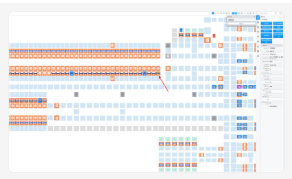
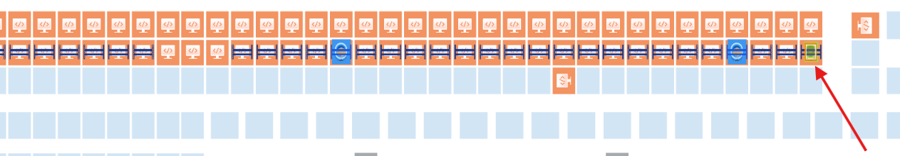

# Recover hospital tote flow using Apidog / WCS API and validate AGV operation

## Runbook Header

| Field | Value |
| --- | --- |
| Procedure ID | `proc_recover_hospital_tote_flow_apidog_wcs_api_v1` |
| Title | Recover hospital tote flow using Apidog / WCS API and validate AGV operation |
| Procedure Type | `recovery` |
| Primary Role | `L2_support` |
| Supporting Roles | `operator` |
| Support Safe | Yes |
| Capability Tags | `tote_lifecycle_state`, `agv_physical_recovery`, `fleet_system_status` |
| Access Surface | `apidog`, `wcs_api`, `tipper_hmi`, `hospital_hmi` |
| Audience Roles | `L2_support`, `operator` |
| Failure Pattern Tags | `tote_error_noread_or_mismatch`, `zone_agv_mismatch` |
| Validation Status | `needs_sme_review` |
| Merge Status | `source_finalized` |

## Summary

For the UPS Haslet TX (TXRTH) hospital-station tote-induction condition, use the Tipper HMI / WebVisu / VISU to pause the station when operators are not present at the tippers, then use Apidog / WCS API to remove the inducted or disconnected tote state and recover affected AGV state. Validate tote add/remove operation on the Hospital HMI / lane UI, confirm affected robots are re-added and operating, and confirm the system is running. The incident did not establish a single definitive root cause or provide exact API request names, parameters, or AGV control names.

## When To Use

Use for a hospital-station condition where totes cannot be added or inducted, especially when an inducted tote or disconnected tote association is present and Apidog / WCS API recovery actions are identifiable on the live system. Coordinate the recovery with the Tipper HMI / WebVisu / VISU and validate the result on the Hospital HMI / lane UI.

## Do Not Use For

* Do not use for an undocumented API request, parameter, AGV control, or tote mutation that cannot be identified on the live Apidog / WCS API surface.
* Do not treat the AGV/tote association as the confirmed root cause; the incident recorded multiple possible contributing conditions.
* Do not use as a physical AGV handling or E-stop procedure; the supplied incident evidence does not define physical handling steps.
* Do not continue recovery if tote operations remain unavailable, robots cannot be re-added, or the required Apidog / WCS API action is not identifiable.

## Safety And Operational Notes

* When operators are not present at the tippers, pause the station on the Tipper HMI / WebVisu / VISU during recovery so totes do not continue going to the hospital.
* Do not perform an API or AGV state change unless the live Apidog / WCS API surface clearly identifies the supported recovery action.

## Access Or Tools Needed

* Apidog / WCS API client
* OptiSweep / WCS API
* Tipper HMI / WebVisu / VISU
* Hospital HMI / lane UI
* Affected AGV and tote identifiers from the live incident state

## Visual References

*Annotated HMI-style layout showing the AGV location anomaly and the reported condition of two AGVs under the rack in the same zone.*

*Annotated facility layout showing the highlighted AGV or zone location involved in the incident.*

## Procedure Steps

### Step 1 — Pause the hospital feed at the tippers

**Responsible role:** operator

**Instruction:**
On the Tipper HMI / WebVisu / VISU, place the station on pause before recovery when operators are not present at the tippers.

**Expected result:**
The Tipper HMI / WebVisu / VISU shows the station in a paused state while recovery is in progress.

**Stop or Escalate If:**

* Operators are present at the tippers and the station state cannot be coordinated safely.
* The Tipper HMI / WebVisu / VISU does not identify a pause state.

---

### Step 2 — Remove the inducted tote through Apidog / WCS API

**Responsible role:** L2_support

**Instruction:**
On the Apidog / WCS API client, identify the inducted tote associated with the hospital flow condition and use the source-supported tote-removal action. Use only the live request or action that is explicitly identifiable; the incident does not provide a request name or parameters.

**Expected result:**
The Apidog / WCS API response or live tote state shows that the identified inducted tote has been removed or is no longer blocking the hospital flow.

**Stop or Escalate If:**

* The required tote-removal action or affected tote is not identifiable on Apidog / WCS API.
* The API response does not show a successful removal or the tote remains in the blocking state.

---

### Step 3 — Address the disconnected tote association in Apidog / WCS API

**Responsible role:** L2_support

**Instruction:**
On the Apidog / WCS API client, inspect the affected AGV and tote association. For the documented tote 51 condition, use the source-supported API action when the tote cannot be removed from the hospital through the normal live operation. Do not infer or invent an API request name.

**Expected result:**
The Apidog / WCS API live state no longer shows the targeted disconnected tote association as blocking the hospital flow, or the API returns the supported removal result.

**Stop or Escalate If:**

* The affected AGV or tote association cannot be identified on Apidog / WCS API.
* The disconnected tote remains after the supported API action.
* The live state does not match the documented tote condition and no supported action is identifiable.

---

### Step 4 — Recover affected AGVs through Apidog / WCS API

**Responsible role:** L2_support

**Instruction:**
On Apidog / WCS API, identify the affected AGVs and use only the source-supported AGV recovery action to remove them from the obstructed state or location and re-add them as required by the live system state. The incident identified AGVs 1542188, 1555028, and 1555012, but the current live identifiers must be confirmed before any change.

**Expected result:**
The affected AGVs are no longer shown in the obstructed or incorrect association state on Apidog / WCS API, and the required robots are re-added to the live system roster.

**Screens / Images:**

*Annotated HMI-style layout showing the AGV location anomaly and the reported condition of two AGVs under the rack in the same zone.*

*Annotated facility layout showing the highlighted AGV or zone location involved in the incident.*

**Stop or Escalate If:**

* The live AGV identifier or supported recovery action is not identifiable on Apidog / WCS API.
* An AGV cannot be re-added after the supported recovery action.
* The AGV remains in an unexpected location or duplicate-zone condition.

---

### Step 5 — Validate tote add and remove on the Hospital HMI / lane UI

**Responsible role:** operator

**Instruction:**
On the Hospital HMI / lane UI, verify that the hospital station can add a tote and remove a tote again. Have L2 support observe the live result as needed.

**Expected result:**
The Hospital HMI / lane UI accepts both a tote-add operation and a tote-remove operation without the reported hospital induction restriction.

**Stop or Escalate If:**

* Totes cannot be added after the recovery actions.
* Totes cannot be removed or the Hospital HMI / lane UI remains unavailable.

---

### Step 6 — Confirm robots and system are running

**Responsible role:** L2_support

**Instruction:**
On the Hospital HMI / lane UI and the live Apidog / WCS API state, confirm that the affected robots have been re-added and are operating. Confirm that the system is running after recovery.

**Expected result:**
The affected robots are shown as re-added and operating, and the live system state is running.

**Stop or Escalate If:**

* Tote operations remain unavailable.
* Robots cannot be re-added or are not back up and running.
* The system is not running after the supported recovery actions.

---

## Success Criteria

* The Hospital HMI / lane UI accepts tote additions and removals.
* The affected robots are re-added and shown as back up and running.
* The live system is running after recovery.
* No undocumented Apidog / WCS API or AGV state change was performed.

## Failure Conditions

* The Hospital HMI / lane UI still cannot add totes.
* The targeted inducted or disconnected tote cannot be removed through the identifiable supported Apidog / WCS API action.
* An affected AGV remains disconnected, obstructed, incorrectly located, or cannot be re-added.
* The required API or AGV recovery action is not identifiable on the live surface.
* The system is not running after recovery.

## Escalation Guidance

* Escalate to L2/L3 review if the tote cannot be removed through the supported Apidog / WCS API action, the AGV association remains disconnected, or the Hospital HMI / lane UI still cannot add or remove totes.
* Stop before any API or AGV state change that is not explicitly identifiable from the live Apidog / WCS API state.
* Escalate the unresolved condition rather than assigning a definitive root cause; the incident recorded multiple possible contributing conditions.
* Coordinate with the site operator if the Tipper HMI / WebVisu / VISU pause state cannot be established.

## Missing Details / Known Gaps

* Exact Apidog / WCS API request names, parameters, authentication details, and response codes are not provided.
* Exact AGV recovery or re-add control names are not provided.
* The incident does not establish one normalized root cause.
* The packet does not provide a supported recovery time estimate.
* The packet does not establish whether the station pause constitutes a production stop.
* The incident also references service resets and a Hospital Lane restart, but does not provide enough live control detail to include them as procedure steps.

## Source Lineage

- Candidate IDs: candidate_incident_223554_hospital_tote_agv_recovery
- Source ID: `source_case_223554`
- Source Type: `incident_case`
