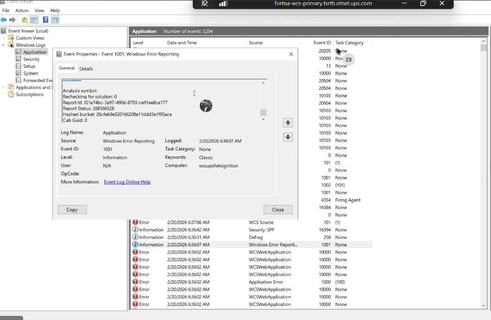

# Windows Event Viewer and Services diagnostic for OptiSweep and WCSWebApplication failures

## Runbook Header

| Field | Value |
| --- | --- |
| Procedure ID | `proc_windows_event_viewer_services_optisweep_wcswebapplication_diagnostic_v1` |
| Title | Windows Event Viewer and Services diagnostic for OptiSweep and WCSWebApplication failures |
| Procedure Type | `diagnostic` |
| Primary Role | `L2_support` |
| Supporting Roles | None |
| Support Safe | Yes |
| Capability Tags | `windows_service_or_event_log`, `wcs_service_health` |
| Access Surface | `event_viewer` |
| Audience Roles | `L2_support` |
| Failure Pattern Tags | `service_crash_or_restart`, `system_fault` |
| Validation Status | `needs_sme_review` |
| Merge Status | `source_finalized` |

## Summary

Use Windows Event Viewer / services to inspect the live Windows Application and System logs, then verify the current OptiSweep service state. Correlate WCSWebApplication database-command errors around 6:35-6:36 AM with OptiSweep Service Control Manager Event 7031 and the current Windows Services status before further recovery.

## When To Use

Use Windows Event Viewer / services when the live OptiSweep or WCS-backed system is unresponsive, when clustered WCSWebApplication errors are suspected, or when a service crash or restart must be correlated with the incident. Inspect the live Windows Application and System logs and current Windows Services state before performing further recovery.

## Do Not Use For

* Do not use this diagnostic alone to establish root cause.
* Do not treat a configured automatic restart after 60000 milliseconds as proof that OptiSweep recovery completed.
* Do not use this procedure as a substitute for RMS AGV status when the OptiSweep service is healthy.

## Safety And Operational Notes

* This is an inspection and diagnostic procedure; do not infer root cause from clustered errors.
* Automatic restart configuration records an intended Windows action, not confirmed service recovery.
* Do not perform further recovery based only on the historical service-state screenshot.

## Access Or Tools Needed

* Windows Event Viewer / services
* Windows Logs > Application
* Windows Logs > System
* Windows Services
* WCSWebApplication Event ID 20102
* OptiSweep Service Control Manager Event ID 7031

## Visual References

*Windows Event Viewer Application log showing Windows Error Reporting Event 1001 and clustered WCSWebApplication and Application Error entries around 6:36 AM.*

*Windows Event Viewer Application log showing WCSWebApplication Event ID 20102 and the 'Failed executing DbCommand (1,840ms)' message.*

*Windows Event Viewer System log showing OptiSweep Service Control Manager Event 7031, unexpected termination, and the planned 60000-millisecond restart.*

*Windows Services showing OptiSweep selected with Status Running and Startup Type Automatic.*

## Procedure Steps

### Step 1 — Inspect the Windows Event Viewer Application log

**Responsible role:** L2_support

**Instruction:**
In Windows Event Viewer / services, open Windows Logs > Application and inspect entries around 2/20/2026 6:35:24-6:36:07 AM. Open the WCSWebApplication error details, including Event ID 20102, and check nearby Application Error or Windows Error Reporting entries.

**Expected result:**
The Application log shows whether WCSWebApplication Event ID 20102 with 'Failed executing DbCommand (1,840ms)' and nearby clustered application errors are present in the inspected time window.

**Stop or Escalate If:**

* Stop and escalate if new or repeated WCSWebApplication errors are present.

---

### Step 2 — Inspect the OptiSweep termination event

**Responsible role:** L2_support

**Instruction:**
In Windows Event Viewer / services, select Windows Logs > System and open the Service Control Manager event for OptiSweep. Check for Event ID 7031, Level Error, and inspect whether the message states that OptiSweep terminated unexpectedly and Windows planned to restart it after 60000 milliseconds.

**Expected result:**
The System log identifies whether an OptiSweep Event ID 7031 termination is present and whether the event contains the 60000-millisecond restart message.

**Stop or Escalate If:**

* Stop and escalate if Event 7031 repeats or indicates that OptiSweep is terminating unexpectedly.

---

### Step 3 — Verify the current OptiSweep service state

**Responsible role:** L2_support

**Instruction:**
In Windows Event Viewer / services, open Windows Services, select OptiSweep, and inspect the current Status and Startup Type.

**Expected result:**
Windows Services displays the current OptiSweep Status and Startup Type, allowing the live service state to be compared with the Event Viewer evidence.

**Stop or Escalate If:**

* Stop and escalate if OptiSweep is not Running.

---

### Step 4 — Correlate Windows Event Viewer / services evidence with the live incident state

**Responsible role:** L2_support

**Instruction:**
Compare the timestamps and live entries in Windows Event Viewer / services with the current incident state and the current OptiSweep status in Windows Services. Do not treat the configured automatic restart as proof that recovery completed.

**Expected result:**
The diagnostic conclusion separately identifies the observed WCSWebApplication errors, any OptiSweep Event 7031 termination, and the current OptiSweep service state.

**Stop or Escalate If:**

* Stop and escalate if new or repeated WCSWebApplication errors are present.
* Stop and escalate if Event 7031 repeats.
* Stop and escalate if OptiSweep is not Running.
* Escalate when the evidence supports correlation but not a definitive root cause.

---

## Success Criteria

* Windows Event Viewer / services inspection identifies whether current Application log evidence includes WCSWebApplication Event ID 20102 or clustered related errors.
* Windows Event Viewer / services inspection identifies whether an OptiSweep Event ID 7031 termination is present and whether a 60000-millisecond restart was configured.
* Windows Services shows the current OptiSweep Status and Startup Type.
* The diagnostic conclusion does not claim recovery or root cause without live supporting evidence.

## Failure Conditions

* WCSWebApplication Event ID 20102 or clustered application errors are present or repeating in the current inspection.
* OptiSweep Event ID 7031 is present or repeating in the current System log inspection.
* OptiSweep is not shown as Running in Windows Services.
* The available evidence only shows a configured restart and does not establish that recovery completed.
* The evidence is insufficient to establish a definitive root cause.

## Escalation Guidance

* Escalate to L2/L3 investigation if new or repeated WCSWebApplication errors are observed.
* Escalate if OptiSweep Event 7031 repeats or OptiSweep is not Running.
* Do not infer root cause from clustered WCSWebApplication and OptiSweep errors; the incident evidence supports correlation only.
* Treat the 60000-millisecond automatic restart as configured behavior, not as confirmed recovery.

## Missing Details / Known Gaps

* Source-package site_location ingestion metadata is empty; site_code and structured site-location fields were not available.
* The Windows Services screenshot is not timestamped and does not establish whether the Running state occurred before or after a restart.
* The packet does not provide a definitive root cause for the WCSWebApplication errors or OptiSweep termination.
* The packet does not provide a confirmed current live result beyond the historical evidence supplied.

## Source Lineage

- Candidate IDs: candidate_incident_228086_event_viewer_optisweep_failure_diagnostic
- Source ID: `source_case_228086`
- Source Type: `incident_case`
