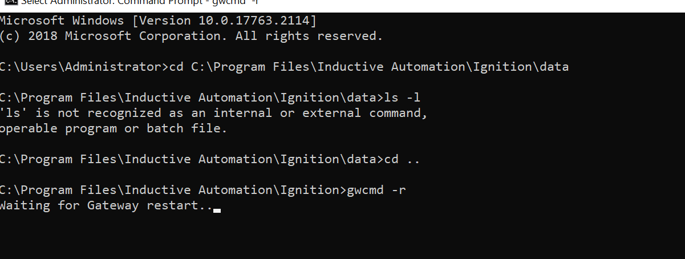
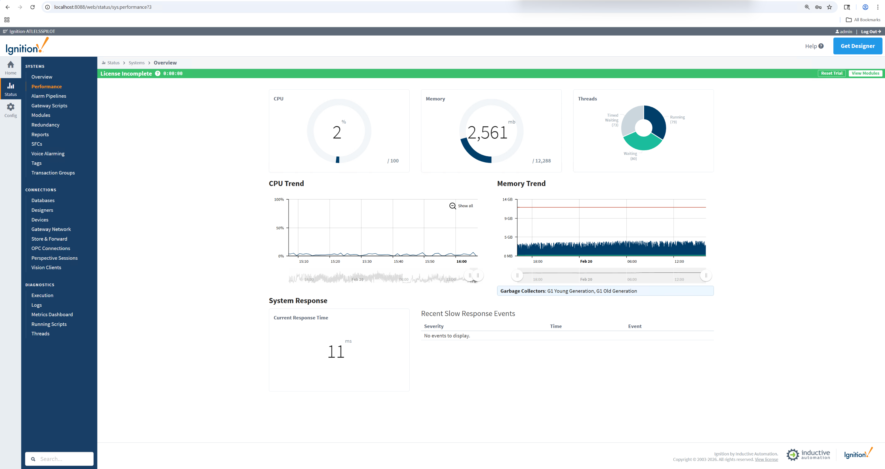

# Ignition gateway restart and OptiSweep / WCS API response validation

## Runbook Header

| Field | Value |
| --- | --- |
| Procedure ID | `proc_ignition_gateway_restart_and_optisweep_response_validation_v1` |
| Title | Ignition gateway restart and OptiSweep / WCS API response validation |
| Procedure Type | `recovery` |
| Primary Role | `L2_support` |
| Supporting Roles | `operator` |
| Support Safe | Yes |
| Capability Tags | `gateway_health`, `wcs_api_responsiveness`, `e_stop_or_safety_stop` |
| Access Surface | `ignition_gateway`, `apidog`, `wcs_api`, `event_viewer`, `physical_floor` |
| Audience Roles | `L2_support`, `operator` |
| Failure Pattern Tags | `gateway_unhealthy`, `api_unresponsive`, `service_crash_or_restart` |
| Validation Status | `needs_sme_review` |
| Merge Status | `source_finalized` |

## Summary

Use the Ignition gateway, Windows Event Viewer / services, and Apidog / WCS API surfaces to restart the Ignition gateway, verify the GetAgvStatuses response, and restart OptiSweep only if the API does not respond. The site operator must place and release the physical E-stop; support must not release it until the API response is confirmed.

## When To Use

Use when the Ignition gateway or OptiSweep / WCS API is not responding and the site is held in the physical E-stop state pending recovery validation. Perform the Ignition gateway restart, verify the Ignition gateway, then validate OptiSweep through the GetAgvStatuses request before returning the system to operation.

## Do Not Use For

* Do not use to perform or release a physical E-stop remotely; only the site operator may perform those physical actions.
* Do not release the physical E-stop before GetAgvStatuses returns a response after the documented validation and any required OptiSweep service restart.
* Do not treat an HTTP 200 response as eliminating the recorded response-schema warning; the warning must be retained for review.

## Safety And Operational Notes

* The site operator must place the system in the physical E-stop state before the restart sequence.
* Keep the physical E-stop active during recovery.
* Do not release the physical E-stop until the OptiSweep / WCS API response is confirmed.
* Support must not perform or remotely release the physical E-stop.

## Access Or Tools Needed

* Ignition gateway
* Windows Event Viewer / services, including a Windows Administrator Command Prompt
* Apidog / WCS API client
* OptiSweep / WCS API GetAgvStatuses request
* Physical floor / grid for the site operator's E-stop and release

## Visual References

*Windows Administrator Command Prompt showing the Ignition directory, `gwcmd -r`, and `Waiting for Gateway restart...`.*

*Ignition gateway Status > Systems > Overview showing Current Response Time and Recent Slow Response Events.*

*Apidog / WCS API GetAgvStatuses response showing HTTP 200, AGV records, visible NORMAL values, and the response-schema warning.*

*Windows Event Viewer / services surface showing OptiSweep selected with status Running and the Restart the service control visible.*

## Procedure Steps

### Step 1 — Place the system in the physical E-stop state

**Responsible role:** operator

**Instruction:**
On the physical floor / grid, have the site operator place the system in the physical E-stop state and keep it active throughout recovery.

**Expected result:**
The physical E-stop is active and remains active while the Ignition gateway and OptiSweep / WCS API are restarted or checked.

**Stop or Escalate If:**

* Stop if the site cannot confirm the physical E-stop state.
* Escalate any safety uncertainty; do not continue toward E-stop release.

---

### Step 2 — Restart the Ignition gateway

**Responsible role:** L2_support

**Instruction:**
On the Windows Event Viewer / services surface, open a Windows Administrator Command Prompt, navigate to the Inductive Automation Ignition installation directory, run `gwcmd -r`, and wait for the console to show `Waiting for Gateway restart...`.

**Expected result:**
The Windows Administrator Command Prompt shows `gwcmd -r` executed from the Ignition directory and displays `Waiting for Gateway restart...`.

**Stop or Escalate If:**

* Stop and escalate if the Ignition gateway restart command cannot be executed or the gateway does not return for later verification.

---

### Step 3 — Verify the Ignition gateway Systems Overview

**Responsible role:** L2_support

**Instruction:**
On the Ignition gateway, open Status > Systems > Overview and check that the page responds, including Current Response Time and Recent Slow Response Events.

**Expected result:**
The Ignition gateway Systems Overview responds and displays a Current Response Time; the incident evidence showed 11 ms and `No events to display` under Recent Slow Response Events.

**Stop or Escalate If:**

* Escalate if the Ignition gateway does not return to the Systems Overview page.

---

### Step 4 — Validate OptiSweep / WCS API responsiveness

**Responsible role:** L2_support

**Instruction:**
On the Apidog / WCS API surface, send the `GetAgvStatuses` request and inspect the response for HTTP Success / Status 200 and returned AGV records, including visible status values such as `NORMAL`.

**Expected result:**
The GetAgvStatuses request returns HTTP 200 with AGV records; the incident response showed visible `NORMAL` status values.

**Stop or Escalate If:**

* Stop before releasing the physical E-stop if GetAgvStatuses does not return a response.
* Record the response-schema warning `Response data differs from endpoint spec` and `$ should be object` for review even when HTTP 200 and AGV records are returned.

---

### Step 5 — Restart OptiSweep only if GetAgvStatuses does not respond

**Responsible role:** L2_support

**Instruction:**
If GetAgvStatuses does not respond, open Windows Event Viewer / services, select OptiSweep, use the visible `Restart the service` control, then return to Apidog / WCS API and send GetAgvStatuses again.

**Expected result:**
After the documented OptiSweep service restart, GetAgvStatuses returns a response with AGV records; Windows Event Viewer / services shows OptiSweep in a Running state when inspected.

**Stop or Escalate If:**

* Stop before releasing the physical E-stop if GetAgvStatuses remains nonresponsive after the documented OptiSweep restart and repeat check.
* Escalate if OptiSweep does not show Running.

---

### Step 6 — Release the physical E-stop and confirm auto bag-out

**Responsible role:** operator

**Instruction:**
After the GetAgvStatuses response is confirmed, have the site operator release the physical E-stop on the physical floor / grid and confirm that the site can resume the auto bag-out operation.

**Expected result:**
The site operator releases the physical E-stop and confirms that auto bag-out can resume.

**Stop or Escalate If:**

* Do not release the physical E-stop until GetAgvStatuses responsiveness is confirmed.
* Escalate if the site cannot resume auto bag-out after the operator releases the E-stop.

---

## Success Criteria

* The Ignition gateway Systems Overview responds after the restart.
* The Systems Overview displays a current response-time value; the incident evidence showed 11 ms and no recent slow response events.
* GetAgvStatuses returns HTTP 200 with AGV records and visible status values such as NORMAL.
* If the initial API check is nonresponsive, OptiSweep is restarted through Windows Event Viewer / services and the repeated GetAgvStatuses request responds.
* The site operator releases the physical E-stop only after API confirmation and confirms that auto bag-out can resume.

## Failure Conditions

* Ignition gateway Systems Overview does not respond after the restart.
* GetAgvStatuses does not return a response.
* OptiSweep does not show Running after the documented restart attempt.
* The API returns a response-schema warning: `Response data differs from endpoint spec` and `$ should be object`.
* The physical E-stop cannot be safely released or the site cannot resume auto bag-out.

## Escalation Guidance

* Escalate if the Ignition gateway does not return to the Systems Overview page.
* Escalate if GetAgvStatuses remains nonresponsive after the documented OptiSweep restart and repeat check.
* Escalate if OptiSweep does not show Running in Windows Event Viewer / services.
* Keep the physical E-stop active when API responsiveness is not confirmed.
* Record the API response-schema warning for review even when the HTTP response is 200.

## Missing Details / Known Gaps

* The command evidence shows the Ignition restart was initiated and waiting, but does not show restart completion.
* The Windows Event Viewer / services evidence shows OptiSweep Running and the restart control, but does not prove that a service restart was performed.
* No source-supported timeout or wait duration is provided for gateway recovery or the repeated API check.
* The API response-schema warning remains unresolved and requires review.
* The source package site_location is empty; no ingestion site_code or structured site-location fields were supplied.

## Source Lineage

- Candidate IDs: candidate_incident_228086_ignition_gateway_and_optisweep_validation
- Source ID: `source_case_228086`
- Source Type: `incident_case`
