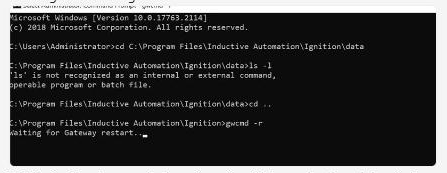

# Restart the Ignition gateway and validate OptiSweep through Apidog / WCS API

## Runbook Header

| Field | Value |
| --- | --- |
| Procedure ID | `proc_restart_ignition_gateway_validate_optisweep_apidog_wcs_api_v1` |
| Title | Restart the Ignition gateway and validate OptiSweep through Apidog / WCS API |
| Procedure Type | `recovery` |
| Primary Role | `L2_support` |
| Supporting Roles | `operator`, `L3_support` |
| Support Safe | Yes |
| Capability Tags | `gateway_health`, `wcs_api_responsiveness`, `e_stop_or_safety_stop` |
| Access Surface | `ignition_gateway`, `apidog`, `wcs_api`, `physical_floor` |
| Audience Roles | `L2_support`, `L3_support`, `operator` |
| Failure Pattern Tags | `gateway_unhealthy`, `api_unresponsive` |
| Validation Status | `needs_sme_review` |
| Merge Status | `source_finalized` |

## Summary

Use the Ignition gateway, Administrator Windows Command Prompt, and Apidog / WCS API client to restart the Ignition gateway and verify that OptiSweep responds. The site operator must confirm and control the physical E-stop; do not release it until the GetAgvStatuses response is confirmed.

## When To Use

Use when the Ignition gateway requires a documented restart and OptiSweep responsiveness must be validated through the Apidog / WCS API client before the system returns to operation. Confirm the physical-floor E-stop state with the site operator before restarting the Ignition gateway.

## Do Not Use For

* Do not use this procedure to perform or remotely release a physical E-stop.
* Do not infer that the Ignition License Incomplete banner is the incident cause.
* Do not assume the Ignition restart completed solely because the restart command displayed Waiting for Gateway restart.

## Safety And Operational Notes

* The system must remain physically E-stopped before the Ignition gateway restart.
* Only the site operator may perform the physical E-stop action or release it.
* If OptiSweep does not respond, keep the physical-floor E-stop in place and escalate.

## Access Or Tools Needed

* Ignition gateway
* Administrator Windows Command Prompt
* Apidog / WCS API client
* OptiSweep / WCS API
* GetAgvStatuses request
* Physical-floor E-stop controlled by the site operator

## Visual References

*Windows Command Prompt evidence associated with the Ignition gateway restart instructions and waiting-for-restart state.*

*Administrator Windows Command Prompt showing navigation to the Ignition directory, gwcmd -r, and Waiting for Gateway restart.*

*Ignition gateway Status > Systems > Overview showing Current Response Time and Recent Slow Response Events.*

*Apidog / WCS API client showing GetAgvStatuses with HTTP 200 and returned AGV records.*

## Procedure Steps

### Step 1 — Confirm the physical-floor E-stop before restarting Ignition gateway

**Responsible role:** operator

**Instruction:**
On the physical floor, have the site operator confirm that the system is physically E-stopped before L2 support begins the Ignition gateway restart.

**Expected result:**
The site operator confirms that the physical E-stop is active.

**Stop or Escalate If:**

* Stop if the E-stop state cannot be confirmed.
* Escalate if safety status is uncertain; do not release or remotely reset the physical E-stop.

---

### Step 2 — Restart the Ignition gateway from Administrator Windows Command Prompt

**Responsible role:** L2_support

**Instruction:**
In Administrator Windows Command Prompt, navigate to C:\Program Files\Inductive Automation\Ignition and run the source-documented command gwcmd -r. Wait for the gateway to return.

**Expected result:**
The command prompt displays the gateway restart activity, including Waiting for Gateway restart, and the Ignition gateway becomes available for the next live status check.

**Stop or Escalate If:**

* Stop if the gateway does not return.
* Escalate to L2/L3 support if the command does not complete or the gateway remains unavailable.

---

### Step 3 — Check Ignition gateway Systems Overview

**Responsible role:** L2_support

**Instruction:**
Open the Ignition gateway Systems Overview on the Ignition gateway surface and inspect Current Response Time and Recent Slow Response Events.

**Expected result:**
The Systems Overview page responds, displays a Current Response Time, and displays Recent Slow Response Events, including No events to display when that is the live result.

**Stop or Escalate If:**

* Stop if the Ignition gateway page does not respond.
* Escalate if the gateway remains unavailable or its live status cannot be verified.

---

### Step 4 — Validate OptiSweep through Apidog / WCS API

**Responsible role:** L2_support

**Instruction:**
Open the Apidog / WCS API client, send the GetAgvStatuses request, confirm the HTTP response status, and inspect the returned AGV records and visible status values.

**Expected result:**
GetAgvStatuses returns HTTP Success/Status 200 with AGV records in the response, including visible status values such as NORMAL when present.

**Stop or Escalate If:**

* Keep the physical-floor E-stop active if GetAgvStatuses receives no response.
* Escalate if the request fails or the returned payload cannot confirm OptiSweep responsiveness.
* Do not treat the response-schema warning as resolved without further support review.

---

### Step 5 — Keep the physical-floor E-stop in place until API confirmation

**Responsible role:** operator

**Instruction:**
On the physical floor, keep the E-stop active until L2 support confirms that GetAgvStatuses returned a successful response. If there is no response, do not release the E-stop and escalate for the source-supported OptiSweep restart and repeat validation.

**Expected result:**
The physical-floor E-stop remains active until successful GetAgvStatuses confirmation is communicated.

**Stop or Escalate If:**

* Stop release of the E-stop if GetAgvStatuses has not returned a successful response.
* Escalate for the source-supported OptiSweep restart and repeat validation if the request receives no response.

---

## Success Criteria

* The Ignition gateway Systems Overview page responds and displays live response-time and recent-slow-response indicators.
* The Apidog / WCS API GetAgvStatuses request returns HTTP Success/Status 200 with AGV records.
* The physical-floor E-stop is not released until OptiSweep responsiveness is confirmed.

## Failure Conditions

* Ignition gateway does not return after gwcmd -r.
* Ignition Systems Overview does not respond or lacks live status indicators.
* GetAgvStatuses receives no response or returns an unsuccessful HTTP response.
* The API response contains a schema warning whose operational significance has not been resolved.
* The physical E-stop state is uncertain or released before validation.

## Escalation Guidance

* Escalate to L2/L3 support if the Ignition gateway does not return or the restart command does not complete.
* Keep the physical-floor E-stop active if GetAgvStatuses receives no response.
* If GetAgvStatuses does not confirm responsiveness, escalate for the source-supported OptiSweep restart and repeat validation.
* Do not infer that the Ignition License Incomplete banner is the cause of the incident.

## Missing Details / Known Gaps

* The authoritative source_package.site_location is empty; the evidence and candidate identify the incident as UPS Fort Worth, TX (Haslet), but that site label is not authoritative ingestion metadata.
* The packet does not confirm that the Ignition gateway restart completed successfully after the Waiting for Gateway restart message.
* The operational significance of the Apidog response-schema warning is unresolved.
* No source-supported restart command or procedure for OptiSweep itself is provided beyond the instruction to escalate and repeat validation if GetAgvStatuses receives no response.
* No universal response-time threshold is established; the 11 ms value is an incident observation only.
* The final physical E-stop release outcome is not established by the supplied evidence.

## Source Lineage

- Candidate IDs: candidate_incident_228086_ignition_restart_and_status_validation
- Source ID: `source_case_228086`
- Source Type: `incident_evidence_pdf`
