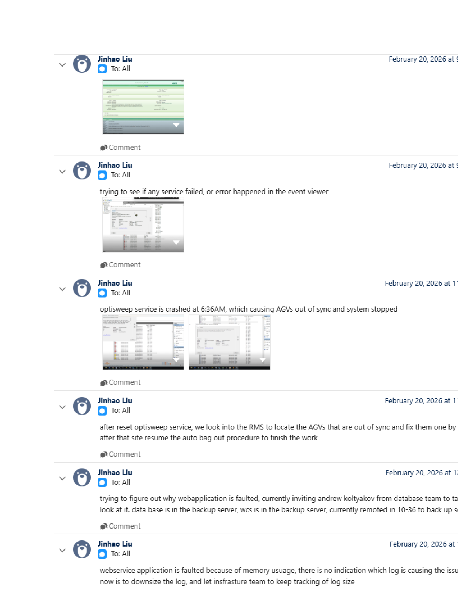

# Check and reset the OptiSweep service in Windows Event Viewer / Services, then validate through Apidog / WCS API

## Runbook Header

| Field | Value |
| --- | --- |
| Procedure ID | `proc_optisweep_service_reset_and_api_check_v1` |
| Title | Check and reset the OptiSweep service in Windows Event Viewer / Services, then validate through Apidog / WCS API |
| Procedure Type | `recovery` |
| Primary Role | `L2_support` |
| Supporting Roles | `L3_support` |
| Support Safe | Yes |
| Capability Tags | `wcs_service_health`, `wcs_api_responsiveness` |
| Access Surface | `event_viewer`, `apidog`, `wcs_api` |
| Audience Roles | `L2_support`, `L3_support` |
| Failure Pattern Tags | `service_crash_or_restart`, `unplanned_restart`, `api_unresponsive` |
| Validation Status | `needs_sme_review` |
| Merge Status | `source_finalized` |

## Summary

Use Windows Event Viewer / services to identify an OptiSweep service termination, inspect the OptiSweep service state in Windows Services, use the visible Restart the service control when a reset is required, and validate recovery through Apidog / WCS API with GetAgvStatuses.

## When To Use

Use Windows Event Viewer / services and Apidog / WCS API when OptiSweep or the robotic system is not responding, the system has stopped, AGVs are out of sync, or a service termination is suspected. Confirm the service state and API response before treating the reset as successful.

## Do Not Use For

* Do not use this runbook to perform undocumented RMS state changes or correct individual out-of-sync AGVs; the incident did not identify the required RMS control.
* Do not treat a Running status in Windows Services alone as proof that OptiSweep is healthy.
* Do not make undocumented service, configuration, or web-application changes.

## Safety And Operational Notes

* Stop and escalate if OptiSweep remains stopped, cannot be restarted, or GetAgvStatuses does not return a response after the reset.
* The Event Viewer evidence confirms a configured automatic restart action after 60000 milliseconds; it does not confirm that the automatic restart succeeded.
* Do not release an E-stop or perform undocumented RMS corrections as part of this runbook.

## Access Or Tools Needed

* Windows Event Viewer / services
* Windows Services MMC
* OptiSweep service
* Apidog / WCS API client
* OptiSweep / WCS API
* GetAgvStatuses endpoint

## Visual References

*Windows Event Viewer System log showing Service Control Manager Event 7031 for OptiSweep, including unexpected termination and the configured 60000-millisecond restart action.*

*Windows Services console showing OptiSweep selected, Running, Automatic startup, and the visible Restart the service control.*

*Apidog / WCS API client showing GetAgvStatuses with HTTP 200 and returned AGV records, including visible NORMAL values.*

*Incident Teams update stating that OptiSweep was reset and RMS was then used to locate and correct out-of-sync AGVs.*

## Procedure Steps

### Step 1 — Inspect the OptiSweep termination event in Windows Event Viewer / services

**Responsible role:** L2_support

**Instruction:**
In Windows Event Viewer / services, inspect the System log for Service Control Manager Event 7031 for OptiSweep. Check that the event reports an unexpected termination and identifies the 60000-millisecond restart action.

**Expected result:**
The live Windows Event Viewer / services System log displays an OptiSweep Event 7031 at Error level with an unexpected-termination message and a configured restart action after 60000 milliseconds.

**Stop or Escalate If:**

* The event indicates repeated OptiSweep termination.
* The event confirms a configured restart but the service state cannot be confirmed in Windows Services.

---

### Step 2 — Inspect the OptiSweep service in Windows Event Viewer / services

**Responsible role:** L2_support

**Instruction:**
In Windows Event Viewer / services, open Windows Services, select the service named OptiSweep, and inspect its live Status, Startup Type, and available service controls.

**Expected result:**
Windows Services displays OptiSweep with an observable Status and Startup Type; the incident evidence showed Running, Automatic, and a visible Restart the service control.

**Stop or Escalate If:**

* OptiSweep is stopped and cannot be restarted.
* The Windows Services state is inconsistent with the Event Viewer evidence and cannot be confirmed.

---

### Step 3 — Reset the OptiSweep service in Windows Event Viewer / services

**Responsible role:** L2_support

**Instruction:**
In Windows Event Viewer / services, use the visible Restart the service control for OptiSweep when the service requires the documented reset. Do not make other service or configuration changes.

**Expected result:**
The Windows Services console completes the selected OptiSweep restart operation and displays the resulting service state for subsequent Apidog / WCS API validation.

**Stop or Escalate If:**

* OptiSweep cannot be restarted.
* OptiSweep remains stopped after the restart control is used.
* The service restarts but the subsequent Apidog / WCS API validation is unsuccessful.

---

### Step 4 — Validate OptiSweep through Apidog / WCS API

**Responsible role:** L2_support

**Instruction:**
In Apidog / WCS API, send the GetAgvStatuses request and inspect the live response status and returned AGV records.

**Expected result:**
Apidog / WCS API returns HTTP 200 for GetAgvStatuses and the response contains AGV records; visible records may include NORMAL status values.

**Stop or Escalate If:**

* GetAgvStatuses has no response after the OptiSweep reset.
* The response is not HTTP 200 or contains no usable AGV records.
* The response is successful but the AGV state remains inconsistent and requires an undocumented RMS correction.

---

### Step 5 — Escalate when Windows Event Viewer / services or Apidog / WCS API validation fails

**Responsible role:** L2_support

**Instruction:**
If OptiSweep cannot be restarted in Windows Event Viewer / services or GetAgvStatuses does not return a response through Apidog / WCS API, stop this procedure and transfer ownership to L3_support. Do not attempt undocumented RMS state changes.

**Expected result:**
The unresolved service or API condition is assigned to L3_support with the observed Windows Services state, Event Viewer evidence, and Apidog / WCS API response condition available for review.

**Stop or Escalate If:**

* OptiSweep remains stopped or cannot be restarted.
* GetAgvStatuses does not return a response after the reset.
* A required RMS correction control is not identified.

---

## Success Criteria

* Windows Event Viewer / services identifies or rules out an OptiSweep termination condition.
* OptiSweep is displayed as Running in Windows Services after the reset when a reset is required.
* Apidog / WCS API GetAgvStatuses returns HTTP 200 with returned AGV records.
* No undocumented RMS, service, or configuration changes are required.

## Failure Conditions

* Windows Event Viewer / services records a new or repeated OptiSweep termination.
* OptiSweep remains stopped or cannot be restarted in Windows Services.
* GetAgvStatuses is unresponsive, does not return HTTP 200, or returns no usable AGV records.
* The service is Running but the API validation remains unsuccessful.

## Escalation Guidance

* Escalate to L3_support if OptiSweep cannot be restarted, remains stopped, or repeatedly terminates.
* Escalate if GetAgvStatuses remains unresponsive or unsuccessful after the documented service reset.
* Do not perform undocumented RMS corrections; the incident only states that RMS was used to locate and fix out-of-sync AGVs.

## Missing Details / Known Gaps

* The packet does not identify the exact person who performed the OptiSweep reset or prove that the visible Windows Services Restart the service control was the control used.
* The packet does not provide a specific RMS control for correcting out-of-sync AGVs.
* The Apidog evidence includes a response-data-versus-endpoint-spec warning; the packet does not define whether this schema difference is operationally acceptable.
* The authoritative source_package.site_location is empty. The incident evidence labels the case as UPS Fort Worth, TX (Haslet), but that evidence label is not used as authoritative site ingestion metadata.
* The packet does not provide a confirmed production-stop or service-reset duration.

## Source Lineage

- Candidate IDs: candidate_incident_228086_optisweep_service_reset_and_api_check
- Source ID: `source_case_228086`
- Source Type: `incident_case`
