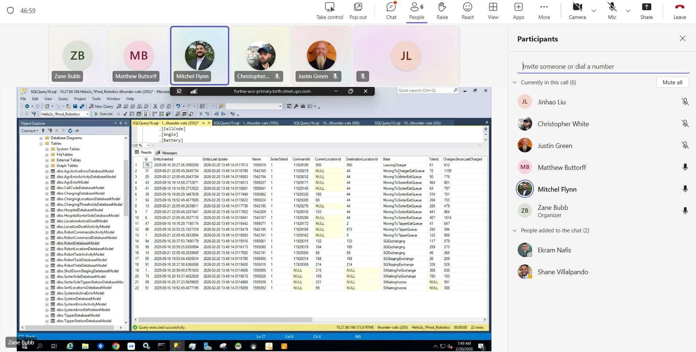

# WCS / Helix DB (SSMS) AGV state inspection

## Runbook Header

| Field | Value |
| --- | --- |
| Procedure ID | `proc_wcs_helix_db_ssms_agv_state_inspection_v1` |
| Title | WCS / Helix DB (SSMS) AGV state inspection |
| Procedure Type | `diagnostic` |
| Primary Role | `L2_support` |
| Supporting Roles | None |
| Support Safe | Yes |
| Capability Tags | `fleet_system_status`, `agv_active_errors` |
| Access Surface | `wcs_sql`, `rms_ui` |
| Audience Roles | `L2_support` |
| Failure Pattern Tags | `system_fault` |
| Validation Status | `needs_sme_review` |
| Merge Status | `source_finalized` |

## Summary

Use the WCS / Helix DB (SSMS) live read-only database surface to inspect robotics-related AGV state records when the RMS / fleet status UI reports AGVs out of sync or the robotic system is stopped. Compare the populated SSMS State results with the live RMS / fleet status UI; the listed state values do not independently establish a fault.

## When To Use

Use the live WCS / Helix DB (SSMS) surface to inspect AGV state records when the RMS / fleet status UI reports AGVs out of sync or the robotic system is stopped.

## Do Not Use For

* Do not use this diagnostic to infer that a listed AGV State value is abnormal without corresponding live RMS / fleet status UI context or SME interpretation.
* Do not use it to modify database records or perform recovery actions.
* Do not use it as a substitute for physical E-stop or other site safety actions.

## Safety And Operational Notes

* This procedure is supported as a read-only diagnostic; do not modify database values.
* Do not treat the displayed AGV State values as proof of a fault by themselves.
* Escalate if the WCS / Helix DB (SSMS) connection or query execution fails, or if expected AGV results are unavailable.

## Access Or Tools Needed

* WCS / Helix DB (SSMS)
* Robotics-related database context in WCS / Helix DB (SSMS)
* AGV State column in the WCS / Helix DB (SSMS) results grid
* RMS / fleet status UI

## Visual References

*Incident screenshot showing WCS / Helix DB (SSMS) with a robotics-related query results grid, an AGV State column, and successful query execution status.*

## Procedure Steps

### Step 1 — Open WCS / Helix DB (SSMS) and connect to the robotics-related database context

**Responsible role:** L2_support

**Instruction:**
Open WCS / Helix DB (SSMS) and connect to the robotics-related database context shown in the incident evidence. Do not substitute an undocumented database name or context.

**Expected result:**
WCS / Helix DB (SSMS) shows an active connection to the robotics-related database context and is ready to execute the source-provided AGV state check.

**Stop or Escalate If:**

* Stop and escalate if WCS / Helix DB (SSMS) cannot connect.
* Stop and escalate if the robotics-related database context is not available.

---

### Step 2 — Run the source-provided AGV state check in WCS / Helix DB (SSMS)

**Responsible role:** L2_support

**Instruction:**
In WCS / Helix DB (SSMS), run the source-provided robotics AGV state check without adding undocumented query text. Wait for the SSMS status bar to show that the query executed successfully.

**Expected result:**
WCS / Helix DB (SSMS) shows a populated query results grid and a successful execution indication in the SSMS status bar.

**Stop or Escalate If:**

* Stop and escalate if the query does not execute successfully.
* Stop and escalate if the expected AGV state results are unavailable.

---

### Step 3 — Inspect the AGV State column in WCS / Helix DB (SSMS)

**Responsible role:** L2_support

**Instruction:**
Inspect the returned State column in the WCS / Helix DB (SSMS) results grid and record the visible values. Incident examples include LeavingCharger, MovingToChargerExitQueue, MovingToSorterExitQueue, MovingToTipperQueue, SQExchanging, SQStagingExchange, SWaitingForExchange, and SWaitingInzone. Do not assign fault meaning to a value without live context.

**Expected result:**
The WCS / Helix DB (SSMS) results grid visibly contains AGV records with State values that can be recorded for comparison.

**Stop or Escalate If:**

* Stop and escalate if the expected AGV state results are unavailable.
* Do not infer that a listed state is abnormal without corresponding live RMS / fleet status UI context or SME interpretation.

---

### Step 4 — Compare WCS / Helix DB (SSMS) states with the RMS / fleet status UI

**Responsible role:** L2_support

**Instruction:**
Compare the recorded AGV State values from WCS / Helix DB (SSMS) with the corresponding live AGV information in the RMS / fleet status UI. Keep this diagnostic read-only and do not change database values.

**Expected result:**
The WCS / Helix DB (SSMS) AGV records and the corresponding RMS / fleet status UI information are available for side-by-side diagnostic comparison.

**Stop or Escalate If:**

* Stop and escalate if the SSMS records cannot be compared with the live RMS / fleet status UI.
* Stop if any action would modify database values.
* Escalate for SME interpretation when a State value appears inconsistent with the live RMS / fleet status UI.

---

## Success Criteria

* WCS / Helix DB (SSMS) connects to the available robotics-related database context.
* The source-provided AGV state check executes successfully and produces a populated results grid.
* Visible State values are recorded and compared with the live RMS / fleet status UI without modifying database records.

## Failure Conditions

* WCS / Helix DB (SSMS) cannot connect to the robotics-related database context.
* The source-provided check fails to execute or produces no usable results.
* The State column or expected AGV records are unavailable.
* SSMS records cannot be correlated with the RMS / fleet status UI.
* The diagnostic would require modifying database values.

## Escalation Guidance

* Stop and escalate to the appropriate L2/L3 support or SME contact when SSMS cannot connect, the query fails, or expected AGV results are unavailable.
* Escalate for interpretation when a State value appears inconsistent with the live RMS / fleet status UI.
* Do not perform database modifications as part of this runbook.

## Missing Details / Known Gaps

* The packet does not provide a reliable database name.
* The packet does not provide a table name, model name, or complete SQL statement.
* The operational meaning of the listed AGV State values is not established by the incident evidence.
* The source-package site_location ingestion object is empty; no site_code or structured site-location fields were supplied.
* The candidate confidence is low and the procedure requires SME review.

## Source Lineage

- Candidate IDs: candidate_incident_228086_ssms_agv_state_diagnostic
- Source ID: `source_case_228086`
- Source Type: `incident_case`
