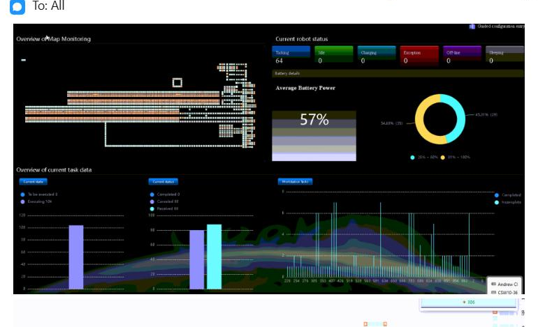
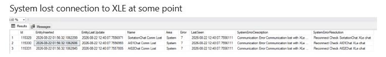
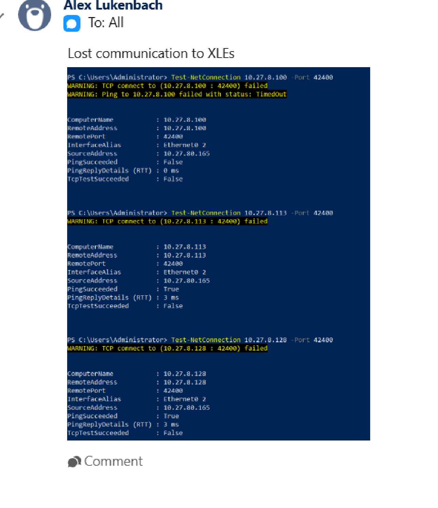
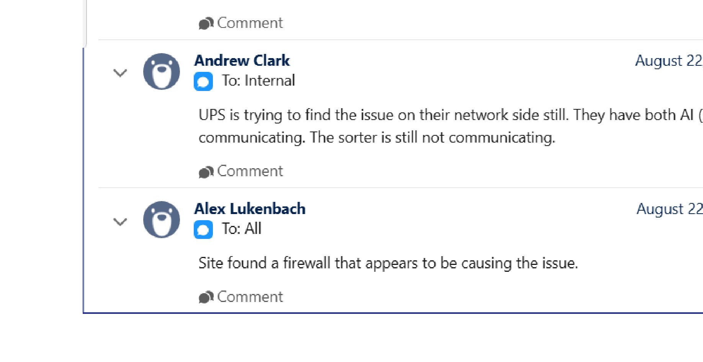
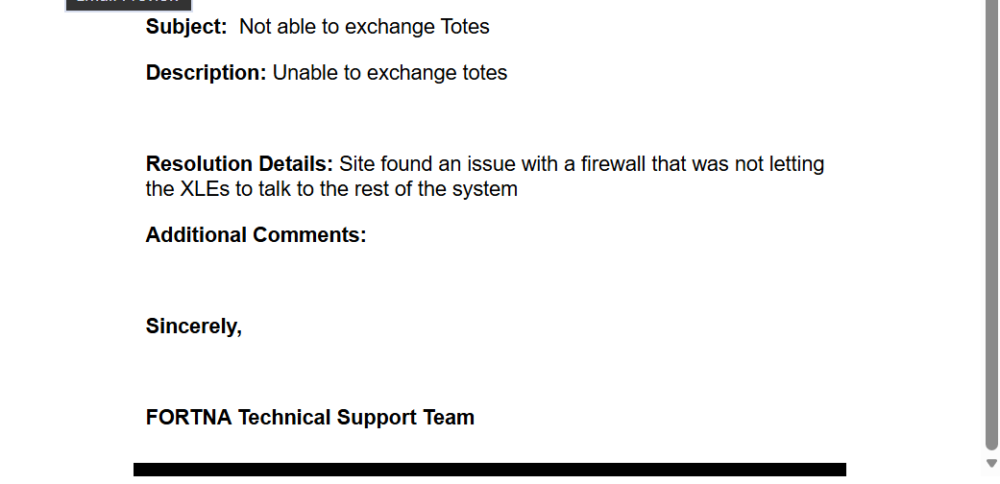
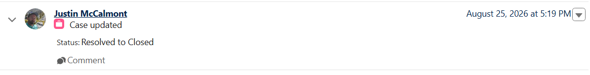
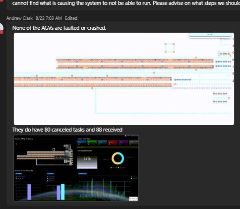
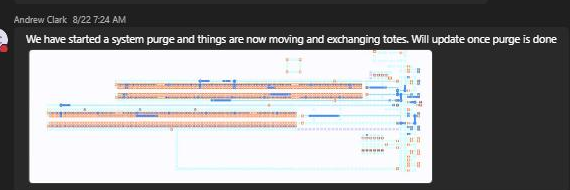
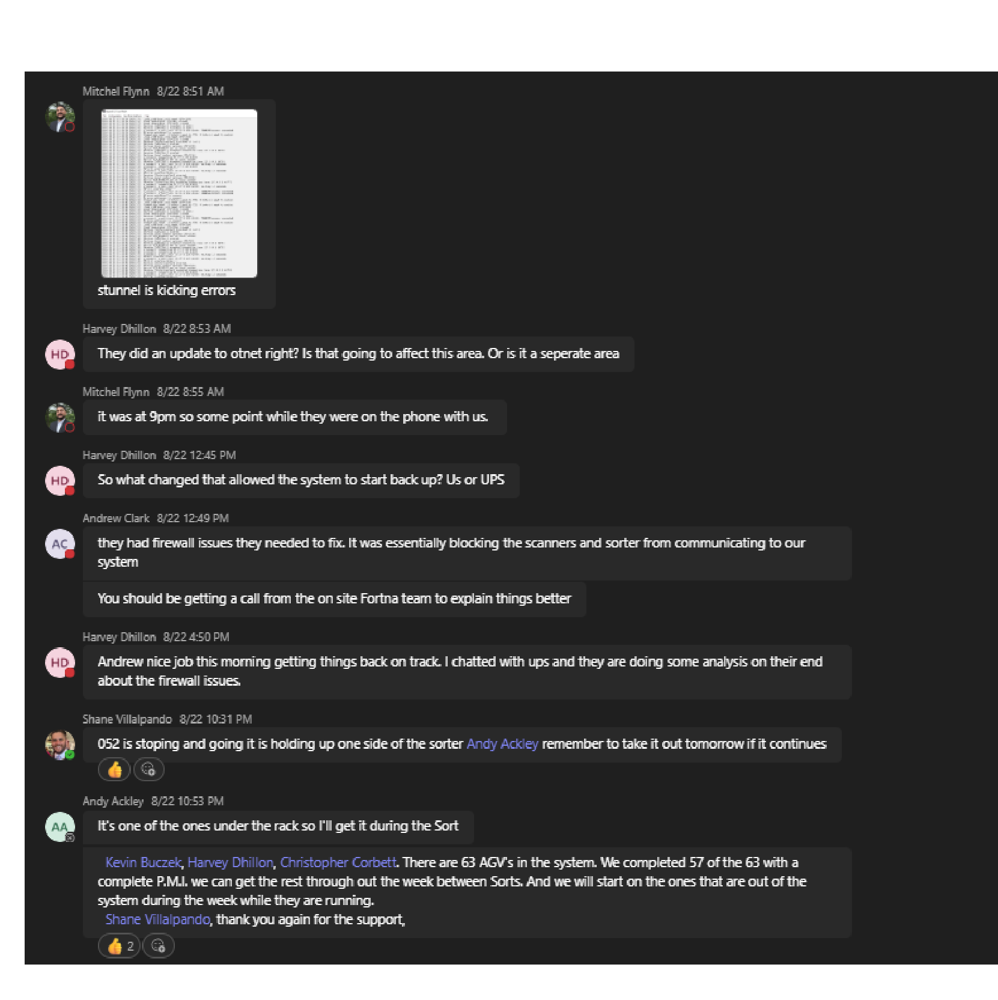

# Stage 3 Artifact Enrichment Review - Case 233681

## Summary

| Metric | Value |
| --- | --- |
| Artifacts | 9 |
| Enriched | 9 |
| Failed | 0 |
| Validation errors | 0 |
| Warnings | 0 |
| Artifacts with uncertainty or quality notes | 9 |

## Counts

### Evidence Roles

| Role | Count |
| --- | --- |
| diagnostic_evidence | 3 |
| symptom_evidence | 2 |
| validation_evidence | 2 |
| action_evidence | 1 |
| incident_context_evidence | 1 |

### OCR Quality

| Quality | Count |
| --- | --- |
| usable | 9 |

## Artifact Index

| Page | Artifact | Role | OCR | Summary | Review flags |
| --- | --- | --- | --- | --- | --- |
| 4 | artifact_incident_233681_page_004_nested_image_01 | symptom_evidence | usable | RMS monitoring screenshot showing current robot status, battery information, and current task data. | uncertainty, quality, duplicate:unique |
| 5 | artifact_incident_233681_page_005_nested_image_01 | diagnostic_evidence | usable | Screenshot showing reported loss of communication with XLE and repeated communication-error entries. | uncertainty, quality, duplicate:unique |
| 6 | artifact_incident_233681_page_006_detected_region_01 | diagnostic_evidence | usable | Computer screenshot showing failed network connectivity tests associated with lost communication to XLEs. | uncertainty, quality, duplicate:unique |
| 7 | artifact_incident_233681_page_007_detected_region_01 | diagnostic_evidence | usable | Chat screenshot documenting an ongoing UPS network communication issue, including sorter non-communication and a suspected firewall cause. | uncertainty, quality, duplicate:unique |
| 10 | artifact_incident_233681_page_010_embedded_image_01 | incident_context_evidence | usable | Salesforce case screenshot describing inability to exchange totes and identifying a firewall communication issue involving XLEs. | uncertainty, quality, duplicate:unique |
| 10 | artifact_incident_233681_page_010_embedded_image_02 | validation_evidence | usable | Screenshot showing a case update by Justin McCalmont with status changed from Resolved to Closed. | uncertainty, quality, duplicate:unique |
| 11 | artifact_incident_233681_page_011_nested_image_01 | symptom_evidence | usable | RMS screenshot documenting an abnormal AGV operating state at UPS Haslet TX (TXRTH), with no AGV fault or crash reported but 80 canceled tasks and 88 received tasks shown. | uncertainty, quality, duplicate:unique |
| 11 | artifact_incident_233681_page_011_nested_image_02 | validation_evidence | usable | Screenshot message reporting that a system purge had started and tote movement had resumed. | uncertainty, quality, duplicate:unique |
| 12 | artifact_incident_233681_page_012_nested_image_01 | action_evidence | usable | Chat screenshot documenting firewall-related communication blocking, service errors, recovery activity, and a later sorter interruption at UPS Haslet TX (TXRTH). | uncertainty, quality, duplicate:unique |

## Artifact Details

### artifact_incident_233681_page_004_nested_image_01

| Field | Value |
| --- | --- |
| Page | 4 |
| Image type | rms_screenshot |
| Evidence role | symptom_evidence |
| OCR quality | usable |
| Duplicate group |  |
| Validation status | needs_sme_review |

**Short description:** RMS monitoring screenshot showing current robot status, battery information, and current task data.

**Detailed description:** Azure Vision identifies the artifact as a computer screenshot containing software interface text. The visible/OCR-supported interface includes an overview of map monitoring, current robot status, a likely robot identifier rendered as "Ctarzine" or similar, numeric status fields including "64" and several zeros, average battery power of 57%, an ambiguous value rendered as "-45.01% (27)", and current task data. Several labels and identifiers are uncertain because the OCR is partially garbled.

#### What To Look At

- Confirm the exact robot or AGV identifier.
- Interpret the numeric status fields and determine whether the zero values represent normal state, inactive state, or an alarm.
- Determine the meaning of the "-45.01% (27)" value.
- Check whether the RMS interface contains status colors, alarms, task-state labels, or other indicators not captured by OCR.
- Compare the battery and task values with known normal operating ranges for this site.

#### Source Supported Claims

- The artifact is a computer/software screenshot containing an RMS-style monitoring interface. (azure_vision_description)
- The interface contains map monitoring, current robot status, battery power, and current task data sections. (artifact_ocr)
- The screenshot OCR reports average battery power of 57%. (artifact_ocr)
- The artifact belongs to the UPS Haslet TX (TXRTH) ingestion site. (duplicate_metadata)
- The surrounding page OCR associates the message with Alex Lukenbach and August 22. (page_ocr_context)

#### Review Uncertainty

- Artifact OCR and Azure Vision read text agree on the main labels and 57% battery value, increasing confidence that those items are present.
- Both OCR sources produce ambiguous strings such as "Ctarzine," "Battery dicail," and "Correrwind," so these should not be treated as verified identifiers or labels.
- The state cannot be classified as healthy, warning, abnormal, failure, or recovery in progress from the available evidence.
- The page context contains site/case information, but page OCR should not be treated as text inside the cropped screenshot.

#### Quality Notes

- Azure Vision caption confidence supports identification as a computer screenshot, while its dense captions are generic.
- Artifact OCR is marked usable with an overall confidence of 67.96, but several individual lines have low confidence.
- Clean OCR is used only to improve readability of the raw OCR and does not resolve uncertain identifiers.
- Authoritative ingestion metadata identifies the site as UPS Haslet TX (TXRTH), Haslet, Texas, United States.

### artifact_incident_233681_page_005_nested_image_01

| Field | Value |
| --- | --- |
| Page | 5 |
| Image type | unknown_incident_evidence |
| Evidence role | diagnostic_evidence |
| OCR quality | usable |
| Duplicate group |  |
| Validation status | needs_sme_review |

**Short description:** Screenshot showing reported loss of communication with XLE and repeated communication-error entries.

**Detailed description:** The artifact is a computer screenshot containing a message and an error-record table. The clearly readable message states, "System lost connection to XLE at some point." The table appears to contain multiple records for SortationChat and chat components, with repeated text indicating communication was lost with XLE. Several timestamps and record identifiers are present, but some fields are degraded or ambiguously recognized by OCR.

#### What To Look At

- Confirm the exact XLE component or service names in the table.
- Validate the record identifiers and timestamps for timeline use.
- Confirm whether the listed resolution text actually recommends reconnecting or checking the affected chat components.
- Determine whether the XLE connection was restored and identify any subsequent validation evidence.
- Review the relationship between the XLE communication loss and tote assignment or movement symptoms.
- Confirm site association as UPS Haslet TX (TXRTH).

#### Source Supported Claims

- The artifact is a computer screenshot containing text and a tabular interface. (azure_vision_description)
- The screenshot reports that the system lost connection to XLE at some point. (artifact_ocr)
- Multiple table entries contain a communication-loss error involving XLE. (azure_vision_description)
- The surrounding page describes a planned reset of the camera tunnel and XLE. (page_ocr_context)
- The evidence belongs to UPS Haslet TX (TXRTH), Haslet, Texas. (stage2_classification)

#### Review Uncertainty

- Tesseract and Azure OCR agree on the primary XLE connection-loss message and repeated communication-loss text, but disagree or are unclear on several table labels, component names, dates, timestamps, and resolution fields.
- The OCR contains variants such as XLe, XLE, Al01Chat, A102Chat, A132Chat, and other low-confidence names; these should not be normalized without SME or source-image review.
- The page context references a camera tunnel and XLE reset, while the artifact itself primarily supports the communication-loss records; the operational relationship requires confirmation.
- The ingestion site is UPS Haslet TX (TXRTH). No conflicting site is identified in the supplied evidence.

#### Quality Notes

- Azure Computer Vision read confidence is 66.82 and Tesseract confidence is 66.82; the primary message is high-confidence, but much of the table is noisy.
- Azure visual analysis confirms a screenshot with text but provides no object detections beyond the generic screenshot-related tags.
- Page OCR is marked usable and is used only for surrounding incident context.
- No resolution or recovery is asserted because the artifact does not clearly show a successful recovery.

### artifact_incident_233681_page_006_detected_region_01

| Field | Value |
| --- | --- |
| Page | 6 |
| Image type | ignition_status_screenshot |
| Evidence role | diagnostic_evidence |
| OCR quality | usable |
| Duplicate group |  |
| Validation status | needs_sme_review |

**Short description:** Computer screenshot showing failed network connectivity tests associated with lost communication to XLEs.

**Detailed description:** The artifact is a computer-program screenshot containing PowerShell Test-NetConnection output. The visible/OCR-supported content reports lost communication to XLEs and failed TCP connectivity tests on port 42400 for multiple 10.27.x.x addresses. The first target also shows a failed ping, while subsequent targets show successful ping responses but failed TCP tests. IP addresses and some field labels contain OCR inconsistencies and require SME review.

#### What To Look At

- Confirm the endpoint IP addresses and port values against the original screenshot.
- Confirm whether all listed targets correspond to XLEs.
- Review the failed TCP tests separately from the successful ping tests.
- Determine whether the screenshot contains any additional Ignition status indicators not captured by OCR.
- Confirm incident relevance and any associated timeline timestamp with an SME.

#### Source Supported Claims

- The artifact is a computer-program screenshot containing textual diagnostic output. (azure_vision_description)
- The visible text states "Lost communication to XLEs." (azure_vision_description)
- A Test-NetConnection attempt to 10.27.8.100 on port 42400 reports failed TCP connectivity and a failed ping with a timeout. (artifact_ocr)
- Additional Test-NetConnection output reports failed TCP connectivity on port 42400 for targets identified in OCR as 10.27.8.113 and 10.27.0.128; the latter two tests show PingSucceeded as True. (artifact_ocr)
- The artifact is associated with UPS Haslet TX (TXRTH), site code ups_haslet_tx. (duplicate_metadata)
- Stage 2 classified the artifact as an ignition_status_screenshot and diagnostic_evidence. (stage2_classification)

#### Review Uncertainty

- Artifact OCR and Azure Vision read text agree on the communication failure pattern, but both contain ambiguous or inconsistent IP addresses and field labels.
- The second command is variously recognized with port 42488 or 42400, while the warning reports port 42400; confirm the original pixels.
- OCR alternates among addresses such as 10.27.8.100, 18.27.8.140, 19.27.8.113, 10.27.0.120, and 10.27.9.129; these values should not be normalized without visual review.
- The apparent August 22 date comes from page OCR context and is not asserted as artifact-visible.
- No root cause, remediation action, or recovery result is shown.

#### Quality Notes

- Artifact OCR quality is marked usable with an overall confidence of 85.25, but individual network fields have lower confidence and contain character substitutions.
- Azure Vision read confidence is 85.25 and independently corroborates the major message and connectivity outcomes.
- Azure Vision caption and tags identify a generic computer screenshot; the Ignition identification comes from Stage 2 classification rather than a precise Azure visual label.
- Site metadata identifies UPS Haslet TX (TXRTH); no conflicting site-specific location text is present in the artifact OCR.

### artifact_incident_233681_page_007_detected_region_01

| Field | Value |
| --- | --- |
| Page | 7 |
| Image type | unknown_incident_evidence |
| Evidence role | diagnostic_evidence |
| OCR quality | usable |
| Duplicate group |  |
| Validation status | needs_sme_review |

**Short description:** Chat screenshot documenting an ongoing UPS network communication issue, including sorter non-communication and a suspected firewall cause.

**Detailed description:** The artifact is a screenshot of a chat. OCR from both Tesseract and Azure Computer Vision shows comments dated August 22 from Andrew Clark and Alex Lukenbach. The comments state that UPS was still investigating the issue on its network side, that the sorter was still not communicating, and that the site found a firewall that appeared to be causing the issue. The text also includes an unclear fragment rendered as "Al (" by both OCR sources.

#### What To Look At

- Confirm the exact identity of the system or component represented by the unclear OCR fragment "Al (".
- Review whether the suspected firewall was confirmed as the cause or only considered a possibility.
- Determine whether a later comment or artifact documents restoration of sorter communication.
- Confirm the relationship between the reported sorter issue and the surrounding XLE communications issue.

#### Source Supported Claims

- The artifact is a chat screenshot. (azure_vision_description)
- A comment attributed to Andrew Clark on August 22 states that UPS was still trying to find the issue on its network side. (artifact_ocr)
- The artifact states that the sorter was still not communicating. (artifact_ocr)
- A comment attributed to Alex Lukenbach on August 22 states that the site found a firewall that appeared to be causing the issue. (artifact_ocr)
- The surrounding page context refers to an XLE communications issue and ongoing site investigation. (page_ocr_context)
- The case is assigned by ingestion metadata to UPS Haslet TX (TXRTH). (duplicate_metadata)

#### Review Uncertainty

- Tesseract and Azure Computer Vision agree on the main incident statements, increasing confidence in those statements.
- Both OCR sources contain the unclear fragment "Al ("; the surrounding page OCR renders a similar fragment as "Al". It should not be normalized without review.
- The firewall is described as appearing to cause the issue, so causation is suspected rather than confirmed.
- The ingestion site is UPS Haslet TX (TXRTH); the artifact text itself does not visibly state Haslet, TX, or TXRTH.

#### Quality Notes

- Artifact OCR quality is marked usable with high confidence.
- Azure Computer Vision identifies the image as a chat screenshot with high confidence.
- Logo-like visual detections are generic and should not be treated as confirmed branding or system identity.

### artifact_incident_233681_page_010_embedded_image_01

| Field | Value |
| --- | --- |
| Page | 10 |
| Image type | salesforce_case_screenshot |
| Evidence role | incident_context_evidence |
| OCR quality | usable |
| Duplicate group |  |
| Validation status | needs_sme_review |

**Short description:** Salesforce case screenshot describing inability to exchange totes and identifying a firewall communication issue involving XLEs.

**Detailed description:** The artifact is a screenshot-like white text panel containing Salesforce case details. It reports that totes could not be exchanged and states that a firewall issue was preventing the XLEs from communicating with the rest of the system. The artifact is associated with case 233681 for UPS Haslet TX (TXRTH).

#### What To Look At

- Case subject and description
- Resolution details
- Customer and site references
- Case status and timestamps in the surrounding Salesforce context

#### Source Supported Claims

- The artifact is a screenshot containing a white text panel with black text. (azure_vision_description)
- The case subject and description report that totes could not be exchanged. (artifact_ocr)
- The recorded resolution details state that a firewall was not allowing the XLEs to communicate with the rest of the system. (artifact_ocr)
- The incident is associated with UPS Haslet TX (TXRTH), site code ups_haslet_tx. (duplicate_metadata)
- Surrounding page OCR reports a Salesforce case status update from Resolved to Closed. (page_ocr_context)

#### Review Uncertainty

- Artifact OCR and Azure Computer Vision read text agree on the subject, tote-exchange symptom, firewall reference, and XLE communication statement.
- The page OCR omits the phrase "was not letting" in the resolution sentence; the artifact OCR and Azure read text both include it.
- The page-level Resolved to Closed status is surrounding Salesforce context rather than a direct live-system validation.
- The artifact does not identify the specific firewall rule, network endpoint, or corrective action.

#### Quality Notes

- Artifact OCR quality is marked usable with high confidence.
- Azure Computer Vision identifies the image as a screenshot and provides matching read text.
- Visual captioning is generic; substantive content is grounded primarily in the artifact OCR and Azure read text.
- Site ingestion metadata identifies the customer site as UPS Haslet TX (TXRTH), site code ups_haslet_tx.

### artifact_incident_233681_page_010_embedded_image_02

| Field | Value |
| --- | --- |
| Page | 10 |
| Image type | ignition_status_screenshot |
| Evidence role | validation_evidence |
| OCR quality | usable |
| Duplicate group |  |
| Validation status | needs_sme_review |

**Short description:** Screenshot showing a case update by Justin McCalmont with status changed from Resolved to Closed.

**Detailed description:** Azure Vision identifies a screenshot-like white rectangular image with black text. Both artifact OCR sources agree on the visible text: Justin McCalmont, August 25, 2026 at 5:19 PM, Case updated, Status: Resolved to Closed, and Comment. Surrounding page OCR identifies the related case as an inability to exchange totes and records a firewall issue affecting XLE communication with the rest of the system; this is page context and is not attributed to the cropped artifact itself.

#### What To Look At

- Visible status transition
- Case-update timestamp and author
- Relationship to the surrounding firewall and XLE communication resolution context
- Reviewer confirmation that closure represented validated resolution

#### Source Supported Claims

- The artifact is a screenshot containing a case update attributed to Justin McCalmont at August 25, 2026 at 5:19 PM. (azure_vision_description)
- The visible status text reads "Status: Resolved to Closed." (artifact_ocr)
- The surrounding case describes inability to exchange totes and reports a firewall issue affecting the XLEs' ability to communicate with the rest of the system. (page_ocr_context)
- Stage 2 classified the artifact as an Ignition status screenshot and diagnostic evidence. (stage2_classification)

#### Review Uncertainty

- The artifact and Azure Vision OCR agree closely on the visible text; the isolated leading "V" may be a UI symbol or OCR artifact.
- The screenshot confirms case closure status but does not by itself prove operational recovery.
- The firewall/XLE resolution details come from surrounding page OCR rather than confirmed text inside the cropped artifact.

#### Quality Notes

- Artifact OCR quality is marked usable with high confidence.
- Azure Vision read confidence is high and agrees with Tesseract on the substantive text.
- Azure Vision captions are generic; visual interpretation is limited to a screenshot-like white rectangular image with text.

### artifact_incident_233681_page_011_nested_image_01

| Field | Value |
| --- | --- |
| Page | 11 |
| Image type | rms_screenshot |
| Evidence role | symptom_evidence |
| OCR quality | usable |
| Duplicate group |  |
| Validation status | needs_sme_review |

**Short description:** RMS screenshot documenting an abnormal AGV operating state at UPS Haslet TX (TXRTH), with no AGV fault or crash reported but 80 canceled tasks and 88 received tasks shown.

**Detailed description:** The artifact is identified by Azure Computer Vision as a computer screenshot, with a possible graph or software interface. Its OCR shows a message from Andrew Clark at 8/22 7:03 AM stating that none of the AGVs were faulted or crashed, while reporting 80 canceled tasks and 88 received, followed by an uncertain percentage or status value. The artifact supports the incident symptom that the system was unable to run, but it does not establish a root cause or resolution.

#### What To Look At

- AGV IDs or states
- Task/status columns
- Evidence of corrected state

#### Source Supported Claims

- The artifact is a computer screenshot containing software or web-interface text. (azure_vision_description)
- The screenshot text states that none of the AGVs were faulted or crashed. (artifact_ocr)
- The screenshot reports 80 canceled tasks and 88 received tasks, followed by an uncertain value that may be 57%. (artifact_ocr)
- The incident site is UPS Haslet TX (TXRTH), in Haslet, Texas. (duplicate_metadata)
- The surrounding page describes inability to bag out and exchange totes, followed later by movement and tote exchange after a system purge was started. (page_ocr_context)

#### Review Uncertainty

- Azure Vision and Tesseract agree on the main message content, including the absence of reported AGV faults or crashes and the task counts.
- The token associated with the value after '88 received' is ambiguous in artifact OCR ('O'); the reported 57% value has lower artifact OCR confidence but is present in page OCR and Azure Read OCR.
- The later purge and recovery information comes from surrounding page OCR rather than confirmed visible content in the cropped artifact.
- Ingestion metadata assigns the case to UPS Haslet TX (TXRTH); no conflicting site location is present in the available evidence.

#### Quality Notes

- Artifact OCR quality is marked usable with high overall confidence.
- Azure Computer Vision provides generic screenshot/software observations and does not identify specific RMS controls, AGV IDs, or graph semantics.
- Page OCR is used only as surrounding incident context.

### artifact_incident_233681_page_011_nested_image_02

| Field | Value |
| --- | --- |
| Page | 11 |
| Image type | hmi_screenshot |
| Evidence role | validation_evidence |
| OCR quality | usable |
| Duplicate group |  |
| Validation status | needs_sme_review |

**Short description:** Screenshot message reporting that a system purge had started and tote movement had resumed.

**Detailed description:** The artifact is a computer screenshot containing a message attributed to Andrew Clark at 8/22 7:24 AM. The message states that a system purge had started, that things were moving and exchanging totes, and that an update would follow after the purge was complete. Azure Vision and artifact OCR agree on the visible message text. The artifact itself does not provide a confirmed final-resolution state.

#### What To Look At

- Whether the system purge was subsequently completed.
- Whether tote exchange and bagout remained operational after the reported movement resumed.
- Any later HMI or case evidence confirming normal operation or identifying a recurrence.

#### Source Supported Claims

- The artifact contains a message from Andrew Clark at 8/22 7:24 AM stating that a system purge had started and that totes were moving and exchanging. (azure_vision_description)
- The same message text is independently supported by the artifact Tesseract OCR. (artifact_ocr)
- The surrounding case context identifies an earlier AGV tote-exchange and bagout problem at Haslet, followed by the report that movement resumed during the purge. (page_ocr_context)
- The case belongs to UPS Haslet TX (TXRTH). (stage2_classification)

#### Review Uncertainty

- Azure Vision and Tesseract OCR agree on the message text, providing high-confidence evidence that the statement is present in the artifact.
- Although Stage 2 classified the artifact as an HMI screenshot, Azure Vision only describes a generic computer screenshot and does not identify specific HMI elements.
- The message reports improvement during an active purge, not confirmed resolution.

#### Quality Notes

- Artifact OCR quality is usable with 98.92 confidence.
- Page OCR quality is usable with 97.79 confidence.
- Page OCR was used as surrounding incident context and not treated as additional text inside the cropped artifact.
- Site metadata is preserved as UPS Haslet TX (TXRTH).

### artifact_incident_233681_page_012_nested_image_01

| Field | Value |
| --- | --- |
| Page | 12 |
| Image type | windows_services_screenshot |
| Evidence role | action_evidence |
| OCR quality | usable |
| Duplicate group |  |
| Validation status | needs_sme_review |

**Short description:** Chat screenshot documenting firewall-related communication blocking, service errors, recovery activity, and a later sorter interruption at UPS Haslet TX (TXRTH).

**Detailed description:** Azure Computer Vision identifies the artifact as a screenshot of a chat containing text. The OCR records that stunnel was generating errors and that UPS firewall issues were blocking scanners and the sorter from communicating with the system. The conversation states that the system was brought back up after the firewall issue was addressed, while later messages report AGV 052 stopping intermittently and holding up one side of the sorter. It also records that 57 of 63 AGVs had completed preventive maintenance, with the remainder planned between sorts.

#### What To Look At

- Confirm whether the screenshot contains a visible service name beyond the OCR reference to stunnel.
- Verify whether any service-status or restart evidence is actually visible in the image.
- Review the firewall change or remediation details with the UPS and Fortna teams.
- Determine whether AGV 052's intermittent stopping was related to the firewall incident or was a separate sorter issue.
- Confirm completion status for the remaining six AGV preventive-maintenance inspections.

#### Source Supported Claims

- The artifact is a screenshot of a chat containing text. (azure_vision_description)
- A participant reported that stunnel was generating errors. (artifact_ocr)
- The chat states that UPS firewall issues were blocking scanners and the sorter from communicating with the system. (artifact_ocr)
- The chat states that the system was getting back on track after the issue and that UPS was analyzing the firewall problem. (artifact_ocr)
- The chat reports that AGV 052 was stopping and starting and holding up one side of the sorter. (artifact_ocr)
- The evidence belongs to UPS Haslet TX (TXRTH), in Haslet, Texas. (stage2_classification)

#### Review Uncertainty

- The artifact is classified as a Windows Services screenshot by upstream metadata, but Azure visually describes it as a chat screenshot and does not identify Windows Services controls.
- The reported firewall issue is attributed in the chat to UPS, but the evidence does not establish the precise firewall change, affected endpoint, or root-cause chain.
- The messages span multiple times on 8/22 and may describe more than one operational condition.
- The OCR sources substantially agree; no material disagreement between Tesseract and Azure read text was observed.

#### Quality Notes

- Artifact OCR quality is usable with reported confidence of 97.85.
- Page OCR quality is usable with reported confidence of 97.88.
- Azure Computer Vision read text closely agrees with the artifact OCR.
- Page OCR was used as surrounding chat context and not as independent visual content inside the crop.
