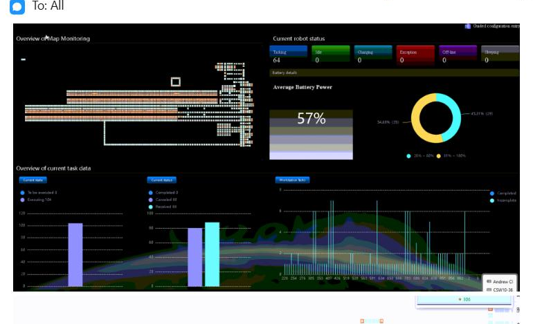
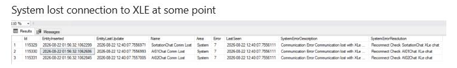
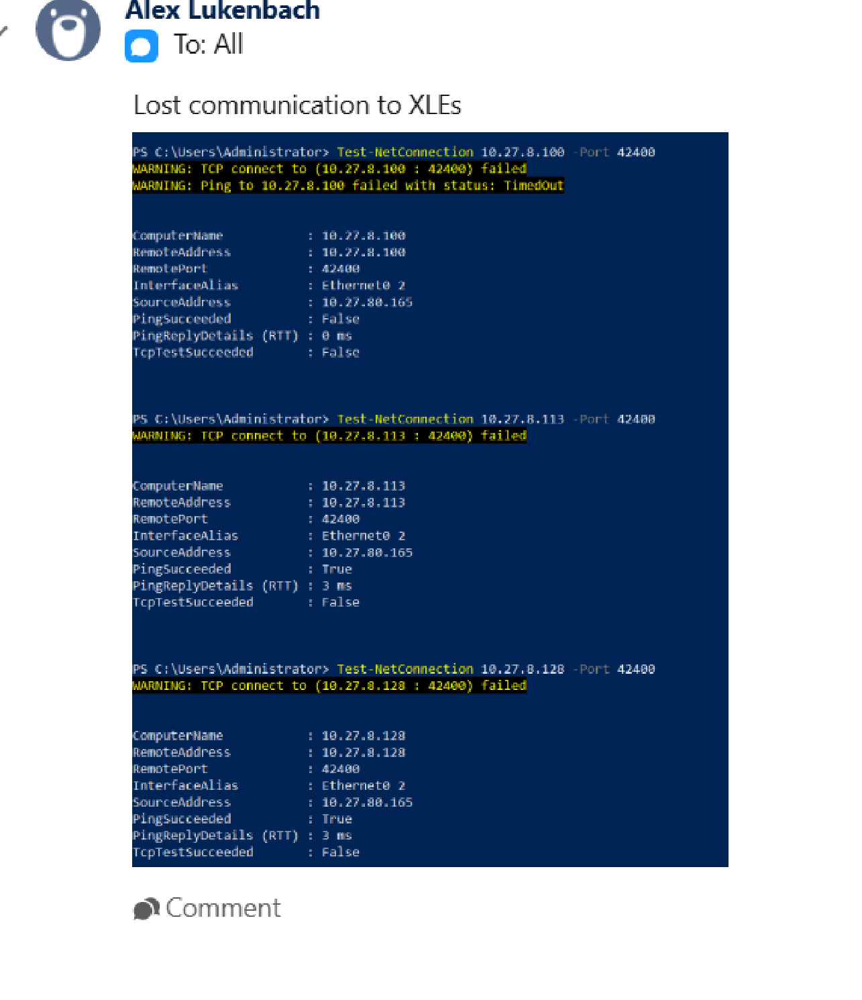
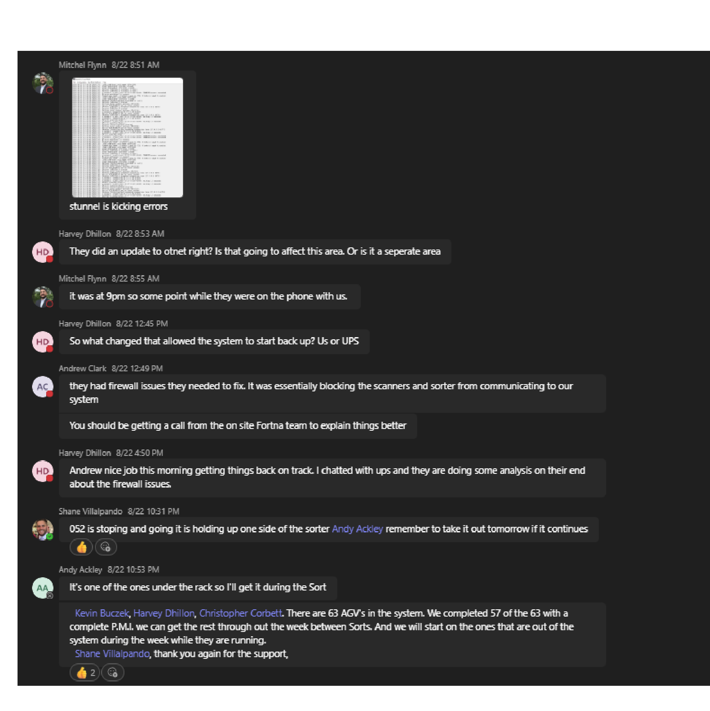

# Diagnose XLE communication loss using RMS / fleet status UI, Ignition gateway, and S-Tunnel / Chat path

## Runbook Header

| Field | Value |
| --- | --- |
| Procedure ID | `proc_xle_communication_loss_diagnostic_v1` |
| Title | Diagnose XLE communication loss using RMS / fleet status UI, Ignition gateway, and S-Tunnel / Chat path |
| Procedure Type | `diagnostic` |
| Primary Role | `L2_support` |
| Supporting Roles | `L3_support` |
| Support Safe | Yes |
| Capability Tags | `agv_active_errors` |
| Access Surface | `rms_ui`, `ignition_gateway`, `stunnel` |
| Audience Roles | `L2_support`, `L3_support` |
| Failure Pattern Tags | `api_unresponsive`, `stunnel_or_chat_down`, `site_stoppage` |
| Validation Status | `needs_sme_review` |
| Merge Status | `source_finalized` |

## Summary

Use the RMS / fleet status UI, Ignition gateway, and S-Tunnel / Chat path at UPS Haslet TX (TXRTH) to compare live AGV and task state with XLE communication and stunnel indicators. The incident showed no reported AGV faults or crashes, 80 canceled tasks, 88 received tasks, repeated XLE communication-loss messages, failed TCP connectivity on port 42400, and stunnel errors. Do not modify firewall or service configuration from this diagnostic procedure.

## When To Use

Use on the live UPS Haslet TX (TXRTH) job when tote exchange, bag-out, or sorter communication is abnormal and the cause may involve XLE communication, abnormal AGV task state, or S-Tunnel / Chat communication errors. Compare RMS / fleet status UI, Ignition gateway, and S-Tunnel / Chat path observations before escalating.

## Do Not Use For

* Do not use this procedure to change firewall rules or other network configuration.
* Do not use this procedure to restart undocumented services.
* Do not use this procedure to perform a system purge.
* Do not treat the absence of an AGV fault or crash in RMS / fleet status UI as proof that the communication path is healthy.

## Safety And Operational Notes

* This is an inspection and diagnostic procedure; do not modify firewall or service configuration.
* Do not restart undocumented services or perform a system purge from this procedure.
* Escalate rather than treating the condition as an AGV hardware fault when RMS shows no AGV faults or crashes but tote exchange, bag-out, task counts, or sorter communication remain abnormal.

## Access Or Tools Needed

* RMS / fleet status UI
* Ignition gateway
* S-Tunnel / Chat path
* Source-documented Test-NetConnection diagnostic against documented XLE targets on port 42400

## Visual References

*RMS / fleet status UI screenshot showing current robot status, average battery power of 57%, and current task data; the exact health state is not established.*

*Incident communication view showing loss of connection to XLE and repeated communication-lost entries.*

*Ignition gateway-associated diagnostic screenshot showing lost communication to XLEs and failed TCP connectivity on port 42400; several target addresses are OCR-uncertain.*

*S-Tunnel / Chat path evidence reporting stunnel errors and firewall-related blocking of scanner and sorter communication.*

## Procedure Steps

### Step 1 — Inspect live AGV and task state in the RMS / fleet status UI

**Responsible role:** L2_support

**Instruction:**
In the RMS / fleet status UI for UPS Haslet TX (TXRTH), inspect current robot status, current task data, and the displayed tote-exchange or bag-out operating state. Record whether AGVs are reported as faulted or crashed and record the displayed canceled and received task counts.

**Expected result:**
The RMS / fleet status UI displays current robot and task values that can be compared with the live tote-exchange or sorter symptom, including whether AGV faults or crashes are reported and the current canceled and received task counts.

**Stop or Escalate If:**

* RMS / fleet status UI shows an AGV fault or crash and the condition cannot be explained by the communication comparison.
* No AGV fault or crash is shown but tote exchange, bag-out, or task state remains abnormal.

---

### Step 2 — Check XLE communication in the Ignition gateway

**Responsible role:** L2_support

**Instruction:**
In the Ignition gateway Systems Overview or status view for UPS Haslet TX (TXRTH), check for a current or recent message stating lost communication to XLEs. If the source-documented connectivity diagnostic is available, inspect the result for the documented XLE targets on port 42400 without substituting OCR-uncertain endpoint values.

**Expected result:**
The Ignition gateway status view shows either an active/recent XLE communication-loss indication or no such indication, and the connectivity diagnostic exposes an observable TCP result for the documented port when run.

**Stop or Escalate If:**

* The Ignition gateway continues to report lost communication to XLEs.
* TCP connectivity remains failed on port 42400.
* The target address or command details are not confirmed in the live environment.

---

### Step 3 — Inspect stunnel communication in the S-Tunnel / Chat path

**Responsible role:** L2_support

**Instruction:**
Open the S-Tunnel / Chat path for UPS Haslet TX (TXRTH), inspect the connection list and current error state, and record whether stunnel errors are present. Record whether scanners or the sorter are reported as unable to communicate with the system.

**Expected result:**
The S-Tunnel / Chat path exposes the current connection/error state and indicates whether stunnel errors or scanner/sorter communication failures are being reported.

**Stop or Escalate If:**

* Stunnel continues to report errors.
* Scanners or the sorter remain unable to communicate with the system.
* The evidence suggests a firewall or network-owner issue requiring site or network-owner action.

---

### Step 4 — Compare RMS / fleet status UI, Ignition gateway, and S-Tunnel / Chat path observations

**Responsible role:** L2_support

**Instruction:**
Compare the observations from the RMS / fleet status UI, Ignition gateway, and S-Tunnel / Chat path. Treat a communication-related abnormal state as supported when XLE loss or stunnel errors coincide with tote-exchange or sorter communication failure, including when RMS reports no AGV fault or crash.

**Expected result:**
The comparison identifies whether the live tote-exchange or sorter symptom coincides with XLE communication loss, failed TCP connectivity on port 42400, stunnel errors, abnormal RMS task counts, or no corroborating communication indicator.

**Stop or Escalate If:**

* XLE communication remains lost.
* Stunnel continues to report errors.
* TCP connectivity remains failed on port 42400.
* The sorter remains non-communicating or tote exchange remains unavailable.
* RMS shows no AGV faults or crashes but task counts or tote exchange remain abnormal.

---

## Success Criteria

* RMS / fleet status UI, Ignition gateway, and S-Tunnel / Chat path observations are compared for the same live job.
* The diagnostic identifies whether active XLE loss, failed TCP connectivity on port 42400, stunnel errors, or abnormal RMS task state coincides with the tote-exchange or sorter symptom.
* No unsupported firewall, service, purge, or recovery action is performed.

## Failure Conditions

* The Ignition gateway continues to report lost communication to XLEs.
* TCP connectivity remains failed on port 42400.
* The S-Tunnel / Chat path continues to report stunnel errors.
* The sorter, scanners, tote exchange, or bag-out remain non-communicating or unavailable.
* RMS shows no AGV faults or crashes but task counts or tote exchange remain abnormal.

## Escalation Guidance

* Escalate to L2/L3 support or the site network owner if XLE communication remains lost, stunnel continues to report errors, TCP connectivity remains failed, or the sorter remains non-communicating.
* Retain the RMS, Ignition gateway, and S-Tunnel / Chat path observations when escalating.
* Do not change firewall rules, restart undocumented services, or perform a system purge from this diagnostic procedure.
* The incident recorded a firewall issue affecting XLE communication, but the exact firewall change and sustained live validation are not documented.

## Missing Details / Known Gaps

* Exact XLE target list is not fully reliable because several IP addresses are OCR-uncertain.
* The exact firewall rule or network correction is not documented.
* No complete service restart procedure is documented.
* No system purge procedure is documented.
* The incident does not provide independent sustained live-system validation after recovery.
* The exact healthy meanings of several RMS fields and task values are not established.

## Source Lineage

- Candidate IDs: candidate_incident_233681_xle_communication_diagnostic
- Source ID: `source_case_233681`
- Source Type: `incident_evidence_pdf`
