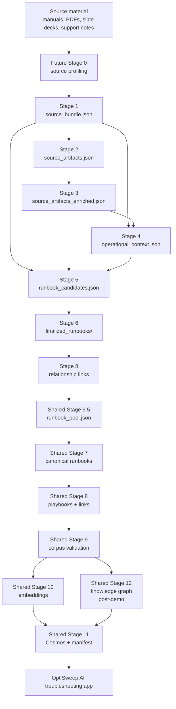

# OptiSweep Ingestion

`optisweep-ingestion` is the local ingestion workspace for turning OptiSweep operational source material into structured, traceable knowledge records.

Architecture (whole repo): [docs/architecture.md](../docs/architecture.md).  
README updates: [docs/README_UPDATE.md](../docs/README_UPDATE.md).

The long-term goal is a repeatable LangGraph ingestion pipeline that product and operations teammates can use to add more OptiSweep operational knowledge without hand-building data records. The pipeline should produce reviewed JSON outputs locally first, then feed Azure Cosmos DB via **cumulative** Shared Stage 11 publish for the OptiSweep AI troubleshooting app.

## Why This Pipeline Exists

OptiSweep troubleshooting knowledge currently lives in manuals, figures, tables, screenshots, procedures, and engineering context. Those sources are useful to people, but they are not directly usable by a RAG assistant unless they are broken into reliable, source-linked records.

This project is building that bridge. Each ingestion stage keeps provenance back to the original source so product reviewers can answer:

- What source document did this knowledge come from?
- Which page, section, figure, table, or image supports it?
- Is this a stable operational fact, a visual artifact, or a possible procedure?
- Is it ready for retrieval, or does it need review before production use?

The first source is the OptiSweep Operation and Maintenance Manual, with the heartbeat diagnostic flow used as an early proof case.

## Pipeline At A Glance

The current pipeline is stage-based and writes local JSON files under `data/output/`. Some stages are deterministic, and some require Azure OpenAI through the project LLM client.

```text
Stage 1: Source bundle extraction
  -> Stage 2: Source artifact and image extraction
  -> Stage 3: Source artifact enrichment
  -> Stage 4: Operational context extraction
  -> Stage 5: Runbook candidate discovery
  -> Stage 6: Source runbook finalization
  -> Stage 8: Relationship linking (artifact ↔ context ↔ runbook)
  -> Training video bundle generation: video + VTT normalization

SHARED PUBLISH — see ../shared_pipeline_stages/README.md and docs/architecture.md
  -> Shared Stage 6.5: Runbook pool generation
  -> Shared Stage 7: Cross-source runbook merge
  -> Shared Stage 8: Playbook finalization + operator-language enrichment
  -> Shared Stage 8.5: Corpus relationship linking
  -> Shared Stage 9: Corpus validation
  -> Shared Stage 10: Vector embedding generation
  -> Shared Stage 11: Cumulative Cosmos publish (merge + gate + smoke + gate_phrase_table)
  -> Shared Stage 12: Operational knowledge graph (post-demo)
  -> Future: LangGraph orchestration
  -> Future: RAG retrieval in the OptiSweep AI troubleshooting app
```

The intended production shape is one LangGraph pipeline with explicit nodes for source profiling, extraction, enrichment, validation, review, and publishing. The current scripts are the local, testable building blocks for those future graph nodes.

## Directed Stage Graph

This graph shows the intended direction of data flow. Stages 1 through 6 are implemented as local scripts today. Shared Stages 6.5 through 11 and Stage 12 are documented in `../shared_pipeline_stages/README.md`.



## Standard Paths

Examples below use the current manual output folder:

```text
data/input/manuals/OptiSweep Operation and Maintenance Manual - Final 1.pdf
data/output/manual_optisweep_om_v3/
```

Generated images are written inside the output folder, usually under:

```text
data/output/manual_optisweep_om_v3/stage_2_source_artifacts/images/
```

Stage outputs are grouped by stage number:

```text
data/output/manual_optisweep_om_v3/
  stage_1_source_bundle/
  stage_2_source_artifacts/
  stage_3_artifact_enrichment/
  stage_4_operational_context/
  stage_5_runbook_candidates/
  stage_6_finalized_runbooks/
  stage_8_relationship_linking/
```

Operational extraction ends at Stage 8 relationship linking. Shared publish outputs live under `../shared_pipeline_stages/data/output/shared/`. See [shared_pipeline_stages/README.md](../shared_pipeline_stages/README.md).

To run the implemented manual stages through one orchestrator, use:

```bash
python scripts/extract_operational_knowledge.py \
  --source-pdf "data/input/manuals/OptiSweep Operation and Maintenance Manual - Final 1.pdf" \
  --output-dir data/output/manual_optisweep_om_v3 \
  --stages 1,2
```

Stage modules and scripts follow the same stage numbering as output folders:

```text
src/optisweep_ingestion/
  stage1_source_bundle.py
  stage1_training_video_builder.py
  stage2_source_artifacts.py
  stage2_training_video_preparer.py
  stage3_artifact_enrichment.py
  stage4_operational_context.py
  stage5_runbook_candidates.py
  stage6_runbook_finalization.py
  stage6_5_runbook_pool.py
  stage7_runbook_drafter.py
  stage8_relationship_linking.py
  stage9_validation_repair.py
  stage10_report_writer.py
  tools/artifact_linker.py
  tools/relationship_linker.py
  tools/pdf_parser.py
  tools/docx_parser.py
  tools/source_bundle_loader.py
scripts/
  stage1_extract_source_bundle.py
  stage1_build_training_video_bundle.py
  stage2_extract_source_artifacts.py
  stage2_prepare_training_video_for_extraction.py
  stage3_enrich_source_artifacts.py
  stage4_extract_operational_context.py
  stage4_repair_operational_context_sections.py
  stage4_rerun_artifact_link_enrichment.py
  stage4_report_image_link_metrics.py
  stage5_extract_runbook_candidates.py
  stage6_finalize_runbooks.py
  stage8_link_relationships.py
  stage6_5_build_runbook_pool.py
  stage9_validate_output.py
  stage10_inspect_output.py
  stage10_migrate_source_lineage.py
  extract_operational_knowledge.py
```

## Stage 1: Source Bundle Extraction

Stage 1 reads the source PDF and creates the canonical text and reference bundle for downstream stages.

**Purpose**

Create a stable source inventory: document metadata, pages, detected sections, figure references, table references, and source identifiers. This is the foundation for traceability.

**Inputs**

```text
data/input/manuals/OptiSweep Operation and Maintenance Manual - Final 1.pdf
```

Optional CLI metadata can also be supplied, including source bundle ID, source document ID, source ID, source type, source title, source version, and ingestion batch ID.

**Outputs**

```text
data/output/manual_optisweep_om_v3/stage_1_source_bundle/source_bundle.json
```

`source_bundle.json` contains:

- source metadata and ingestion batch metadata
- page-level extracted text
- section records
- figure and table references
- stable source references used by later records

**Run**

```bash
python scripts/stage1_extract_source_bundle.py \
  --source-pdf "data/input/manuals/OptiSweep Operation and Maintenance Manual - Final 1.pdf" \
  --output-dir data/output/manual_optisweep_om_v3
```

Stage 1 is deterministic and does not call an LLM.

Short procedural guides without OM-style numbered headings (for example remote-support SQL/query playbooks) get a single document-level section covering all pages. Word export noise such as `Formatted: Font …` lines is stripped from page text before section detection.

## Stage 2: Source Artifact And Image Extraction

Stage 2 reads the Stage 1 bundle and the original PDF, then extracts source artifacts such as figures and page-rendered fallback images.

**Purpose**

Capture visual and structural artifacts that are important for troubleshooting, including screenshots, diagrams, figures, and fallback page renders when an embedded image cannot be extracted cleanly.

**Inputs**

```text
data/output/manual_optisweep_om_v3/stage_1_source_bundle/source_bundle.json
data/input/manuals/OptiSweep Operation and Maintenance Manual - Final 1.pdf
```

**Outputs**

```text
data/output/manual_optisweep_om_v3/stage_2_source_artifacts/source_artifacts.json
data/output/manual_optisweep_om_v3/stage_2_source_artifacts/artifact_extraction_report.json
data/output/manual_optisweep_om_v3/stage_2_source_artifacts/images/
```

`source_artifacts.json` contains artifact records with IDs, source references, artifact type, page/figure linkage, image paths, extraction method, and review hints.

`artifact_extraction_report.json` summarizes extraction counts, saved images, missing figure images, warnings, and priority checks such as whether the heartbeat artifact was found.

**Run**

```bash
python scripts/stage2_extract_source_artifacts.py \
  --source-bundle data/output/manual_optisweep_om_v3/stage_1_source_bundle/source_bundle.json \
  --source-pdf "data/input/manuals/OptiSweep Operation and Maintenance Manual - Final 1.pdf" \
  --output-dir data/output/manual_optisweep_om_v3
```

Stage 2 is deterministic and does not call an LLM.

## Stage 3: Source Artifact Enrichment

Stage 3 uses Azure OpenAI to make source artifacts more useful for review and retrieval.

**Purpose**

Turn raw artifact records into retrieval-friendly records. For example, a raw image reference becomes an enriched artifact with a plain-language description, tags, what-to-look-at guidance, and text that can later be embedded or indexed.

**Inputs**

```text
data/output/manual_optisweep_om_v3/stage_2_source_artifacts/source_artifacts.json
data/output/manual_optisweep_om_v3/stage_2_source_artifacts/artifact_extraction_report.json
```

**Outputs**

```text
data/output/manual_optisweep_om_v3/stage_3_artifact_enrichment/source_artifacts_enriched.json
data/output/manual_optisweep_om_v3/stage_3_artifact_enrichment/artifact_enrichment_report.json
```

`source_artifacts_enriched.json` preserves the original artifact identity and source linkage while adding LLM-generated descriptions, retrieval text, tags, and reviewer-facing guidance.

`artifact_enrichment_report.json` records input counts, enriched counts, failures, warnings, and priority checks.

**Run**

```bash
python scripts/stage3_enrich_source_artifacts.py \
  --source-artifacts data/output/manual_optisweep_om_v3/stage_2_source_artifacts/source_artifacts.json \
  --artifact-report data/output/manual_optisweep_om_v3/stage_2_source_artifacts/artifact_extraction_report.json \
  --output-dir data/output/manual_optisweep_om_v3 \
  --llm
```

Stage 3 requires `--llm`.

## Stage 4: Operational Context Extraction

Stage 4 extracts reusable operational knowledge from the source bundle and enriched artifacts.

**Purpose**

Create retrieval-ready context records that explain systems, components, screens, metrics, alarms, statuses, constraints, and operating concepts. These records are meant to answer "what is this thing and how should support think about it?"

Stage 4 does not create runbooks, workflows, trigger rules, or final procedures.

**Inputs**

```text
data/output/manual_optisweep_om_v3/stage_1_source_bundle/source_bundle.json
data/output/manual_optisweep_om_v3/stage_3_artifact_enrichment/source_artifacts_enriched.json
```

**Outputs**

```text
data/output/manual_optisweep_om_v3/stage_4_operational_context/operational_context.json
data/output/manual_optisweep_om_v3/stage_4_operational_context/operational_context_extraction_report.json
```

`operational_context.json` contains context records with source references, related artifact references, normalized topic fields, retrieval text, and evidence links.

`operational_context_extraction_report.json` records context counts, failed packets, warnings, and priority coverage checks.

**Run**

```bash
python scripts/stage4_extract_operational_context.py \
  --source-bundle data/output/manual_optisweep_om_v3/stage_1_source_bundle/source_bundle.json \
  --source-artifacts data/output/manual_optisweep_om_v3/stage_3_artifact_enrichment/source_artifacts_enriched.json \
  --output-dir data/output/manual_optisweep_om_v3 \
  --llm
```

Stage 4 requires `--llm`.

## Stage 5: Runbook Candidate Discovery

Stage 5 identifies likely reusable troubleshooting or operational procedures.

**Purpose**

Create lightweight runbook candidate records for product review. A candidate is not an approved runbook. It is an evidence-linked suggestion that says, "this source material appears to describe a reusable procedure."

**Inputs**

```text
data/output/manual_optisweep_om_v3/stage_1_source_bundle/source_bundle.json
data/output/manual_optisweep_om_v3/stage_3_artifact_enrichment/source_artifacts_enriched.json
data/output/manual_optisweep_om_v3/stage_4_operational_context/operational_context.json
```

**Outputs**

```text
data/output/manual_optisweep_om_v3/stage_5_runbook_candidates/runbook_candidates.json
data/output/manual_optisweep_om_v3/stage_5_runbook_candidates/runbook_candidate_extraction_report.json
data/output/manual_optisweep_om_v3/stage_5_runbook_candidates/runbook_candidate_coverage_report.json
```

`runbook_candidates.json` contains candidate IDs, titles, likely procedure type, likely role, rough steps, source references, related context IDs, related artifact IDs, and review metadata.

`runbook_candidate_extraction_report.json` records failed packets, dropped candidates, deduplicated candidates, warnings, and extraction statistics.

`runbook_candidate_coverage_report.json` highlights procedural source sections that may still need candidate coverage.

**Run**

```bash
python scripts/stage5_extract_runbook_candidates.py \
  --source-bundle data/output/manual_optisweep_om_v3/stage_1_source_bundle/source_bundle.json \
  --source-artifacts data/output/manual_optisweep_om_v3/stage_3_artifact_enrichment/source_artifacts_enriched.json \
  --operational-context data/output/manual_optisweep_om_v3/stage_4_operational_context/operational_context.json \
  --output-dir data/output/manual_optisweep_om_v3 \
  --llm
```

Stage 5 requires `--llm`. Use `--backfill-missing-sections` only when conservative missing-section candidates are desired after the main LLM pass.

## Stage 6: Source Runbook Finalization

Stage 6 turns Stage 5 runbook candidates into finalized source runbooks.

Each finalized runbook also emits taxonomy-constrained tags for Stage 8 linking: `capability_tags`, `access_surface`, `audience_roles`, and optional `failure_pattern_tags` (shown in SME review MD/HTML). Taxonomy IDs are appended to the Stage 6 prompt at runtime. Deep surface catalogs (WCS SQL fields, etc.) live under `docs/ontology/catalogs/`. Mini-RAG snippets are packet-wired: Stage 5 gets ≤2 surface/capability cards when the section is not already surface-grounded; Stage 6 gets ≤3 deeper model/capability/activity snippets (`ontology_snippets` via `shared_pipeline_stages/ontology_rag.py`). Source/OCR still wins on conflicts. Design: `docs/design_decisions/ontology_surface_catalogs_and_stage6_rag.md`. To re-tag existing Stage 6 JSON without re-running LLM:

```bash
python shared_pipeline_stages/scripts/backfill_runbook_capability_tags.py --regenerate-reviews
```

**Purpose**

Draft one finalized runbook JSON per accepted candidate, grounded in source artifacts, operational context, and the source bundle.

**Inputs**

```text
data/output/manual_optisweep_om_v3/stage_5_runbook_candidates/runbook_candidates.json
data/output/manual_optisweep_om_v3/stage_3_artifact_enrichment/source_artifacts_enriched.json
data/output/manual_optisweep_om_v3/stage_4_operational_context/operational_context.json
data/output/manual_optisweep_om_v3/stage_1_source_bundle/source_bundle.json
```

**Outputs**

```text
data/output/manual_optisweep_om_v3/stage_6_finalized_runbooks/finalized_runbooks/<candidate_id>.json
data/output/manual_optisweep_om_v3/stage_6_finalized_runbooks/review_markdown/runbooks/<candidate_id>.md
data/output/manual_optisweep_om_v3/stage_6_finalized_runbooks/review_markdown/runbooks/<candidate_id>.html
data/output/manual_optisweep_om_v3/stage_6_finalized_runbooks/runbook_finalization_report.json
```

Review MD/HTML includes a **Visual References** section from runbook-level `visual_references` / `screens_or_images` (plus any remaining step screens). Re-emit reviews from existing finalized JSON without re-running the LLM:

```bash
python scripts/regenerate_stage6_review_outputs.py \
  --stage6-dir data/output/training_video_day2/stage_6_finalized_runbooks \
  --source-artifacts data/output/training_video_day2/stage_2_source_artifacts/source_artifacts_enriched.json
```

For training-video outputs, prune Q&A slides and unrelated neighboring DB frames (rescored against the procedure text), then regenerate reviews:

```bash
python scripts/prune_training_runbook_images.py \
  --stage6-dir data/output/training_video_day2/stage_6_finalized_runbooks \
  --source-artifacts data/output/training_video_day2/stage_2_source_artifacts/source_artifacts_enriched.json \
  --max-visuals 2
```

Quarantine Stage 6 JSON/reviews that fail live-runbook eligibility (orientation, invented UI, “per the source”, vague outcomes):

```bash
python scripts/quarantine_non_runbooks.py \
  --stage6-dir data/output/training_video_day1/stage_6_finalized_runbooks
python scripts/quarantine_non_runbooks.py \
  --stage6-dir data/output/training_video_day2/stage_6_finalized_runbooks
```

**Run**

```bash
python scripts/stage6_finalize_runbooks.py \
  --runbook-candidates data/output/manual_optisweep_om_v3/stage_5_runbook_candidates/runbook_candidates.json \
  --source-artifacts data/output/manual_optisweep_om_v3/stage_3_artifact_enrichment/source_artifacts_enriched.json \
  --operational-context data/output/manual_optisweep_om_v3/stage_4_operational_context/operational_context.json \
  --source-bundle data/output/manual_optisweep_om_v3/stage_1_source_bundle/source_bundle.json \
  --output-dir data/output/manual_optisweep_om_v3 \
  --llm
```

Stage 6 requires `--llm`.

## Stage 8: Relationship Linking

Stage 8 connects source artifacts, operational context records, and finalized source runbooks within one operational source output directory.

**Purpose**

Earlier stages intentionally leave bidirectional link fields empty (`linked_context_ids`, `linked_runbook_ids`, `related_runbook_ids`) so extraction does not guess relationships mid-pipeline. Stage 8 derives explicit and shared-artifact links from Stage 4/6 cross-references and writes auditable `relationship_links.json` records for review, retrieval, and future graph export.

**Inputs**

```text
data/output/manual_optisweep_om_v3/stage_3_artifact_enrichment/source_artifacts_enriched.json
data/output/manual_optisweep_om_v3/stage_4_operational_context/operational_context.json
data/output/manual_optisweep_om_v3/stage_6_finalized_runbooks/finalized_runbooks/*.json
data/output/manual_optisweep_om_v3/stage_5_runbook_candidates/runbook_candidates.json   # optional lineage
```

**Outputs**

```text
data/output/manual_optisweep_om_v3/stage_8_relationship_linking/relationship_links.json
data/output/manual_optisweep_om_v3/stage_8_relationship_linking/source_artifacts_linked.json
data/output/manual_optisweep_om_v3/stage_8_relationship_linking/operational_context_linked.json
data/output/manual_optisweep_om_v3/stage_8_relationship_linking/finalized_runbooks_linked.json
data/output/manual_optisweep_om_v3/stage_8_relationship_linking/relationship_linking_report.json
```

**Run**

```bash
python scripts/stage8_link_relationships.py \
  --output-dir data/output/manual_optisweep_om_v3
```

Or through the orchestrator:

```bash
python scripts/extract_operational_knowledge.py \
  --source-pdf "data/input/manuals/OptiSweep Operation and Maintenance Manual - Final 1.pdf" \
  --output-dir data/output/manual_optisweep_om_v3 \
  --stages 8
```

Stage 8 is deterministic and does not require `--llm`.

**Review**

Start with `relationship_linking_report.json`, then spot-check linked records in `source_artifacts_linked.json` and `operational_context_linked.json`. Confirm unresolved references are documented and link records still show `needs_sme_review`.

## Stage 6.5: Shared Runbook Pool Generation

Stage 6.5 is implemented in `shared_pipeline_stages/stage_6_5/` and combines Stage 6 finalized runbooks from one or more source output roots into a shared runbook pool.

**Purpose**

Index finalized runbooks for retrieval, score cross-source similarity, and prepare merge clusters for Shared Stage 7. This stage runs after source-specific Stage 6 finalization across operational and incident sources.

**Inputs**

Each source root must contain:

```text
<output-dir>/stage_6_finalized_runbooks/finalized_runbooks/*.json
```

Repeat `--source-root` for each operational or incident output directory.

**Outputs**

Shared outputs are written under:

```text
shared_pipeline_stages/data/output/shared/stage_6_5_runbook_pool/
  runbook_pool.json
  retrieval_cards.json
  runbook_retrieval_index.json
  merge_clusters.json
  pass_through_runbooks.json
  runbook_similarity.json
  runbook_pool_report.json
```

Per-source Stage 6.5 output under a single source directory is still supported when running through `extract_operational_knowledge.py --stages 6.5`, but cross-source review should use the shared output root above.

**Run**

From the repo root:

```powershell
python shared_pipeline_stages/scripts/stage6_5_build_runbook_pool.py `
  --source-root operationalknowledgeingestion/data/output/manual_optisweep_om_v3 `
  --source-root operationalknowledgeingestion/data/output/training_video_day1 `
  --output-dir shared_pipeline_stages/data/output/shared
```

Or from this directory:

```powershell
python scripts/stage6_5_build_runbook_pool.py `
  --source-root data/output/manual_optisweep_om_v3 `
  --output-dir ../shared_pipeline_stages/data/output/shared
```

Stage 6.5 uses Azure OpenAI embeddings by default. Use `--skip-embed` or `--use-mock-embedder` for structural tests.

**Review**

See `shared_pipeline_stages/README.md` for the full Stage 6.5 review checklist. Start with `runbook_pool_report.json`, then inspect `merge_clusters.json` and `pass_through_runbooks.json`.

## Training Video Bundle Generation

The v1 training video builder normalizes a screen-share training recording and external `.vtt` transcript into source artifacts and timestamped slide segment records. It does not directly create operational context records or runbook candidates.

**Purpose**

Capture the video timeline as source evidence. The builder detects slide intervals from cropped video frames, can use local Tesseract OCR to catch slide title/text changes, saves representative slide-frame artifacts, captures limited extra frames when visual content changes within an interval, parses VTT cues, and aligns transcript text to detected slide intervals.

**Inputs**

```text
data/input/videos/example.mp4
data/input/videos/example.vtt
```

**Outputs**

```text
data/output/training_video_example/stage_1_source_bundle/source_artifacts.json
data/output/training_video_example/stage_1_source_bundle/training_video_slide_segments.json
data/output/training_video_example/stage_1_source_bundle/training_video_ingestion_report.json
data/output/training_video_example/stage_1_source_bundle/images/
```

**Run**

```bash
python scripts/stage1_build_training_video_bundle.py \
  --source-video "data/input/videos/example.mp4" \
  --transcript-vtt "data/input/videos/example.vtt" \
  --output-dir data/output/training_video_example \
  --source-id training_video_example \
  --source-title "OptiSweep Training Video" \
  --crop-box "0,68,1676,1012" \
  --ocr-backend tesseract \
  --sample-ocr-interval-seconds 3 \
  --max-segment-seconds 120 \
  --write-segmentation-inspection
```

The default transcript alignment buffer is 1.5 seconds before each slide interval and 3.0 seconds after each slide interval. The builder preserves original VTT cue timestamps and labels each cue alignment as `exact_overlap`, `buffered_overlap`, or `nearest_slide`.

When `--ocr-backend tesseract` is used, local Tesseract must be available as `tesseract` on `PATH` or via `TESSERACT_CMD` / `--tesseract-command`. OCR text is stored with backend, confidence, timestamp, source image path, text hash, and detected title metadata. Use `--ocr-backend none` to disable OCR.

`--write-segmentation-inspection` also writes:

```text
data/output/training_video_example/stage_1_source_bundle/candidate_cuts.json
data/output/training_video_example/stage_1_source_bundle/segmentation_quality_report.json
data/output/training_video_example/stage_1_source_bundle/segmentation_contact_sheet.jpg
```

Use `--fail-on-low-quality-segmentation` when long or high cue-density segments should stop the run before Stage 4/5.

## Training Video Extraction Preparation

Training video bundle generation is followed by a deterministic preparation step that converts `training_video_slide_segments.json` into a source-bundle-compatible shape for the existing Stage 4 and Stage 5 extractors.

This keeps the semantic pipeline consistent: training videos do not get separate operational context or runbook-candidate extractors. They reuse the same Stage 4 and Stage 5 logic after source normalization.

**Inputs**

```text
data/output/training_video_example/stage_1_source_bundle/training_video_slide_segments.json
data/output/training_video_example/stage_1_source_bundle/source_artifacts.json
```

**Outputs**

```text
data/output/training_video_example/stage_2_source_artifacts/source_bundle.json
data/output/training_video_example/stage_2_source_artifacts/source_artifacts_enriched.json
data/output/training_video_example/stage_2_source_artifacts/training_video_preparation_report.json
```

**Run**

```bash
python scripts/stage2_prepare_training_video_for_extraction.py \
  --training-segments data/output/training_video_example/stage_1_source_bundle/training_video_slide_segments.json \
  --source-artifacts data/output/training_video_example/stage_1_source_bundle/source_artifacts.json \
  --output-dir data/output/training_video_example
```

After this preparation step, the same Stage 4 and Stage 5 commands can run against the training video output directory:

```bash
python scripts/stage4_extract_operational_context.py \
  --source-bundle data/output/training_video_example/stage_2_source_artifacts/source_bundle.json \
  --source-artifacts data/output/training_video_example/stage_2_source_artifacts/source_artifacts_enriched.json \
  --output-dir data/output/training_video_example \
  --llm

python scripts/stage5_extract_runbook_candidates.py \
  --source-bundle data/output/training_video_example/stage_2_source_artifacts/source_bundle.json \
  --source-artifacts data/output/training_video_example/stage_2_source_artifacts/source_artifacts_enriched.json \
  --operational-context data/output/training_video_example/stage_4_operational_context/operational_context.json \
  --output-dir data/output/training_video_example \
  --llm
```

## Shared Pipeline Handoff

After operational Stage 6 (or Stage 8 when relationship links are needed per source), finalized runbooks feed **Shared Stage 6.5** alongside incident Stage 6 outputs. Cross-source merge, playbook linking, corpus validation, embedding, and Cosmos publishing are **shared stages** — not operational-local stages.

| Shared stage | Status | Notes |
| --- | --- | --- |
| 6.5 Runbook pool | Implemented | Uses embedder for similarity scoring only |
| 7 Runbook merge | Implemented | Selective LLM merge on clusters |
| 8 Playbook finalization | Implemented | Playbook→runbook linking; builds retrieval cards |
| 8.5 Corpus relationship linking | Implemented | Aggregates per-source graphs + playbook links |
| 9 Corpus validation | Planned | Publish gate for Stage 7+8 outputs |
| 10 Embeddings | Planned | Full-corpus `EmbeddingRecord` export |
| 11 Cosmos + manifest | Planned | Versioned publish batch |

Run commands and output paths: [shared_pipeline_stages/README.md](../shared_pipeline_stages/README.md).

### Per-source extraction helpers (not publish gates)

These modules support source extraction QA and per-source relationship linking. They are not the shared publish gate:

- `stage8_relationship_linking.py` — deterministic artifact ↔ context ↔ source-runbook linking after Stage 6
- `stage9_validation_repair.py` — validates artifacts/contexts/candidates during source extraction only
- `stage10_report_writer.py` — writes per-source `extraction_report.json` into `stage_9_validation_repair/`

The demo critical path gates on **Shared Stage 9**, not these per-source helpers.

## Stage 7–12 (Historical Operational Numbering)

Older docs numbered canonical merge, validation, embedding, and Cosmos publish as operational Stages 7–11. That numbering now lives in `shared_pipeline_stages/` as **Shared Stages 6.5–11**. `stage7_runbook_drafter.py` in this directory is legacy single-source drafting; cross-source merge uses `shared_pipeline_stages/stage_7/`.

**Shared Stage 10 embeddings** use one model and one export for the full corpus. Operational runbooks contribute `canonical_runbook` records; incident playbooks contribute `playbook` records with `extraction_mode` metadata for the app A/B toggle. See the embedding table in [shared_pipeline_stages/README.md](../shared_pipeline_stages/README.md#shared-stage-10-vector-embedding-generation).

**Shared Stage 12** (operational knowledge graph) remains post-demo and is not on the July 15 critical path.

## Future Production Flow

The current local outputs are intended to become the reviewed source of truth for production publishing.

Future stages should:

- orchestrate the stage scripts as LangGraph nodes
- add source profiling so manuals, slide PDFs, native presentations, OCR-heavy files, and mixed source packages can route through the right extraction strategy
- add a video/source inspection node that can sample training video frames, parse external VTT transcripts, recommend a stable screen-share crop, estimate slide-change thresholds, flag whether OCR is recommended, and write a `source_profile.json` for downstream extractors
- let training video builders accept either an explicit crop box or a generated `source_profile.json`, so early deterministic runs can stay simple while the future LangGraph pipeline can add LLM or vision-assisted inspection when crop/layout confidence is low
- implement Shared Stages 9–11 (corpus validation, embedding, Cosmos publish) per [shared_pipeline_stages/README.md](../shared_pipeline_stages/README.md)
- support product team review and approval
- generate an operational knowledge graph from reviewed records and relationships (Shared Stage 12)
- support vector retrieval, graph-aware retrieval, and citation-backed answers in the OptiSweep AI troubleshooting app

Cosmos publishing is intentionally not the first step. The pipeline needs to make the knowledge repeatable, inspectable, and explainable before production storage is introduced.

## Docs Guide

`docs/data_contracts.md`

Defines the main planned record types at a conceptual level: source bundles, source artifacts, manual references, operational context, runbooks, embedding records, knowledge graph records, and extraction reports. Start here when you need to understand what kinds of JSON records the pipeline is trying to produce.

`docs/development_log.md`

Tracks what changed, what was added, and what decisions have been made. The README includes an auto-synced copy of this log at the bottom so newcomers can see the current project state quickly.

`docs/operational_knowledge_pipeline_architecture.md`

Captures architecture decisions for the broader operational knowledge pipeline. It explains why the future system should profile sources before extraction, treat PyMuPDF as one adapter rather than the whole architecture, handle PowerPoint-exported PDFs differently from manuals, and treat OCR as additive provenance rather than replacement text.

`cursorprompts/manual_ingestion_prompts/manual_ingestion_plan.md`

Contains the manual-specific stage plan used while building the current ingestion path. It is the detailed planning reference for source extraction (Stages 1–6) and shared publish stages (6.5–11).

## Reviewing Data Outputs

All operational stage outputs live under `data/output/<source_id>/`. Review locally before treating records as production-ready.

**Standard review order for any stage**

1. Open the stage report first (`artifact_extraction_report.json`, `artifact_enrichment_report.json`, `operational_context_extraction_report.json`, `runbook_candidate_extraction_report.json`, `runbook_finalization_report.json`).
2. Check dropped records, warnings, failed packets, and coverage gaps.
3. Open the primary stage JSON for spot checks.
4. Trace sample records back to source refs in `source_bundle.json`, enriched artifacts, or images under `stage_2_source_artifacts/images/`.
5. Confirm review metadata still shows `needs_sme_review` unless explicitly approved.

**Stage-specific checks**

| Stage | Start here | What to verify |
| --- | --- | --- |
| 1 | `stage_1_source_bundle/source_bundle.json` | Page coverage, section refs, figure/table inventory |
| 2 | `stage_2_source_artifacts/artifact_extraction_report.json` | Artifact count, image paths, missing priority figures |
| 3 | `stage_3_artifact_enrichment/artifact_enrichment_report.json` | Enrichment failures, retrieval text quality, source linkage preserved |
| 4 | `stage_4_operational_context/operational_context_extraction_report.json` | Context count, artifact links, unsupported claims |
| 5 | `stage_5_runbook_candidates/runbook_candidate_extraction_report.json` | Candidate quality, dedupe drops, coverage gaps |
| 6 | `stage_6_finalized_runbooks/runbook_finalization_report.json` | Finalized runbook count, step grounding, validation status |
| 8 | `stage_8_relationship_linking/relationship_linking_report.json` | Link counts, unresolved refs, linked artifact/context/runbook coverage |
| 6.5 | `shared_pipeline_stages/data/output/shared/stage_6_5_runbook_pool/runbook_pool_report.json` | Merge clusters, pass-through list, cross-source pairs |

**Images and artifacts**

- Open linked images in `stage_2_source_artifacts/images/` when reviewing artifact or runbook steps.
- For training video sources, also inspect `stage_1_source_bundle/segmentation_samples/` and `segmentation_quality_report.json`.

**Shared stages**

Cross-source Stage 6.5+ outputs and review instructions live in `shared_pipeline_stages/README.md`.

## Project Layout

```text
.
  README.md
  pyproject.toml
  data/
    input/      source files provided by product or engineering
    output/     generated local JSON and image outputs
    processed/  optional intermediate files
    review/     reviewer-facing samples and validation outputs
  docs/         project decisions, contracts, and architecture notes
  scripts/      runnable stage entrypoints
  src/
    optisweep_ingestion/
      graph/    future LangGraph orchestration pieces
      prompts/  LLM prompts used by enrichment and extraction stages
      schemas/  Pydantic data contracts
      services/ shared clients and ID/reference helpers
      tools/    stage implementations
  tests/        unit tests for stage behavior and contracts

../shared_pipeline_stages/
  data/output/shared/   cross-source shared stage outputs
  stage_6_5/            shared Stage 6.5 implementation
```

## Development Workflow

1. Add source files under `data/input/`.
2. Run stages locally and write outputs under `data/output/`.
3. Inspect extraction reports and review generated records before treating them as production-ready.
4. Update schemas, prompts, and tools as the source material reveals new cases.
5. Keep docs current so product teammates can understand what the pipeline expects and produces.
6. Only publish to production storage after records are validated and reviewable.

## README Update Hook

Run the README update hook after meaningful project changes:

```bash
python scripts/update_readme.py
```

The hook refreshes the marked development log section while preserving the rest of this README.

## Current Status

Stages 1 through 6 are implemented as local scripts. Shared Stages 6.5 through 11 (documented in [shared_pipeline_stages/README.md](../shared_pipeline_stages/README.md)), Shared Stage 12 knowledge graph generation, and LangGraph orchestration are the next production-shape milestones.

<!-- AUTO:DEVELOPMENT_LOG_START -->
# Development Log

## Unreleased

### Changed (2026-08-07)
- Training video Stage 1 OCR default switched from local Tesseract to Azure
  AI Vision Image Analysis 4.0 ("Read" feature, synchronous
  `imageanalysis:analyze?features=read`), via new `AzureComputerVisionOCRClient`
  in `stage1_training_video_builder.py`. Select with `--ocr-backend azure_cv`
  (now default), `tesseract`, or `none`. Requires
  `AZURE_COMPUTER_VISION_ENDPOINT` / `AZURE_COMPUTER_VISION_KEY` (see
  `.env.example`); paced to the Azure free tier's 20 calls/min via
  `AZURE_COMPUTER_VISION_MIN_INTERVAL_SEC` (default 3.5s/call). Motivation:
  Tesseract-OCR'd video frames lost exact SQL column names, enum values, and
  table structure from on-screen SSMS/slide content (see
  `docs/design_decisions/day2_ontology_backend_evidence_deep_dive.md`), which
  Azure AI Vision's line/word-level Read result preserves more reliably.
  `scripts/backfill_training_video_ocr_azure_cv.py` mirrors the existing
  Tesseract backfill script for re-OCR'ing already-captured Stage 1 frames
  without re-touching the source video. This uses Azure AI Vision's Image
  Analysis "Read" feature, not Azure Document Intelligence — the 2026-08-05
  and earlier "do not use Azure Document Intelligence for this path" decision
  below was about the layout/table-extraction Document Intelligence product,
  not this OCR-only Computer Vision Read call; that decision is unchanged and
  not being revisited here.

### Changed
- Training packet enrichment: Stage 2 section `text` + stronger artifact short_description/retrieval_text; Stage 5/6 packets pass `nearby_text`/`ocr_text` and longer section text (Stage 6 also hydrates empty section text from pages). Artifact linker prefers same `section_id`, penalizes Q&A/lunch slides. Stage 5/6 prompts require named fields/outcomes and ban Q&A slide evidence. Re-prepare Stage 2 then regen Stage 5–6 (+ shared 6.5–10) for Day 1/2 to apply.
- Stage 5/6 prompts: ban training-study fluff (“from the training material,” “record that the source says,” expected_result = “documented intent captured”). Require live surface naming (SSMS / Helix DB / Robotics module / API Dog), observable expected results; prefer `diagnostic` + `L2_support` for DB/API interpretation. Existing Day 2 outputs need Stage 5–6 regen to pick this up.
- Stage 6 finalization emits taxonomy-constrained `capability_tags` / `access_surface` / `audience_roles` / `failure_pattern_tags` (prompts + normalize + SME review MD/HTML). Runtime appends taxonomy IDs via `shared_pipeline_stages/stage_prompts.py`.
- Backfill: `shared_pipeline_stages/scripts/backfill_runbook_capability_tags.py` tagged existing Stage 6 finalized runbooks (incl. `active_agv_error_query_1`) and regenerated reviews.
- Stage 5 discovery/backfill: clarify that **source-backed WCS/SSMS/DB diagnostics are valid candidates** (do not invent SQL; operator has no DB access — use L1/L2). Deterministic placeholder backfill `_role_from_title` now maps SQL/SSMS/database/query titles to `L2_support` (and Event Viewer/API/Ignition to `L1_support`) instead of defaulting to `operator`.
- Aligns operational placeholder creation with the locked role/component access matrix and Day 2 SSMS training content. See `docs/design_decisions/stage_8_capability_tags_and_linking_plan.md` and `docs/design_decisions/stage_5_8_c2_b2_b1_changelog.md`.

### Added
- Stage 1 source bundle extraction for the OptiSweep Operation and Maintenance Manual.
- Stage 2 source artifact and image extraction with artifact reports and priority figure checks.
- Stage 3 Azure AI Foundry source artifact enrichment with descriptions, tags, what-to-look-at guidance, and retrieval text.
- Stage 4 operational context extraction scaffolding for reusable context records.
- V1 training video bundle builder for video plus external VTT transcript inputs.
- Training video slide-segment normalization with cropped frame artifacts and timestamped transcript alignment.
- CLI entrypoint for building local training video source artifacts and slide segment records.
- Training video extraction preparation stage that emits a source-bundle-compatible shape for shared Stage 4 and Stage 5 reuse.
- Local Tesseract OCR-assisted training video segmentation with inspection outputs and quality gates.

### Changed
- README current-stage guidance now reflects the implemented ingestion stages.

### Decisions
- Keep this repo focused on local ingestion and data quality before database writes.
- Use one future LangGraph pipeline with multiple stage nodes.
- Keep source artifact enrichment separate from operational context, runbooks, workflows, and relationship linking.
- Training video ingestion should normalize video evidence first; Stage 4 context extraction and Stage 5 runbook candidate discovery should run afterward through the main pipeline.
- Avoid separate semantic extractors for video unless the shared Stage 4/5 packet model proves insufficient.
- Use local Tesseract OCR for training video slide-change assistance; do not use Azure Document Intelligence for this path.
<!-- AUTO:DEVELOPMENT_LOG_END -->

