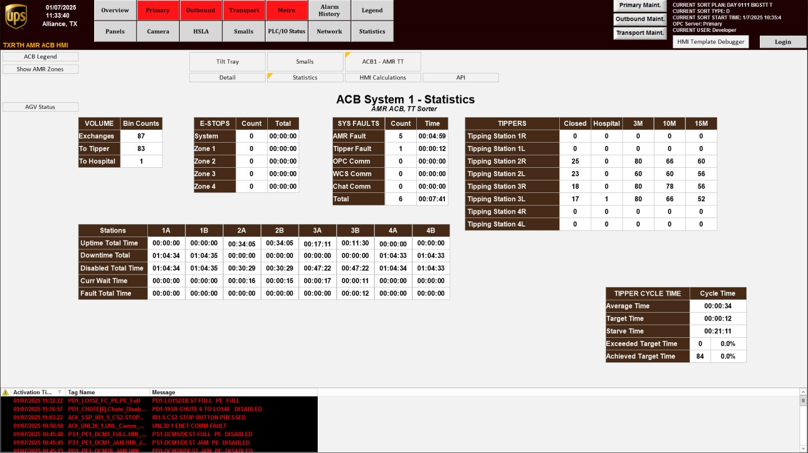

# Check ACB System Statistics (robot faults, system faults, cycle time, tipping station bag counts) on the ACB System Statistics screen

## Runbook Header

| Field | Value |
| --- | --- |
| Procedure ID | `proc_check_acb_system_statistics_screen_check_v1` |
| Title | Check ACB System Statistics (robot faults, system faults, cycle time, tipping station bag counts) on the ACB System Statistics screen |
| Procedure Type | `diagnostic` |
| Primary Role | `operator` |
| Supporting Roles | None |
| Support Safe | Yes |
| Capability Tags | `fleet_system_status` |
| Access Surface | `tipper_hmi` |
| Audience Roles | `operator` |
| Failure Pattern Tags | None |
| Validation Status | `needs_sme_review` |
| Merge Status | `source_finalized` |

## Summary

Open the OptiSweep Tipper HMI/WebVisu “ACB System” screen, press “STATISTICS” to view the “ACB System Statistics” screen, and verify the displayed ACB metrics: number of robot faults, number of system faults, cycle time, and tipping station bag counts.

## When To Use

Use when you need a quick, on-screen view of current Automated Carton Buffer (ACB) statistics—robot faults, system faults, cycle time, and tipping station bag counts—on the live OptiSweep HMI.

## Access Or Tools Needed

* Tipper HMI / WebVisu / VISU access to view the ACB System screens

## Related Operational Context

* ctx_manual_acb_system_statistics_screen_v1
* ctx_manual_acb_system_statistics_metrics_v1
* ctx_manual_acb_system_screen_navigation_v1

## Visual References

*Figure 4-5: ACB System Statistics Screen layout showing the statistical information areas for robot faults, system faults, cycle time, and tipping station bag counts.*

## Procedure Steps

### Step 1 — Open ACB System Statistics from the ACB System screen

**Responsible role:** operator

**Instruction:**
On the Tipper HMI/WebVisu/VISU, open the “ACB System” screen, then press the “STATISTICS” button to access the “ACB System Statistics” screen.

**Expected result:**
The “ACB System Statistics” screen opens successfully.

**Stop or Escalate If:**

* STATISTICS button does not open the ACB System Statistics screen

---

### Step 2 — Locate and record the four ACB metrics on the ACB System Statistics screen

**Responsible role:** operator

**Instruction:**
On the “ACB System Statistics” screen, locate the displayed values for: (1) number of robot faults, (2) number of system faults, (3) cycle time, and (4) tipping station bag counts.

**Expected result:**
All four metric areas are visible and you can read the displayed values for robot faults, system faults, cycle time, and tipping station bag counts.

**Stop or Escalate If:**

* One or more of the four metrics (robot faults, system faults, cycle time, tipping station bag counts) are missing/blank

---

### Step 3 — Confirm the ACB System Statistics screen is populated with numeric/statistical values

**Responsible role:** operator

**Instruction:**
Verify that the “ACB System Statistics” screen shows numeric/statistical values (not blank/missing) for all four metrics: robot faults, system faults, cycle time, and tipping station bag counts.

**Expected result:**
The four metrics are populated with numeric/statistical values.

**Stop or Escalate If:**

* One or more of the four metrics are missing/blank when the screen is open

---

## Success Criteria

* The “ACB System Statistics” screen opens after pressing “STATISTICS” on the “ACB System” screen.
* The screen displays all four required metrics: number of robot faults, number of system faults, cycle time, and tipping station bag counts.
* None of the four metrics are blank/missing.

## Failure Conditions

* The “STATISTICS” button does not open the “ACB System Statistics” screen.
* One or more of the four metrics (robot faults, system faults, cycle time, tipping station bag counts) are missing/blank.

## Escalation Guidance

* If the “STATISTICS” button does not open the “ACB System Statistics” screen, stop and escalate to support.
* If one or more of the four metrics are missing/blank when the screen is open, stop and escalate to support.

## Missing Details / Known Gaps

* The source does not provide specific field labels beyond the four metric categories (robot faults, system faults, cycle time, tipping station bag counts), nor does it provide numeric thresholds or expected ranges for “healthy” values.

## Source Lineage

- Candidate IDs: candidate_manual_acb_system_statistics_screen_check
- Source ID: `manual_optisweep_om_v3`
- Source Type: `manual`
