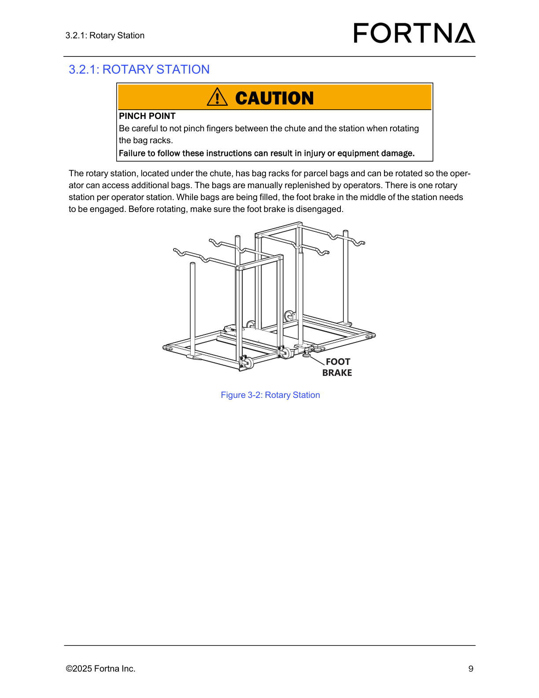
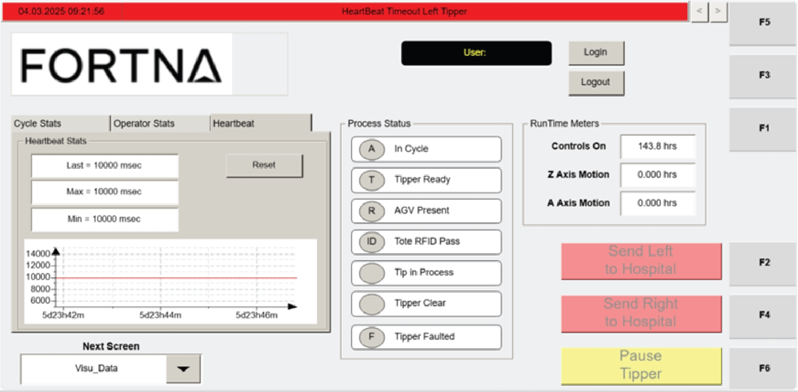
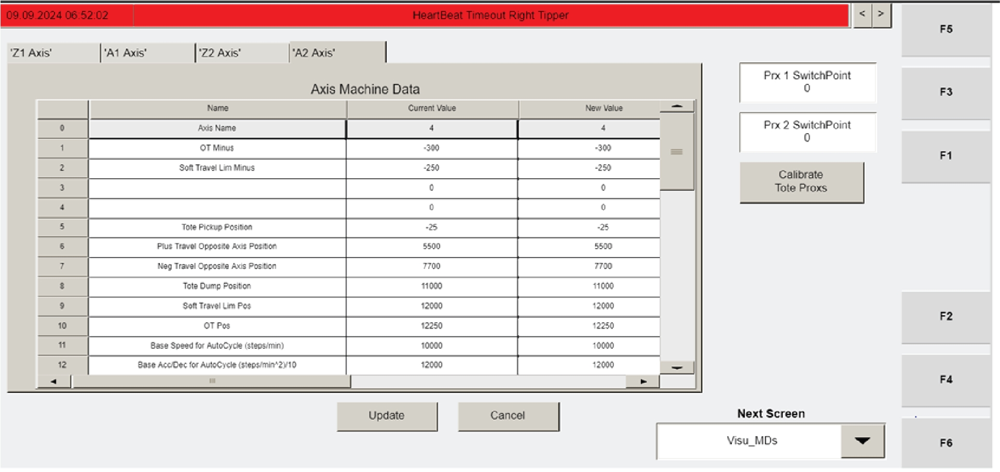

# Perform Daily Maintenance Checklist: Operator Station, Chute, Stacklights, Guards, and QR Codes

## Runbook Header

| Field | Value |
| --- | --- |
| Procedure ID | `proc_perform_daily_maintenance_checklist_operator_station_chute_stacklights_guards_qr_v1` |
| Title | Perform Daily Maintenance Checklist: Operator Station, Chute, Stacklights, Guards, and QR Codes |
| Procedure Type | `operation` |
| Primary Role | `operator` |
| Supporting Roles | None |
| Support Safe | Yes |
| Capability Tags | `device_roster_state` |
| Access Surface | `physical_floor` |
| Audience Roles | `operator` |
| Failure Pattern Tags | None |
| Validation Status | `needs_sme_review` |
| Merge Status | `source_finalized` |

## Summary

Complete the daily inspection items to confirm the Operator Station controller/chute are intact and that stacklights, guards, and QR codes are in good condition.

## When To Use

Use this daily, on-site inspection checklist to verify the Operator Station controller, Operator Station chute, stacklights, guards/attaching hardware, and QR codes (floor and racks) are in acceptable condition before operation.

## Safety And Operational Notes

* Follow site safety practices while inspecting physical equipment (controller, chute area, guards, and QR code locations).

## Access Or Tools Needed

* On-site access to the Operator Station controller, chute, stacklights, guards, and QR codes
* Daily Maintenance Checklist form (photocopyable)

## Related Operational Context

* ctx_manual_daily_maintenance_checklist_v1

## Visual References

*Controller PCA diagram (used here only as a visual reference for the controller assembly location/components; the daily checklist step is to inspect the Operator Station controller for damage).*

*Rotary station photo under the chute (optional visual reference for the chute/station area context while performing the chute debris inspection).*

*Operator Station HMI Heartbeat Stats screen (not required by the daily checklist excerpt; included only if your site uses HMI indicators as part of determining 'operational' stacklight/overall station health—no explicit daily checklist criteria provided in the excerpt).*

*Operator station HMI screen 'Visu_MDs' (F2) (not required by the daily checklist excerpt; included only as an optional visual reference for operator station HMI context).*

## Procedure Steps

### Step 1 — Record inspection date, inspected by, and unit inspected

**Responsible role:** operator

**Instruction:**
On the Daily Maintenance Checklist form, record the Inspection Date, Inspected By, and Unit Inspected.

**Expected result:**
The form has entries for Inspection Date, Inspected By, and Unit Inspected.

---

### Step 2 — Inspect the Operator Station controller for damage

**Responsible role:** operator

**Instruction:**
Visually inspect the Operator Station controller for damage.

**Expected result:**
No damage is observed on the Operator Station controller.

**Stop or Escalate If:**

* If the controller shows damage, stop the checklist and escalate for corrective action.

---

### Step 3 — Ensure the Operator Station chute is free of debris

**Responsible role:** operator

**Instruction:**
Visually check the Operator Station chute area and ensure it is free of debris.

**Expected result:**
No debris is present in the Operator Station chute.

**Stop or Escalate If:**

* If debris is found, stop the checklist and escalate for corrective action.

---

### Step 4 — Verify stacklights are operational

**Responsible role:** operator

**Instruction:**
Verify the stacklights are operational.

**Expected result:**
Stacklights are operational (as determined by your site’s operational check for stacklights).

**Stop or Escalate If:**

* If stacklights are not operational, stop the checklist and escalate for corrective action.

---

### Step 5 — Inspect guards and verify attaching hardware is secure

**Responsible role:** operator

**Instruction:**
Inspect the guards and verify the attaching hardware is secure.

**Expected result:**
Guards are intact and attaching hardware is secure.

**Stop or Escalate If:**

* If guards or attaching hardware are damaged/not secure, stop the checklist and escalate for corrective action.

---

### Step 6 — Inspect all QR codes on the floor for damage or peeling

**Responsible role:** operator

**Instruction:**
Inspect all QR codes on the floor for damage or peeling.

**Expected result:**
All floor QR codes show no damage and no peeling.

**Stop or Escalate If:**

* If any floor QR code is damaged or peeling, stop the checklist and escalate for corrective action.

---

### Step 7 — Inspect all QR codes on the racks for damage or peeling

**Responsible role:** operator

**Instruction:**
Inspect all QR codes on the racks for damage or peeling.

**Expected result:**
All rack QR codes show no damage and no peeling.

**Stop or Escalate If:**

* If any rack QR code is damaged or peeling, stop the checklist and escalate for corrective action.

---

## Success Criteria

* Operator Station controller shows no damage
* Operator Station chute is free of debris
* Stacklights are operational
* Guards/attaching hardware are secure
* All floor QR codes show no damage or peeling
* All rack QR codes show no damage or peeling

## Failure Conditions

* Operator Station controller shows damage
* Operator Station chute contains debris
* Stacklights are not operational
* Guards/attaching hardware are not secure
* Any floor QR code is damaged or peeling
* Any rack QR code is damaged or peeling

## Escalation Guidance

* If any item shows damage (controller, guards/attaching hardware, QR codes) or stacklights are not operational, stop the checklist and escalate for corrective action.

## Missing Details / Known Gaps

* The excerpt does not define a specific visual/functional criterion for what “stacklights are operational” looks like (e.g., illuminated state, color, or indicator behavior).
* The excerpt does not provide labeled images/figures for guard locations/attaching hardware or for floor/rack QR code locations and what “damage/peeling” looks like.

## Source Lineage

- Candidate IDs: candidate_manual_daily_maintenance_checklist_operator_station_qr_stacklights
- Source ID: `manual_optisweep_om_v3`
- Source Type: `manual`
