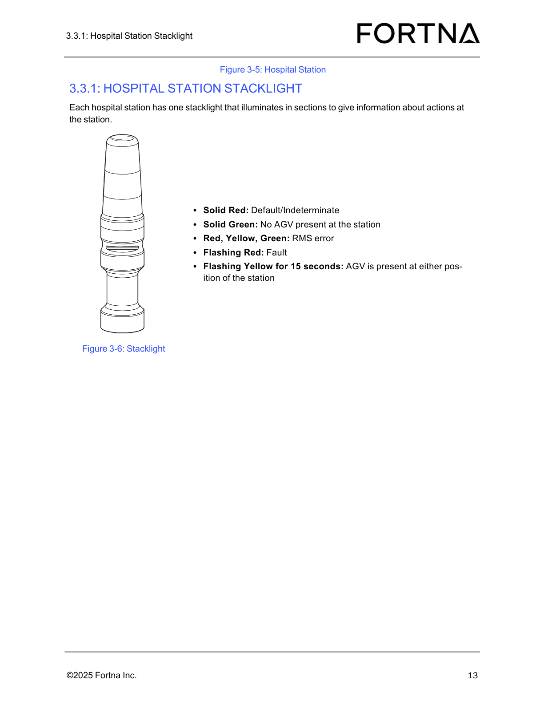

# Perform Daily Preventive Maintenance Inspection on OptiSweep Hospital Station(s)

## Runbook Header

| Field | Value |
| --- | --- |
| Procedure ID | `proc_perform_daily_preventive_maintenance_inspection_on_optsweep_hospital_station_s_v1` |
| Title | Perform Daily Preventive Maintenance Inspection on OptiSweep Hospital Station(s) |
| Procedure Type | `operation` |
| Primary Role | `operator` |
| Supporting Roles | None |
| Support Safe | Yes |
| Capability Tags | `hospital_diversion` |
| Access Surface | `physical_floor`, `hospital_hmi` |
| Audience Roles | `operator` |
| Failure Pattern Tags | None |
| Validation Status | `needs_sme_review` |
| Merge Status | `source_finalized` |

## Summary

Perform a daily inspection of each OptiSweep hospital station to verify the barcode scanner is operational, the stacklight is operational, and the tabletop is free of debris.

## When To Use

Use this daily checklist to verify each hospital station is safe to operate by confirming (1) barcode scanner operational status, (2) stacklight operational status, and (3) tabletop is free of debris.

## Access Or Tools Needed

* Physical access to each OptiSweep hospital station
* Visual inspection capability

## Related Operational Context

* ctx_manual_daily_pm_hospital_station_v1

## Visual References

*Diagram of the Hospital Station layout showing induct and extract sides and the location of the green barcode scanner (used to orient the inspection).*

*Photo/figure of the hospital station stacklight with labeled light states (used to judge whether the stacklight is operational).*

*Photo of a hospital station showing the stacklight and station physical layout (used to locate the stacklight and station components).*

## Procedure Steps

### Step 1 — Inspect the barcode scanner at each hospital station

**Responsible role:** operator

**Instruction:**
For each OptiSweep hospital station, visually inspect the hospital station barcode scanner and confirm it is operational.

**Expected result:**
For the station being inspected, the barcode scanner is operational.

**Stop or Escalate If:**

* Barcode scanner issue is observed

---

### Step 2 — Inspect the hospital station stacklight

**Responsible role:** operator

**Instruction:**
For each OptiSweep hospital station, inspect the stacklight and confirm it is operational.

**Expected result:**
For the station being inspected, the stacklight is operational.

**Stop or Escalate If:**

* Stacklight is not operational

---

### Step 3 — Inspect the hospital station tabletop for debris

**Responsible role:** operator

**Instruction:**
For each OptiSweep hospital station, inspect the tabletop and remove/confirm absence of debris.

**Expected result:**
For the station being inspected, the tabletop is free of debris.

**Stop or Escalate If:**

* Debris is present on the tabletop

---

### Step 4 — Stop inspection and escalate if any required item fails

**Responsible role:** operator

**Instruction:**
If any barcode scanner issue is observed, if the stacklight is not operational, or if debris is present on the tabletop, stop the inspection and escalate to maintenance support.

**Expected result:**
Inspection is stopped for the failing condition and maintenance support is engaged.

**Stop or Escalate If:**

* Barcode scanner issue is observed
* Stacklight is not operational
* Debris is present on the tabletop

---

## Success Criteria

* For every hospital station inspected: barcode scanner is operational, stacklight is operational, and tabletop is free of debris.

## Failure Conditions

* Barcode scanner is not operational at any inspected hospital station.
* Stacklight is not operational at any inspected hospital station.
* Debris is present on the tabletop at any inspected hospital station.

## Escalation Guidance

* Stop the inspection and escalate to maintenance support if any barcode scanner issue is observed, if the stacklight is not operational, or if debris is present on the tabletop.

## Missing Details / Known Gaps

* The source excerpt does not define specific, observable indicators for what “barcode scanner is operational” looks like (e.g., expected LED state or test procedure). The checklist states the pass/fail requirement but not the operational indicator details.

## Source Lineage

- Candidate IDs: candidate_manual_daily_pm_hospital_station_inspect
- Source ID: `manual_optisweep_om_v3`
- Source Type: `manual`
