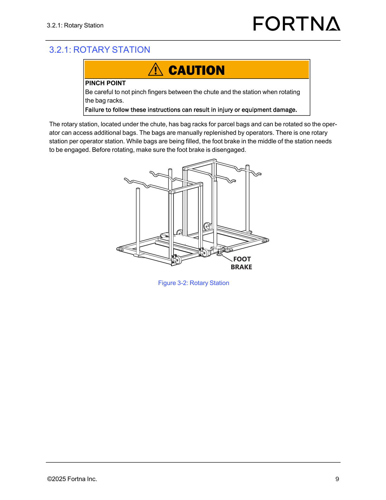
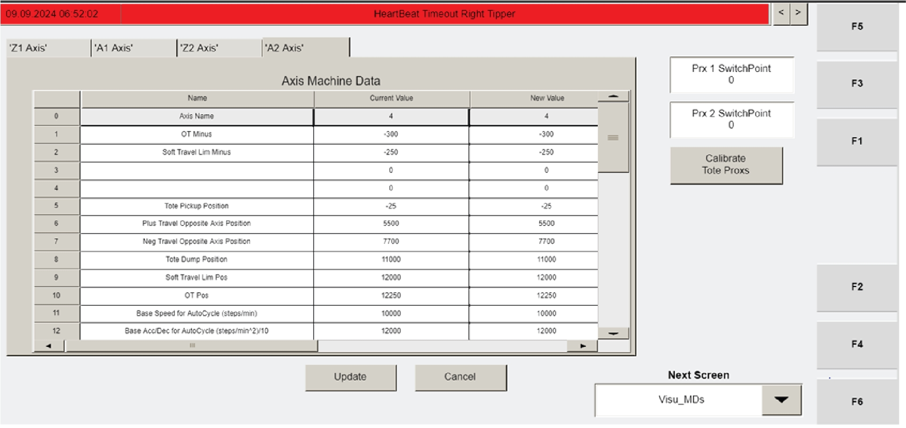
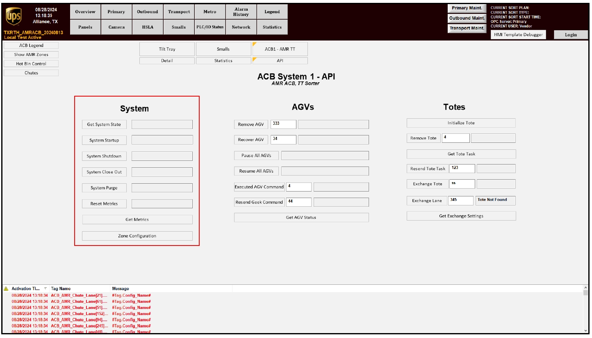

# Perform Daily Preventive Maintenance Inspection on OptiSweep Operator Station

## Runbook Header

| Field | Value |
| --- | --- |
| Procedure ID | `proc_perform_daily_preventive_maintenance_inspection_on_optsweep_operator_station_v1` |
| Title | Perform Daily Preventive Maintenance Inspection on OptiSweep Operator Station |
| Procedure Type | `operation` |
| Primary Role | `operator` |
| Supporting Roles | None |
| Support Safe | Yes |
| Capability Tags | `fleet_system_status` |
| Access Surface | `physical_floor` |
| Audience Roles | `operator` |
| Failure Pattern Tags | None |
| Validation Status | `needs_sme_review` |
| Merge Status | `source_finalized` |

## Summary

Perform a daily operator-station inspection to verify the OptiSweep operator station is safe to operate by checking (1) controller condition, (2) stacklight operation, and (3) that the chute is free of debris such as stuck labels.

## When To Use

Use this daily checklist to verify the operator station is safe to operate by confirming controller condition, stacklight operation, and that the chute is free of debris (e.g., stuck labels).

## Safety And Operational Notes

* This procedure is a visual inspection. Do not proceed with operation if any inspection item fails (controller damage, stacklights not operational, or debris/stuck labels in the chute).

## Access Or Tools Needed

* Physical access to the OptiSweep operator station
* Visual inspection capability

## Related Operational Context

* ctx_manual_daily_pm_operator_station_v1

## Visual References

*Rotary station photo under the chute (useful for visual context of the chute/station area during inspection).*

*Operator station HMI screen ('Visu_MDs' (F2)) shown in the manual (not required for this daily visual inspection, included only as an available operator-station visual reference in the packet).*

*System HMI ACB API screen ('SYSTEM PURGE') shown in the manual (not required for this daily visual inspection, included only as an available operator-station visual reference in the packet).*

## Procedure Steps

### Step 1 — Inspect the operator station controller area for damage

**Responsible role:** operator

**Instruction:**
Go to the OptiSweep operator station and visually inspect the controller area for damage.

**Expected result:**
No damage to the controller is observed.

**Stop or Escalate If:**

* Controller damage is observed.

---

### Step 2 — Check that the operator station stacklights are operational

**Responsible role:** operator

**Instruction:**
Check that the operator station stacklights are operational by observing that the stacklights function.

**Expected result:**
Stacklights are operational.

**Stop or Escalate If:**

* Stacklights are not operational.

---

### Step 3 — Inspect the chute area for debris (including stuck labels)

**Responsible role:** operator

**Instruction:**
Inspect the chute area for debris, specifically looking for stuck labels.

**Expected result:**
Chute is free of debris, including no stuck labels.

**Stop or Escalate If:**

* Debris/stuck labels are found in the chute.

---

### Step 4 — Stop the inspection and escalate if any checklist item fails

**Responsible role:** operator

**Instruction:**
If any controller damage is observed, or if stacklights are not operational, or if debris/stuck labels are found in the chute, stop the daily inspection and escalate to maintenance support.

**Expected result:**
Inspection is stopped and maintenance support is escalated when any failure condition is found.

**Stop or Escalate If:**

* Controller damage is observed.
* Stacklights are not operational.
* Debris/stuck labels are found in the chute.

---

## Success Criteria

* No damage to the controller is observed.
* Stacklights are operational.
* Chute is free of debris, including no stuck labels.

## Failure Conditions

* Damage to the controller is observed.
* Stacklights are not operational.
* Debris/stuck labels are found in the chute.

## Escalation Guidance

* Escalate to maintenance support if controller damage is observed, stacklights are not operational, or debris/stuck labels are found in the chute.

## Missing Details / Known Gaps

* The packet does not provide stacklight color/state expectations or specific visual indicators for “stacklights are operational.”
* The packet does not provide example imagery specifically showing what “damage to the controller” looks like for this daily inspection.
* The packet does not provide example imagery specifically showing the chute area and examples of debris/stuck labels for this daily inspection.

## Source Lineage

- Candidate IDs: candidate_manual_daily_pm_operator_station_inspect
- Source ID: `manual_optisweep_om_v3`
- Source Type: `manual`
