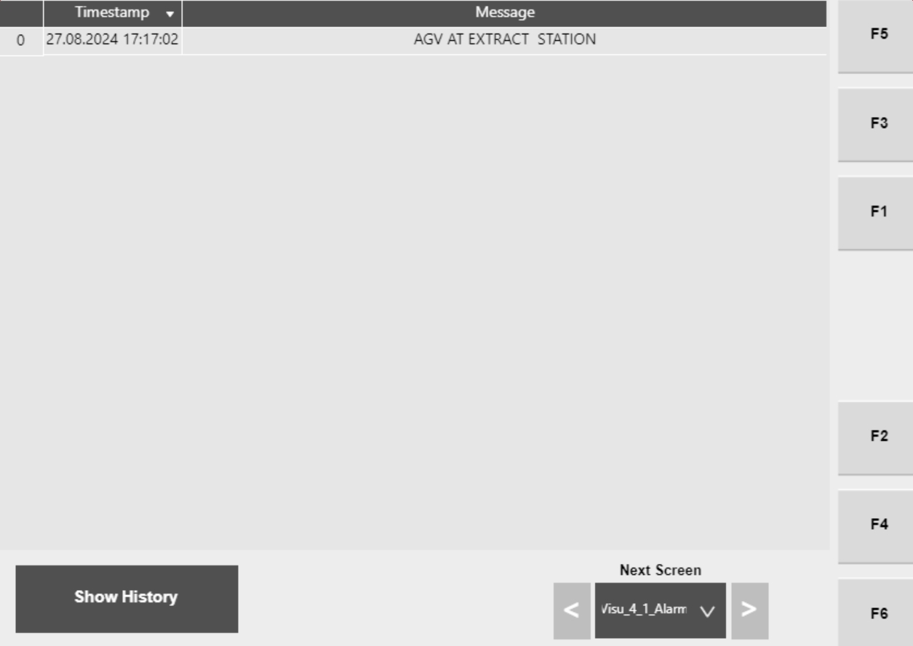

# Check Hospital HMI Alarms List and Timestamp for Active Alarms

## Runbook Header

| Field | Value |
| --- | --- |
| Procedure ID | `proc_check_hospital_hmi_alarms_list_timestamp_v1` |
| Title | Check Hospital HMI Alarms List and Timestamp for Active Alarms |
| Procedure Type | `diagnostic` |
| Primary Role | `operator` |
| Supporting Roles | None |
| Support Safe | Yes |
| Capability Tags | `tipper_station_fault` |
| Access Surface | `hospital_hmi` |
| Audience Roles | `operator` |
| Failure Pattern Tags | None |
| Validation Status | `needs_sme_review` |
| Merge Status | `source_finalized` |

## Summary

Use the Hospital HMI Alarms screen to identify active alarm entries and their timestamps. Then match the Alarm Text/ID to the manual’s Alarms and Corrective Actions table to determine the documented Cause and Corrective Action for the specific alarm.

## When To Use

When the system is showing an alarm/fault condition at the Hospital station and you need to identify the specific active alarm text/ID and its timestamp so the correct documented corrective action can be applied.

## Access Or Tools Needed

* Hospital HMI / lane UI (Hospital HMI Alarms screen)

## Related Operational Context

* ctx_manual_hospital_hmi_alarms_screen_v1
* ctx_manual_alarm_table_structure_v1

## Visual References

*Hospital HMI Alarms screen showing a list of active alarms with timestamps (Figure 4-42).*

## Procedure Steps

### Step 1 — Open the Hospital HMI Alarms screen

**Responsible role:** operator

**Instruction:**
On the Hospital HMI / lane UI, navigate to the Alarms screen (Hospital HMI Alarms Screen, Figure 4-42).

**Expected result:**
The Hospital HMI Alarms screen is displayed and shows a list of alarms along with a time stamp.

**Stop or Escalate If:**

* Alarm list is empty when an alarm condition is expected.

---

### Step 2 — Verify alarms list and timestamps are present

**Responsible role:** operator

**Instruction:**
On the Hospital HMI Alarms screen, verify that the alarms list rows are present and that each alarm entry includes a time stamp.

**Expected result:**
The screen shows active alarm entries and a time stamp for each entry.

---

### Step 3 — Record the active alarm Alarm Text and ID

**Responsible role:** operator

**Instruction:**
For the alarm(s) currently relevant to the issue, record the Alarm Text and the associated ID from the alarms list entry.

**Expected result:**
You have the Alarm Text and ID for the active alarm entry/entries that correspond to the observed system condition.

---

### Step 4 — Match Alarm Text/ID to Table 4-23 to determine Cause and Corrective Action

**Responsible role:** operator

**Instruction:**
Using Table 4-23 (Alarms and Corrective Actions), match the recorded Alarm Text/ID to the corresponding row to identify the documented Cause and Corrective Action.

**Expected result:**
The recorded Alarm Text/ID matches a specific Table 4-23 entry that provides Cause and Corrective Action.

**Stop or Escalate If:**

* Alarm text/ID cannot be matched to Table 4-23 entries.

---

## Success Criteria

* Active alarm entry/entries are identified on the Hospital HMI Alarms screen with timestamps.
* Alarm Text and ID for the relevant active alarm(s) are recorded.
* The recorded Alarm Text/ID matches a Table 4-23 entry that provides Cause and Corrective Action.

## Failure Conditions

* Hospital HMI Alarms screen shows no alarm entries while an alarm/fault condition is expected.
* Alarm text/ID shown on the Hospital HMI cannot be matched to Table 4-23 entries.

## Escalation Guidance

* Escalate if the Alarms screen is empty when an alarm condition is expected.
* Escalate if the alarm text/ID cannot be matched to Table 4-23 (Alarms and Corrective Actions) entries.

## Source Lineage

- Candidate IDs: candidate_manual_hospital_hmi_alarms_screen_check_alarm_list
- Source ID: `manual_optisweep_om_v3`
- Source Type: `manual`
