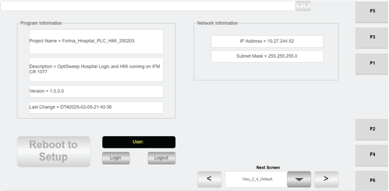

# Check Hospital HMI Default Screen for software version, station IP, and login/logout access

## Runbook Header

| Field | Value |
| --- | --- |
| Procedure ID | `proc_check_hospital_hmi_default_screen_version_ip_loginlogout_v1` |
| Title | Check Hospital HMI Default Screen for software version, station IP, and login/logout access |
| Procedure Type | `diagnostic` |
| Primary Role | `operator` |
| Supporting Roles | None |
| Support Safe | Yes |
| Capability Tags | `gateway_health` |
| Access Surface | `hospital_hmi` |
| Audience Roles | `operator` |
| Failure Pattern Tags | None |
| Validation Status | `needs_sme_review` |
| Merge Status | `source_finalized` |

## Summary

Use the Hospital HMI 2.4 “Default” screen to confirm the currently installed software version, the Hospital Station IP address, and that login/logout controls are available.

## When To Use

When you need to verify the Hospital Station HMI is running the expected software version, that the displayed Hospital Station IP address is correct, and that the user can access login/logout controls from the Hospital HMI “Default” screen.

## Safety And Operational Notes

* Only maintenance personnel should use the “REBOOT TO SETUP” button (for updating the date/time on the HMI).

## Access Or Tools Needed

* Hospital HMI / lane UI (hospital_hmi)

## Related Operational Context

* ctx_manual_hospital_hmi_default_screen_v1

## Visual References

*Hospital HMI 2.4 “Default” screen showing software currently installed info, Hospital Station IP address, login/logout controls, and the “REBOOT TO SETUP” button.*

## Procedure Steps

### Step 1 — Open Hospital HMI and navigate to the “Default” screen (Hospital HMI 2.4)

**Responsible role:** operator

**Instruction:**
On the Hospital HMI / lane UI, navigate to the “Default” screen (Hospital HMI 2.4).

**Expected result:**
The Hospital HMI “Default” screen is displayed.

**Stop or Escalate If:**

* If the “Default” screen cannot be reached or does not display the expected information, escalate to support/maintenance.

---

### Step 2 — Verify software currently installed and Hospital Station IP address

**Responsible role:** operator

**Instruction:**
On the Hospital HMI “Default” screen, locate the displayed “software currently installed” information and the Hospital Station IP address, and verify they are present and correct.

**Expected result:**
The “software currently installed” information and the Hospital Station IP address are displayed on the “Default” screen.

**Stop or Escalate If:**

* If the software version or IP address fields are blank, missing, or obviously incorrect, escalate to support/maintenance for further investigation.

---

### Step 3 — Verify login and logout controls are available

**Responsible role:** operator

**Instruction:**
On the Hospital HMI “Default” screen, verify that login and logout controls are present and usable (e.g., visible Login/Logout buttons or equivalent controls).

**Expected result:**
Login and logout controls are present on the “Default” screen.

**Stop or Escalate If:**

* If login/logout controls are not present or do not respond, escalate to support/maintenance.

---

### Step 4 — Confirm “REBOOT TO SETUP” is reserved for maintenance personnel

**Responsible role:** operator

**Instruction:**
On the Hospital HMI “Default” screen, identify the “REBOOT TO SETUP” button and do not use it unless you are maintenance personnel.

**Expected result:**
The “REBOOT TO SETUP” button is visible, and you do not press it as part of this check.

**Stop or Escalate If:**

* If the “REBOOT TO SETUP” button was pressed by non-maintenance personnel, escalate to support/maintenance.

---

## Success Criteria

* Hospital HMI “Default” screen shows software currently installed information
* Hospital HMI “Default” screen shows Hospital Station IP address
* Login/logout controls are present and usable
* “REBOOT TO SETUP” is not used by operator during this check

## Failure Conditions

* Software version field is blank/missing or obviously incorrect
* Hospital Station IP address field is blank/missing or obviously incorrect
* Login/logout controls are missing or do not respond
* “REBOOT TO SETUP” is used by non-maintenance personnel

## Escalation Guidance

* If software version or IP address are blank/missing/obviously incorrect, escalate to support/maintenance for further investigation.
* If login/logout controls are missing or do not respond, escalate to support/maintenance.
* If “REBOOT TO SETUP” was pressed by non-maintenance personnel, escalate to support/maintenance.

## Source Lineage

- Candidate IDs: candidate_manual_hospital_hmi_default_check_ip_login
- Source ID: `manual_optisweep_om_v3`
- Source Type: `manual`
