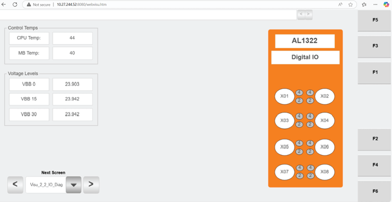

# Use Hospital HMI IO Diagnostics screen to verify station switch input states and HMI temperature/voltage readings

## Runbook Header

| Field | Value |
| --- | --- |
| Procedure ID | `proc_use_hospital_hmi_io_diagnostics_check_inputs_temps_voltages_v1` |
| Title | Use Hospital HMI IO Diagnostics screen to verify station switch input states and HMI temperature/voltage readings |
| Procedure Type | `diagnostic` |
| Primary Role | `operator` |
| Supporting Roles | None |
| Support Safe | Yes |
| Capability Tags | `gateway_health` |
| Access Surface | `hospital_hmi` |
| Audience Roles | `operator` |
| Failure Pattern Tags | None |
| Validation Status | `needs_sme_review` |
| Merge Status | `source_finalized` |

## Summary

Use the Hospital HMI 2.2 “IO Diagnostics” screen to confirm which station switch inputs are ON vs OFF and to review the HMI’s own temperature and voltage readings for basic hardware health visibility.

## When To Use

When you need to verify station switch input states (ON/OFF) and check the Hospital HMI’s temperature and voltage readings shown on the Hospital HMI 2.2 “IO Diagnostics” screen.

## Access Or Tools Needed

* Hospital HMI / lane UI (Hospital HMI) access

## Related Operational Context

* ctx_manual_hospital_hmi_io_diagnostics_screen_v1

## Visual References

*Hospital HMI 2.2 “IO Diagnostics” screen showing station switch input on/off indicators and HMI temperature/voltage readings (Figure 4-40).*

## Procedure Steps

### Step 1 — Open Hospital HMI 2.2 IO Diagnostics screen

**Responsible role:** operator

**Instruction:**
On the Hospital HMI, navigate to the “IO Diagnostics” screen (Hospital HMI 2.2).

**Expected result:**
The Hospital HMI “IO Diagnostics” screen is displayed, showing (a) station switch input on/off indicators and (b) temperature readings and voltage readings for the HMI itself.

---

### Step 2 — Verify station switch input indicators (ON vs OFF)

**Responsible role:** operator

**Instruction:**
On the Hospital HMI “IO Diagnostics” screen, identify the on/off indicators for the station switch inputs and determine which inputs are currently ON and which are OFF.

**Expected result:**
You can clearly distinguish which station switch input indicators are ON vs OFF on the “IO Diagnostics” screen.

**Stop or Escalate If:**

* If switch input states do not match expected physical switch positions, escalate to support/maintenance for further investigation.

---

### Step 3 — Record HMI temperature readings

**Responsible role:** operator

**Instruction:**
On the Hospital HMI “IO Diagnostics” screen, locate the temperature readings and note the displayed values.

**Expected result:**
Temperature reading fields on the “IO Diagnostics” screen show values that you can read and record.

**Stop or Escalate If:**

* If temperature readings are missing/blank or appear abnormal, escalate to support/maintenance.

---

### Step 4 — Record HMI voltage readings

**Responsible role:** operator

**Instruction:**
On the Hospital HMI “IO Diagnostics” screen, locate the voltage readings and note the displayed values.

**Expected result:**
Voltage reading fields on the “IO Diagnostics” screen show values that you can read and record.

**Stop or Escalate If:**

* If voltage readings are missing/blank or appear abnormal, escalate to support/maintenance.

---

## Success Criteria

* Switch input indicators on the Hospital HMI “IO Diagnostics” screen clearly show which inputs are ON vs OFF.
* Temperature readings and voltage readings are present (not blank) on the Hospital HMI “IO Diagnostics” screen.

## Failure Conditions

* Switch input states shown on the screen do not match expected physical switch positions.
* Temperature readings are missing/blank or appear abnormal.
* Voltage readings are missing/blank or appear abnormal.

## Escalation Guidance

* If switch input states do not match expected physical switch positions, escalate to support/maintenance for further investigation.
* If temperature/voltage readings are missing/blank or appear abnormal, escalate to support/maintenance.

## Missing Details / Known Gaps

* The candidate does not specify the exact navigation path/button sequence from the Hospital HMI home/maintenance menu to the “IO Diagnostics” screen; it only states to navigate to “IO Diagnostics” (Hospital HMI 2.2).

## Source Lineage

- Candidate IDs: candidate_manual_hospital_hmi_io_diagnostics_check_inputs_temps_voltages
- Source ID: `manual_optisweep_om_v3`
- Source Type: `manual`
