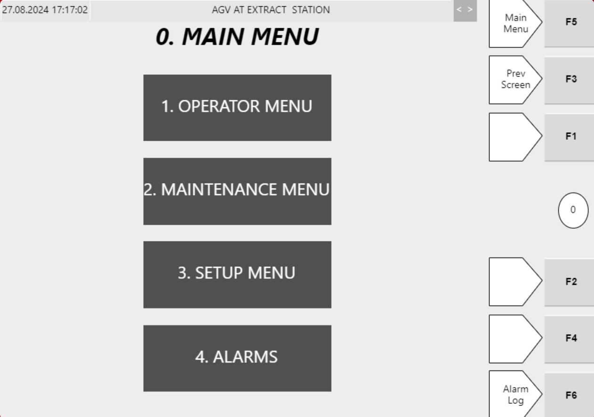
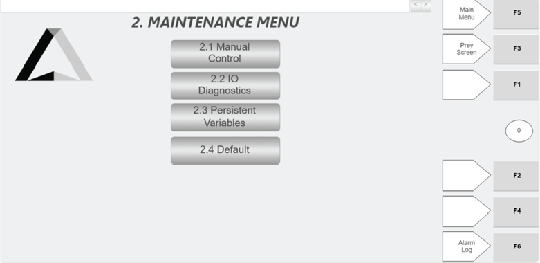

# Navigate Hospital HMI Main Menu to Operator, Maintenance, Setup, and Alarms

## Runbook Header

| Field | Value |
| --- | --- |
| Procedure ID | `proc_navigate_hospital_hmi_main_menu_navigation_v1` |
| Title | Navigate Hospital HMI Main Menu to Operator, Maintenance, Setup, and Alarms |
| Procedure Type | `operation` |
| Primary Role | `operator` |
| Supporting Roles | None |
| Support Safe | Yes |
| Capability Tags | `hospital_diversion` |
| Access Surface | `hospital_hmi` |
| Audience Roles | `operator` |
| Failure Pattern Tags | None |
| Validation Status | `needs_sme_review` |
| Merge Status | `source_finalized` |

## Summary

On the Hospital HMI Main Menu screen, use the right-hand function buttons (F1/F2/F3/F4/F5/F6) to navigate to the Operator Menu, Maintenance Menu, Setup menu, and Alarms for totes directed to the Hospital Station. Use F3 (Previous screen) to return one screen.

## When To Use

Use when you are on the Hospital Station Hospital HMI Main Menu screen and need to reach the Operator Menu, Maintenance Menu, Setup menu, or Alarms using the Hospital HMI function keys.

## Safety And Operational Notes

* Do not attempt configuration changes from the Setup menu unless instructed by FORTNA support.

## Access Or Tools Needed

* Hospital HMI / lane UI (Hospital Station screen)

## Related Operational Context

* ctx_manual_hospital_hmi_purpose_v1
* ctx_manual_hospital_hmi_controls_v1

## Visual References

*Hospital HMI Main Menu screen showing right-hand function buttons (F1/F2/F3/F4/F5/F6).*

*Hospital HMI Maintenance Menu screen with navigation buttons (2.1 Manual Control, 2.2 IO Diagnostics, 2.3 Persistent Variables, 2.4 Default).*

## Procedure Steps

### Step 1 — Open Hospital HMI Main Menu for the Hospital Station

**Responsible role:** operator

**Instruction:**
Open the Hospital HMI / lane UI for the Hospital Station and display the Hospital HMI Main Menu screen.

**Expected result:**
The Hospital HMI Main Menu screen is displayed with the right-hand function buttons available.

---

### Step 2 — Confirm you are on the Main menu using F5

**Responsible role:** operator

**Instruction:**
On the right-hand side of the Main Menu screen, press F5.

**Expected result:**
The screen confirms you are on the Main menu (F5 routes to the Main menu).

**Stop or Escalate If:**

* If pressing a function key does not change screens to the expected menu, stop and escalate to FORTNA support for assistance.

---

### Step 3 — Open Operator menu using F1

**Responsible role:** operator

**Instruction:**
Press F1 on the right-hand side of the Main Menu screen.

**Expected result:**
The Operator menu screen opens (F1 routes to Operator menu).

**Stop or Escalate If:**

* If pressing a function key does not change screens to the expected menu, stop and escalate to FORTNA support for assistance.

---

### Step 4 — Open Maintenance menu using F2

**Responsible role:** operator

**Instruction:**
Press F2 on the right-hand side of the Main Menu screen.

**Expected result:**
The Maintenance menu screen opens (F2 routes to Maintenance menu).

**Stop or Escalate If:**

* If pressing a function key does not change screens to the expected menu, stop and escalate to FORTNA support for assistance.

---

### Step 5 — Open Setup menu using F4

**Responsible role:** operator

**Instruction:**
Press F4 on the right-hand side of the Main Menu screen.

**Expected result:**
The Setup menu screen opens (F4 routes to Setup menu).

**Stop or Escalate If:**

* If pressing a function key does not change screens to the expected menu, stop and escalate to FORTNA support for assistance.
* Do not attempt configuration changes from the Setup menu unless instructed by FORTNA support.

---

### Step 6 — Open Alarms using F6

**Responsible role:** operator

**Instruction:**
Press F6 on the right-hand side of the Main Menu screen.

**Expected result:**
The Alarms screen opens (F6 routes to Alarms).

**Stop or Escalate If:**

* If pressing a function key does not change screens to the expected menu, stop and escalate to FORTNA support for assistance.

---

### Step 7 — Return to previous screen using F3

**Responsible role:** operator

**Instruction:**
If you need to return, press F3 (Previous screen).

**Expected result:**
The HMI returns to the previous screen (F3 routes to Previous screen).

**Stop or Escalate If:**

* If pressing a function key does not change screens to the expected menu, stop and escalate to FORTNA support for assistance.

---

## Success Criteria

* From the Hospital HMI Main Menu screen, F1 routes to the Operator menu.
* From the Hospital HMI Main Menu screen, F2 routes to the Maintenance menu.
* From the Hospital HMI Main Menu screen, F4 routes to the Setup menu.
* From the Hospital HMI Main Menu screen, F6 routes to the Alarms screen.
* From any menu screen, F3 returns to the previous screen.
* F5 routes to/keeps the Main menu screen.

## Failure Conditions

* Pressing F1/F2/F4/F6 does not navigate to the expected menu screen.
* Pressing F3 does not return to the previous screen.
* Pressing F5 does not route to/confirm the Main menu.

## Escalation Guidance

* If pressing a function key does not change screens to the expected menu, stop and escalate to FORTNA support for assistance.

## Missing Details / Known Gaps

* The candidate includes image support needed notes for each navigation target screen (Operator menu, Setup menu, Alarms, and F3 Previous screen). Only the Hospital HMI Main Menu and Maintenance Menu artifacts are present in the provided packet; Operator/Setup/Alarms/Previous-screen target screenshots are not attached here.

## Source Lineage

- Candidate IDs: candidate_manual_hospital_hmi_main_menu_navigation
- Source ID: `manual_optisweep_om_v3`
- Source Type: `manual`
