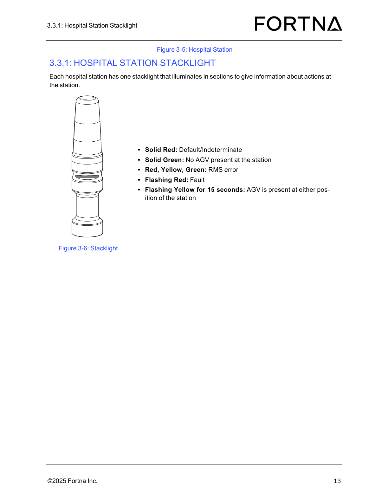
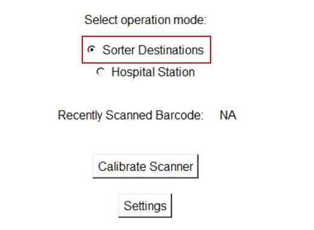

# Inspect Hospital Station Daily Preventive Maintenance (Barcode Scanner, Stacklight, Tabletop Debris)

## Runbook Header

| Field | Value |
| --- | --- |
| Procedure ID | `proc_inspect_hospital_station_daily_preventive_maintenance_v1` |
| Title | Inspect Hospital Station Daily Preventive Maintenance (Barcode Scanner, Stacklight, Tabletop Debris) |
| Procedure Type | `operation` |
| Primary Role | `operator` |
| Supporting Roles | None |
| Support Safe | Yes |
| Capability Tags | `device_roster_state` |
| Access Surface | `hospital_hmi`, `physical_floor` |
| Audience Roles | `operator` |
| Failure Pattern Tags | None |
| Validation Status | `needs_sme_review` |
| Merge Status | `source_finalized` |

## Summary

Perform a daily preventive maintenance inspection on each hospital station by verifying the barcode scanner is operational, the stacklight is operational, and the tabletop is free of debris (e.g., stuck labels).

## When To Use

Use this procedure for daily preventive maintenance on each hospital station to confirm the station’s barcode scanner and stacklight are operational and that the tabletop is clear of debris.

## Access Or Tools Needed

* Physical access to each hospital station
* Visual inspection capability for barcode scanner, stacklight, and tabletop

## Related Operational Context

* ctx_manual_hospital_station_inspection_v1

## Visual References

*Hospital station photo showing the stacklight and its signal context (solid red/solid green/red-yellow-green, flashing red, flashing yellow). Use to visually identify the stacklight assembly and expected signal context during inspection.*

*Hospital Station layout diagram showing induct/extract sides and the location of the green barcode scanner for station context during inspection.*

*Tote initialization procedure image (Zebra scanner) included in the packet as scanner-related visual guidance; use only as a visual reference for the Zebra scanner workflow context if needed during escalation/maintenance discussion.*

## Procedure Steps

### Step 1 — Inspect each hospital station barcode scanner for operational condition

**Responsible role:** operator

**Instruction:**
For each hospital station, visually inspect the barcode scanner to confirm it is operational (e.g., not visibly damaged/obstructed).

**Expected result:**
The barcode scanner at the station is operational (no visible damage/obstruction preventing normal use).

**Stop or Escalate If:**

* Stop inspection for this station if the barcode scanner is not operational.

---

### Step 2 — Inspect each hospital station stacklight for operational condition

**Responsible role:** operator

**Instruction:**
For each hospital station, visually inspect the stacklight to confirm it is operational (e.g., not visibly damaged/obstructed).

**Expected result:**
The stacklight at the station is operational (no visible damage/obstruction preventing normal use).

**Stop or Escalate If:**

* Stop inspection for this station if the stacklight is not operational.

---

### Step 3 — Inspect tabletop and clear debris (e.g., stuck labels)

**Responsible role:** operator

**Instruction:**
For each hospital station, inspect the tabletop and remove/clear any debris such as stuck labels.

**Expected result:**
The tabletop is free of debris (no stuck labels) at the station.

**Stop or Escalate If:**

* Stop inspection for this station if debris cannot be cleared.

---

### Step 4 — Stop inspection and escalate when scanner/stacklight/debris issue is found

**Responsible role:** operator

**Instruction:**
If a hospital station barcode scanner or stacklight is not operational, or if debris cannot be cleared, stop the inspection for that station and escalate to the appropriate maintenance contact.

**Expected result:**
Inspection is stopped for the affected station and maintenance escalation is initiated.

**Stop or Escalate If:**

* Barcode scanner not operational.
* Stacklight not operational.
* Debris cannot be cleared.

---

## Success Criteria

* For every hospital station inspected: barcode scanner is operational.
* For every hospital station inspected: stacklight is operational.
* For every hospital station inspected: tabletop is free of debris (no stuck labels).

## Failure Conditions

* Any hospital station barcode scanner is not operational.
* Any hospital station stacklight is not operational.
* Any hospital station tabletop still has debris (e.g., stuck labels) after clearing attempt.

## Escalation Guidance

* If a hospital station barcode scanner or stacklight is not operational, or debris cannot be cleared, stop inspection for that station and escalate to the appropriate maintenance contact.
* If the maintenance issue is related to the tipper, contact Lifecycle Performance Services (LPS) at 888-444-4647.

## Missing Details / Known Gaps

* The manual section provided defines “operational” for the barcode scanner and stacklight at a high level (operational / not visibly damaged/obstructed) but does not specify exact pass/fail indicators beyond that; the candidate requested additional images for what “operational” looks like for the barcode scanner and tabletop debris, but those specific images are not present in the packet as dedicated scanner/debris visuals.
* The candidate includes an escalation image note about initializing totes at the sorter using a Zebra scanner; the packet does not provide a step-by-step escalation procedure for hospital-station inspection failures, so this runbook only includes the escalation instruction at a high level and the tipper-related contact number.

## Source Lineage

- Candidate IDs: candidate_manual_hospital_station_daily_inspection
- Source ID: `manual_optisweep_om_v3`
- Source Type: `manual`
