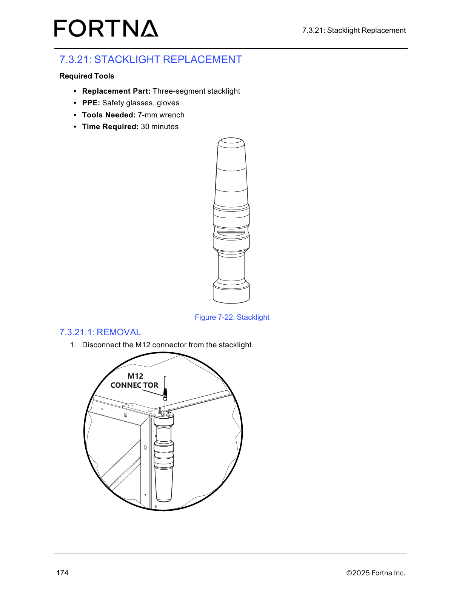
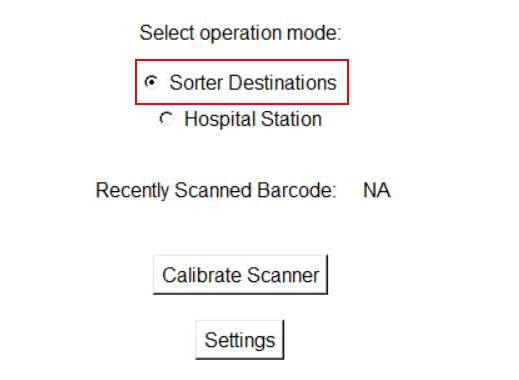

# Perform Hospital Station Daily Preventive Maintenance Checks (Barcode Scanner, Stacklight, Tabletop Debris)

## Runbook Header

| Field | Value |
| --- | --- |
| Procedure ID | `proc_perform_hospital_station_daily_preventive_maintenance_checks_v1` |
| Title | Perform Hospital Station Daily Preventive Maintenance Checks (Barcode Scanner, Stacklight, Tabletop Debris) |
| Procedure Type | `operation` |
| Primary Role | `operator` |
| Supporting Roles | None |
| Support Safe | Yes |
| Capability Tags | `hospital_diversion` |
| Access Surface | `hospital_hmi`, `physical_floor` |
| Audience Roles | `operator` |
| Failure Pattern Tags | None |
| Validation Status | `needs_sme_review` |
| Merge Status | `source_finalized` |

## Summary

Perform a daily physical inspection of each Hospital Station to verify the barcode scanner is operational, the stacklight is operational, and the tabletop is free of debris.

## When To Use

Use this procedure at the start of each day (daily preventive maintenance) to confirm each Hospital Station is safe/ready for operation by checking: (1) barcode scanner operational status, (2) stacklight operational status, and (3) tabletop debris-free condition.

## Access Or Tools Needed

* Physical access to each hospital station
* Visual inspection capability

## Related Operational Context

* ctx_manual_hospital_station_daily_pm_v1

## Visual References

*Hospital Station layout showing the green scanner location and induct/extract sides (used to orient where to inspect).*

*Photo of the three-segment stacklight assembly (used to visually recognize the stacklight hardware during inspection).*

*Tote Initialization Procedure (Zebra scanner) showing scanner behavior (green flash vs yellow flash) that can help interpret scanner operational behavior during checks.*

## Procedure Steps

### Step 1 — Inspect each Hospital Station barcode scanner and confirm it is operational

**Responsible role:** operator

**Instruction:**
For each Hospital Station, visually inspect the barcode scanner and confirm it is operational.

**Expected result:**
For the station being inspected, the barcode scanner is operational.

**Stop or Escalate If:**

* Barcode scanner issue is observed

---

### Step 2 — Inspect each Hospital Station stacklight and confirm it is operational

**Responsible role:** operator

**Instruction:**
For each Hospital Station, visually inspect the stacklight and confirm it is operational.

**Expected result:**
For the station being inspected, the stacklight is operational.

**Stop or Escalate If:**

* Stacklight is not operational

---

### Step 3 — Inspect each Hospital Station tabletop and confirm it is free of debris

**Responsible role:** operator

**Instruction:**
For each Hospital Station, visually inspect the tabletop area and confirm it is free of debris.

**Expected result:**
For the station being inspected, the tabletop is free of debris.

**Stop or Escalate If:**

* Debris is found on the tabletop

---

### Step 4 — Stop inspection and escalate if any required condition fails

**Responsible role:** operator

**Instruction:**
If any barcode scanner issue is observed, if the stacklight is not operational, or if debris is present on the tabletop, stop the inspection and escalate to maintenance/support as required by site practice.

**Expected result:**
Inspection is stopped for the day/sequence and escalation is initiated when any required condition fails.

**Stop or Escalate If:**

* Barcode scanner issue is observed
* Stacklight is not operational
* Debris is present on the tabletop

---

## Success Criteria

* For each Hospital Station inspected: barcode scanner is operational
* For each Hospital Station inspected: stacklight is operational
* For each Hospital Station inspected: tabletop is free of debris

## Failure Conditions

* Barcode scanner is not operational at a Hospital Station
* Stacklight is not operational at a Hospital Station
* Debris is present on the tabletop at a Hospital Station

## Escalation Guidance

* Stop the inspection and escalate to maintenance/support as required by site practice if any barcode scanner issue is observed, if the stacklight is not operational, or if debris is present on the tabletop.

## Missing Details / Known Gaps

* The source does not define a specific observable test method for what “operational” means for the barcode scanner and stacklight during this daily PM (e.g., specific LED states, scan test steps, or pass/fail indicators).

## Source Lineage

- Candidate IDs: candidate_manual_hospital_station_daily_pm_v1_hospital_station_daily_preventive_maintenance
- Source ID: `manual_optisweep_om_v3`
- Source Type: `manual`
