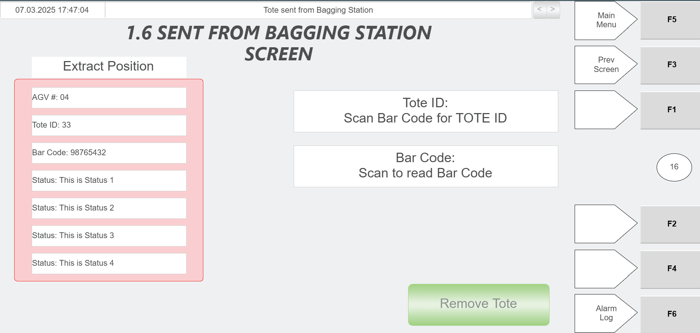
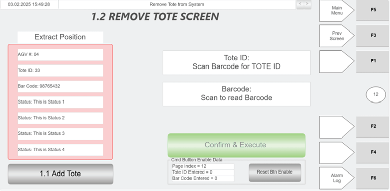
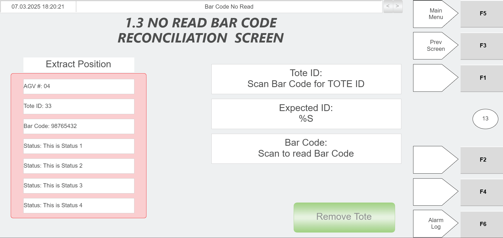

# Extract an Arriving Tote at the Hospital Station Using Hospital HMI and Green Scanner

## Runbook Header

| Field | Value |
| --- | --- |
| Procedure ID | `proc_extract_arriving_tote_hospital_station_hmi_green_scanner_v1` |
| Title | Extract an Arriving Tote at the Hospital Station Using Hospital HMI and Green Scanner |
| Procedure Type | `operation` |
| Primary Role | `operator` |
| Supporting Roles | None |
| Support Safe | Yes |
| Capability Tags | `tote_lifecycle_state` |
| Access Surface | `hospital_hmi` |
| Audience Roles | `operator` |
| Failure Pattern Tags | None |
| Validation Status | `needs_sme_review` |
| Merge Status | `source_finalized` |

## Summary

When an AGV brings a tote to the Hospital Station, use the Hospital HMI to open the correct tote-extraction screen based on the status fields, scan the tote barcode with the green scanner to populate the Tote ID field, and then perform the task indicated by the status fields. If the tote is being returned into the system, place it on the induct side (left) and ensure it is flush against the end stops.

## When To Use

Use this procedure when an AGV arrives at the Hospital Station with a tote and you need to extract the tote using the Hospital HMI workflow (screen selection driven by status fields), scan the tote barcode with the green scanner, and then execute the task indicated by the status fields.

## Safety And Operational Notes

* If the Tote ID field does not populate after scanning, stop and escalate for assistance rather than proceeding with the task.
* If the tote cannot be positioned flush against the induct-side end stops, stop and escalate for assistance.

## Access Or Tools Needed

* Hospital HMI / lane UI
* Green barcode scanner
* Physical access to the Hospital Station induct side (left) and end stops

## Related Operational Context

* ctx_manual_hospital_station_hmi_screen_v1
* ctx_manual_hospital_station_task_v1

## Visual References

*Hospital Station layout diagram showing right side for AGV tote delivery/extraction, left side induct side, and induct-side end stops; also indicates green scanner location for barcode scanning.*

*Hospital HMI screen example showing Tote ID population via green scanner, Bar Code scan, Remove Tote button, and Extract Position Information (AGV#, Tote ID, Bar Code, Status from WCS).*

*Hospital HMI Remove Tote screen showing Tote ID and Barcode fields populated via green scanner and Confirm & Execute to remove tote from the system.*

*Hospital HMI No Read Bar Code screen showing Tote ID scanning, Expected ID, and Remove Tote button for cases where barcode cannot be scanned at the Operator Station.*

## Procedure Steps

### Step 1 — Confirm a tote has arrived at the Hospital Station (right side)

**Responsible role:** operator

**Instruction:**
Visually confirm the AGV has brought a tote to the right side of the Hospital Station.

**Expected result:**
A tote is physically present at the Hospital Station right side designated for AGV tote delivery/extraction.

---

### Step 2 — Open the corresponding Hospital HMI screen for tote extraction (based on status fields)

**Responsible role:** operator

**Instruction:**
On the Hospital HMI / lane UI, open the corresponding screen used to extract the tote from the system. Select the screen based on the information shown in the status fields.

**Expected result:**
The Hospital HMI tote-extraction screen corresponding to the arriving tote is open, showing status-field information used to determine the workflow.

---

### Step 3 — Scan the tote barcode using the green scanner

**Responsible role:** operator

**Instruction:**
Scan the tote barcode using the green scanner.

**Expected result:**
The scan is accepted by the Hospital HMI workflow and the Tote ID field begins to populate after scanning.

**Stop or Escalate If:**

* If the Tote ID field does not populate after scanning, stop and escalate for assistance rather than proceeding with the task.

---

### Step 4 — Verify Tote ID field auto-populates after scanning

**Responsible role:** operator

**Instruction:**
Verify that the Tote ID field automatically populates after scanning.

**Expected result:**
The Tote ID field on the Hospital HMI is populated with the scanned tote ID.

**Stop or Escalate If:**

* If the Tote ID field does not populate after scanning, stop and escalate for assistance rather than proceeding with the task.

---

### Step 5 — Perform the task indicated by the status fields

**Responsible role:** operator

**Instruction:**
Perform whatever task needs to be performed as determined by the information in the status fields.

**Expected result:**
The required Hospital Station action for the arriving tote is executed according to the status fields on the active Hospital HMI screen.

---

### Step 6 — If returning tote into the system, place it on the induct side (left) flush against end stops

**Responsible role:** operator

**Instruction:**
If the tote is going back into the system, put the tote on the induct side (left side) of the station and ensure it is flush against the end stops.

**Expected result:**
The tote is positioned on the induct side (left) and is flush against the induct-side end stops.

**Stop or Escalate If:**

* If the tote cannot be positioned flush against the induct-side end stops, stop and escalate for assistance.

---

## Success Criteria

* Hospital HMI tote-extraction screen is opened for the arriving tote based on the status fields.
* Tote barcode scan is performed with the green scanner and the Tote ID field populates automatically after scanning.
* The task indicated by the status fields is performed.
* If returning the tote into the system, the tote is placed on the induct side (left) and is flush against the end stops.

## Failure Conditions

* Tote ID field does not populate after scanning.
* Tote cannot be positioned flush against the induct-side end stops.

## Escalation Guidance

* If the Tote ID field does not populate after scanning, stop and escalate for assistance rather than proceeding with the task.
* If the tote cannot be positioned flush against the induct-side end stops, stop and escalate for assistance.

## Missing Details / Known Gaps

* The source does not name the exact Hospital HMI screen title(s) to open for tote extraction; it only states to open the corresponding screen determined by information in the status fields.
* The source does not enumerate the specific status-field values and the exact task actions/buttons to press for each status-field outcome.

## Source Lineage

- Candidate IDs: candidate_manual_hospital_station_extract_tote_via_hmi_scan
- Source ID: `manual_optisweep_om_v3`
- Source Type: `manual`
