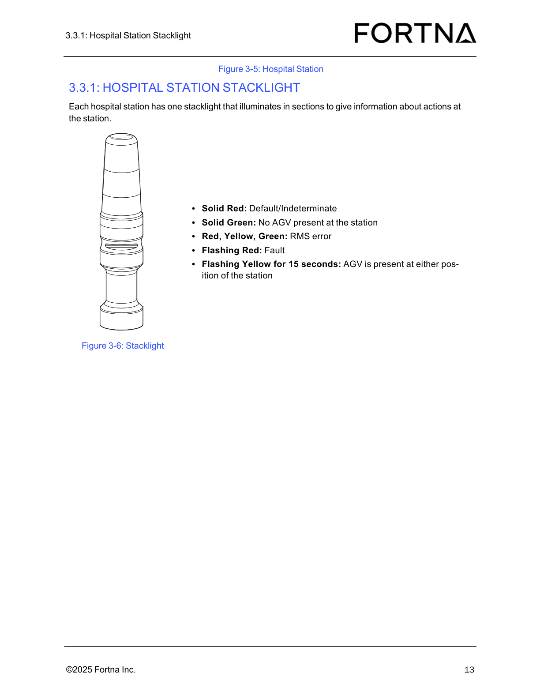
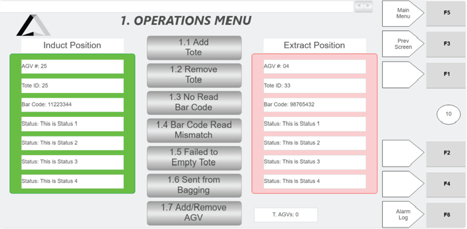
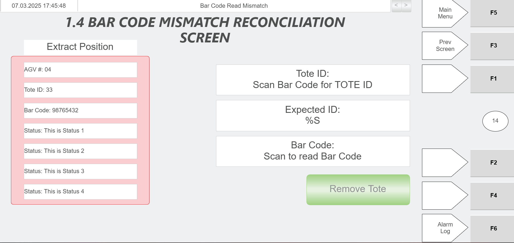
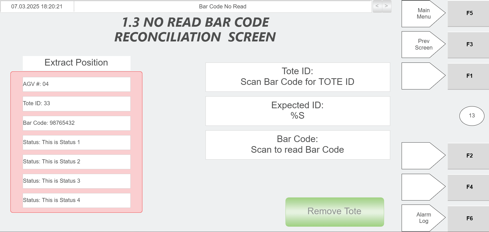
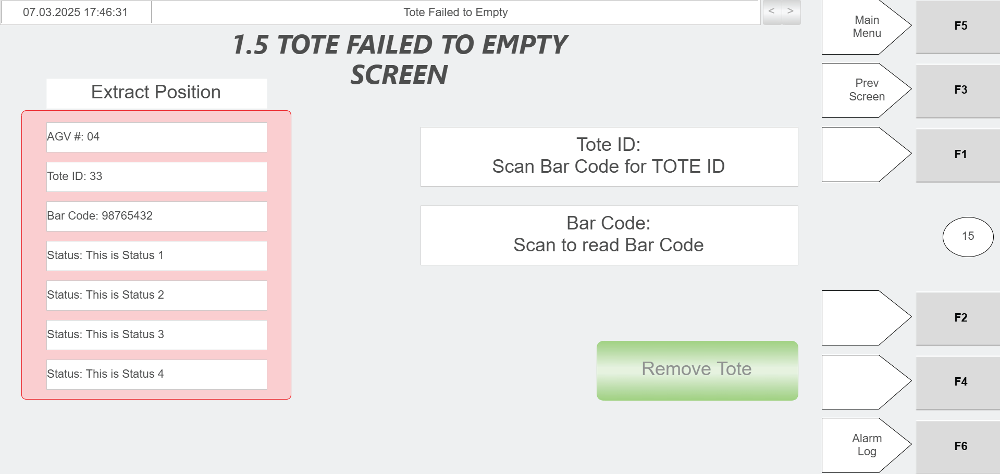

# Scan Hospital Station Tote With Green Scanner to Determine Reason for Arrival

## Runbook Header

| Field | Value |
| --- | --- |
| Procedure ID | `proc_scan_hospital_station_tote_green_scanner_reason_v1` |
| Title | Scan Hospital Station Tote With Green Scanner to Determine Reason for Arrival |
| Procedure Type | `operation` |
| Primary Role | `operator` |
| Supporting Roles | None |
| Support Safe | Yes |
| Capability Tags | `hospital_diversion` |
| Access Surface | `hospital_hmi`, `physical_floor` |
| Audience Roles | `operator` |
| Failure Pattern Tags | None |
| Validation Status | `needs_sme_review` |
| Merge Status | `source_finalized` |

## Summary

When an AGV delivers a tote to the hospital station, the operator uses the green scanner to determine why the tote was brought to the station for manual handling.

## When To Use

Use when an AGV brings a tote to a hospital station for manual handling (mis-sort, bad tip, or tote overload scenarios).

## Do Not Use For

* Do not use this procedure as a substitute for diagnosing system-wide RMS/WCS issues; it is specifically for determining the tote arrival reason at the hospital station using the green scanner and station/HMI indications.

## Access Or Tools Needed

* Green scanner
* Visual access to the hospital station stacklight
* Hospital HMI / lane UI (if the scan result is displayed there)

## Related Operational Context

* ctx_manual_hospital_station_overview_v1
* ctx_manual_hospital_station_workflow_v1
* ctx_manual_hospital_station_scanner_v1

## Visual References

*Diagram of the Hospital Station layout showing the induct (left side) and extract (right side) sides and location context for the green scanner.*

*Photo of the Hospital Station stacklight and its status meanings (e.g., Solid Green = No AGV present; Flashing Yellow for AGV present pre-tipping; RMS error indicated by Red/Yellow/Green).*

*Induct/Extract Position information and Status messages that tell the operator why the tote is at the station and what action/menu to use.*

*Tote ID field populated using the green scanner, Expected ID, Bar Code scan area, and Extract Position Information panel (AGV#, Tote ID, Bar Code, Status).*

*Tote ID field populated using the green scanner, Expected ID, Bar Code scan area, and Extract Position Information panel (AGV#, Tote ID, Bar Code, Status).*

*Tote ID field and Bar Code Read button for scanning with the green scanner, plus Status messages and Extract Position Information panel (AGV#, Tote ID, Bar Code, Status).*

## Procedure Steps

### Step 1 — Wait for the AGV to bring the tote to the correct side of the hospital station

**Responsible role:** operator

**Instruction:**
At the hospital station, wait for the AGV to bring the tote to the right side (from the operator’s perspective).

**Expected result:**
The tote is delivered to the right side of the hospital station (extract side) where the operator can attend it.

---

### Step 2 — Confirm tote presence using the hospital station stacklight indication

**Responsible role:** operator

**Instruction:**
Visually check the hospital station stacklight to confirm a tote is present at the station.

**Expected result:**
The stacklight indicates a tote is present at the hospital station.

**Stop or Escalate If:**

* If the stacklight does not indicate tote presence, do not proceed with scanning; re-check station/tote positioning.

---

### Step 3 — Scan the tote with the green scanner to determine the reason for arrival

**Responsible role:** operator

**Instruction:**
Scan the tote barcode using the green scanner.

**Expected result:**
A scan-based reason for the tote’s arrival is produced/available for use in manual handling.

**Stop or Escalate If:**

* Escalate if the green scanner cannot read/produce a reason for the tote arrival (no scan result available).
* Escalate if the tote reason cannot be determined even after re-scanning.

---

### Step 4 — Verify the scan result is available on the hospital station HMI (or scanner output) and proceed with manual handling

**Responsible role:** operator

**Instruction:**
Check the hospital station HMI (if present) or the scanner output to confirm the scan result is available, then use that reason to proceed with manual handling.

**Expected result:**
The operator can see the scan-based reason (or the scan-populated tote ID/barcode fields that drive the station’s status) on the hospital station HMI or scanner output and uses it to proceed.

**Screens / Images:**

*Induct/Extract Position information and Status messages that tell the operator why the tote is at the station and what action/menu to use.*

*Tote ID field populated using the green scanner, Expected ID, Bar Code scan area, and Extract Position Information panel (AGV#, Tote ID, Bar Code, Status).*

*Tote ID field populated using the green scanner, Expected ID, Bar Code scan area, and Extract Position Information panel (AGV#, Tote ID, Bar Code, Status).*

*Tote ID field and Bar Code Read button for scanning with the green scanner, plus Status messages and Extract Position Information panel (AGV#, Tote ID, Bar Code, Status).*

**Stop or Escalate If:**

* Escalate if the tote reason cannot be determined even after re-scanning.

---

## Success Criteria

* Operator obtains a scan-based reason for why the tote arrived at the hospital station and can proceed with the appropriate manual handling action.

## Failure Conditions

* Green scanner cannot read/produce a reason for the tote arrival (no scan result available).
* Tote reason cannot be determined even after re-scanning.
* Hospital HMI does not show scan-populated fields/status messages needed to determine the tote arrival reason.

## Escalation Guidance

* Escalate if the green scanner cannot read/produce a reason for the tote arrival (no scan result available).
* Escalate if the tote reason cannot be determined even after re-scanning.

## Missing Details / Known Gaps

* The manual confirms the operator uses a green scanner to determine the reason for arrival, but it does not specify the exact scanner UI workflow beyond scanning and (in some screens) tote ID auto-population. This runbook therefore focuses on observable outcomes: stacklight tote presence, scan-based reason availability, and HMI status messages/fields populated from the green scanner.

## Source Lineage

- Candidate IDs: candidate_manual_hospital_station_operator_scan_tote_reason
- Source ID: `manual_optisweep_om_v3`
- Source Type: `manual`
