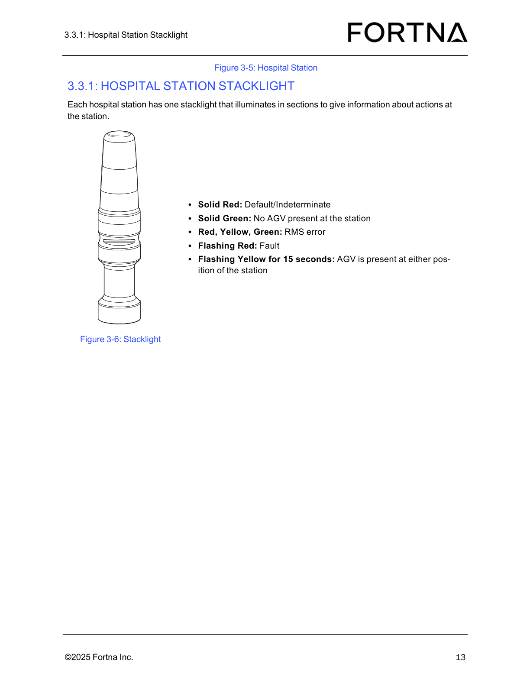

# Interpret Hospital Station Stacklight States (Solid/Flashing Colors)

## Runbook Header

| Field | Value |
| --- | --- |
| Procedure ID | `proc_interpret_hospital_station_stacklight_states_solid_flashing_colors_v1` |
| Title | Interpret Hospital Station Stacklight States (Solid/Flashing Colors) |
| Procedure Type | `diagnostic` |
| Primary Role | `operator` |
| Supporting Roles | None |
| Support Safe | Yes |
| Capability Tags | `agv_active_errors` |
| Access Surface | `hospital_hmi` |
| Audience Roles | `operator` |
| Failure Pattern Tags | None |
| Validation Status | `needs_sme_review` |
| Merge Status | `source_finalized` |

## Summary

Use the hospital station stacklight color and flashing pattern to determine the current station condition: Default/Indeterminate, No AGV present, RMS error, Fault, or AGV present (flashing yellow for 15 seconds).

## When To Use

When you need to identify the current hospital station condition by observing the station stacklight (solid vs flashing colors).

## Access Or Tools Needed

* Visual access to the hospital station stacklight

## Related Operational Context

* ctx_manual_hospital_station_agv_present_indicator_v1
* ctx_manual_hospital_station_rms_error_indicator_v1
* ctx_manual_hospital_station_fault_indicator_v1

## Visual References

*Figure showing the hospital station stacklight state mapping: Solid Red (Default/Indeterminate), Solid Green (No AGV present), Red+Yellow+Green (RMS error), Flashing Red (Fault), Flashing Yellow for 15 seconds (AGV present at either position).*

*Photo of the hospital station showing the physical station and stacklight context.*

## Procedure Steps

### Step 1 — Locate the hospital station stacklight

**Responsible role:** operator

**Instruction:**
Locate the hospital station’s stacklight (each hospital station has one stacklight).

**Expected result:**
You can visually see the hospital station stacklight that illuminates in sections.

---

### Step 2 — Observe whether the stacklight is solid or flashing

**Responsible role:** operator

**Instruction:**
Observe the stacklight indication and note whether it is solid or flashing.

**Expected result:**
You have identified the stacklight pattern as solid or flashing (and which colors are lit).

---

### Step 3 — Map Solid Red to Default/Indeterminate

**Responsible role:** operator

**Instruction:**
If the stacklight is Solid Red, record the state as Default/Indeterminate.

**Expected result:**
Recorded station condition = Default/Indeterminate when Solid Red is observed.

---

### Step 4 — Map Solid Green to No AGV present

**Responsible role:** operator

**Instruction:**
If the stacklight is Solid Green, record the state as No AGV present at the station.

**Expected result:**
Recorded station condition = No AGV present at the station when Solid Green is observed.

---

### Step 5 — Map Red+Yellow+Green to RMS error

**Responsible role:** operator

**Instruction:**
If the stacklight shows Red, Yellow, and Green simultaneously, record the state as RMS error.

**Expected result:**
Recorded station condition = RMS error when Red+Yellow+Green are simultaneously lit.

---

### Step 6 — Map Flashing Red to Fault

**Responsible role:** operator

**Instruction:**
If the stacklight is Flashing Red, record the state as Fault.

**Expected result:**
Recorded station condition = Fault when Flashing Red is observed.

---

### Step 7 — Map Flashing Yellow (15 seconds) to AGV present

**Responsible role:** operator

**Instruction:**
If the stacklight is Flashing Yellow, confirm it lasts for 15 seconds, then record the state as AGV is present at either position of the station.

**Expected result:**
Recorded station condition = AGV is present at either position of the station when Flashing Yellow persists for 15 seconds.

---

## Success Criteria

* Operator maps the observed hospital station stacklight solid/flashing color pattern to exactly one documented station condition: Default/Indeterminate, No AGV present, RMS error, Fault, or AGV present (15-second Flashing Yellow).

## Failure Conditions

* Observed stacklight pattern does not match any documented state (Solid Red, Solid Green, Red+Yellow+Green, Flashing Red, Flashing Yellow for 15 seconds).
* Flashing Yellow is observed but duration is not confirmed as 15 seconds before recording AGV present.

## Escalation Guidance

* If the observed stacklight pattern does not match any documented state, escalate (do not guess a station condition).

## Missing Details / Known Gaps

* No additional troubleshooting or next-step actions are provided in the source beyond mapping the stacklight state to the station condition.

## Source Lineage

- Candidate IDs: candidate_manual_hospital_station_stacklight_interpret_states
- Source ID: `manual_optisweep_om_v3`
- Source Type: `manual`
