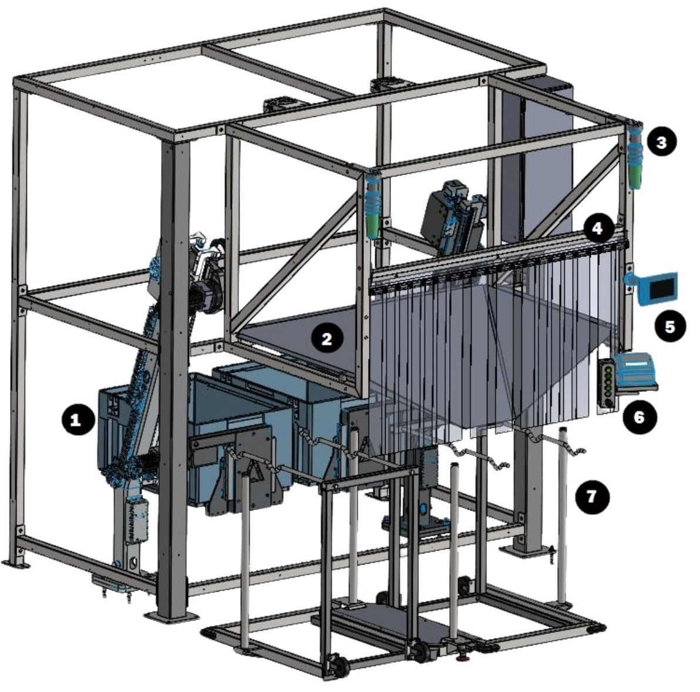
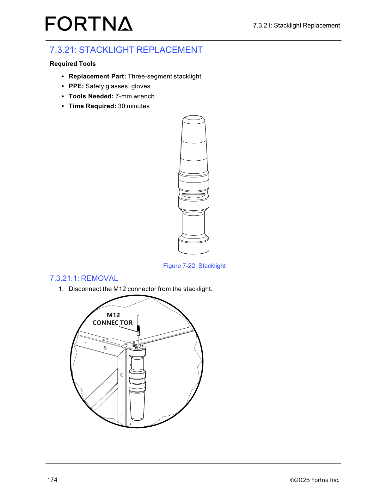

# Perform Operator Station Daily Preventive Maintenance Checks (Controller, Stacklights, Chute Debris)

## Runbook Header

| Field | Value |
| --- | --- |
| Procedure ID | `proc_perform_operator_station_daily_preventive_maintenance_checks_controller_stacklights_chute_debris_v1` |
| Title | Perform Operator Station Daily Preventive Maintenance Checks (Controller, Stacklights, Chute Debris) |
| Procedure Type | `operation` |
| Primary Role | `operator` |
| Supporting Roles | None |
| Support Safe | Yes |
| Capability Tags | `device_roster_state` |
| Access Surface | `physical_floor` |
| Audience Roles | `operator` |
| Failure Pattern Tags | None |
| Validation Status | `needs_sme_review` |
| Merge Status | `source_finalized` |

## Summary

Perform a daily operator station inspection to verify the operator station is safe/ready for operation by checking for controller damage, confirming stacklights are operational, and ensuring the chute is free of debris such as stuck labels.

## When To Use

Use this procedure for daily preventive maintenance checks of the OptiSweep operator station to confirm it is safe/ready for operation (controller condition, stacklights operational, chute free of debris such as stuck labels).

## Safety And Operational Notes

* If any controller damage is observed, or stacklights are not operational, or debris/stuck labels are found in the chute, stop the daily inspection and escalate to maintenance/support as required by site practice.

## Access Or Tools Needed

* Physical access to the operator station
* Visual inspection capability

## Related Operational Context

* ctx_manual_operator_station_daily_pm_v1

## Visual References

*Labeled photograph of the operator station showing controller area components including chute and stacklights (used to orient where to inspect).*

*Photo of the three-segment stacklight assembly (used to visually confirm what an operational stacklight looks like).*

## Procedure Steps

### Step 1 — Visually inspect the operator station controller area for damage

**Responsible role:** operator

**Instruction:**
Go to the operator station and visually inspect the controller area for any damage.

**Expected result:**
The controller shows no visible damage.

**Stop or Escalate If:**

* Controller damage is observed

---

### Step 2 — Check operator station stacklights are operational

**Responsible role:** operator

**Instruction:**
Check the operator station stacklights and confirm they are operational (functioning/visible as intended).

**Expected result:**
Stacklights are operational.

**Stop or Escalate If:**

* Stacklights are not operational

---

### Step 3 — Inspect chute and clear debris such as stuck labels

**Responsible role:** operator

**Instruction:**
Inspect the chute and remove/clear any debris such as stuck labels.

**Expected result:**
The chute is free of debris (e.g., no stuck labels).

**Stop or Escalate If:**

* Debris/stuck labels are found in the chute

---

### Step 4 — Stop inspection and escalate if any unsafe condition is found

**Responsible role:** operator

**Instruction:**
If any controller damage is found, or stacklights are not operational, or debris is present in the chute, stop the daily inspection and escalate to maintenance/support as required by site practice.

**Expected result:**
Inspection is stopped and maintenance/support escalation is initiated when any of the three checks fail.

**Stop or Escalate If:**

* Controller damage is observed
* Stacklights are not operational
* Debris/stuck labels are present in the chute

---

## Success Criteria

* Controller shows no damage
* Stacklights are operational
* Chute is free of debris (e.g., no stuck labels)

## Failure Conditions

* Damage to the controller is observed
* Stacklights are not operational
* Debris/stuck labels are present in the chute

## Escalation Guidance

* If any controller damage is observed, or stacklights are not operational, or debris/stuck labels are found in the chute, stop the daily inspection and escalate to maintenance/support as required by site practice.

## Missing Details / Known Gaps

* The manual section provides the daily inspection checklist items (controller damage, stacklights operational, chute free of debris) but does not define a specific visual criterion for what exact stacklight states/indications qualify as 'operational' for this daily check.

## Source Lineage

- Candidate IDs: candidate_manual_operator_station_daily_pm_v1_operator_station_daily_preventive_maintenance
- Source ID: `manual_optisweep_om_v3`
- Source Type: `manual`
