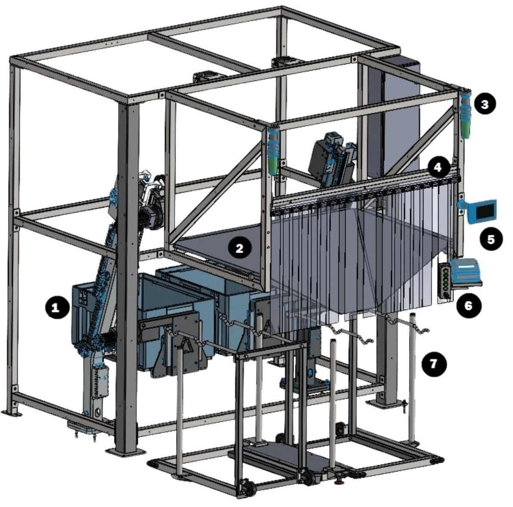
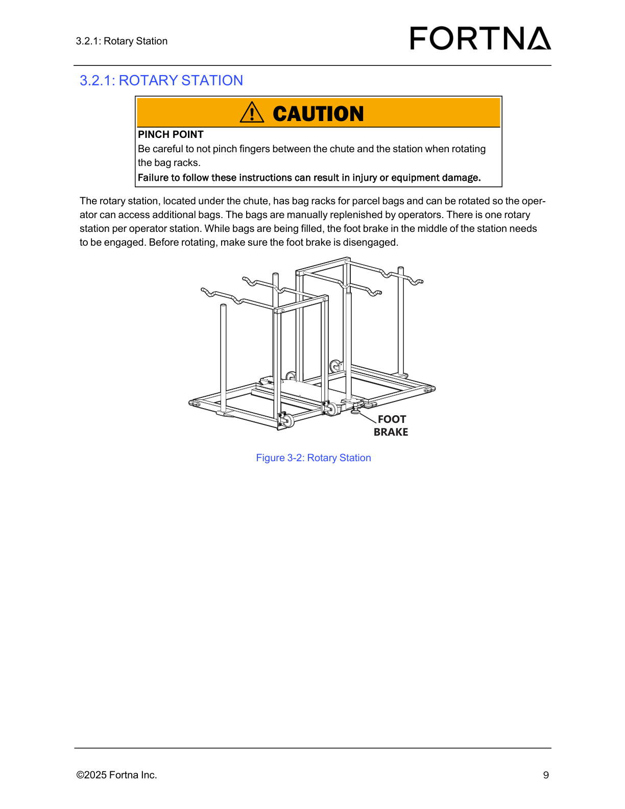
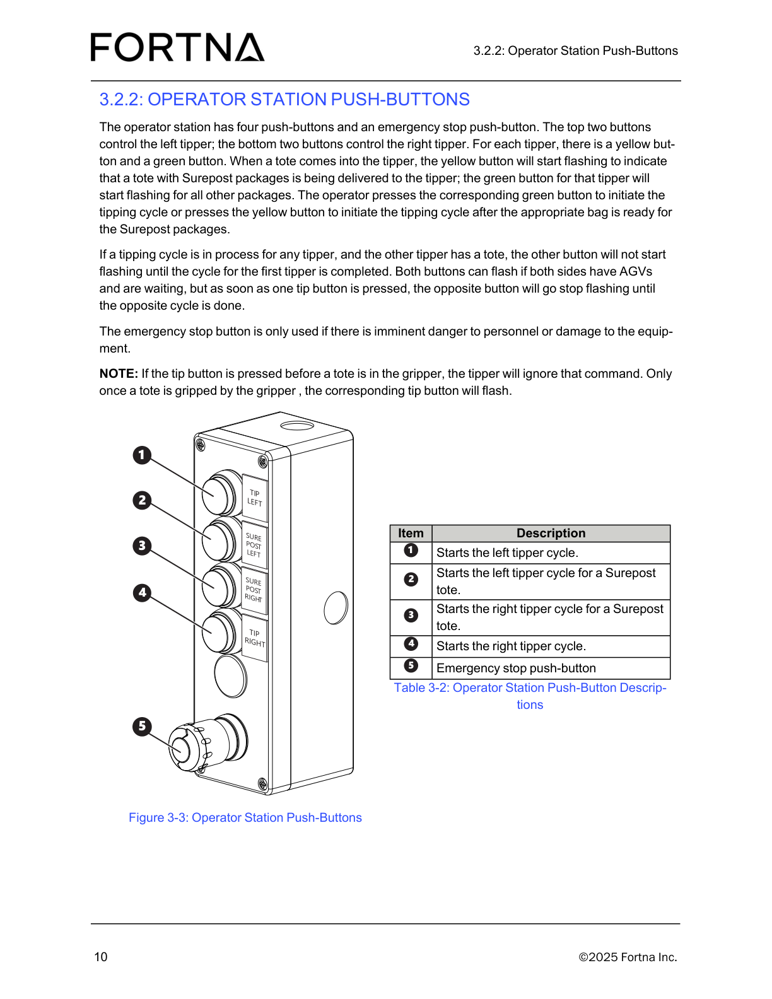

# Identify Operator Station Components (Tipper, Chute, Stacklights, HMI, Push-Buttons, Rotary Station)

## Runbook Header

| Field | Value |
| --- | --- |
| Procedure ID | `proc_identify_operator_station_components_v1` |
| Title | Identify Operator Station Components (Tipper, Chute, Stacklights, HMI, Push-Buttons, Rotary Station) |
| Procedure Type | `operation` |
| Primary Role | `operator` |
| Supporting Roles | None |
| Support Safe | Yes |
| Capability Tags | `device_roster_state` |
| Access Surface | `physical_floor` |
| Audience Roles | `operator` |
| Failure Pattern Tags | None |
| Validation Status | `needs_sme_review` |
| Merge Status | `source_finalized` |

## Summary

Walk up to the OptiSweep operator station and visually locate the key components used to receive parcels from the tippers: two tippers, chute, two stacklights, operator station HMI, four push-buttons, and rotary station.

## When To Use

Use when you need to visually confirm where the operator-station components are located so you can interact with the operator station HMI and push-buttons and understand how parcels flow from the tippers to the chute and rotary station.

## Do Not Use For

* Do not use this procedure to troubleshoot tipper faults, HMI alarms, or system faults—this procedure only identifies physical components and their locations.

## Safety And Operational Notes

* Rotary station pinch point: Be careful not to pinch fingers between the chute and the station when rotating the bag racks.

## Access Or Tools Needed

* Physical access to the operator station on the live system
* Operator station visual reference (Figure 3-1 / Table 3-1 from the manual)

## Related Operational Context

* ctx_manual_operator_station_overview_v1
* ctx_manual_operator_station_components_v1

## Visual References

*Labeled photograph of the operator station (panels removed for clarity) showing Item 1 Tipper, Item 2 Chute, Item 3 Stacklight, Item 5 Operator station HMI, Item 6 Push-buttons, Item 7 Rotary station (Table 3-1).*

*Rotary station photo showing bag racks and foot brake; includes caution about pinch point between chute and station when rotating bag racks.*

*Operator station push-button panel photo showing TIP LEFT, SURE POST LEFT, SURE POST RIGHT, TIP RIGHT, and emergency stop (Item 5 in Figure 3-3).*

*Operator station HMI manual control screen (VISU_MANCONTROL) showing the informational banner and manual controls (e.g., GRIPPERS OPEN/CLOSE, LAMP TEST, LEFT/RIGHT TIPPER FAULT RESET, LEFT/RIGHT TIPPER DISABLE).*

## Procedure Steps

### Step 1 — Locate the operator station area where parcels are received from the tippers

**Responsible role:** operator

**Instruction:**
Walk to the OptiSweep operator station area where an operator receives parcels from the tippers.

**Expected result:**
You are at the operator station area that contains (at minimum) the two tippers, chute, rotary station, operator station HMI screen, and push-buttons.

**Stop or Escalate If:**

* If the operator station area cannot be located, stop and escalate to FORTNA support for site-specific verification.

---

### Step 2 — Identify the two tippers at the operator station

**Responsible role:** operator

**Instruction:**
At the operator station, visually locate the two tippers (Tipper = Item 1 in Figure 3-1 / Table 3-1).

**Expected result:**
Both tippers are visible at the operator station and correspond to Item 1 (Tipper) in Figure 3-1.

**Stop or Escalate If:**

* If any component cannot be located (e.g., stacklights not visible on top of the frame or HMI/push-buttons not present), stop and escalate to FORTNA support for site-specific verification.

---

### Step 3 — Identify the chute positioned to receive parcels from the tippers

**Responsible role:** operator

**Instruction:**
Visually locate the chute (Chute = Item 2 in Figure 3-1 / Table 3-1) positioned to receive parcels from the tippers.

**Expected result:**
The chute is visible and corresponds to Item 2 (Chute) in Figure 3-1.

**Stop or Escalate If:**

* If any component cannot be located (e.g., stacklights not visible on top of the frame or HMI/push-buttons not present), stop and escalate to FORTNA support for site-specific verification.

---

### Step 4 — Identify the two stacklights mounted on the top of the frame on either side of the chute

**Responsible role:** operator

**Instruction:**
Look on the top of the frame on either side of the chute and identify the two stacklights (Stacklight = Item 3 in Figure 3-1 / Table 3-1).

**Expected result:**
Two stacklights are visible on the top of the frame, one on each side of the chute, matching Item 3 (Stacklight).

**Stop or Escalate If:**

* If any component cannot be located (e.g., stacklights not visible on top of the frame or HMI/push-buttons not present), stop and escalate to FORTNA support for site-specific verification.

---

### Step 5 — Identify the operator station HMI screen

**Responsible role:** operator

**Instruction:**
Find the operator station HMI screen (Operator station HMI = Item 5 in Figure 3-1 / Table 3-1).

**Expected result:**
The operator station HMI screen is visible and corresponds to Item 5 (Operator station HMI) in Figure 3-1.

**Stop or Escalate If:**

* If any component cannot be located (e.g., stacklights not visible on top of the frame or HMI/push-buttons not present), stop and escalate to FORTNA support for site-specific verification.

---

### Step 6 — Identify the four push-buttons on the operator station

**Responsible role:** operator

**Instruction:**
Locate the push-button panel on the operator station (Push-buttons = Item 6 in Figure 3-1 / Table 3-1). On the push-button panel, identify the TIP LEFT, TIP RIGHT, and the Surepost left/right buttons as shown in the push-button photo.

**Expected result:**
The push-button panel is visible and corresponds to Item 6 (Push-buttons) in Figure 3-1; the panel includes TIP LEFT, TIP RIGHT, SURE POST LEFT, and SURE POST RIGHT buttons.

**Stop or Escalate If:**

* If any component cannot be located (e.g., stacklights not visible on top of the frame or HMI/push-buttons not present), stop and escalate to FORTNA support for site-specific verification.

---

### Step 7 — Identify the rotary station

**Responsible role:** operator

**Instruction:**
Locate the rotary station under the chute (Rotary station = Item 7 in Figure 3-1 / Table 3-1).

**Expected result:**
The rotary station is visible under the chute and corresponds to Item 7 (Rotary station) in Figure 3-1.

**Stop or Escalate If:**

* If any component cannot be located (e.g., stacklights not visible on top of the frame or HMI/push-buttons not present), stop and escalate to FORTNA support for site-specific verification.

---

## Success Criteria

* All seven operator-station features from Table 3-1 are found in the expected locations: two tippers, chute, two stacklights on top of the frame on either side of the chute, operator station HMI, four push-buttons, and rotary station.

## Failure Conditions

* Any of the required components (tippers, chute, stacklights, operator station HMI, push-buttons, rotary station) cannot be located.

## Escalation Guidance

* If any component cannot be located (e.g., stacklights not visible on top of the frame or HMI/push-buttons not present), stop and escalate to FORTNA support for site-specific verification.

## Missing Details / Known Gaps

* This procedure is component identification only. It does not include HMI navigation or fault interpretation because the provided section text only defines component locations.

## Source Lineage

- Candidate IDs: candidate_manual_operator_station_identify_components
- Source ID: `manual_optisweep_om_v3`
- Source Type: `manual`
