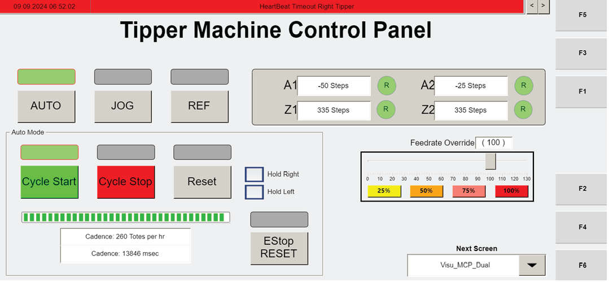

# Start the Operator Station: verify AGVs/main disconnect, reset flashing ESTOP, home axes, and press CYCLE START

## Runbook Header

| Field | Value |
| --- | --- |
| Procedure ID | `proc_start_the_operator_station_verify_agvs_main_disconnect_reset_flashing_estop_home_axes_cycle_start_v1` |
| Title | Start the Operator Station: verify AGVs/main disconnect, reset flashing ESTOP, home axes, and press CYCLE START |
| Procedure Type | `operation` |
| Primary Role | `operator` |
| Supporting Roles | None |
| Support Safe | Yes |
| Capability Tags | `agv_physical_recovery`, `robot_command_or_task_state` |
| Access Surface | `tipper_hmi`, `physical_floor` |
| Audience Roles | `operator` |
| Failure Pattern Tags | None |
| Validation Status | `needs_sme_review` |
| Merge Status | `source_finalized` |

## Summary

Bring the operator station from an off/faulted state to the tipper “ready” state by verifying AGVs are powered and the main disconnect is ON, clearing flashing ESTOP faults via HMI RESET, homing all tipper axes (Z1/A1 and Z2/A2) using AUTO REF, then pressing CYCLE START to move from “home” to “ready” and placing the tipper into AUTO mode so it waits for WCS instructions.

## When To Use

Use when the operator station has been turned off or is in a faulted/off state and you need to start it so the tipper can home and then wait for WCS instructions in AUTO mode.

## Safety And Operational Notes

* If the ESTOP is flashing, pull out the ESTOP and press RESET on the HMI screen to clear any faults before continuing with homing and cycle start.

## Access Or Tools Needed

* Operator station control panel
* Operator station HMI screen (RESET, AUTO REF, CYCLE START, and mode/status indicators)

## Related Operational Context

* ctx_manual_operator_station_startup_prerequisites_v1
* ctx_manual_operator_station_estop_reset_v1
* ctx_manual_tipper_axis_homing_v1
* ctx_manual_tipper_cycle_start_ready_v1
* ctx_manual_tipper_auto_mode_v1

## Visual References

*Operator station main screen image used for the startup flow (includes CYCLE STOP and references the startup steps on page 82).*

*Operator Station Control Panel (Visu_MCP_Dual screen) showing AUTO, JOG, REF, CYCLE START, and CYCLE STOP; active buttons indicated by illuminated green bars.*

*HMI screen capture showing MCP_Dual manual mode fault display with RESET and axis status indicators (used as visual support for RESET/fault context).*

*Operator Station HMI screen during manual jog mode showing axis fault indicators and RESET (visual support for fault/reset behavior).*

*HMI screen for jogging the tipper (Visu_Dual_MCP) showing Z1/Z2/A1/A2 axis controls and Manual Mode indicator (visual support for axis naming).*

*HMI screen for referencing axes (Visu_Dual_MCP) showing AUTO REF referencing completion behavior and CYCLE START restart context.*

## Procedure Steps

### Step 1 — Verify AGVs are powered on

**Responsible role:** operator

**Instruction:**
Verify the AGVs are powered on.

**Expected result:**
AGVs are powered on (observable at the site’s AGV power status indicators).

---

### Step 2 — Verify main disconnect is ON

**Responsible role:** operator

**Instruction:**
Verify the main disconnect is ON.

**Expected result:**
Main disconnect is ON (observable at the main disconnect indicator/label).

---

### Step 3 — Reset flashing ESTOP faults via HMI RESET

**Responsible role:** operator

**Instruction:**
At the operator station control panel, if the ESTOP is flashing: pull out the ESTOP, then press RESET on the HMI screen to clear any faults.

**Expected result:**
Flashing ESTOP fault is cleared after pulling out ESTOP and pressing RESET on the HMI.

**Stop or Escalate If:**

* If the ESTOP is flashing and faults do not clear after pulling out ESTOP and pressing HMI RESET, stop and escalate to support rather than continuing homing/cycle start.

---

### Step 4 — Home all tipper axes using AUTO REF (Z1/A1 and Z2/A2)

**Responsible role:** operator

**Instruction:**
Home every axis (Z1 and A1 for the left tipper; Z2 and A2 for the right tipper) by pressing AUTO REF. Watch the axis button color change from green to yellow while it is moving; the tipper motor moves until it senses the “home” proximity switch, then stops.

**Expected result:**
All axes home successfully: axis button changes green → yellow while moving, then the tipper motor stops when the “home” proximity switch is sensed.

**Stop or Escalate If:**

* If axis buttons do not change green→yellow when AUTO REF is pressed, or if the tipper motor does not stop at the “home” proximity switch, stop and escalate.

---

### Step 5 — Press CYCLE START to move from home to ready

**Responsible role:** operator

**Instruction:**
Press CYCLE START. Confirm the motor moves from “home” to “ready.”

**Expected result:**
Motor moves from “home” to “ready” after pressing CYCLE START.

**Stop or Escalate If:**

* If CYCLE START does not move the motor from “home” to “ready”, stop and escalate.

---

### Step 6 — Place tipper in AUTO mode to wait for WCS instructions

**Responsible role:** operator

**Instruction:**
Place the tipper in AUTO mode. Confirm the tipper will wait for the WCS to send instructions.

**Expected result:**
Tipper is in AUTO mode and is waiting for WCS instructions.

---

## Success Criteria

* If ESTOP was flashing, it is cleared after pulling out ESTOP and pressing HMI RESET.
* All axes home successfully: axis button changes green → yellow while moving and then stops when the “home” proximity switch is sensed.
* Pressing CYCLE START moves the motor from “home” to “ready.”
* Tipper is placed in AUTO mode and waits for WCS instructions.

## Failure Conditions

* ESTOP remains flashing and faults do not clear after pulling out ESTOP and pressing HMI RESET.
* AUTO REF does not produce the expected green → yellow axis button movement indication, or the motor does not stop at the home proximity switch.
* CYCLE START does not move the motor from home to ready.
* Tipper is not in AUTO mode / does not wait for WCS instructions.

## Escalation Guidance

* If ESTOP faults do not clear after pulling out ESTOP and pressing HMI RESET, stop and escalate to support rather than continuing homing/cycle start.
* If homing via AUTO REF does not show the expected axis button color change or the motor does not stop at the home proximity switch, stop and escalate.
* If CYCLE START does not move the motor from home to ready, stop and escalate.

## Missing Details / Known Gaps

* The candidate requested specific photos/figures for AGV power status and main disconnect indicator location; those specific visuals were not provided as artifacts in this packet for those exact items. Use the site’s available indicators for AGV power and main disconnect ON status.

## Source Lineage

- Candidate IDs: candidate_manual_operator_station_startup_cycle_start_ready
- Source ID: `manual_optisweep_om_v3`
- Source Type: `manual`
