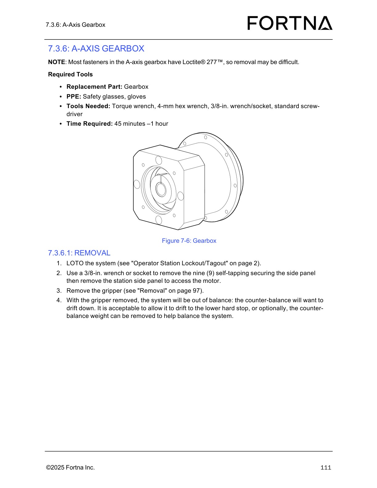
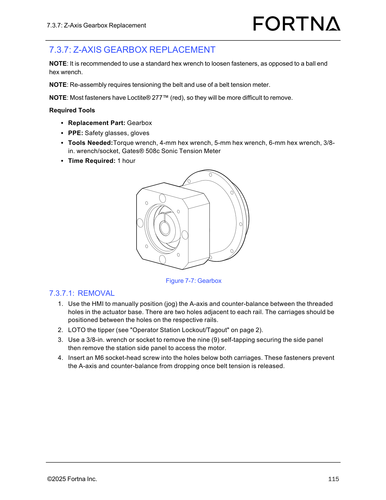
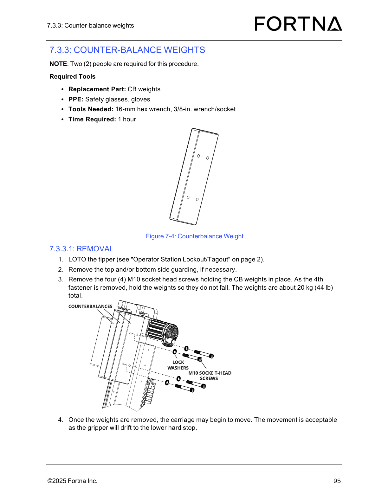

# Remove A-Axis Gearbox (LOTO, side panel access, gripper removal, counter-balance handling)

## Runbook Header

| Field | Value |
| --- | --- |
| Procedure ID | `proc_remove_a_axis_gearbox_loto_sidepanel_gripper_v1` |
| Title | Remove A-Axis Gearbox (LOTO, side panel access, gripper removal, counter-balance handling) |
| Procedure Type | `recovery` |
| Primary Role | `operator` |
| Supporting Roles | None |
| Support Safe | Yes |
| Capability Tags | `agv_physical_recovery` |
| Access Surface | `physical_floor` |
| Audience Roles | `operator` |
| Failure Pattern Tags | None |
| Validation Status | `needs_sme_review` |
| Merge Status | `source_finalized` |

## Summary

Safely remove the OptiSweep A-axis gearbox assembly by performing LOTO, removing the station side panel to access the motor, removing the gripper, and controlling counter-balance drift after gripper removal (either allow drift to the lower hard stop or remove the counter-balance weight).

## When To Use

Use when the OptiSweep A-axis gearbox must be removed and you need to follow the manual’s LOTO and disassembly sequence, including managing counter-balance drift risk after gripper removal.

## Safety And Operational Notes

* Most fasteners in the A-axis gearbox have Loctite® 277™, so removal may be difficult (use appropriate tools and control unexpected movement).
* After gripper removal, the system will be out of balance and the counter-balance will want to drift down; it is acceptable to allow drift to the lower hard stop or optionally remove the counter-balance weight to help balance the system.
* If unexpected motion occurs during disassembly, stop and re-check LOTO.

## Access Or Tools Needed

* Physical access to the A-axis gearbox area
* PPE: safety glasses, gloves
* Tools: torque wrench, 4-mm hex wrench, 3/8-in. wrench/socket, standard screwdriver
* Replacement part: gearbox

## Visual References

*Figure 7-6 (A-Axis Gearbox) supporting the A-axis gearbox removal sequence and fastener/tooling context.*

*Figure 7-7 (Gearbox) showing gearbox assembly context and the manual’s note about Loctite® 277 and positioning/prevention of dropping.*

*Figure 7-4 (Counterbalance Weight) supporting the optional counter-balance weight removal approach and the note that carriage movement/drift is acceptable as gripper will drift to the lower hard stop.*

## Procedure Steps

### Step 1 — Perform LOTO on the system

**Responsible role:** operator

**Instruction:**
Perform LOTO on the system using the manual’s referenced "Operator Station Lockout/Tagout" procedure.

**Expected result:**
The system is in a locked-out/tagged-out state prior to side panel removal.

**Stop or Escalate If:**

* If any unexpected motion occurs during disassembly, stop and re-check LOTO.

---

### Step 2 — Remove the station side panel to access the motor

**Responsible role:** operator

**Instruction:**
Using a 3/8-in. wrench or socket, remove the nine (9) self-tapping securing the side panel, then remove the station side panel to access the motor.

**Expected result:**
The station side panel is removed and the motor access area is exposed.

**Stop or Escalate If:**

* If any unexpected motion occurs during disassembly, stop and re-check LOTO.

---

### Step 3 — Remove the gripper

**Responsible role:** operator

**Instruction:**
Remove the gripper (manual cross-reference: "Removal" on page 97).

**Expected result:**
The gripper is removed.

**Stop or Escalate If:**

* If the counter-balance drift cannot be controlled to the lower hard stop (or by removing the counter-balance weight as allowed), stop and escalate to qualified support before proceeding.

---

### Step 4 — Control counter-balance drift after gripper removal

**Responsible role:** operator

**Instruction:**
After gripper removal, allow the counter-balance to drift down to the lower hard stop OR remove the counter-balance weight to help balance the system.

**Expected result:**
Counter-balance drift is controlled: either it reaches the lower hard stop or the counter-balance weight is removed to balance the system.

**Stop or Escalate If:**

* If the counter-balance drift cannot be controlled to the lower hard stop (or by removing the counter-balance weight as allowed), stop and escalate to qualified support before proceeding.

---

### Step 5 — Remove the gearbox without removing the motor (motor may be needed for fastener access)

**Responsible role:** operator

**Instruction:**
Remove the gearbox without removing the motor; if fastener access requires it, remove the motor (manual cross-reference: "Motor Removal" on page 106).

**Expected result:**
You are positioned to remove the gearbox mounting fasteners; motor removal is only performed if required for fastener access.

**Stop or Escalate If:**

* If you cannot access fasteners safely without causing uncontrolled movement, stop and escalate to qualified support before proceeding.

---

### Step 6 — Remove the gearbox mounting screws

**Responsible role:** operator

**Instruction:**
Remove the eight (8) M5x18 socket-head screws mounting the gearbox to the carriage.

**Expected result:**
All eight (8) M5x18 socket-head screws are removed and the gearbox is no longer secured to the carriage.

**Stop or Escalate If:**

* If fasteners resist removal due to Loctite® 277 and you cannot remove them without risking uncontrolled movement, stop and escalate to qualified support before proceeding.

---

### Step 7 — Remove the gearbox

**Responsible role:** operator

**Instruction:**
Remove the gearbox.

**Expected result:**
The gearbox is removed from the carriage.

**Stop or Escalate If:**

* If any unexpected motion occurs during disassembly, stop and re-check LOTO.
* If the gearbox cannot be removed cleanly, stop and escalate to qualified support before proceeding.

---

## Success Criteria

* Station side panel is removed to access the motor.
* Gripper is removed.
* Counter-balance drift is controlled: either drift to the lower hard stop or counter-balance weight removed to help balance the system.
* Gearbox is unmounted after removing eight (8) M5x18 socket-head screws and is removed.

## Failure Conditions

* Unexpected motion occurs during disassembly (indicates LOTO issue).
* Counter-balance drift cannot be controlled to the lower hard stop (or by removing the counter-balance weight as allowed).
* Gearbox cannot be removed due to remaining attachment points or uncontrolled binding.

## Escalation Guidance

* If counter-balance drift cannot be controlled to the lower hard stop (or by removing the counter-balance weight as allowed), stop and escalate to qualified support before proceeding.
* If unexpected motion occurs during disassembly, stop and re-check LOTO.

## Missing Details / Known Gaps

* The packet does not include the referenced "Operator Station Lockout/Tagout" procedure content (page 2) or the referenced gripper "Removal" procedure (page 97); this runbook only covers the steps explicitly present in section 7.3.6.1 REMOVAL.
* The packet does not provide the exact gripper removal fastener locations/steps from page 97; Step 3 cross-references that section without additional detail.

## Source Lineage

- Candidate IDs: candidate_manual_optisweep_a_axis_gearbox_removal_loto_sidepanel_gripper
- Source ID: `manual_optisweep_om_v3`
- Source Type: `manual`
