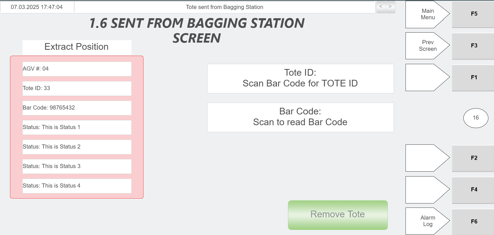
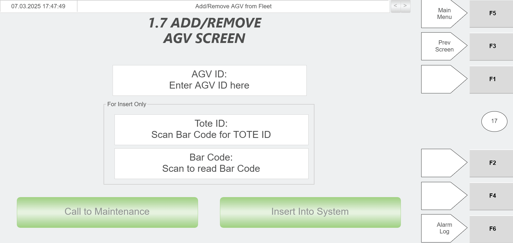

# Add an AGV to a Zone When There Is No Empty AGV Available (RMS Fault Recovery)

## Runbook Header

| Field | Value |
| --- | --- |
| Procedure ID | `proc_add_agv_to_zone_no_empty_agv_rms_fault_recovery_v1` |
| Title | Add an AGV to a Zone When There Is No Empty AGV Available (RMS Fault Recovery) |
| Procedure Type | `recovery` |
| Primary Role | `L2_support` |
| Supporting Roles | None |
| Support Safe | Yes |
| Capability Tags | `agv_physical_recovery` |
| Access Surface | `rms_ui`, `hospital_hmi`, `physical_floor` |
| Audience Roles | `L2_support` |
| Failure Pattern Tags | None |
| Validation Status | `needs_sme_review` |
| Merge Status | `source_finalized` |

## Summary

Recover operation by stopping RMS, physically placing an AGV into the zone under the tote rack, adding the AGV in RMS using Tote API Controls, verifying the AGV turns blue and reaches AGV status/state "szonestaging" on the Hospital HMI/lane UI, then stopping again and resuming RMS.

## When To Use

Use when there is no empty AGV available for a zone and you must recover by adding an AGV into the zone under the tote rack, ensuring it reaches the required "szonestaging" state before resuming RMS.

## Safety And Operational Notes

* E-stop RMS before making the AGV add/recovery changes in RMS.

## Access Or Tools Needed

* RMS / fleet status UI (rms_ui)
* Hospital HMI / lane UI (hospital_hmi) for AGV state verification
* Physical floor access to move an AGV into the zone under the tote rack (physical_floor)

## Related Operational Context

* ctx_manual_add_agv_to_zone_no_empty_agv_v1
* ctx_manual_agv_szonestaging_state_v1
* ctx_manual_agv_hospital_state_v1
* ctx_manual_tote_api_controls_reference_v1

## Visual References

*RMS screen for "Add AGV to Zone with No Empty AGV" (includes E-stop RMS, add AGV in RMS, wait for blue, and E-stop again/resume RMS steps).*

*AGV API Controls screen showing controls used to remove/recover/add AGVs and pause/resume movement (used by the RMS Tote API Controls function referenced by the procedure).*

*Fault recovery HMI example showing E-stop RMS and remove/add AGV via RMS/Hospital HMI workflow (supporting context for remove/re-add behavior).*

*System in Shut-down Mode screen (referenced as part of the broader AGV fault recovery/startup context).*

*Hospital HMI screen example (context for Hospital HMI usage; procedure requires verifying AGV state on Hospital HMI/lane UI).*

*Hospital HMI Add/Remove AGV screen (used when the AGV is moving to the Hospital and must be removed and added again).*

## Procedure Steps

### Step 1 — E-stop RMS on the RMS / fleet status UI

**Responsible role:** L2_support

**Instruction:**
On the RMS / fleet status UI (rms_ui), press the E-stop for RMS.

**Expected result:**
RMS is in an E-stopped state on the RMS / fleet status UI.

---

### Step 2 — Move an AGV into the zone under the tote rack

**Responsible role:** L2_support

**Instruction:**
Move an AGV into the zone under the tote rack (physical_floor).

**Expected result:**
An AGV is physically positioned in the zone under the tote rack.

---

### Step 3 — Add the AGV in RMS using Tote API Controls

**Responsible role:** L2_support

**Instruction:**
On the RMS / fleet status UI (rms_ui), add the AGV using the "Tote API Controls" function.

**Expected result:**
The AGV is added in RMS via Tote API Controls (AGV appears in RMS roster/map context for the add operation).

---

### Step 4 — Wait for the AGV to turn blue on the RMS UI

**Responsible role:** L2_support

**Instruction:**
Wait for the AGV to turn blue on the RMS / fleet status UI (rms_ui).

**Expected result:**
The added AGV changes to blue on the RMS UI.

---

### Step 5 — Verify AGV status/state is exactly "szonestaging" on the Hospital HMI

**Responsible role:** L2_support

**Instruction:**
On the Hospital HMI / lane UI (hospital_hmi), verify the AGV status/state is exactly "szonestaging".

**Expected result:**
Hospital HMI shows the AGV state/status value "szonestaging".

**Stop or Escalate If:**

* Do not proceed to resume RMS until the AGV state verification step shows "szonestaging".

---

### Step 6 — If AGV is moving to the Hospital, remove and add it again

**Responsible role:** L2_support

**Instruction:**
If the AGV is moving to the Hospital (Hospital HMI shows Hospital destination/state), remove the AGV and add it again (repeat the add step).

**Expected result:**
AGV is removed from the system and then re-added so it can transition back toward "szonestaging".

**Stop or Escalate If:**

* Escalate if the AGV does not reach "szonestaging" after being added, or if it repeatedly moves to the Hospital instead of staging.

---

### Step 7 — Press E-stop again on the RMS / fleet status UI

**Responsible role:** L2_support

**Instruction:**
Press the E-stop again on the RMS / fleet status UI (rms_ui).

**Expected result:**
RMS reflects the E-stopped state again on the RMS / fleet status UI.

---

### Step 8 — Resume RMS on the RMS / fleet status UI

**Responsible role:** L2_support

**Instruction:**
Resume RMS on the RMS / fleet status UI (rms_ui) (Starting the System procedure reference).

**Expected result:**
RMS is resumed/started on the RMS / fleet status UI.

---

## Success Criteria

* The selected AGV appears as blue on the RMS UI.
* The Hospital HMI shows the AGV status/state exactly "szonestaging".
* RMS is resumed after the second E-stop press.

## Failure Conditions

* AGV does not reach "szonestaging" after being added.
* AGV repeatedly moves to the Hospital instead of staging.
* RMS cannot be resumed after the second E-stop press.

## Escalation Guidance

* Escalate if the AGV does not reach "szonestaging" after being added, or if it repeatedly moves to the Hospital instead of staging.

## Missing Details / Known Gaps

* The packet does not provide the exact Hospital HMI screen name/field label where the AGV state/status value "szonestaging" is shown; it only states to verify on the Hospital HMI / lane UI or other referenced HMI.

## Source Lineage

- Candidate IDs: candidate_manual_optisweep_add_agv_to_zone_no_empty_agv
- Source ID: `manual_optisweep_om_v3`
- Source Type: `manual`
