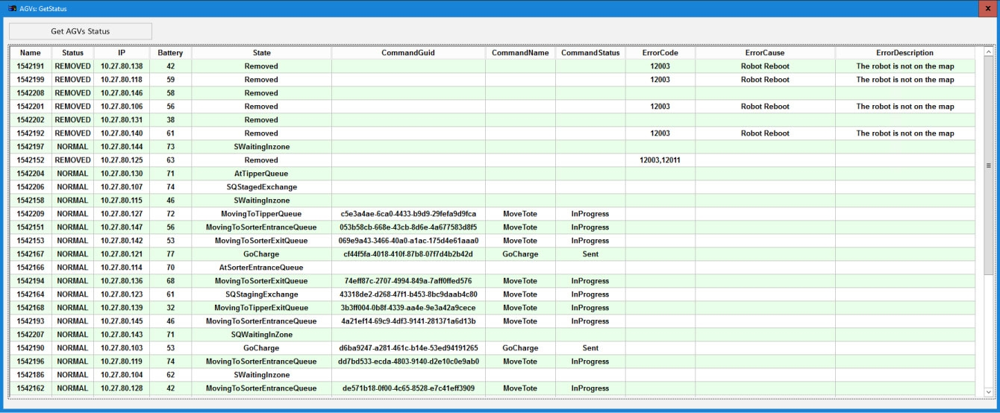

# Use AGV API Controls to Remove/Recover an AGV and Pause/Resume All AGVs

## Runbook Header

| Field | Value |
| --- | --- |
| Procedure ID | `proc_use_agv_api_controls_remove_recover_pause_resume_v1` |
| Title | Use AGV API Controls to Remove/Recover an AGV and Pause/Resume All AGVs |
| Procedure Type | `operation` |
| Primary Role | `operator` |
| Supporting Roles | None |
| Support Safe | Yes |
| Capability Tags | `agv_physical_recovery`, `agv_active_errors` |
| Access Surface | `tipper_hmi` |
| Audience Roles | `operator` |
| Failure Pattern Tags | None |
| Validation Status | `needs_sme_review` |
| Merge Status | `source_finalized` |

## Summary

Use the System HMI API screen’s AGVs section to remove a problematic AGV by ID, recover (add back) the AGV by ID after physical recovery, and pause/resume all AGV movement fleet-wide.

## When To Use

When an AGV needs to be removed from the system (e.g., it has an issue) and later recovered after physical removal/recovery, and you need to pause/resume all AGV movement using the AGV API Controls.

## Do Not Use For

* Do not use this procedure as a substitute for required physical removal/recovery steps after using Remove AGV (the AGV must be physically removed; if it has a tote, the tote must be taken to the hospital where the tote is removed).

## Safety And Operational Notes

* If the AGV has a tote, take the tote to the hospital where the tote is removed; the tote is recovered when it is put back in the system.

## Access Or Tools Needed

* Hospital/onsite physical access to remove/recover the AGV and tote
* System HMI API screen (AGVs section) with AGV API Controls

## Related Operational Context

* ctx_manual_agv_api_controls_screen_v1
* ctx_manual_agv_remove_recover_procedure_v1

## Visual References

*AGV API Controls screen showing Remove AGV, Recover AGV, Pause All AGVs, Resume All AGVs (and related controls).*

*Get AGV Status pop-up used to view AGV details (battery status, command status, error codes, and AGV state).*

*Example HMI state for a faulted AGV with a tote; recovery guidance references removing the AGV via API controls and taking the tote to the hospital.*

## Procedure Steps

### Step 1 — Open the System HMI API screen and navigate to the AGVs section

**Responsible role:** operator

**Instruction:**
Open the System HMI API screen and navigate to the AGVs section (AGV API Controls).

**Expected result:**
The AGVs section is visible with controls including Remove AGV, Recover AGV, Pause All AGVs, and Resume All AGVs.

---

### Step 2 — Remove an AGV from the system by AGV ID

**Responsible role:** operator

**Instruction:**
In the AGVs section, enter the target AGV ID in the Remove AGV input field, then click the Remove AGV control/button.

**Expected result:**
The Remove AGV action is accepted for the entered AGV ID, and the AGV is removed from the system after the required physical removal step.

**Stop or Escalate If:**

* Stop and escalate if you cannot physically remove/recover the AGV/tote as required after using Remove AGV.

---

### Step 3 — Recover (add back) the AGV by AGV ID after physical recovery

**Responsible role:** operator

**Instruction:**
After the physical recovery/add-back step, enter the same (or correct) AGV ID in the Recover AGV input field, then click the Recover AGV control/button.

**Expected result:**
The Recover AGV action is accepted for the entered AGV ID, and the AGV is added back into the system after physical recovery.

---

### Step 4 — Pause all AGV movement

**Responsible role:** operator

**Instruction:**
Click Pause All AGVs in the AGVs section of the API screen.

**Expected result:**
Fleet-wide AGV movement is paused after clicking Pause All AGVs.

**Stop or Escalate If:**

* Stop and escalate if the system does not reflect the expected fleet behavior after Pause All AGVs (use the Get AGV Status pop-up to verify AGV state).

---

### Step 5 — Resume all AGV movement

**Responsible role:** operator

**Instruction:**
Click Resume All AGVs in the AGVs section of the API screen.

**Expected result:**
Fleet-wide AGV movement resumes after clicking Resume All AGVs.

---

## Success Criteria

* Remove AGV is followed by physical removal of the AGV from the system; if a tote is present, the tote is taken to the hospital where the tote is removed.
* Recover AGV is performed after physical recovery/add-back, resulting in the AGV being added back into the system.
* Pause All AGVs stops fleet-wide AGV movement, and Resume All AGVs resumes fleet-wide AGV movement.

## Failure Conditions

* Cannot physically remove/recover the AGV/tote as required after using Remove AGV.
* System does not reflect expected fleet behavior after Pause All AGVs (verify AGV state using Get AGV Status pop-up).

## Escalation Guidance

* Stop and escalate if you cannot physically remove/recover the AGV/tote as required after using Remove AGV.
* Stop and escalate if the system does not reflect expected fleet behavior after Pause All AGVs; verify AGV state using the Get AGV Status pop-up.

## Missing Details / Known Gaps

* The packet does not specify exact on-screen confirmation fields or status messages after clicking Remove AGV / Recover AGV / Pause All AGVs / Resume All AGVs; expected results are therefore framed as acceptance of the control action and required physical follow-through.

## Source Lineage

- Candidate IDs: candidate_manual_optisweep_agv_api_controls_remove_recover_pause_resume
- Source ID: `manual_optisweep_om_v3`
- Source Type: `manual`
