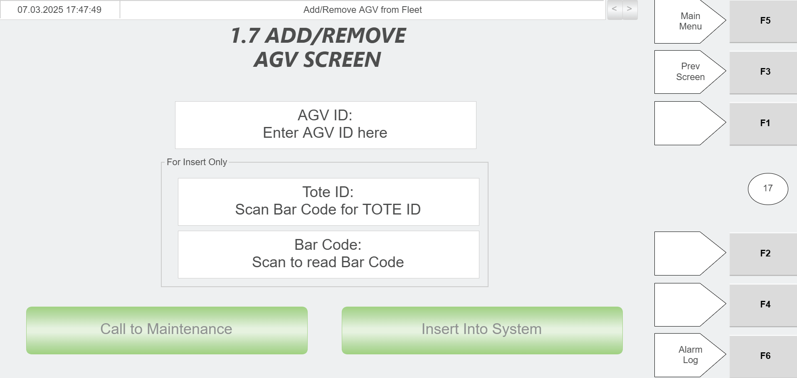
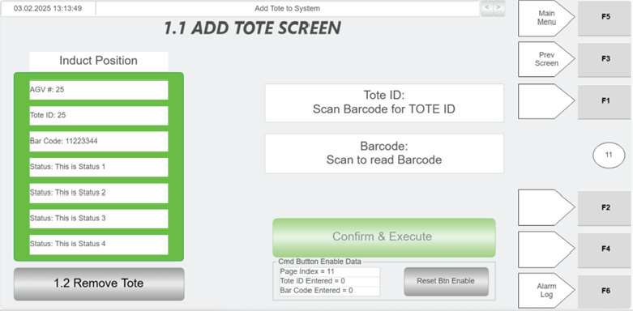

# Recover an AGV After It Loses a Tote (No Fault) Using RMS and Hospital HMI

## Runbook Header

| Field | Value |
| --- | --- |
| Procedure ID | `proc_recover_agv_after_lost_tote_no_fault_using_rms_and_hospital_hmi_v1` |
| Title | Recover an AGV After It Loses a Tote (No Fault) Using RMS and Hospital HMI |
| Procedure Type | `recovery` |
| Primary Role | `operator` |
| Supporting Roles | None |
| Support Safe | Yes |
| Capability Tags | `agv_active_errors`, `agv_physical_recovery` |
| Access Surface | `rms_ui`, `hospital_hmi`, `physical_floor` |
| Audience Roles | `operator` |
| Failure Pattern Tags | None |
| Validation Status | `needs_sme_review` |
| Merge Status | `source_finalized` |

## Summary

Recover from the “AGV LOST TOTE NO FAULT” condition by stopping RMS, physically moving the AGV to the Hospital, removing and re-adding the AGV via the Hospital station PC/HMI workflow, power-cycling the AGV, re-localizing it by rolling over the Inbound Hospital Station QR code, then locating/removing the missing tote and adding it back into the system so the AGV can return the tote to the sorter.

## When To Use

Use when an AGV has lost a tote but is in the “AGV LOST TOTE NO FAULT” recovery scenario, and you need to remove/re-add the AGV and re-localize it at the Inbound Hospital Station so the missing tote can be removed and reintroduced for normal sorter flow.

## Safety And Operational Notes

* E-stop RMS as the first action in this recovery sequence.

## Access Or Tools Needed

* RMS / fleet status UI (rms_ui)
* Hospital HMI / lane UI (hospital_hmi)
* Hospital station PC (used to remove/add AGV and remove/add tote via the referenced Hospital HMI workflows)

## Related Operational Context

* ctx_manual_agv_green_lights_status_v1

## Visual References

*Faulted AGV with Tote screen used as visual context for the recovery scenario (includes the recovery step list for AGV LOST TOTE NO FAULT).*

*Hospital HMI Add/Remove AGV screen (AGV ID field, Tote ID scanner, Call to Maintenance, Insert Into System).*

*Hospital HMI Add Tote screen (Tote ID and Barcode fields via green scanner; Confirm & Execute).*

*Hospital Station layout diagram showing induct/extract sides and green scanner location for tote handling.*

## Procedure Steps

### Step 1 — E-stop RMS

**Responsible role:** operator

**Instruction:**
On the RMS / fleet status UI (rms_ui), perform the RMS E-stop action.

**Expected result:**
RMS is in an E-stopped state (E-stop control/status reflects the stopped condition on the RMS UI).

---

### Step 2 — Release the AGV brake

**Responsible role:** operator

**Instruction:**
On the AGV that lost a tote, press the brake release.

**Expected result:**
The AGV brake is released, allowing the AGV to be pushed.

---

### Step 3 — Push the AGV to the Hospital

**Responsible role:** operator

**Instruction:**
Push the AGV over to the Hospital.

**Expected result:**
The AGV is physically positioned at the Hospital station area for the next remove/add step.

---

### Step 4 — Remove and re-add the AGV at the Hospital station PC/HMI

**Responsible role:** operator

**Instruction:**
At the Hospital station PC, remove the AGV from the system, then add the AGV back into the system using the Hospital station PC workflow/HMI.

**Expected result:**
The AGV is removed and then inserted back into the system via the Hospital station PC/HMI workflow.

---

### Step 5 — Power-cycle the AGV

**Responsible role:** operator

**Instruction:**
Turn the AGV off, then turn it on again.

**Expected result:**
AGV has been turned off and then back on.

---

### Step 6 — Wait for AGV lights to turn green

**Responsible role:** operator

**Instruction:**
Wait for the AGV lights to turn green.

**Expected result:**
AGV lights are green.

**Stop or Escalate If:**

* Stop and escalate if the AGV does not show green lights after the power cycle.

---

### Step 7 — Re-localize by rolling over the Inbound Hospital Station QR code

**Responsible role:** operator

**Instruction:**
Roll the AGV over the QR code in front of the Inbound Hospital Station.

**Expected result:**
AGV has been rolled over the Inbound Hospital Station QR code after lights turned green.

**Stop or Escalate If:**

* Stop and escalate if the AGV does not successfully re-localize after rolling over the Inbound Hospital QR code.

---

### Step 8 — Locate and remove the missing tote at the Hospital

**Responsible role:** operator

**Instruction:**
Locate the missing tote and bring it to the Hospital to remove it from the system.

**Expected result:**
The missing tote is located and removed from the system via the Hospital station workflow.

**Stop or Escalate If:**

* Stop and escalate if the missing tote cannot be located or cannot be removed/added via the Hospital station PC/HMI controls.

---

### Step 9 — Add the tote back into the system

**Responsible role:** operator

**Instruction:**
Add the tote back into the system using the Hospital station PC workflow/HMI.

**Expected result:**
The tote is added back into the system via the Hospital station workflow.

**Stop or Escalate If:**

* Stop and escalate if the missing tote cannot be located or cannot be removed/added via the Hospital station PC/HMI controls.

---

## Success Criteria

* After AGV lights turn green and the AGV is rolled over the Inbound Hospital Station QR code, the missing tote is removed from the system and then successfully added back.
* The AGV then takes the tote back to the sorter.

## Failure Conditions

* AGV does not show green lights after the power cycle.
* AGV does not successfully re-localize after rolling over the Inbound Hospital Station QR code.
* Missing tote cannot be located or cannot be removed/added via the Hospital station PC/HMI controls.

## Escalation Guidance

* Stop and escalate if the AGV does not show green lights after the power cycle.
* Stop and escalate if the AGV does not successfully re-localize after rolling over the Inbound Hospital QR code.
* Stop and escalate if the missing tote cannot be located or cannot be removed/added via the Hospital station PC/HMI controls.

## Missing Details / Known Gaps

* The packet’s inline image notes reference specific RMS E-stop UI, AGV brake release control location/label, AGV movement path/Hospital station area, AGV green light state photo, and the Inbound Hospital Station QR code location; those specific visuals are not included as artifacts in this packet, so step-level visual verification details are limited to the provided Hospital HMI and Hospital layout artifacts.
* The packet references Hospital HMI controls for 'Remove Tote' (referenced as “1.2 Remove Tote”), but the specific 'Remove Tote' screen artifact is not included in the provided related_artifacts; only the 'Add Tote' screen artifact is present.

## Source Lineage

- Candidate IDs: candidate_manual_optisweep_agv_lost_tote_no_fault_recovery
- Source ID: `manual_optisweep_om_v3`
- Source Type: `manual`
