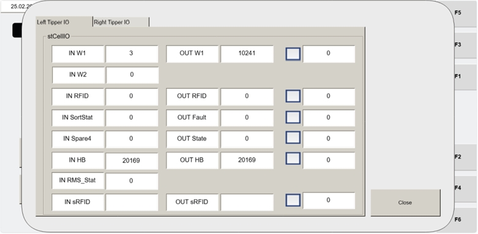

# Recover Non-Recoverable Fault: AGV Stuck Using Operator Station HMI (Visu_ManControl → CellIO Status → OUT W1 forced value)

## Runbook Header

| Field | Value |
| --- | --- |
| Procedure ID | `proc_recover_non_recoverable_fault_agv_stuck_hmi_cellio_status_out_w1_forced_value_v1` |
| Title | Recover Non-Recoverable Fault: AGV Stuck Using Operator Station HMI (Visu_ManControl → CellIO Status → OUT W1 forced value) |
| Procedure Type | `recovery` |
| Primary Role | `operator` |
| Supporting Roles | None |
| Support Safe | Yes |
| Capability Tags | `agv_physical_recovery`, `tipper_station_fault`, `hospital_diversion` |
| Access Surface | `tipper_hmi` |
| Audience Roles | `operator` |
| Failure Pattern Tags | None |
| Validation Status | `needs_sme_review` |
| Merge Status | `source_finalized` |

## Summary

On the operator station HMI, verify the non-recoverable AGV-stuck fault by confirming the selected tipper shows OUT Fault Status = 82 on the CellIO Status screen. Then force OUT W1 to either 3 (continue work) or 32771 (send the AGV to the hospital) by entering the value, checking the enable checkbox, waiting 10 seconds, and unchecking. Finally, press CYCLE START to restart operation.

## When To Use

Use when an AGV remains at the tipper after tote-tipping is complete (non-recoverable fault), and the operator station HMI indicates the AGV-stuck condition that requires forcing OUT W1 via the CellIO Status screen.

## Access Or Tools Needed

* Operator station HMI access
* HMI screen: "Visu_ManControl"
* HMI control: "CellIO Status" button
* HMI controls/fields: tipper selection, "OUT Fault Status", "OUT W1" forced value box, checkbox enabling the forced value, "CYCLE START" button

## Related Operational Context

* ctx_manual_agv_stuck_fault_v1
* ctx_manual_hmi_visu_mancontrol_v1
* ctx_manual_hmi_cellio_status_v1
* ctx_manual_agv_stuck_fault_status_82_v1
* ctx_manual_out_w1_forced_values_v1

## Visual References

*Operator station HMI screen for resolving the non-recoverable AGV stuck fault (Visu_ManControl → CellIO Status), including OUT Fault Status and OUT W1 forced value/checkbox.*

*Operator station HMI screen image for the non-recoverable AGV stuck recovery procedure (OUT Fault Status expected 82; OUT W1 forced value box and enable checkbox).*

*Operator Station HMI Manual Control Screen showing the "CellIO STATUS" button used to reach the CellIO Status screen.*

## Procedure Steps

### Step 1 — Navigate to Visu_ManControl

**Responsible role:** operator

**Instruction:**
On the operator station HMI, navigate to the "Visu_ManControl" screen.

**Expected result:**
The "Visu_ManControl" screen is displayed on the operator station HMI.

---

### Step 2 — Open CellIO Status

**Responsible role:** operator

**Instruction:**
Press the "CellIO Status" button on the "Visu_ManControl" screen.

**Expected result:**
The CellIO Status screen (cell control input/output values per tipper) is opened.

---

### Step 3 — Select the stuck tipper

**Responsible role:** operator

**Instruction:**
Select the tipper where the AGV is stuck.

**Expected result:**
The selected tipper on the CellIO Status screen corresponds to the tipper where the AGV is currently stuck.

---

### Step 4 — Verify OUT Fault Status = 82

**Responsible role:** operator

**Instruction:**
Verify the "OUT Fault Status" field shows value 82 for the selected stuck tipper.

**Expected result:**
"OUT Fault Status" shows value 82 for the selected tipper.

**Stop or Escalate If:**

* Stop if "OUT Fault Status" does not show value 82 for the selected stuck tipper.

---

### Step 5 — Enter OUT W1 forced value (3 or 32771)

**Responsible role:** operator

**Instruction:**
Ensure the correct tipper is selected, then enter a forced value in the "OUT W1" forced value box: use 3 if the tote and AGV are ready to continue working, or 32771 if the AGV needs to go to the hospital.

**Expected result:**
The "OUT W1" forced value box contains either 3 or 32771 as selected for the recovery outcome.

---

### Step 6 — Enable the forced OUT W1 value

**Responsible role:** operator

**Instruction:**
Check the box next to the value introduced in the forced value box.

**Expected result:**
The checkbox enabling the forced OUT W1 value is checked (enabled).

---

### Step 7 — Wait 10 seconds, then uncheck OUT W1 forced value

**Responsible role:** operator

**Instruction:**
Wait 10 seconds, then uncheck the box for value OUT W1.

**Expected result:**
After 10 seconds, the OUT W1 forced-value enable checkbox is unchecked.

---

### Step 8 — Press CYCLE START to restart operation

**Responsible role:** operator

**Instruction:**
Press "CYCLE START" to restart operation.

**Expected result:**
"CYCLE START" is pressed and operation restart is initiated.

**Stop or Escalate If:**

* If the fault does not clear after applying the forced value and restarting, escalate to Fortna support for further troubleshooting (do not continue repeated forced-value toggling without guidance).

---

## Success Criteria

* For the selected stuck tipper, OUT Fault Status shows value 82 on the CellIO Status screen.
* OUT W1 forced value is applied by checking the enable checkbox for 10 seconds, then the checkbox is unchecked.
* After pressing CYCLE START, the AGV-stuck fault clears (operator observes the fault condition resolved as part of the restart behavior).

## Failure Conditions

* OUT Fault Status is not 82 for the selected tipper.
* The fault does not clear after applying the forced value and restarting.

## Escalation Guidance

* If the fault does not clear after applying the forced value and restarting, escalate to Fortna support for further troubleshooting (do not continue repeated forced-value toggling without guidance).

## Source Lineage

- Candidate IDs: candidate_manual_optisweep_agv_stuck_hmi_cellio_status_recovery
- Source ID: `manual_optisweep_om_v3`
- Source Type: `manual`
