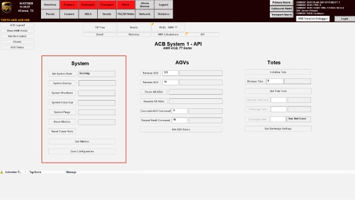

# Start OptiSweep AGV System From Shut-down Mode (Reset Metrics → Start → Close out/Bag Out → Running)

## Runbook Header

| Field | Value |
| --- | --- |
| Procedure ID | `proc_start_optisweep_agv_system_from_shutdown_reset_metrics_start_closeout_running_v1` |
| Title | Start OptiSweep AGV System From Shut-down Mode (Reset Metrics → Start → Close out/Bag Out → Running) |
| Procedure Type | `operation` |
| Primary Role | `operator` |
| Supporting Roles | None |
| Support Safe | Yes |
| Capability Tags | `fleet_system_status` |
| Access Surface | `rms_ui`, `tipper_hmi` |
| Audience Roles | `operator` |
| Failure Pattern Tags | None |
| Validation Status | `needs_sme_review` |
| Merge Status | `source_finalized` |

## Summary

Use the OptiSweep system screen to bring the AGV system from Shut-down Mode into the normal “Running” state by verifying the required number of empty AGVs, resetting metrics, starting the system, performing close out (Bag Out) until the system returns to “Running,” and then shutting down when finished.

## When To Use

Use this procedure when the OptiSweep AGV system is in Shut-down Mode and you need to start it into normal “Running” operation using the documented start-up sequence (Reset metrics → Start → Close out/Bag Out → Running).

## Access Or Tools Needed

* RMS / fleet status UI (for adding an AGV after moving it into the missing zone)
* OptiSweep system screen showing “System in Shut-down Mode” (Figure 5-1) and the system controls (Reset metrics / Start / Close out / Shut down)

## Related Operational Context

* ctx_manual_agv_startup_precondition_v1
* ctx_manual_agv_startup_sequence_v1
* ctx_manual_system_status_running_v1
* ctx_manual_hmi_screen_shut_down_mode_v1

## Visual References

*Figure 5-1: System in Shut-down Mode screen referenced for verifying Shut-down Mode and using the start-up controls (Reset metrics / Start / Close out/Bag Out / Shut down).*

*Figure 4-9: System API Controls screen showing System Startup, System Shutdown, System Close Out, Reset Metrics, and Get System State.*

*Figure 5-3: Add AGV to Zone with No Empty AGV Screen used when the system is started without nine empty AGVs and you must move an AGV into the missing zone and add it to RMS.*

## Procedure Steps

### Step 1 — Verify nine (9) empty AGVs are present (5 north, 4 south)

**Responsible role:** operator

**Instruction:**
Confirm there are nine (9) AGVs without totes in the system: five (5) under the north rack and four (4) under the south rack. If not, move an AGV into the zone missing an empty AGV, then add that AGV to RMS after moving it.

**Expected result:**
You have five (5) empty AGVs under the north rack and four (4) empty AGVs under the south rack (total nine (9) empty AGVs).

---

### Step 2 — Open the System in Shut-down Mode screen and verify Shut-down Mode

**Responsible role:** operator

**Instruction:**
Open the system screen shown as “System in Shut-down Mode” (Figure 5-1) and verify the system mode indicates Shut-down.

**Expected result:**
The system mode indicator on the “System in Shut-down Mode” screen shows Shut-down.

---

### Step 3 — Reset metrics

**Responsible role:** operator

**Instruction:**
On the “System in Shut-down Mode” screen (Figure 5-1), use the control option to Reset metrics.

**Expected result:**
Metrics are reset using the Reset metrics control on the system screen.

---

### Step 4 — Start the system

**Responsible role:** operator

**Instruction:**
On the “System in Shut-down Mode” screen (Figure 5-1), use the control to Start the system.

**Expected result:**
The system start control is executed as part of the start-up sequence.

---

### Step 5 — Perform close out (Bag Out) until system returns to Running

**Responsible role:** operator

**Instruction:**
Perform close out (Bag Out) and continue until the system status returns to “Running.”

**Expected result:**
After close out (Bag Out) is completed, the system status returns to “Running.”

**Stop or Escalate If:**

* Stop the procedure if the system does not return to "Running" after Bag Out; escalate to Fortna support for further troubleshooting.

---

### Step 6 — Shut down when the start-up process is complete and you are done

**Responsible role:** operator

**Instruction:**
When the start-up process is complete and you are done with the procedure, shut down using the documented shut down step/control.

**Expected result:**
System shutdown is initiated using the documented shut down control/step.

---

## Success Criteria

* After close out (Bag Out) is completed, the system status returns to “Running”.

## Failure Conditions

* System does not return to “Running” after Bag Out (Step 5).
* Precondition not met: fewer than nine (9) empty AGVs (5 north, 4 south) before starting (Step 1).

## Escalation Guidance

* If the system does not return to “Running” after Bag Out, stop the procedure and escalate to Fortna support for further troubleshooting.

## Missing Details / Known Gaps

* The packet requests image support for Figure 5-1 controls (exact labels for Reset metrics / Start / Close out/Bag Out / Shut down) but does not provide OCR text for those controls; the runbook relies on the referenced Figure 5-1 and Figure 4-9 artifacts for operator guidance.

## Source Lineage

- Candidate IDs: candidate_manual_optisweep_agv_system_startup_reset_metrics_start_closeout_running
- Source ID: `manual_optisweep_om_v3`
- Source Type: `manual`
