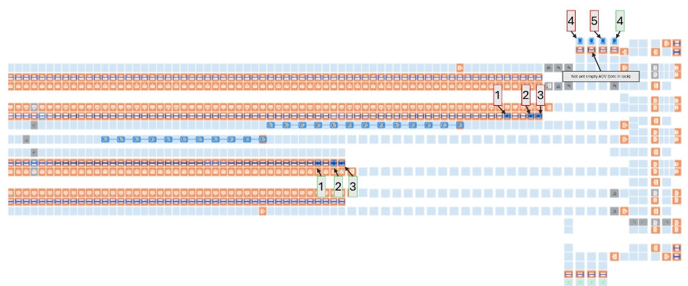
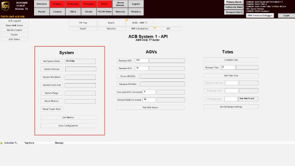

# Start OptiSweep AGV System (Reset Metrics → Start System → Close Out/Bag Out → Verify Running → Shut Down)

## Runbook Header

| Field | Value |
| --- | --- |
| Procedure ID | `proc_start_optsweep_agv_system_reset_metrics_start_closeout_bagout_verify_running_shutdown_v1` |
| Title | Start OptiSweep AGV System (Reset Metrics → Start System → Close Out/Bag Out → Verify Running → Shut Down) |
| Procedure Type | `operation` |
| Primary Role | `operator` |
| Supporting Roles | None |
| Support Safe | Yes |
| Capability Tags | `fleet_system_status` |
| Access Surface | `rms_ui`, `tipper_hmi` |
| Audience Roles | `operator` |
| Failure Pattern Tags | None |
| Validation Status | `needs_sme_review` |
| Merge Status | `source_finalized` |

## Summary

Perform the required AGV start-up prerequisites (nine empty AGVs: five under the north rack and four under the south rack), start the OptiSweep system 15 minutes before the sort, run the documented start sequence (Reset Metrics → Start System → Close Out/Bag Out), verify the system returns to the "Running" state after Bag Out, and then shut down.

## When To Use

Use to start the OptiSweep AGV system for an upcoming sort, ensuring the system is properly prepared (nine empty AGVs) and that the system transitions back to the "Running" state after close out (Bag Out).

## Access Or Tools Needed

* RMS / fleet status UI (RMS / fleet status UI) to add a moved AGV after placing it into the missing empty-AGV zone

## Related Operational Context

* ctx_manual_agv_system_startup_prerequisites_v1
* ctx_manual_system_startup_timing_v1
* ctx_manual_system_startup_sequence_v1
* ctx_manual_system_running_state_v1

## Visual References

*System screen showing the shut-down state used during the AGV system start-up procedure (includes the documented sequence: Reset metrics → Start system → Close out (Bag Out) → Running → Shut down).*

*System API Controls screen showing controls for Get System State, System Startup, System Shutdown, System Close Out, System Purge, and Reset Metrics.*

*RMS screen for adding an AGV to a zone when no empty AGV is present (includes steps to E-stop RMS, move an AGV into the zone, add AGV in RMS, wait for AGV to turn blue, and verify AGV status is "szonestaging").*

## Procedure Steps

### Step 1 — Verify nine empty AGVs are present (5 north / 4 south)

**Responsible role:** operator

**Instruction:**
Verify there are nine (9) AGVs without totes in the system: five (5) under the north rack and four (4) under the south rack.

**Expected result:**
You confirm five (5) empty AGVs under the north rack and four (4) empty AGVs under the south rack.

**Stop or Escalate If:**

* If the nine empty AGV prerequisite cannot be met (5 under north rack, 4 under south rack), do not proceed until an empty AGV is moved into the missing zone and added to the RMS.

---

### Step 2 — Move an empty AGV into the missing zone and add it to RMS (if needed)

**Responsible role:** operator

**Instruction:**
If fewer than nine empty AGVs are present, move an AGV without a tote into the zone that is missing an empty AGV, then add that AGV to the RMS after moving it.

**Expected result:**
The missing zone now has an empty AGV, and the moved AGV has been added to RMS.

**Stop or Escalate If:**

* If the nine empty AGV prerequisite cannot be met (5 under north rack, 4 under south rack), do not proceed without moving an empty AGV into the missing zone and adding it to the RMS.

---

### Step 3 — Confirm start timing (15 minutes before sort starts)

**Responsible role:** operator

**Instruction:**
Confirm the system start will occur 15 minutes before the sort starts.

**Expected result:**
You confirm the start time is set to occur 15 minutes before the sort begins.

---

### Step 4 — Reset metrics

**Responsible role:** operator

**Instruction:**
On the system control surface (System API Controls), perform the Reset Metrics step.

**Expected result:**
Metrics have been reset (Reset Metrics action completed on the System API Controls screen).

---

### Step 5 — Start the system

**Responsible role:** operator

**Instruction:**
On the system control surface (System API Controls), start the system using the System Startup control.

**Expected result:**
The system is placed into the running state via the System Startup control.

---

### Step 6 — Perform close out (Bag Out)

**Responsible role:** operator

**Instruction:**
On the system control surface (System API Controls), perform Close Out (Bag Out) as the next step in the sequence.

**Expected result:**
Close out (Bag Out) is completed.

---

### Step 7 — Verify system returns to "Running" after Bag Out

**Responsible role:** operator

**Instruction:**
After close out (Bag Out) is completed, verify the system state returns to "Running".

**Expected result:**
System state is "Running" after Bag Out completes.

**Stop or Escalate If:**

* If the system does not return to "Running" after close out (Bag Out), stop and escalate for support rather than continuing the sequence.

---

### Step 8 — Shut down the system

**Responsible role:** operator

**Instruction:**
On the system control surface (System API Controls), shut down the system using the System Shutdown control.

**Expected result:**
System shutdown is initiated/completed via the System Shutdown control.

---

## Success Criteria

* Nine empty AGVs prerequisite is satisfied (5 under north rack, 4 under south rack), with any moved empty AGV added to RMS.
* System is started 15 minutes before the sort starts.
* After close out (Bag Out) is completed, the system state returns to "Running".
* System shutdown is completed as the final step.

## Failure Conditions

* System does not return to "Running" after close out (Bag Out).
* Nine empty AGV prerequisite cannot be met (not 5 north / 4 south) without moving an empty AGV and adding it to RMS.

## Escalation Guidance

* If the system does not return to "Running" after close out (Bag Out), stop and escalate for support rather than continuing the sequence.

## Missing Details / Known Gaps

* The packet does not explicitly name the exact operator navigation path (menu/screen name) for the system control surface controls (Reset Metrics / System Startup / System Close Out / System Shutdown). It only provides the System API Controls figure and control descriptions.

## Source Lineage

- Candidate IDs: candidate_manual_optisweep_agv_system_startup_sequence
- Source ID: `manual_optisweep_om_v3`
- Source Type: `manual`
