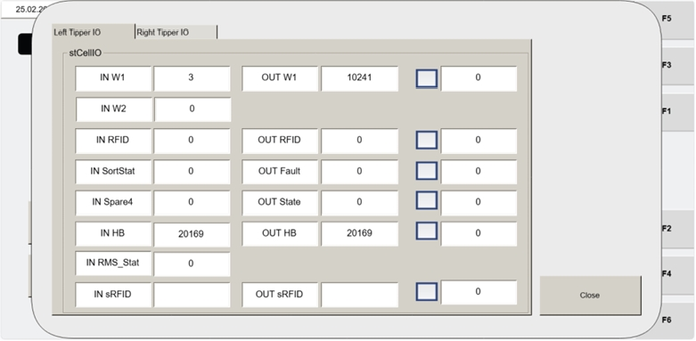

# Automatically Reference All Tipper Axes Using Operator Station HMI (RESET / AUTO REF / AUTO / CYCLE START)

## Runbook Header

| Field | Value |
| --- | --- |
| Procedure ID | `proc_automatically_reference_all_tipper_axes_using_operator_station_hmi_v1` |
| Title | Automatically Reference All Tipper Axes Using Operator Station HMI (RESET / AUTO REF / AUTO / CYCLE START) |
| Procedure Type | `operation` |
| Primary Role | `operator` |
| Supporting Roles | None |
| Support Safe | Yes |
| Capability Tags | `agv_physical_recovery` |
| Access Surface | `tipper_hmi` |
| Audience Roles | `operator` |
| Failure Pattern Tags | None |
| Validation Status | `needs_sme_review` |
| Merge Status | `source_finalized` |

## Summary

Use the operator station HMI controls to automatically reference all tipper axes, confirm completion via green 'R' icons, then return to AUTO and restart operation.

## When To Use

When tipper axes need to be automatically referenced so the system can resume operation.

## Safety And Operational Notes

* A tipper needs to be re-commissioned after any part is replaced.

## Access Or Tools Needed

* Tipper HMI / WebVisu / VISU (operator station HMI)

## Related Operational Context

* ctx_manual_automatic_axes_referencing_v1

## Visual References

*Operator station HMI screen showing the automatic axes referencing sequence area (RESET / AUTO REF / 'R' icons / AUTO / CYCLE START) for tipper axes referencing.*

*Operator Station Control Panel (Visu_MCP_Dual screen) showing primary buttons including AUTO, REF, and CYCLE START (active buttons indicated by illuminated green bars).*

*Operator station HMI screen related to referencing axes (Visu_Dual_MCP context).*

*Operator station HMI screen showing the 'R' icons turning green when referencing is completed (referencing completion confirmation pattern).*

## Procedure Steps

### Step 1 — Press RESET on the operator station HMI

**Responsible role:** operator

**Instruction:**
On the operator station HMI, press RESET.

**Expected result:**
The referencing sequence is initiated (next step is AUTO REF).

---

### Step 2 — Press AUTO REF to reference all tipper axes

**Responsible role:** operator

**Instruction:**
Press AUTO REF to reference all of the axes of the tippers.

**Expected result:**
Referencing runs for all tipper axes.

**Stop or Escalate If:**

* If the 'R' icons do not turn green, do not proceed to AUTO/CYCLE START; stop and escalate for support.

---

### Step 3 — Confirm referencing completion by verifying green 'R' icons

**Responsible role:** operator

**Instruction:**
Watch the 'R' icons on the HMI and confirm they turn green when referencing is completed.

**Expected result:**
All relevant 'R' icons turn green.

**Stop or Escalate If:**

* If the 'R' icons do not turn green, do not proceed to AUTO/CYCLE START; stop and escalate for support.

---

### Step 4 — Press AUTO after referencing completes

**Responsible role:** operator

**Instruction:**
When referencing is completed, press AUTO.

**Expected result:**
System is placed into AUTO mode after referencing completion.

**Stop or Escalate If:**

* Do not proceed to AUTO/CYCLE START if the 'R' icons do not turn green.

---

### Step 5 — Press CYCLE START to restart operation

**Responsible role:** operator

**Instruction:**
Press CYCLE START to restart operation.

**Expected result:**
The tipper operation cycle restarts.

**Stop or Escalate If:**

* If referencing is not confirmed complete (green 'R' icons not present), stop and escalate for support.

---

## Success Criteria

* All tipper axes referencing completes and the HMI 'R' icons turn green.
* After pressing AUTO and CYCLE START, operation restarts.

## Failure Conditions

* HMI 'R' icons do not turn green (referencing not completed).

## Escalation Guidance

* If the 'R' icons do not turn green, do not proceed to AUTO/CYCLE START; stop and escalate for support.

## Source Lineage

- Candidate IDs: candidate_manual_optisweep_axes_referencing_automatic
- Source ID: `manual_optisweep_om_v3`
- Source Type: `manual`
