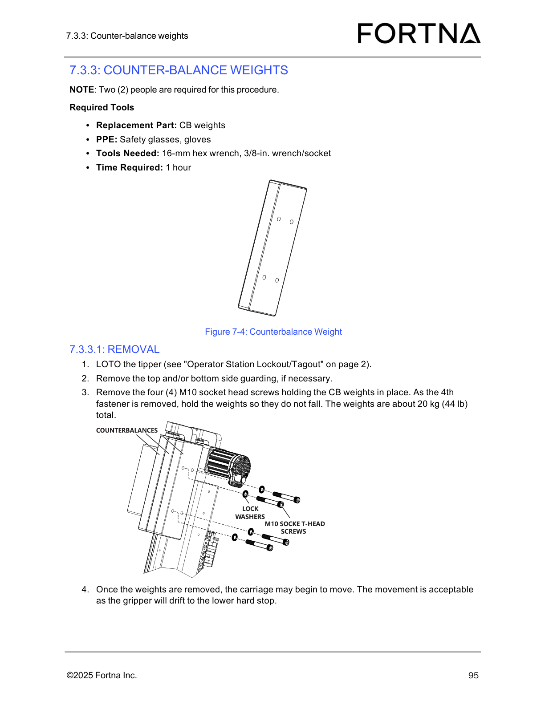

# Install Counter-balance (CB) Weights and Restart Operator Station

## Runbook Header

| Field | Value |
| --- | --- |
| Procedure ID | `proc_install_counterbalance_cb_weights_and_restart_operator_station_v1` |
| Title | Install Counter-balance (CB) Weights and Restart Operator Station |
| Procedure Type | `recovery` |
| Primary Role | `operator` |
| Supporting Roles | None |
| Support Safe | Yes |
| Capability Tags | `agv_physical_recovery` |
| Access Surface | `physical_floor`, `tipper_hmi` |
| Audience Roles | `operator` |
| Failure Pattern Tags | None |
| Validation Status | `needs_sme_review` |
| Merge Status | `source_finalized` |

## Summary

Securely install the counter-balance (CB) weights using the specified screws/torque, ensure side guarding is reinstalled, and restart the operator station so the system can resume operation.

## When To Use

Use when CB weights have been removed and must be reinstalled, and the operator station must be restarted to resume operation.

## Safety And Operational Notes

* Two people are required for the CB weights procedure (weights are about 20 kg / 44 lb total).

## Access Or Tools Needed

* Physical access to the counter-balance weights assembly
* Tools to install M10 socket head screws and lock washers
* Torque wrench capable of ~51 Nm (65 ft-lbs)
* Access to operator station controls to restart the operator station

## Visual References

*Figure showing the counterbalance weight assembly on the tipper carriage, including four M10 socket head screws and lock washers, and the note about acceptable carriage movement drifting to the lower hard stop.*

## Procedure Steps

### Step 1 — Hold the CB weights in place

**Responsible role:** operator

**Instruction:**
At the tipper carriage counter-balance weights location, hold the CB weights in place with two people.

**Expected result:**
CB weights are held securely in position at the mounting location while the four M10 socket head screws are installed.

**Stop or Escalate If:**

* Stop and escalate if the CB weights cannot be held in place during screw installation.

---

### Step 2 — Install four M10 socket head screws with lock washers and tighten to ~51 Nm

**Responsible role:** operator

**Instruction:**
Install the four (4) M10 socket head screws with the lock washers and tighten to approximately ~51 Nm (65 ft-lbs).

**Expected result:**
All four CB weight fasteners are installed with lock washers and tightened to ~51 Nm (65 ft-lbs).

**Stop or Escalate If:**

* Stop and escalate if tightening cannot reach the specified ~51 Nm (65 ft-lbs).

---

### Step 3 — Observe acceptable carriage movement if the gripper is not mounted

**Responsible role:** operator

**Instruction:**
After the weights are in place, if the gripper is not yet mounted, observe the carriage movement; it may begin to move and this movement is acceptable because the weights will drift to the lower hard stop.

**Expected result:**
If the gripper is not mounted, carriage movement occurs and the weights drift to the lower hard stop.

**Stop or Escalate If:**

* Stop and escalate if carriage movement does not drift to the lower hard stop as described.

---

### Step 4 — Reinstall top and/or bottom side guarding if necessary

**Responsible role:** operator

**Instruction:**
Reinstall the top and/or bottom side guarding if necessary.

**Expected result:**
Top and/or bottom side guarding panels are reinstalled (as needed) after CB weight installation.

**Stop or Escalate If:**

* Stop and escalate if side guarding cannot be reinstalled or appears misaligned/unsafe after reinstallation.

---

### Step 5 — Restart the operator station

**Responsible role:** operator

**Instruction:**
Restart the operator station (manual references “Starting The Operator Station” on page 66).

**Expected result:**
Operator station restarts successfully after CB weight installation and guarding reinstallation.

**Stop or Escalate If:**

* If the operator station does not restart after completing the installation and guarding steps, escalate to FORTNA support for the appropriate restart/troubleshooting procedure.

---

## Success Criteria

* Four CB weights are secured with lock washers and tightened to ~51 Nm (65 ft-lbs).
* If the gripper is not yet mounted, carriage movement drifts to the lower hard stop.
* Top and/or bottom side guarding is reinstalled as necessary.
* Operator station restarts successfully.

## Failure Conditions

* CB weights cannot be held in place during screw installation.
* Tightening cannot reach ~51 Nm (65 ft-lbs).
* Carriage movement does not drift to the lower hard stop as described.
* Side guarding cannot be reinstalled or appears misaligned/unsafe after reinstallation.
* Operator station does not restart after completing installation and guarding steps.

## Escalation Guidance

* If the operator station does not restart after completing the installation and guarding steps, escalate to FORTNA support for the appropriate restart/troubleshooting procedure.

## Missing Details / Known Gaps

* The manual section referenced for the operator station restart control (“Starting The Operator Station” on page 66) is not included in this packet; the exact UI control/button/menu steps are therefore not specified here.

## Source Lineage

- Candidate IDs: candidate_manual_optisweep_cb_weights_installation
- Source ID: `manual_optisweep_om_v3`
- Source Type: `manual`
