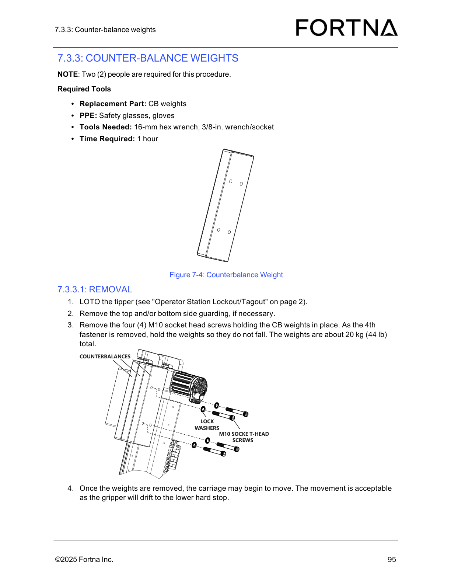

# Remove Counter-balance (CB) Weights From OptiSweep Tipper Carriage

## Runbook Header

| Field | Value |
| --- | --- |
| Procedure ID | `proc_remove_cb_weights_from_optiSweep_tipper_carriage_v1` |
| Title | Remove Counter-balance (CB) Weights From OptiSweep Tipper Carriage |
| Procedure Type | `recovery` |
| Primary Role | `operator` |
| Supporting Roles | None |
| Support Safe | Yes |
| Capability Tags | `tipper_station_fault` |
| Access Surface | `physical_floor` |
| Audience Roles | `operator` |
| Failure Pattern Tags | None |
| Validation Status | `needs_sme_review` |
| Merge Status | `source_finalized` |

## Summary

Use a two-person, LOTO-protected mechanical procedure to remove the counter-balance (CB) weight assembly from the OptiSweep tipper carriage by removing four M10 socket head screws while supporting the ~20 kg weights during the final fastener removal, then allow the carriage/gripper to drift to the lower hard stop.

## When To Use

When you need to remove the OptiSweep tipper counter-balance (CB) weight assembly (CB weights) from the tipper carriage using the documented LOTO and fastener removal steps.

## Safety And Operational Notes

* LOTO the tipper before removing the CB weights.
* Support the CB weights during removal of the 4th (last) fastener to prevent dropping.
* CB weights are about 20 kg (44 lb) total.

## Access Or Tools Needed

* Physical floor access to the OptiSweep tipper carriage
* LOTO capability for the tipper (manual reference: "Operator Station Lockout/Tagout" on page 2)
* PPE: safety glasses, gloves
* 16-mm hex wrench
* 3/8-in. wrench/socket
* Replacement part: CB weights

## Visual References

*Figure 7-4: Counterbalance Weight assembly showing the four M10 socket head screws, lock washers, and counterbalance plates on the OptiSweep tipper carriage.*

## Procedure Steps

### Step 1 — Confirm two-person setup and required PPE/tools

**Responsible role:** operator

**Instruction:**
Before approaching the OptiSweep tipper carriage, confirm you have two people available and the required PPE/tools: safety glasses, gloves; 16-mm hex wrench; 3/8-in. wrench/socket; and the replacement part CB weights.

**Expected result:**
Two people are available and the required PPE/tools are ready for use at the tipper carriage.

**Stop or Escalate If:**

* Stop if you cannot maintain the required two-person setup for the procedure.

---

### Step 2 — LOTO the tipper

**Responsible role:** operator

**Instruction:**
LOTO the tipper using the manual reference "Operator Station Lockout/Tagout" (page 2).

**Expected result:**
The tipper is LOTO-protected prior to removing the CB weight fasteners.

**Stop or Escalate If:**

* Stop if LOTO is not completed before fastener removal.

---

### Step 3 — Remove top and/or bottom side guarding if necessary

**Responsible role:** operator

**Instruction:**
Remove the top and/or bottom side guarding, if necessary, to access the CB weights.

**Expected result:**
CB weights mounting area is accessible for locating and removing the four M10 socket head screws.

**Stop or Escalate If:**

* Stop if you cannot access the CB weight fasteners safely.

---

### Step 4 — Locate the four M10 socket head screws holding the CB weights

**Responsible role:** operator

**Instruction:**
Locate the four (4) M10 socket head screws holding the CB weights in place (including lock washers and counterbalance plates as shown in Figure 7-4).

**Expected result:**
All four M10 socket head screws are identified and reachable for removal.

**Stop or Escalate If:**

* Stop if you cannot locate all four M10 socket head screws.

---

### Step 5 — Remove the four M10 socket head screws while supporting the weights during the 4th fastener removal

**Responsible role:** operator

**Instruction:**
Remove the four (4) M10 socket head screws holding the CB weights in place. As you remove the 4th (last) fastener, hold the weights so they do not fall. The weights are about 20 kg (44 lb) total.

**Expected result:**
The CB weights are removed without dropping during removal of the 4th (last) fastener.

**Stop or Escalate If:**

* Stop and escalate if the CB weights cannot be securely supported during removal of the 4th fastener (risk of dropping).

---

### Step 6 — Observe carriage movement after CB weights removal (drift to lower hard stop)

**Responsible role:** operator

**Instruction:**
After the weights are removed, observe the carriage movement. Movement is acceptable because the gripper will drift to the lower hard stop.

**Expected result:**
After CB weights removal, the carriage/gripper drifts to the lower hard stop.

**Stop or Escalate If:**

* Stop and escalate if the carriage/gripper does not drift to the lower hard stop after the weights are removed.

---

## Success Criteria

* CB weights are removed without dropping during the 4th fastener removal.
* After removal, the carriage/gripper drifts to the lower hard stop.

## Failure Conditions

* CB weights cannot be securely supported during removal of the 4th fastener (risk of dropping).
* Carriage/gripper does not drift to the lower hard stop after weights are removed.

## Escalation Guidance

* Stop and escalate if the CB weights cannot be securely supported during removal of the 4th fastener (risk of dropping).
* Stop and escalate if the carriage/gripper does not drift to the lower hard stop after the weights are removed.

## Missing Details / Known Gaps

* The procedure references "Operator Station Lockout/Tagout" (page 2), but the actual LOTO step content is not included in this packet; only the reference is present.

## Source Lineage

- Candidate IDs: candidate_manual_optisweep_cb_weights_removal
- Source ID: `manual_optisweep_om_v3`
- Source Type: `manual`
