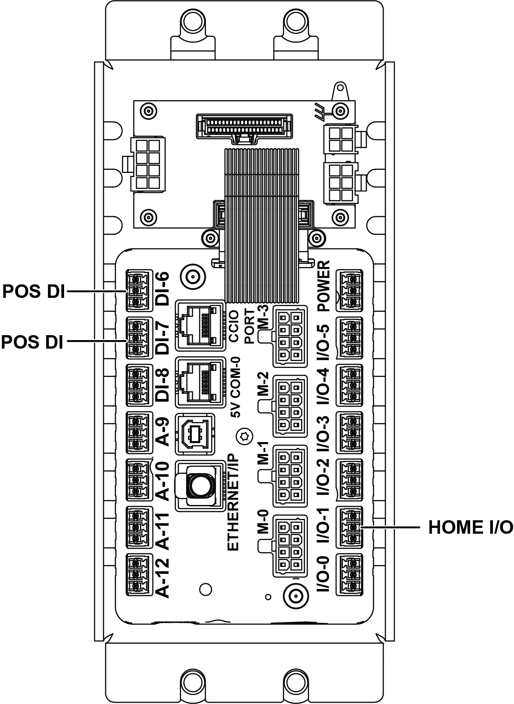
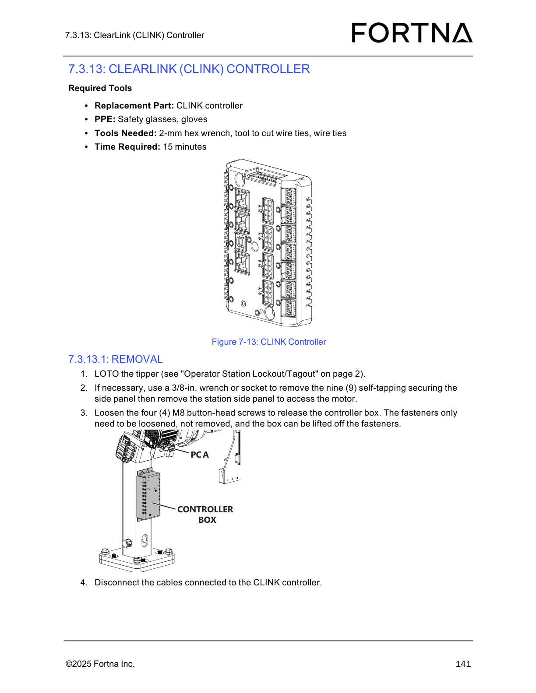

# Replace ClearLink (CLINK) Controller by Transferring Connections and Mounting New Unit

## Runbook Header

| Field | Value |
| --- | --- |
| Procedure ID | `proc_replace_clearlink_clink_controller_transfer_connections_mount_v1` |
| Title | Replace ClearLink (CLINK) Controller by Transferring Connections and Mounting New Unit |
| Procedure Type | `recovery` |
| Primary Role | `operator` |
| Supporting Roles | None |
| Support Safe | Yes |
| Capability Tags | `device_roster_state` |
| Access Surface | `physical_floor` |
| Audience Roles | `operator` |
| Failure Pattern Tags | None |
| Validation Status | `needs_sme_review` |
| Merge Status | `source_finalized` |

## Summary

Safely replace a ClearLink (CLINK) controller by transferring all existing connections from the old controller to the new controller, mounting the new controller in the box/stand using the specified screws, reinstalling side panels, and preparing the operator station to restart.

## When To Use

Use when a ClearLink (CLINK) controller needs replacement and you must transfer the existing wiring connections to the new controller, then remount and secure the controller and side panels before restarting the operator station.

## Safety And Operational Notes

* The source procedure includes a restart handoff to “Starting The Operator Station” (page 66), but does not include lockout/tagout steps in the provided excerpt for this specific installation section.

## Access Or Tools Needed

* Physical access to the ClearLink (CLINK) controller hardware
* Tools to fasten M5 socket-head screws and M8 button-head screws (tool type not specified in source)

## Visual References

*Diagram supporting the CLINK controller replacement installation step: transfer connections from old controller to new controller.*

*Diagram of the CLINK controller showing the controller box and mounting/cable access context (used to orient the physical replacement).*

## Procedure Steps

### Step 1 — Identify the old and new ClearLink (CLINK) controllers

**Responsible role:** operator

**Instruction:**
Identify the old ClearLink (CLINK) controller to be replaced and the new ClearLink (CLINK) controller to be installed.

**Expected result:**
You have correctly identified both the old CLINK controller (to remove/transfer from) and the new CLINK controller (to receive the transferred connections).

---

### Step 2 — Transfer all connections from the old controller to the new controller

**Responsible role:** operator

**Instruction:**
Transfer all the connections from the old controller to the new controller, matching the connection points/ports so each cable lands on the corresponding port on the new unit.

**Expected result:**
All cables are connected to the new CLINK controller on the corresponding ports (no missing connections).

**Stop or Escalate If:**

* Stop and escalate if any connection cannot be transferred to the corresponding port on the new controller.

---

### Step 3 — Place the new controller in the box and fasten with two (2) M5 socket-head screws

**Responsible role:** operator

**Instruction:**
Place the new controller in the box and fasten it with the two (2) M5 socket-head screws.

**Expected result:**
The new CLINK controller is secured inside the box using exactly two (2) M5 socket-head screws.

**Stop or Escalate If:**

* Stop and escalate if the controller/box cannot be secured with the specified screws.

---

### Step 4 — Hang the control box on the M8 button-head screws on the stand; route excess cable back into the stand and avoid pinching

**Responsible role:** operator

**Instruction:**
Hang the control box on the M8 button-head screws on the stand, ensuring excess cable is fed back into the stand and no wires are pinched.

**Expected result:**
The control box is positioned on the stand using the M8 button-head screws, with excess cable routed back into the stand and no wires pinched.

**Stop or Escalate If:**

* Stop and escalate if cables appear pinched.

---

### Step 5 — Tighten the four (4) M8 button-head screws securing the controller box to the stand

**Responsible role:** operator

**Instruction:**
Tighten the four (4) M8 button-head screws securing the controller box to the stand.

**Expected result:**
All four (4) M8 button-head screws are tightened and the controller box is secured to the stand.

**Stop or Escalate If:**

* Stop and escalate if the controller/box cannot be secured with the specified screws.

---

### Step 6 — Reinstall the top and/or bottom side panels if necessary

**Responsible role:** operator

**Instruction:**
Reinstall the top and/or bottom side panels, if necessary.

**Expected result:**
The top and/or bottom side panels are reinstalled as needed to close the station.

---

### Step 7 — Restart the operator station (handoff to “Starting The Operator Station” on page 66)

**Responsible role:** operator

**Instruction:**
Restart the operator station (referenced as “Starting The Operator Station” on page 66).

**Expected result:**
The operator station restart sequence is initiated/completed per the referenced “Starting The Operator Station” procedure.

---

## Success Criteria

* New CLINK controller is physically mounted and secured in the box/stand
* Connections are transferred to corresponding ports on the new controller
* Excess cable is routed back into the stand and no wires are pinched
* Controller box is secured with two (2) M5 socket-head screws (controller in box) and four (4) M8 button-head screws (box to stand)
* Top and/or bottom side panels are reinstalled as necessary
* Operator station restart is performed using the referenced “Starting The Operator Station” procedure

## Failure Conditions

* Any connection cannot be transferred to the corresponding port on the new controller
* Cables appear pinched
* Controller/box cannot be secured with the specified screws
* Operator station restart cannot be completed (exact observables not provided in this excerpt)

## Escalation Guidance

* Stop and escalate if any connection cannot be transferred to the corresponding port on the new controller, if cables appear pinched, or if the controller/box cannot be secured with the specified screws.

## Missing Details / Known Gaps

* The packet references restarting the operator station (“Starting The Operator Station” on page 66) but does not include the restart steps or any observable success/failure indicators for the restart within the provided excerpt.
* The packet does not provide a port-label mapping diagram text beyond the referenced installation diagram; step-level exact port names/labels are not included in the provided OCR text.

## Source Lineage

- Candidate IDs: candidate_manual_optisweep_clink_controller_install_transfer_connections
- Source ID: `manual_optisweep_om_v3`
- Source Type: `manual`
