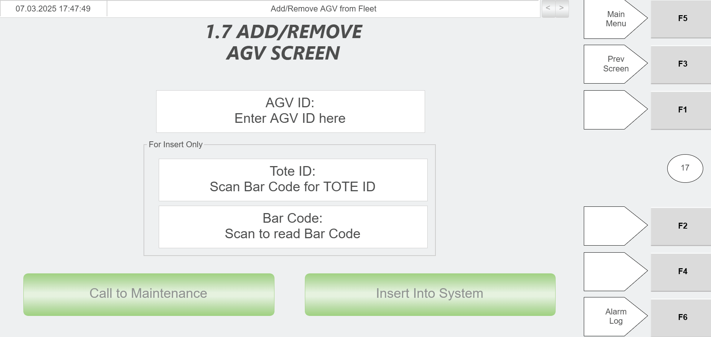

# Recover a Faulted AGV Carrying a Tote (RMS stop → Hospital HMI remove → re-add → resume RMS)

## Runbook Header

| Field | Value |
| --- | --- |
| Procedure ID | `proc_recover_faulted_agv_carrying_tote_rms_hospital_resume_v1` |
| Title | Recover a Faulted AGV Carrying a Tote (RMS stop → Hospital HMI remove → re-add → resume RMS) |
| Procedure Type | `recovery` |
| Primary Role | `operator` |
| Supporting Roles | None |
| Support Safe | Yes |
| Capability Tags | `agv_physical_recovery` |
| Access Surface | `rms_ui`, `hospital_hmi` |
| Audience Roles | `operator` |
| Failure Pattern Tags | None |
| Validation Status | `needs_sme_review` |
| Merge Status | `source_finalized` |

## Summary

When an AGV is faulted while carrying a tote, stop RMS, remove the faulted AGV from RMS, remove the AGV via the Hospital HMI, add the AGV back into RMS, press E-stop again, and resume RMS.

## When To Use

Use this recovery procedure when an AGV is faulted while carrying a tote and you need to restore normal RMS operation by removing the faulted AGV from RMS, removing it at the Hospital HMI, re-adding it to RMS, and resuming RMS.

## Safety And Operational Notes

* This procedure includes pressing E-stop on RMS (twice: before removal and after re-adding).

## Access Or Tools Needed

* RMS / fleet status UI (rms_ui)
* Hospital HMI / lane UI (hospital_hmi)
* Access to the “AGV API Controls” controls referenced by the manual
* Access to the “Starting the System” controls referenced by the manual

## Related Operational Context

* ctx_manual_faulted_agv_with_tote_recovery_v1

## Visual References

*Figure 5-4: Faulted AGV with Tote Screen (fault recovery sequence reference).*

*Figure 4-37: Hospital HMI Add/Remove AGV Screen (used to remove/add an AGV via Hospital HMI).*

*Figure 4-12: AGV API Controls (Remove AGV / Recover AGV / Pause All AGVs / Resume All AGVs controls).*

## Procedure Steps

### Step 1 — E-stop RMS

**Responsible role:** operator

**Instruction:**
On the RMS / fleet status UI, perform an E-stop for RMS.

**Expected result:**
RMS is in an E-stopped state (E-stop RMS action is applied on the RMS UI).

**Stop or Escalate If:**

* If you cannot place RMS into the E-stop state, stop and escalate.

---

### Step 2 — Remove the faulted AGV from RMS

**Responsible role:** operator

**Instruction:**
On the RMS / fleet status UI, use the “AGV API Controls” controls to remove the faulted AGV from RMS (enter the AGV ID and use the Remove AGV action).

**Expected result:**
The faulted AGV is removed from the system via the AGV API Controls Remove AGV action.

**Stop or Escalate If:**

* Escalate if the faulted AGV cannot be removed from RMS.

---

### Step 3 — Remove the AGV at the Hospital HMI

**Responsible role:** operator

**Instruction:**
Take the tote to the Hospital and remove the AGV via the Hospital HMI using the “Add/Remove AGV” screen.

**Expected result:**
The AGV is removed from the system at the Hospital via the Hospital HMI Add/Remove AGV screen.

**Stop or Escalate If:**

* Escalate if the Hospital HMI does not successfully remove the AGV.

---

### Step 4 — Add the AGV back into RMS

**Responsible role:** operator

**Instruction:**
On the RMS / fleet status UI, use the “AGV API Controls” controls to add the AGV back into RMS (enter the AGV ID and use the Recover AGV action).

**Expected result:**
The AGV is added back into the system via the AGV API Controls Recover AGV action.

**Stop or Escalate If:**

* Escalate if RMS cannot be resumed after re-adding the AGV.

---

### Step 5 — Press E-stop again on RMS

**Responsible role:** operator

**Instruction:**
On the RMS / fleet status UI, press E-stop again on RMS.

**Expected result:**
RMS E-stop is pressed again (E-stop RMS action applied a second time).

**Stop or Escalate If:**

* If you cannot apply the second E-stop, stop and escalate.

---

### Step 6 — Resume RMS

**Responsible role:** operator

**Instruction:**
On the RMS / fleet status UI, resume RMS using the “Starting the System” procedure controls.

**Expected result:**
RMS resumes after the faulted AGV has been removed from RMS, removed at the Hospital HMI, and re-added into RMS.

**Stop or Escalate If:**

* Escalate if RMS cannot be resumed after re-adding the AGV.

---

## Success Criteria

* RMS is resumed after the faulted AGV has been removed from RMS, removed via the Hospital HMI, and re-added into RMS.

## Failure Conditions

* RMS cannot be resumed after re-adding the AGV.
* The Hospital HMI does not successfully remove the AGV.

## Escalation Guidance

* Escalate if RMS cannot be resumed after re-adding the AGV, or if the Hospital HMI does not successfully remove the AGV.

## Missing Details / Known Gaps

* The candidate references specific RMS UI control/button names for “E-stop RMS” and “Resume RMS” and specific AGV API Controls UI areas, but the packet does not provide the exact UI labels/fields for those controls beyond the general “AGV API Controls” screen description and the recovery step list. Add exact UI control names/labels if available in the source pages for “Starting the System” (page 65) and the RMS E-stop control within the RMS UI.

## Source Lineage

- Candidate IDs: candidate_manual_optisweep_faulted_agv_with_tote_recovery
- Source ID: `manual_optisweep_om_v3`
- Source Type: `manual`
