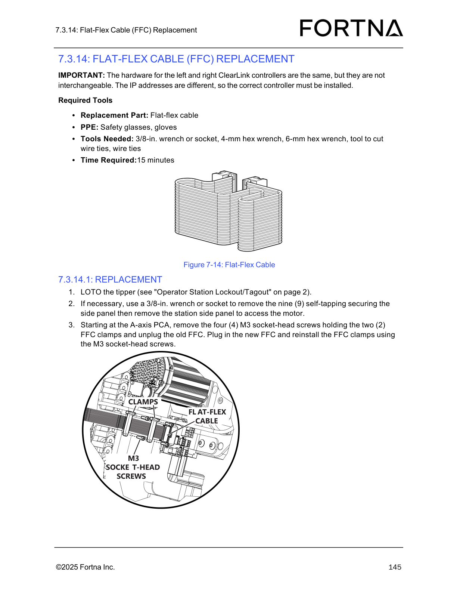

# Replace Flat-Flex Cable (FFC) at the A-axis PCA on a LOTOed tipper station

## Runbook Header

| Field | Value |
| --- | --- |
| Procedure ID | `proc_replace_flat_flex_cable_ffc_a_axis_pca_loto_v1` |
| Title | Replace Flat-Flex Cable (FFC) at the A-axis PCA on a LOTOed tipper station |
| Procedure Type | `recovery` |
| Primary Role | `operator` |
| Supporting Roles | None |
| Support Safe | Yes |
| Capability Tags | `tipper_station_fault` |
| Access Surface | `physical_floor` |
| Audience Roles | `operator` |
| Failure Pattern Tags | None |
| Validation Status | `needs_sme_review` |
| Merge Status | `source_finalized` |

## Summary

Replace the flat-flex cable (FFC) connected to the A-axis PCA on a tipper station that has been LOTOed. Use the correct replacement part and ensure the correct left/right ClearLink controller hardware is installed (left/right are not interchangeable due to different IP addresses). The procedure removes the two FFC clamps (four M3 socket-head screws), unplugs/replugs the FFC, then reinstalls the clamps and the station side panel (nine self-tapping securing screws).

## When To Use

Use when you need to restore correct tipper station operation by replacing the flat-flex cable (FFC) connected to the A-axis PCA on a tipper station that is taken out of service via LOTO.

## Do Not Use For

* Do not proceed if you cannot confirm the correct left/right controller hardware for the tipper station (left/right ClearLink controllers are not interchangeable due to different IP addresses).
* Do not proceed if the FFC cannot be unplugged/plugged cleanly or the clamps cannot be resecured with the four (4) M3 socket-head screws.

## Safety And Operational Notes

* Perform LOTO on the tipper (see "Operator Station Lockout/Tagout" on page 2).
* Wear PPE: safety glasses, gloves.

## Access Or Tools Needed

* Physical access to the tipper station
* PPE: safety glasses, gloves
* Replacement part: flat-flex cable (FFC)
* 3/8-in. wrench or socket
* 4-mm hex wrench
* 6-mm hex wrench
* Tool to cut wire ties
* Wire ties
* 4-mm hex wrench (listed in required tools for the section)
* 6-mm hex wrench (listed in required tools for the section)
* LOTO capability for the tipper (per "Operator Station Lockout/Tagout" on page 2)

## Visual References

*Figure 7-14: Flat-Flex Cable (FFC) showing the A-axis PCA connection, the two FFC clamps, and the four (4) M3 socket-head screws used to secure the clamps.*

## Procedure Steps

### Step 1 — Identify the correct tipper station side/controller to service (left vs right)

**Responsible role:** operator

**Instruction:**
Before starting the hardware replacement, confirm you are servicing the correct tipper station side/controller (left vs right). Do not assume left/right controller hardware can be swapped.

**Expected result:**
You have confirmed the correct left/right controller hardware for the specific tipper station you are servicing.

**Stop or Escalate If:**

* Stop and escalate if the left/right controller hardware cannot be confirmed as the correct non-interchangeable unit (IP addresses differ).

---

### Step 2 — Perform LOTO on the tipper station

**Responsible role:** operator

**Instruction:**
LOTO the tipper (see "Operator Station Lockout/Tagout" on page 2).

**Expected result:**
The tipper is in a LOTO state before any panel removal or cable work begins.

---

### Step 3 — Remove the station side panel to access the motor (if necessary)

**Responsible role:** operator

**Instruction:**
If necessary, use a 3/8-in. wrench or socket to remove the nine (9) self-tapping securing screws for the station side panel, then remove the station side panel to access the motor.

**Expected result:**
The station side panel is removed and the motor area is accessible.

---

### Step 4 — Remove the FFC clamps at the A-axis PCA

**Responsible role:** operator

**Instruction:**
Starting at the A-axis PCA, remove the four (4) M3 socket-head screws holding the two (2) FFC clamps.

**Expected result:**
The four (4) M3 socket-head screws are removed and the two (2) FFC clamps are released.

---

### Step 5 — Unplug the old FFC

**Responsible role:** operator

**Instruction:**
Unplug the old FFC from the clamps.

**Expected result:**
The old FFC is unplugged from the two FFC clamps.

**Stop or Escalate If:**

* Stop and escalate if the FFC cannot be unplugged/plugged cleanly or the clamps cannot be resecured with the four (4) M3 socket-head screws.

---

### Step 6 — Plug in the new FFC

**Responsible role:** operator

**Instruction:**
Plug in the new flat-flex cable (FFC).

**Expected result:**
The new FFC is seated into the clamp connection at the A-axis PCA.

**Stop or Escalate If:**

* Stop and escalate if the FFC cannot be unplugged/plugged cleanly or the clamps cannot be resecured with the four (4) M3 socket-head screws.

---

### Step 7 — Reinstall the FFC clamps and secure with M3 socket-head screws

**Responsible role:** operator

**Instruction:**
Reinstall the FFC clamps and secure them using the four (4) M3 socket-head screws.

**Expected result:**
Both FFC clamps are reinstalled and secured using the four (4) M3 socket-head screws.

**Stop or Escalate If:**

* Stop and escalate if the FFC cannot be unplugged/plugged cleanly or the clamps cannot be resecured with the four (4) M3 socket-head screws.

---

### Step 8 — Reinstall the station side panel

**Responsible role:** operator

**Instruction:**
Reinstall the station side panel using the nine (9) self-tapping securing screws.

**Expected result:**
The station side panel is reinstalled and secured with nine (9) self-tapping securing screws.

---

## Success Criteria

* New FFC is fully seated and secured by the two FFC clamps using the four M3 socket-head screws at the A-axis PCA.
* Station side panel is reinstalled with nine (9) self-tapping securing screws.
* Correct left/right controller hardware was used (left/right ClearLink controllers are not interchangeable due to different IP addresses).

## Failure Conditions

* Left/right controller hardware cannot be confirmed as correct (IP addresses differ).
* FFC cannot be unplugged/plugged cleanly.
* FFC clamps cannot be resecured with the four (4) M3 socket-head screws.

## Escalation Guidance

* Stop and escalate if you cannot confirm the correct left/right controller hardware (not interchangeable due to different IP addresses).
* Stop and escalate if the FFC cannot be unplugged/plugged cleanly or if the clamps cannot be resecured with the four (4) M3 socket-head screws.

## Missing Details / Known Gaps

* The manual section references LOTO steps via "Operator Station Lockout/Tagout" on page 2, but the packet does not include the detailed LOTO control steps themselves.
* The packet provides replacement steps but does not include an explicit post-replacement functional test procedure to confirm tipper operation after reassembly.

## Source Lineage

- Candidate IDs: candidate_manual_optisweep_ffc_replacement_loto_a_axis_pca
- Source ID: `manual_optisweep_om_v3`
- Source Type: `manual`
